#+TITLE: Orgs
#+HTML_THEME: docs
#+TITLE: Overview

* Introduction
  Org is a document interchange format. Yay, the world needs another!

  That said, org-mode is a lifestyle built around using org files
  to help organize your life in a variety of ways. Org Mode has strong
  roots in many common methodologies like GTD, while at the same time
  using org mode files for almost everything in your life.

  OrgS is a server that manages a collection of org files. It watches them,
  parses them, and lets every client (worg in the browser, the =orgs= command
  line, editor plugins and AI agents) work on the same notes at once. It
  offers:

  - A flexible, extensible, plugin based architecture.
  - A query language over every heading in every file, with saved queries
    that can watch for matches and notify you.
  - Getting things done: an agenda and day planner, quick capture from
    templates (and voice notes), refiling and archiving, a weekly review,
    inbox triage, habits, a standup and recap for Slack, and a dashboard
    of the day.
  - Clocking in and out, a pomodoro focus timer, clock reports, timesheets
    and invoices, and effort estimates compared with what was clocked.
  - Planning views: kanban boards, gantt charts with dependencies and a
    critical path, a column view, a mind map, and a dependency checker.
  - Fast table evaluation, dynamic blocks (clocktable, columnview, query),
    and source blocks you can run, tangle and detangle.
  - Records: contacts and anything else worth a list, kept as headings.
  - Flashcards with spaced repetition, org-drill style.
  - Links and backlinks, unlinked mentions, encrypted headings, and
    refactoring (rename, retag, merge, split, move).
  - A writing mode: word count goals, snapshots, prose checkers and an
    optional writing assistant that can use cloud or local models.
  - An exporter framework that turns an org file into a variety of outputs
    - html, markdown, pdf, latex, typst, pandoc - documents
    - revealjs, impressjs, deckjs, webslides, beamer - presentations
    - manuscript (.docx), epub - for editors and ebook readers
    - gantt, mermaid, mindmap - charts and diagrams
    - ics, todotxt - calendars and task lists for other tools
    - confluence - publish a file as a confluence page
    - tangle - write source blocks out as files
    - dndsheet, dndlatex, dndpdf - D&D character sheets
  - A static site generator (=orgs site=): a folder of org files as a web
    site, in a theme.
  - Importers
    - plugins that sync periodically with 3rd party services: google
      calendar, ics calendars, jira, todoist, trello, github and gitlab
    - =orgs import= for Jupyter notebooks, markdown and Obsidian vaults,
      todo.txt and .ics files
  - Background plugins: git sync of your notes, notifications of what is
    coming up, and automatic clock out.
  - Generators
    - daypage - Create and jump to a daily log file
    - dnd     - Dungeons & Dragons characters, sheets, a DM's screen,
      generated dungeons and maps, music and dice
  - Users, logins and administrators, over http or https.
  - An MCP server, so an AI agent can read and change your notes.

  worg, a web front end built into the server, has a view for nearly all of
  this and works in any browser, a phone's included.

  A command line interface covers the same ground from a prompt, for
  scripts, git hooks and ssh, with or without a running server (=-local=).

  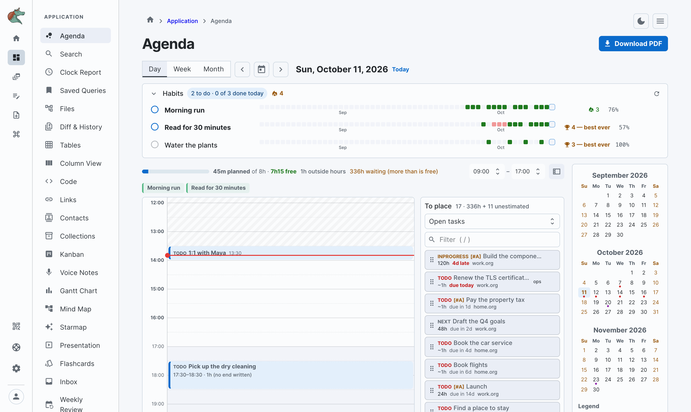

  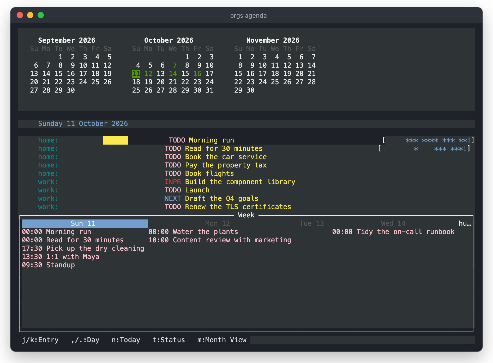

** Creating an admin user
   A server nobody has set up has one account, =admin= with the password
   =default=, built in so that it can be logged into at all. It prints a
   large warning on every startup until you replace it with an account of
   your own.

*** Create the user from the command line
   Users live in a keystore file. Name one under =server:= in the config
   (a relative path is taken relative to the config file):

   #+BEGIN_SRC yaml
   server:
     keystore: "orgs_keystore.yaml"
   #+END_SRC

   Then, *on the machine the server runs on*, add yourself:

   #+BEGIN_SRC sh
   orgs user add ian -admin   # prompts for a password, twice
   #+END_SRC

   =orgs user= edits the keystore file directly and never talks to the
   server, so it works with no server running. The first account written to
   a new keystore replaces the built-in admin/default one. Restart the server
   to pick the change up.

*** Make sure the user is an admin
   =-admin= on =orgs user add= makes the account an administrator. For an
   account that already exists, promote it on the server's machine and
   restart:

   #+BEGIN_SRC sh
   orgs user admin ian        # ian is now an administrator
   orgs user ls               # check: the ADMIN column says true
   #+END_SRC

   An administrator can add more users from anywhere they can log in, and
   those accounts work at once, with no restart:

   #+BEGIN_SRC sh
   orgs adduser dana          # an ordinary user
   orgs adduser sam -admin    # another administrator
   #+END_SRC

   Promoting an account can only be done on the server's own disk, never over
   the wire, so nobody who can add users can make themselves an
   administrator. See [[*Users and the keystore][Users and the keystore]] for the rest.

*** Log in from a client
   Point the command line at the server (=url:= in its config, or =-url=) and
   log in:

   #+BEGIN_SRC sh
   orgs -url https://myserver:8010 login -user ian   # prompts for the password
   #+END_SRC

   The token it gets back is saved as =token:= in the client's config and
   sent with every later command, until it expires (=server.tokenExpiry=,
   an hour by default); then run =orgs login= again. The password itself
   never leaves the client: it is hashed with the user's salt first.

*** Log in from the web page
   Open the server's address in a browser (=https://myserver:8010/=). worg
   shows a login screen until you are signed in: enter the username and
   password and press *Log In*. The session is kept in a cookie, so other tabs
   on the same server are signed in too.

** Uses
   	OrgS is intended to be like the Language Server Protocol of org files.
   	It is intended to support:

   	- org protocol synchronization
   	- web portal access to your org files
   	- rich robust editor integrations for your org files.
   	- a notification mechanism that works across platforms
   	- command line access to your org files.

** Your editor, your browser and your terminal on the same notes

   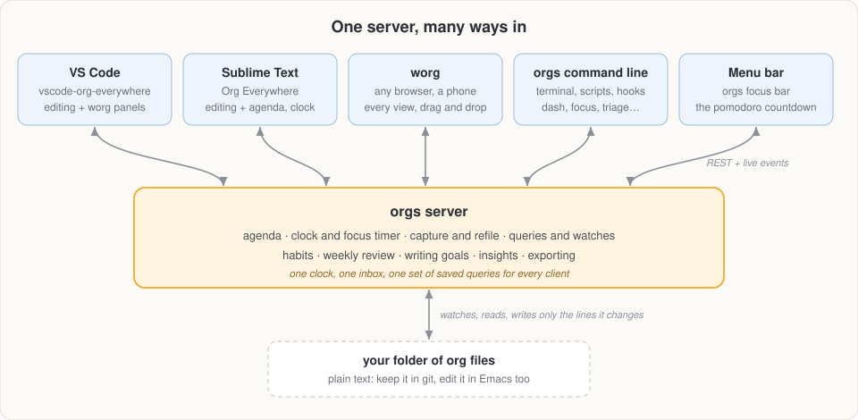

   Every client talks to the one server, so they share one clock, one inbox,
   one set of saved queries and one focus timer. Clock in from your editor and
   the clock is running in worg and at the command line; tick a task off on
   your phone and your editor's agenda shows it done.

   - *VS Code: [[https://github.com/ihdavids/vscode-org-everywhere][vscode-org-everywhere]] (Org Everywhere).* Org mode editing
     (folding, TODO keywords, tables, links, dates) works on its own. With an
     orgs server it adds the agenda and the clock in the side bar, clocking
     in on the heading under the cursor, a focus timer in the status bar that
     clocks in through the server, capture through the server's templates,
     refile and archive, table formulas, running code and exporting. Every
     worg view (kanban, gantt, clock report, search…) opens as an editor
     panel, and a heading picked in one opens in the editor.
   - *Sublime Text: [[https://github.com/ihdavids/orgeverywhere][Org Everywhere]].* A fork of OrgExtended where editing
     stays in the plugin and everything that spans files (the agenda,
     clocking, capture, refile and archive, ids and backlinks, search,
     exporting) is done by orgs. *Org: Set Up a Local orgs Server* downloads
     orgs and runs it on your folder of notes; *Org: orgs Open Web UI* opens
     worg on one of its views.
   - *worg*, the web front end the server hands out at =/=: every view,
     in any browser, including a phone's. See [[*worg, in pictures][worg, in pictures]].
   - *The =orgs= command line*: the same views at a prompt, for scripts, git
     hooks and ssh. See [[*The command line, in pictures][The command line, in pictures]].

   The stories show them working together over a whole week: an engineer at
   the command line and in worg, and a writer working on a book.

** Plans
   - Mu4E style imap email synchronization and exposure of your emails as part of your
     org repository.

* The command line, in pictures
** What this is

  A tour of the =orgs= command line: one picture per command worth seeing,
  and the line that draws it. Every command talks to a running =orgs serve=
  (or runs one in-process for itself with =-local=), so they all see the same
  notes, and anything changed in one shows up in the others and in worg.

  The pictures are of a small demo notebook kept in =docs/screenshots/demo=;
  =tools/screenshots= takes them again (see [[*Taking the pictures again][Taking the pictures again]]).

  Every command also takes =-json=, =-format=, =-dry-run= and =-no-color=,
  so what is drawn here for a person can be read by a program instead.

** The day at a glance: =orgs dash=

  One screen that answers "what does today want from me": the agenda, the
  clock, the focus timer, the habits, the inbox and your watches, read
  together. It only reads; each card names the command that acts on it.
  =orgs dash -w= keeps it on screen, redrawn as things change, and
  =orgs dash -json= gives every card as data.

  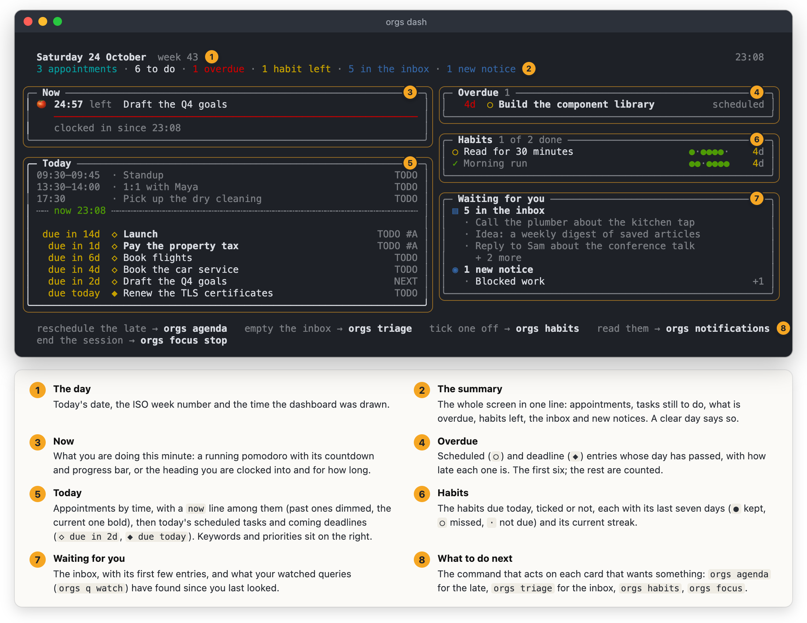

  A card whose part of the server is missing or broken says so in one dim
  line, and the others still draw.

** The morning standup: =orgs standup=

  What you did since the last working day (Friday, on a Monday), what is on
  today and what is in the way, written in Slack's markup so it can be pasted
  straight into a channel. =-copy= puts it on the clipboard as well, =-md=
  writes GitHub Markdown instead, =-since mon= starts from a day of your
  choosing and =-n= caps each section (the rest are counted).

  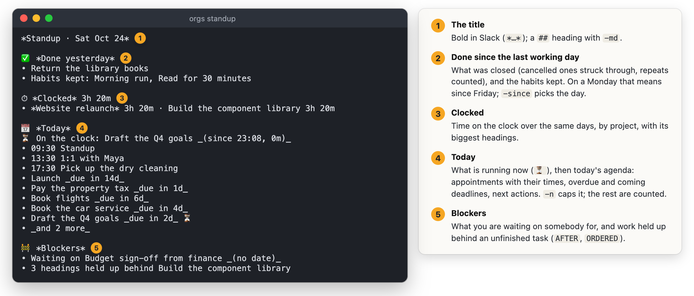

  Every part is read by the view it comes from (the agenda, the clock table,
  the weekly review's waiting list, the dependency check), so a standup never
  says something the agenda would contradict.

** The week in review: =orgs recap=

  A week or a month on one page: what was finished, where the time went, how
  the habits held up, words written and what is still blocked. Like
  =orgs standup= it is Slack's markup unless you ask for =-md=.

  #+BEGIN_SRC sh
  orgs recap                        # the last seven days
  orgs recap -last -week            # last week, Monday to Sunday
  orgs recap -month                 # this month so far
  orgs recap -from 2026-10-01 -to 2026-10-15
  orgs recap -block 2026-Q3 -md     # a clock table range, as Markdown
  #+END_SRC

  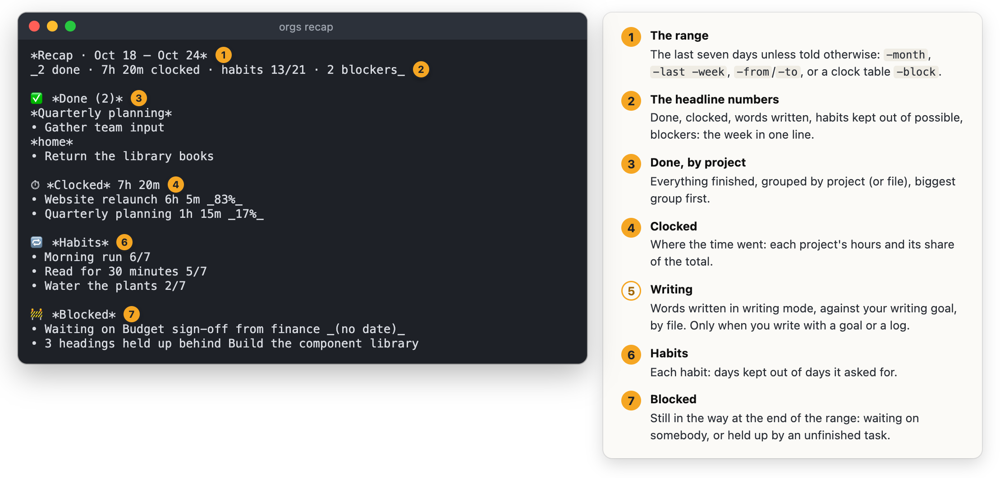

** The agenda: =orgs agenda=

  Three months of calendar, today's entries, and the week underneath. =,= and
  =.= step a day, =n= comes back to today, =t= changes the keyword of the
  entry under the cursor, =m= opens the month.

  

** Planning the day: =orgs plan=

  The day as hours: what is booked, what is free, and the tasks waiting for a
  slot, most urgent first. It is the agenda's day planner in worg, at a prompt.

  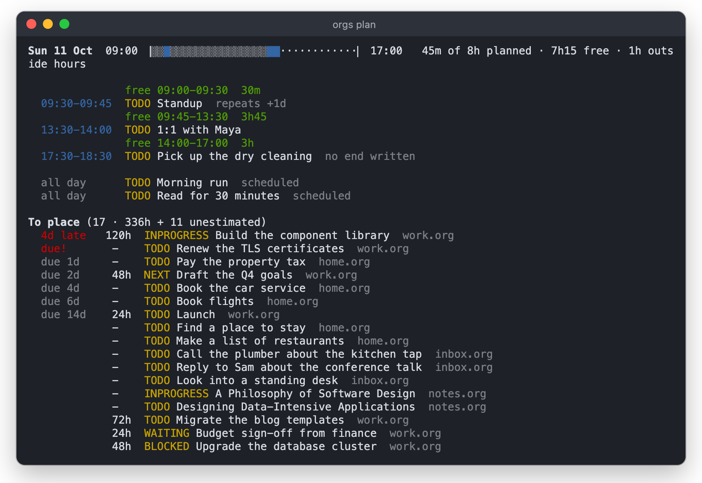

** One screen for everything: =orgs tui=

  A query's results in a list, with the heading's body beside it. =:= changes
  the query, =/= filters what is there, =t= changes a keyword, enter opens the
  heading in your editor.

  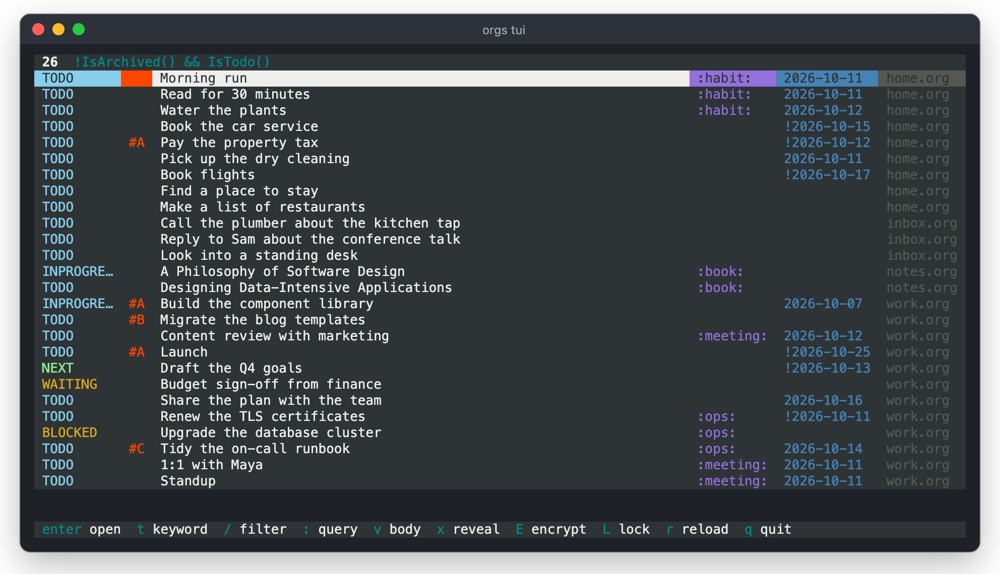

** Asking questions: =orgs search=

  The same query language worg's Search tab uses. Plain words match headlines;
  an expression can ask anything the database knows.

  #+BEGIN_SRC sh
  orgs search 'IsTask() && HasTags("work")'
  orgs search 'DeadlineWithin("7d")' -json | jq '.[].Headline'
  #+END_SRC

  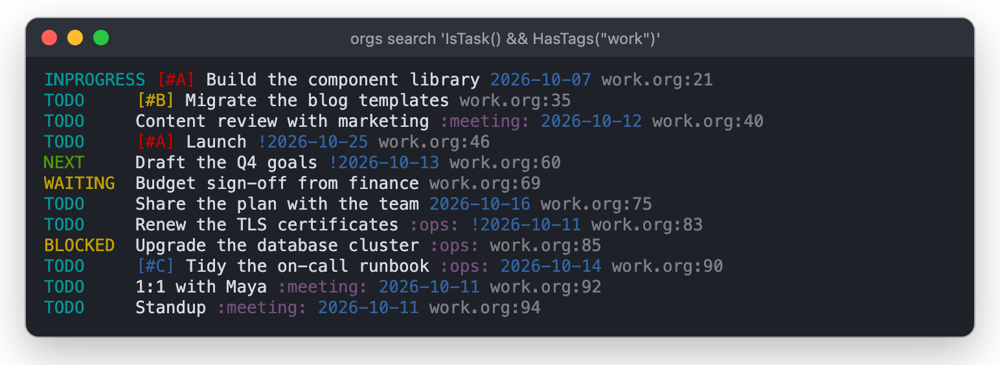

** Boards: =orgs kanban=

  worg's kanban boards, the same boards, editable from the terminal. =H= and
  =L= move a card between columns (which changes its keyword), =J= and =K=
  reorder it, =t= picks a keyword, =c= clocks in.

  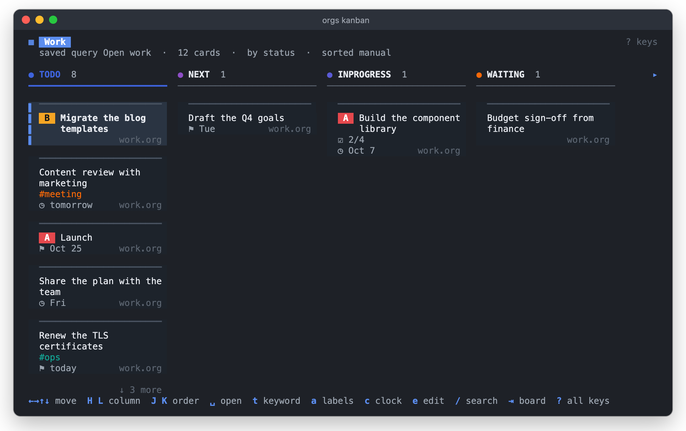

** Schedules: =orgs gantt=

  A saved query drawn as a gantt chart, the same plan worg draws: =EFFORT=
  sizes a bar, =AFTER= and =ORDERED= chain them, weekends are skipped, and
  =-crit= marks the critical path.

  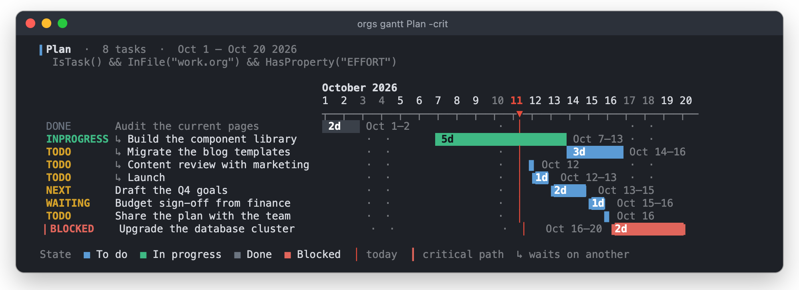

** Column view: =orgs cols=

  org's column view of a file, from its =#+COLUMNS:= line. Parents total the
  columns that ask for it (=%EFFORT{:}=), enter edits a value in place, =s=
  sorts within each parent.

  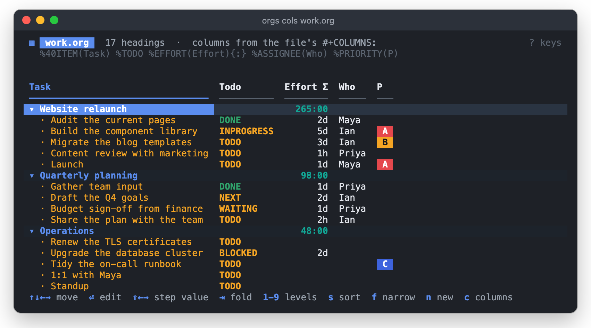

** Habits: =orgs habits=

  Every habit's last month at a glance: =█= kept, =░= missed, =·= not due.
  =orgs habits done <name>= ticks one off.

  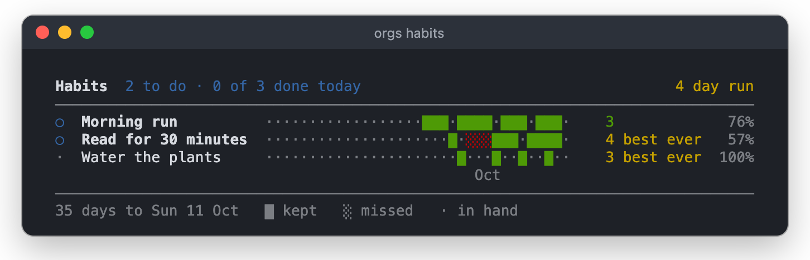

** Tables: =orgs tables=

  Every org table in your notes, in a picker with the table drawn beside it.
  =ctrl-e= runs its =#+TBLFM= formulas.

  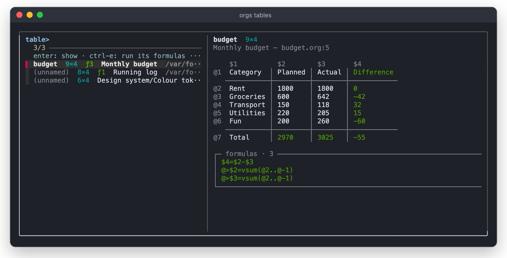

** The weekly review: =orgs review=

  Everything that wants a decision: projects with nothing to do next, deadlines
  nobody scheduled, things waiting on somebody else, time booked against open
  tasks. =orgs review -fix= walks them one at a time.

  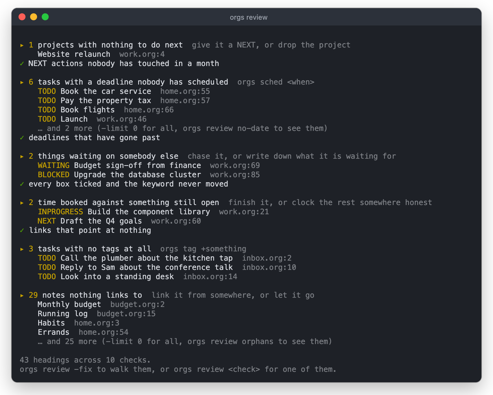

** Flashcards: =orgs drill=

  Spaced repetition over your notes, org-drill style: the same cards, the same
  algorithms, the same =DRILL_*= properties. See [[*Flashcards — drilling your notes, org-drill style][Flashcards]] for how to write
  cards.

  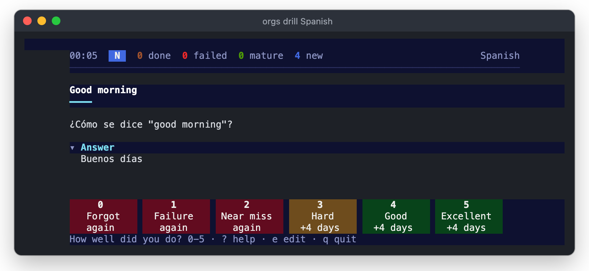

** What is in there: =orgs stats=

  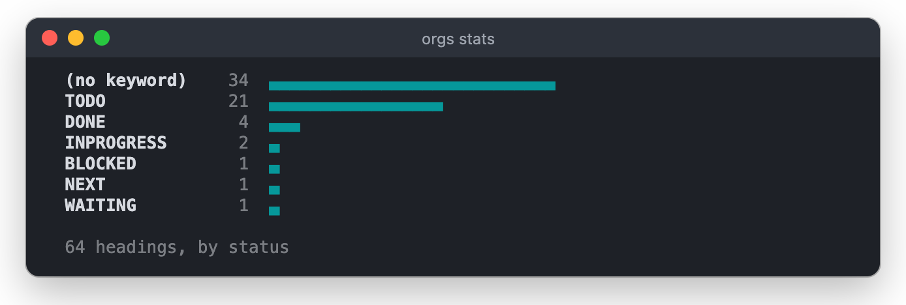

** Finding your way: =orgs help=

  Everything the command line can do is described by the binary itself, so
  the help always matches the version you are running. It needs no server.

  | You type                          | You get                                                                   |
  |-----------------------------------+---------------------------------------------------------------------------|
  | =orgs help=                       | every command, grouped by what it is for, in the order worth reading      |
  | =orgs help standup=               | one command: what it does, its flags, examples and what the guides say     |
  | =orgs help stand=                 | no such command, so the names it might have meant (=standup=)              |
  | =orgs help -all=                  | every command with every flag, one after another, for searching           |
  | =orgs help -json=                 | the command list as a table (name, group, usage), for a script            |
  | =orgs help -man search=           | a command's man page (roff); with no command, =orgs(1)=                    |
  | =orgs help -man-dir DIR=          | =orgs.1= and an =orgs-<command>.1= for every command, written into =DIR= |
  | =orgs completion zsh=             | tab completion for your shell                                             |

  A command's page reads top to bottom like this:

  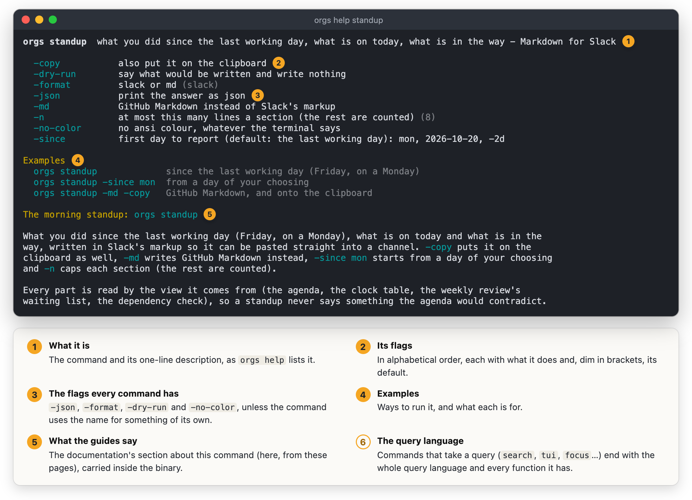

  Some ways to use it:

  #+BEGIN_SRC sh
  # Which command has a flag for this?
  orgs help -all | grep -B20 -- '-since' | grep '^orgs '

  # Read a long page in a pager (search has the whole query language)
  orgs help search | less -R

  # Real man pages: write them once, then `man orgs-search`
  orgs help -man-dir ~/.local/share/man/man1

  # The list for a launcher or a wrapper script
  orgs help -json | jq -r '.[] | "\(.Name)\t\(.Usage)"'
  #+END_SRC

  Commands you add yourself show up too: every filter in your yaml is a
  command, listed under its own group (or "Other"). =orgs p= is the same list
  as a fuzzy picker, together with your saved queries and aliases.

** Taking the pictures again

  The pictures are taken by a script, against a demo server with its own
  notes, so they can be taken again whenever a command changes:

  #+BEGIN_SRC sh
  cd tools/screenshots
  npm install
  node capture.mjs                  # every picture
  node capture.mjs cli-kanban       # just the ones named
  node capture.mjs serve            # just the demo server, to look around
  #+END_SRC

  The demo notes are in =docs/screenshots/demo=. Their dates are written as
  ={{D+3}}= and filled in when the script runs, so the agenda is always about
  today. Terminal pictures run each command in a pseudo terminal and draw the
  screen with xterm.js; worg pictures drive Chrome with puppeteer.

  An annotated picture (=cli-dash=) is a terminal picture with numbered badges
  and a legend. Its notes find their parts by text on the screen (a card's top
  edge, or a line), so the badges follow the layout, and a renamed card fails
  the shot instead of putting a badge in the wrong place. These shots are taken
  last, because they set the demo up first (a pomodoro, a ticked habit, a
  watch that fires) and the other pictures shouldn't show that.

  The stories' pictures live in =tools/screenshots/stories/=, one module a
  story. Each brings its own notebook (=docs/screenshots/<story>/=) and runs on
  a server of its own after the pictures above, so nothing one story sets up
  shows in another. =node capture.mjs -story writer= takes just one story's.

* worg, in pictures
** What worg is

  worg is the web front end built into the server: =orgs serve= hands it out at
  =/=, so any browser that can reach the server (a phone included) has it. It
  works on the same notes as the command line and the editor plugins; a change
  made in one is in the others a second later.

  It has a light and a dark look, picked with the moon in the top corner.

  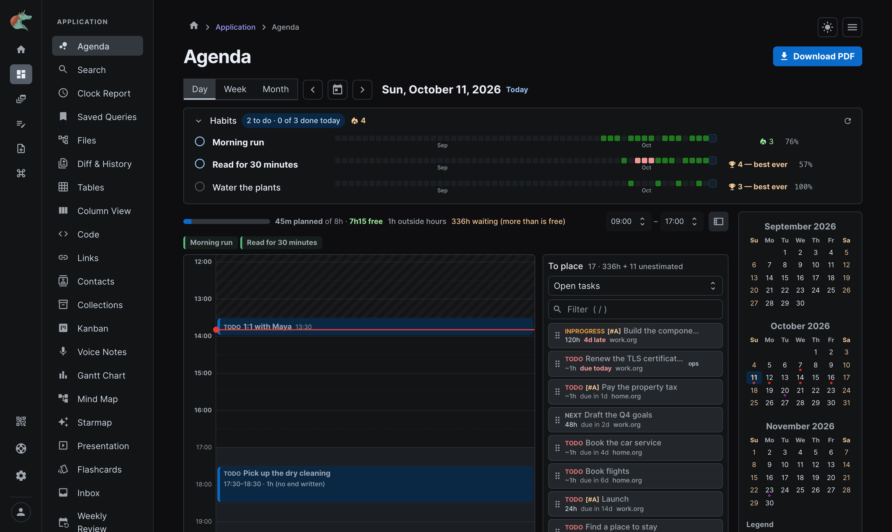

  The pictures here are of the demo notebook in =docs/screenshots/demo=, taken
  by =tools/screenshots= (see [[*Taking the pictures again][Taking the pictures again]] in the command line tour).

** Agenda

  The day as a planner: habits at the top, the hours of the day with what is
  booked into them, and the tasks still to place down the side, most urgent
  first. Drag a task onto an hour to schedule it. Week and Month show the
  wider view; the calendars mark days with something on them.

  

** Search

  The query language in a form: an expression, a regular expression over the
  text, and filters by keyword, tag and property. Rows can be edited where
  they are; Inspect opens a heading's dates, drawers and body beside the
  table.

  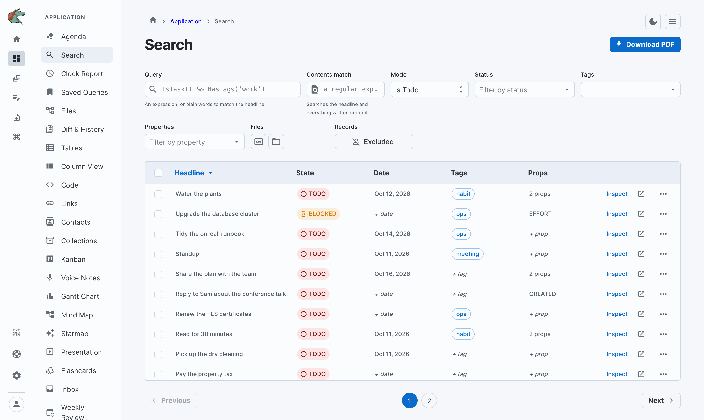

** Files

  Every org file, read rendered or as org, and edited in place. Drawers fold,
  links follow, and the Links panel shows what points at the file and what it
  points at.

  Pictures a file links to are drawn under their links in the Org view and in
  the editor, as Emacs does with =org-display-inline-images=. The picture
  button on the toolbar (*Images* on the editor's status line) shows or hides
  them all; an eye at the end of a link's line, there when the pointer is,
  shows or hides that one. Click a picture to see it full size.

  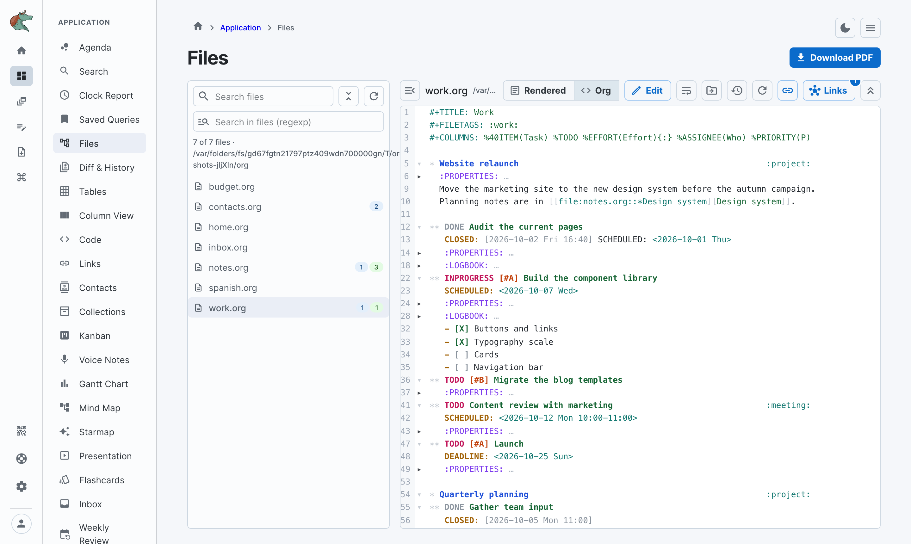

** Kanban

  Boards built from a saved query, one column per keyword (or per tag or
  property value). Dragging a card to another column changes the heading in
  its file.

  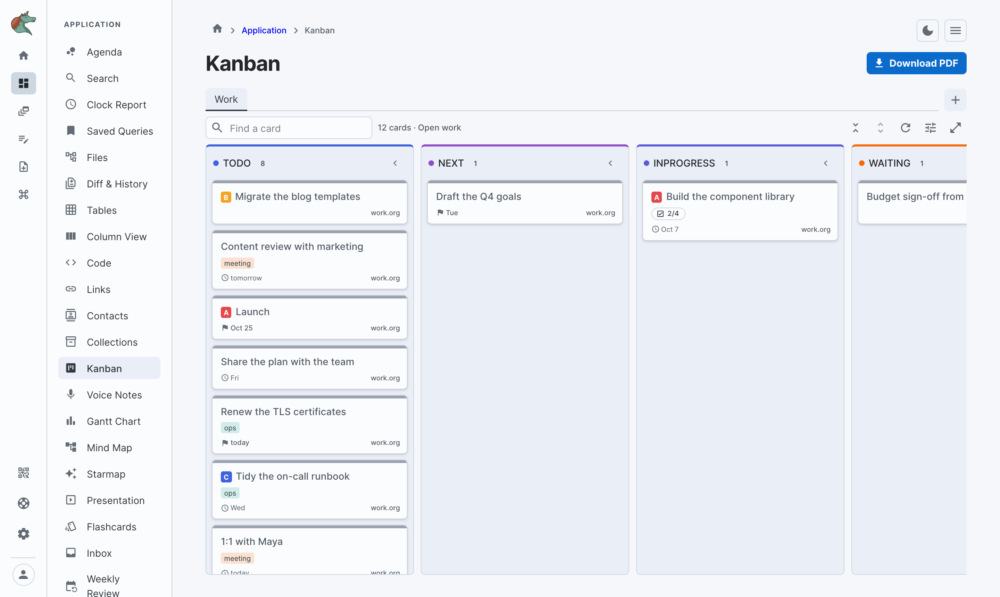

** Gantt Chart

  A saved query as a schedule: =EFFORT= sizes the bars, =AFTER= and =ORDERED=
  chain them, today is the red line. Bars can be dragged to reschedule,
  coloured by state, person or any property, and split into lanes.

  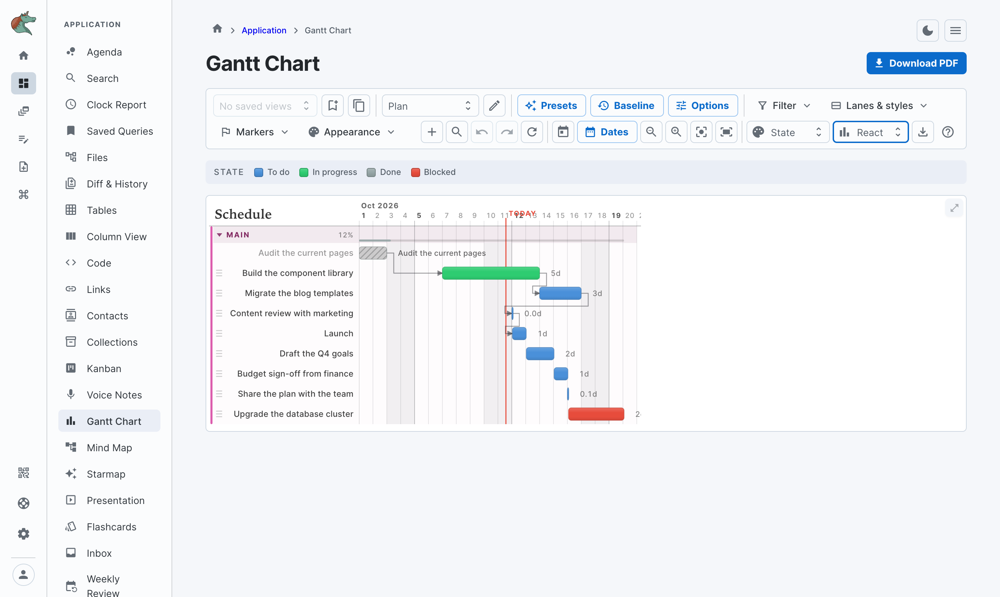

** Column View

  org's column view of a file, from its =#+COLUMNS:= line, with totals on each
  parent. Any cell can be edited in place.

  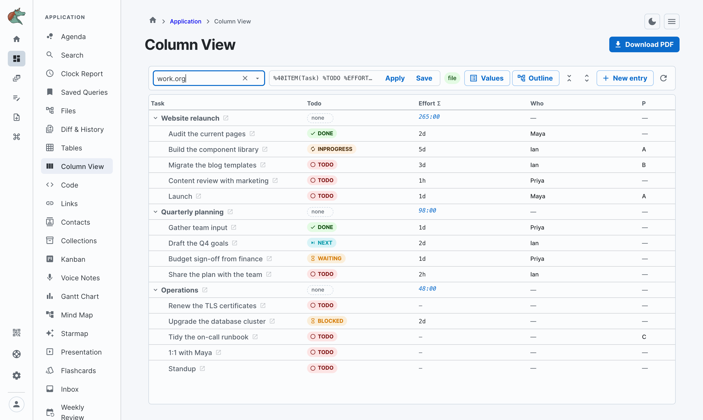

** Tables

  Every org table, opened as a spreadsheet. Formulas (=#+TBLFM=) are shown and
  recalculated, cells are edited in place, and a selection can be charted.
  See [[*Tables][Tables]] for the formula language.

  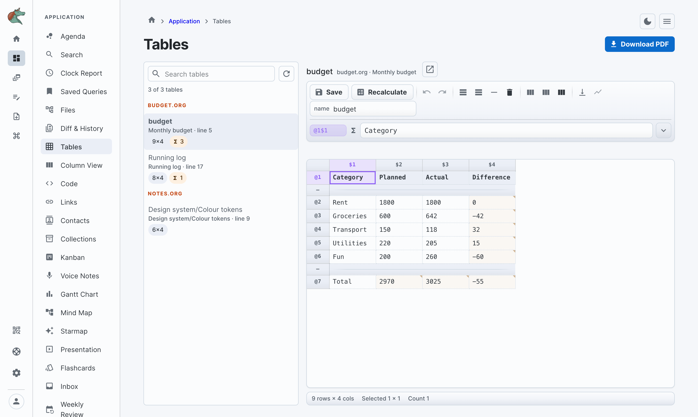

** Mind Map

  A saved query drawn as a map, coloured by branch, keyword or tag, and
  exported as an image.

  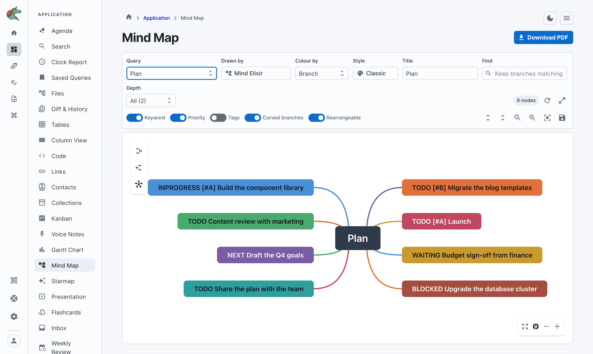

** Contacts

  Headings with a =RECORD= property, as an address book: upcoming birthdays at
  the top, a vCard import, and each contact's fields and notes beside the
  list. See [[*Records — the contact book, and everything else worth a list][Records]].

  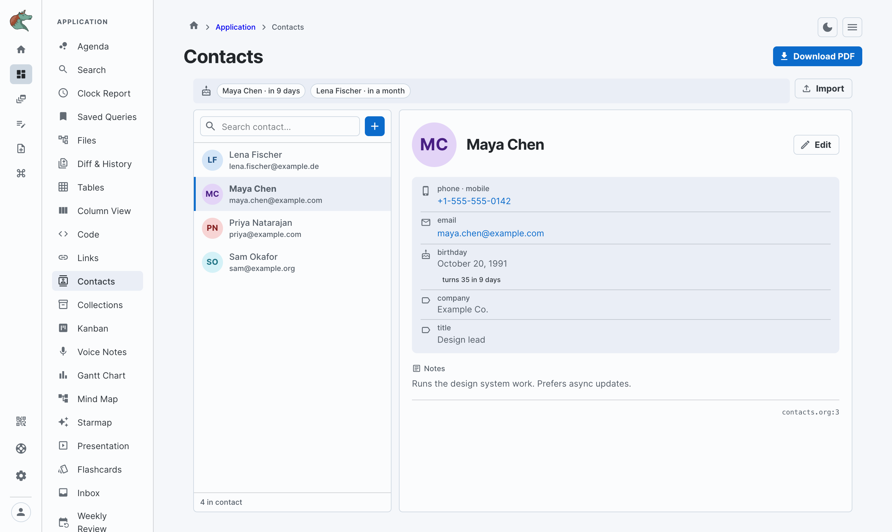

** Flashcards

  Spaced repetition over your notes, org-drill compatible. A deck is a query;
  clozes hide part of a line until you ask for the answer. See
  [[*Flashcards — drilling your notes, org-drill style][Flashcards]].

  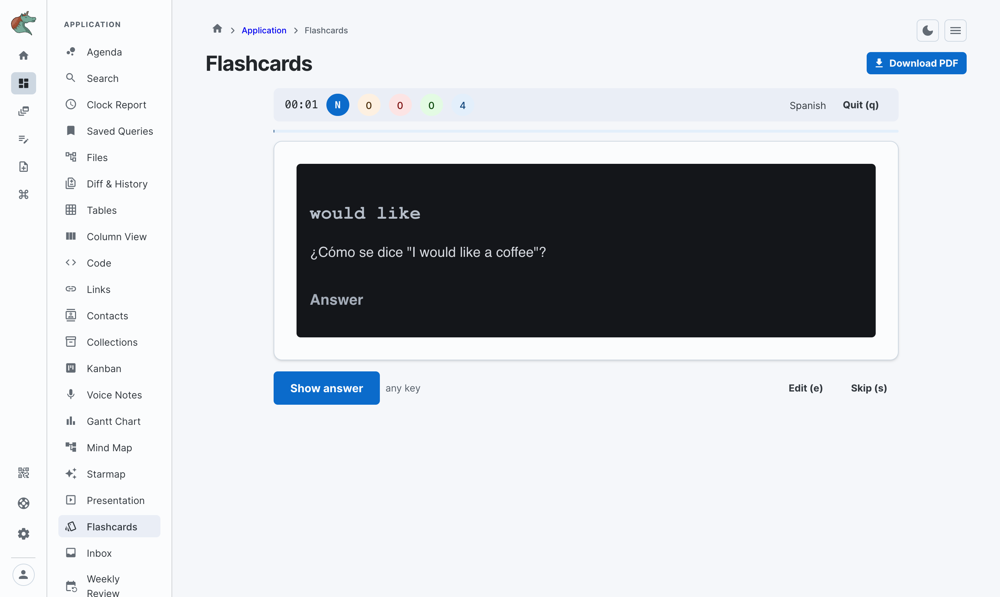

** Weekly Review

  GTD's weekly review as steps: empty the inbox one item at a time (refile,
  schedule, tag, archive, done), then the projects with no next action, what
  is waiting on others, last week's time and the stale scheduled items.

  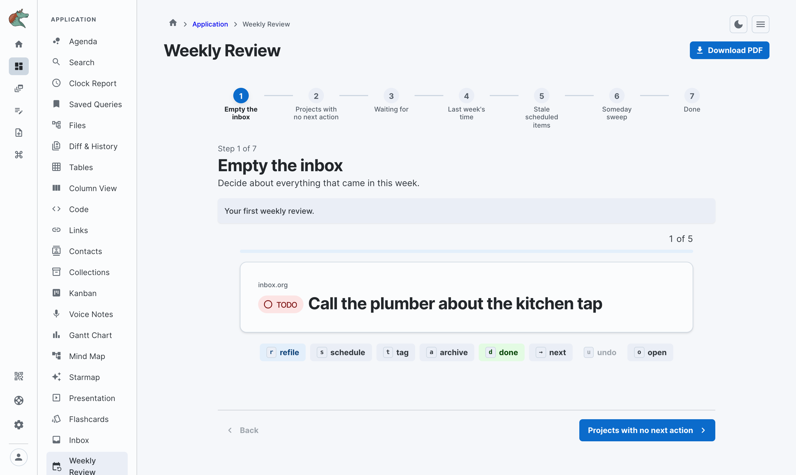

** Code

  Every source block in your notes, by language, with syntax colouring; a block
  can be run and its results written back under it.

  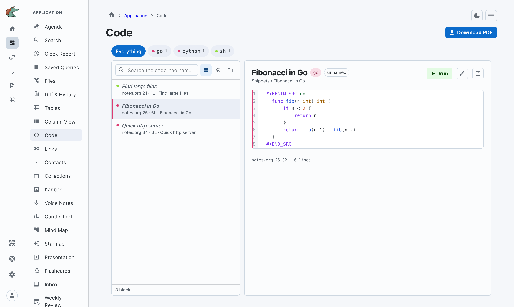

* API

  - GET /newtemplate/list — New-File Templates, With Where Each Comes From
    The templates =/newtemplates= names, each with whether it is built in,
    whether this server has its own copy, and which one is the Plain
    (=newFileTemplate=) one. The Plain template comes first.

    *Response:* a JSON array of ={Name, Label, Plain, Builtin, Edited, Writable}=.

  - GET /newtemplate?name=new/notes.tpl — One Template's Text
    *Response:* ={Name, Label, Plain, Builtin, Edited, Writable, Text, Path}=;
    =Path= is where saving writes it.

  - POST /newtemplate — Save a Template
    *Body:* ={Name, Text, Base, From}=. =Name= is =new/<name>.tpl= or a bare
    name; =Base= is the text the editor started from, and the save is refused
    (=409=) when the template has changed since; =From=, when it differs from
    =Name=, is the template this one is renamed from, whose own copy is
    removed. Refused (=400=) when the text does not parse, with =Line= and
    =Col=, or uses == or includes a file outside the template folders.

  - DELETE /newtemplate?name=new/notes.tpl — Delete a Template
    Removes this server's own copy; a built-in template of that name is used
    again. A built-in template with no copy cannot be deleted.

  - POST /newtemplate/preview — Render a Template That Is Not Saved
    *Body:* ={Name, Text, Title, Filename, Answers}=. *Response:* ={Ok, Text,
    Fields}= (=Fields= as =/newtemplate/fields= reads the text), or ={Ok: false,
    Msg, Line, Col, Fields}= saying where it broke.

  - GET /newtemplate/fields?name=new/meeting.tpl — What a Template Asks
    The template's =ask("Client", "Acme")= questions, in order, each once (an
    included template's in its place): ={Name, Default}=. The New File dialog
    shows a box for each and sends the answers as =answers= on =POST /file=.

  - GET /newtemplate/words — What a Template Can Name
    Every value (with what it would be now), function and filter, with what it
    does, for an editor to complete and explain.

** DELETE /attachment/{hash}/{name} — Throw One Away

	Removes the file from the heading's folder, and takes the line that linked
	to it out of the heading's body when that line was the link and nothing
	else.

	A link written into the middle of a sentence is left alone: the sentence is
	somebody's writing, and a hole in it is worse than a link to a file that has
	gone. A link alone on a line is litter once the file is gone.

	*Method:* =DELETE=

	*Response:* A =Result= JSON object. =Msg= says whether a link was taken out
	as well as the file.

** DELETE /dnd/play/session/{id}/mark — Take An Annotation Off
	Removes the annotation on one block of the timeline. The block itself is untouched -
	the rolls and notes it is made of stay exactly where they are.

	*Method:* =DELETE=

	*Query Parameters:*
	| Parameter | Type   | Required | Description                                  |
	|-----------+--------+----------+----------------------------------------------|
	| =time=    | string | yes      | The clock the annotation is anchored on.     |
	| =kind=    | string | no       | The kind it was written against.             |

	An anchor that carries no annotation is refused with a =400= rather than quietly
	doing nothing, so a page working from a stale reading hears about it.

	*Response:* The session, read back in full.

** DELETE /dnd/play/session/{id}/note/{index} — Throw A Note Away
	Takes one note out of a session's notes altogether. The note is found the same
	way an edit finds it, and refused on the same terms.

	*Method:* =DELETE=

	*Path Parameters:*
	| Parameter | Type   | Description                                       |
	|-----------+--------+---------------------------------------------------|
	| ={id}=    | string | The session.                                      |
	| ={index}= | number | Which note of that session, counting from zero.   |

	*Query Parameters:*
	| Parameter | Type   | Required | Description                                          |
	|-----------+--------+----------+------------------------------------------------------|
	| =was=     | string | no       | The stamp the note carried when the page read it.    |

	=was= is worth sending. Deleting a note shifts every note after it up by one, so a
	page holding stale numbers could otherwise throw away the wrong one and be none the
	wiser; when the stamp no longer matches, the call is refused with a =400= saying so.

	*Response:* The updated session record.

** DELETE /dnd/play/session/{id}/roll/{index} — Throw A Roll Away
	Takes one row out of a session's roll table. The row is found the same way an edit
	finds it, and refused on the same terms.

	*Method:* =DELETE=

	*Path Parameters:*
	| Parameter | Type   | Description                                       |
	|-----------+--------+---------------------------------------------------|
	| ={id}=    | string | The session.                                      |
	| ={index}= | number | Which roll of that session, counting from zero.   |

	*Query Parameters:*
	| Parameter | Type   | Required | Description                                       |
	|-----------+--------+----------+---------------------------------------------------|
	| =was=     | string | no       | The label the roll carried when the page read it. |

	As with a note, =was= is worth sending: deleting shifts every roll after it up by
	one, so a page holding stale numbers could otherwise throw away the wrong row.

	Taking the last row out takes the table with it, leaving the session exactly as it
	was before anything was rolled in it.

	*Response:* The updated session record.

** DELETE /dnd/session/{id} — Abandon a Character Build
	Throws the in progress character away.

	*Method:* =DELETE=

** DELETE /ext/capture/template — Delete a User Capture Template
	Deletes a per-user capture template by name. The change is persisted to the
	extensions YAML file.

	*Method:* =DELETE=

	*Query Parameters:*
	| Parameter | Type   | Required | Description                                   |
	|-----------+--------+----------+-----------------------------------------------|
	| =name=    | string | yes      | The name of the capture template to delete.   |

	*Response:* A =ResultMsg= JSON object confirming the deletion.

	*Errors:*
	- =401= if not authenticated.
	- =400= if =name= is missing.
	- =404= if the named template does not exist.

** DELETE /ext/kanban/board — Delete a Kanban Board
	Deletes one board by name. Only the board goes - a board is a way of looking at
	the org files and owns nothing in them, so no heading is touched.

	*Method:* =DELETE=

	*Query Parameters:*
	| Parameter | Type   | Required | Description                        |
	|-----------+--------+----------+------------------------------------|
	| =name=    | string | yes      | The name of the board to delete.   |

	*Response:* A =ResultMsg= JSON object confirming the deletion.

	*Errors:*
	- =401= if not authenticated.
	- =400= if =name= is missing.
	- =404= if no board has that name.

** DELETE /ext/query — Delete a Stored Query
	Deletes a stored query by name for the authenticated user. The change is
	persisted to the extensions YAML file.

	*Method:* =DELETE=

	*Query Parameters:*
	| Parameter | Type   | Required | Description                           |
	|-----------+--------+----------+---------------------------------------|
	| =name=    | string | yes      | The name of the stored query to delete.|

	*Response:* A =ResultMsg= JSON object confirming the deletion.

	*Errors:*
	- =401= if not authenticated.
	- =400= if =name= is missing.
	- =404= if the named query does not exist.

** DELETE /voice/recording/{id} — Throw a Recording Away
	Deletes one recording. This is not undoable and nothing else is touched: a note
	already filed keeps its heading and its transcript, and is left with an =AUDIO=
	link pointing at a file that is no longer there.

	*Method:* =DELETE=

	*Path Parameters:*
	| Parameter | Type   | Description        |
	|-----------+--------+--------------------|
	| =id=      | string | The recording id.  |

	*Response:* A =ResultMsg=.

	*Errors:*
	- =401= if not authenticated.
	- =404= if there is no recording with that id.

** DELETE /watches — Stop Watching a Query
	Removes a watch by name. Its notifications stay in the list.

	*Method:* =DELETE=

	*Query Parameters:*
	| Parameter | Type   | Required | Description         |
	|-----------+--------+----------+---------------------|
	| =name=    | string | yes      | The watch to remove. |

	*Response:* The =WatchList= after the change; 404 when nothing has that name.

** GET /agenda — What Lands on Each Day

	The agenda worked out on the server: every heading that lands on each day
	of a range, with repeaters expanded, ranges spread over the days they span,
	overdue SCHEDULED items carried forward to today, and DEADLINE warnings.
	A client only draws it. The rules follow org's agenda:

	- A plain active timestamp (in the headline or the heading's own body, not
	  a child's, not in a drawer) lands on its day. A repeater (=+1w=, =++1w=,
	  =.+1w=) lands on its base day and every interval after it; months and
	  years keep to the calendar (Jan 31 =+1m= is Feb 28).
	- A range =<a>--<b>= lands on every day it spans, with the times written
	  there on its first and last day and as all day between.
	- SCHEDULED lands on its day; not done and past, it also lands on *today*
	  only, with =Late= days.
	- DEADLINE lands on its day; not done, it also lands on today inside its
	  warning period (=-Nd= on the stamp, else =agenda.deadlineWarningDays=,
	  default 14) with =DueIn= days, or past it with =Late= days.
	- A finished heading lands only on the days its dates name.
	- CLOSED lands on its day when =closed=t=.
	- A heading in an archived tree (tag ARCHIVE, here or above) is left out
	  unless =archived=t=, as org's agenda skips archived trees.

	*Method:* =GET=

	*Query Parameters:*
	| Parameter | Type   | Required | Description                                            |
	|-----------+--------+----------+--------------------------------------------------------|
	| =from=    | date   | no       | First day, =YYYY-MM-DD=. Defaults to today.             |
	| =to=      | date   | no       | Last day, inclusive. Defaults to =from=.                |
	| =today=   | date   | no       | The day to count late and due from. The server's date. |
	| =query=   | string | no       | Narrows the headings, as =/search=. Empty is all.      |
	| =closed=  | bool   | no       | =t= adds CLOSED dates (the logbook view).              |
	| =archived= | bool  | no       | =t= keeps headings in archived trees.                  |

	*Response:* An =AgendaResult=: ={"Ok": true, "From", "To", "Today",
	"Nodes": [...], "Days": [{"Date", "Entries": [{"Node", "Kind", "Start",
	"End", "HasTime", "Repeat", "Late", "DueIn", "Done"}]}]}=. =Node= is an
	index into =Nodes=, so a heading on five days is sent once. Every day of
	the range is listed, empty or not. A bad date or query answers =Ok: false=
	with the reason in =Msg=.

** GET /agenda/nodes — Headings With Everything the Agenda Reads

	The headings a query finds (all of them with no query) as =AgendaNode=s -
	planning dates, timestamps, clocks, inherited tags, a summary of the
	children, the file's keywords - for list views that are not laid out by
	day: todo lists, projects, the clocked view.

	*Method:* =GET=

	*Query Parameters:*
	| Parameter | Type   | Required | Description                               |
	|-----------+--------+----------+-------------------------------------------|
	| =query=   | string | no       | The query expression, as for =/search=.   |

	*Response:* ={"Ok": true, "Nodes": [...]}=, or =Ok: false= and =Msg=.

** GET /agenda/print — The Agenda as a Printable Planner

	A self-contained html page to print (or to hand a headless Chrome, which is
	what =orgs print -f pdf= does): a week on one landscape sheet, a day on a
	portrait one, or a month as a calendar. What lands on each day is the
	=/agenda= answer for the same query, so paper and screen agree.

	- *week*: a spread - four days on the left page, three and a panel on the
	  right. Each day lists its all day items (deadlines marked =due=, or =in
	  3d= while warning) and its timed ones, done items struck through, and
	  ruled lines to write on. The panel has *Overdue* (what the agenda carries
	  to today, late first), *Tasks* (undated open tasks, active ones first),
	  a *Habits* strip with a box a day and *Notes*.
	- *day*: an hour grid (07:00 to 21:00, wider when something is earlier or
	  later) with overlapping entries side by side, then the day's list, tasks,
	  overdue and notes.
	- *month*: a calendar grid, a few entries a day and how many more.

	*Query Parameters:*
	| Parameter   | Description                                                  |
	|-------------+--------------------------------------------------------------|
	| =view=      | =week= (default), =day= or =month=                           |
	| =from=      | a day in the first sheet, =YYYY-MM-DD=; today when empty     |
	| =pages=     | sheets: weeks, days or months (default 1)                    |
	| =days=      | instead of pages: days to cover (week view: rounded up to weeks) |
	| =query=     | narrows the headings, as =/agenda=                           |
	| =tasks=     | the tasks panel's query; =none= for no panel                 |
	| =habits=    | =f= leaves the habits strip off                              |
	| =theme=     | =classic= (default), =minimal=, =bullet=, =modern=, or yours |
	| =paper=     | =a4= (default) or =letter=                                   |
	| =weekstart= | =mon= (default) or =sun=                                     |
	| =today=     | the day to count overdue from; the server's date            |
	| =list=      | =t= answers the theme names, one a line                      |

	A theme is one stylesheet in =planner/themes/= on the template path; the
	layout is =planner/base.css= and the page =planner/planner.html=, and a copy
	of either in your template folder replaces it.

	*Response:* =text/html=, or a 400 with the reason as text.

** GET /assistant/status — The Writing Assistant's Backends
	Which AI backends the server offers worg's writing assistant, whether each
	has a key, its models, and the default:
	={Ok, Off, Default, Backends: [{Name, Label, Model, Models, Ready, Msg,
	Tools, Where, ModelWhere, Views, ViewTools}]}=. =Views= says it may be
	used in worg's views and =ViewTools= that it can look up and change
	headings there. =Where= is where the writer's text is sent:
	=machine= (this one), =network= (another machine, by a private address
	or local name) or =cloud=; =ModelWhere= gives it per model for =local=,
	whose models may be on servers elsewhere.
	=Off= is true when =assistant.backend= is =off=. Keys are never sent;
	=Source= says where each one comes from (=worg=, =orgs.yaml=,
	=environment=, =profile=), and =CanSetKeys= whether this user may set
	them (=POST /assistant/key=).

** GET /attachment/{hash}/{name} — Fetch One

	The bytes of one attachment.

	Served by this server rather than as a path under =/images= because a
	heading's folder may be named by a =:DIR:= property pointing anywhere at
	all - including outside the org directory, where the static file server
	cannot reach. A url that works for some attachments and answers 404 for
	others is worse than one that always works.

	*Method:* =GET=

	*Path Parameters:*
	| Parameter | Description                                              |
	|-----------+----------------------------------------------------------|
	| ={hash}=  | The heading, base64-url encoded as every hash in a path is |
	| ={name}=  | The file's name inside that heading's folder              |

	*Response:* The file, with a content type worked out from its extension.
	=404= when the heading owns no such file.

** GET /attachments — What a Heading Owns

	Everything in one heading's attachment folder.

	*Method:* =GET=

	*Query Parameters:*
	| Parameter | Type   | Required | Description        |
	|-----------+--------+----------+--------------------|
	| =hash=    | string | yes      | The heading to ask about |

	*Response:* An =AttachList= JSON object.
	| Field         | Description                                                          |
	|---------------+----------------------------------------------------------------------|
	| =Dir=         | The folder, relative to the org root when it is inside it            |
	| =From=        | =dir= when a =:DIR:= property named it, =id= when it came from the   |
	|               | heading's =:ID:=, empty when the heading owns nothing yet            |
	| =Id=          | The heading's id, empty when the folder came from a property         |
	| =Attachments= | The files, newest first                                              |

	A heading with no id and no =:DIR:= is not an error: it simply owns nothing
	yet, and =From= empty is how that is said. Nothing is created by asking.

** GET /attachments/all — Every Heading That Owns Files

	Walks the database for headings with an attachment folder and answers with
	what each of them owns, plus the totals - which is the question an
	attachment store eventually raises and which nothing else can answer.

	*Method:* =GET=

	*Query Parameters:*
	| Parameter | Type   | Required | Description                                               |
	|-----------+--------+----------+-----------------------------------------------------------|
	| =files=   | string | no       | =t= to include each heading's own file list. Off by       |
	|           |        |          | default: the totals are the point and the lists are long. |

	*Response:* An =AttachAll= JSON object holding =Headings=, =Count=, =Size=
	and =Orphans=.

	=Orphans= are folders under the attachment root that no heading claims - the
	heading was deleted, or its id changed, and the files were left behind. They
	are reported rather than cleaned up: they are somebody's files, and a server
	that deletes them because it cannot find a heading is a server that deletes
	them the first time a file fails to parse.

** GET /babel/sessions — The Python Sessions Running

	The sessions =:session= started, one per name per file: =Name=, =File=,
	=Python= (the command), =Version=, =Pid=, =Runs=, =Started=, =LastUsed=.

** GET /beamer/pdf — A File as a Beamer Deck, Compiled

	=GET /beamer/pdf?filename=talk.org= answers with the file as a beamer
	presentation, compiled to pdf (see *Beamer* under exporters). Its own
	endpoint, as =/pdf= and =/book= are, because the answer is bytes.

	*Query Parameters:*
	| Parameter  | Description                                                   |
	|------------+---------------------------------------------------------------|
	| =filename= | the org file                                                  |
	| =theme=    | a preset (clean, dark, metropolis, classic, academic, minimal) or a beamer theme; wins over the file's |
	| =code=     | =listings= (the default) or =minted=                          |
	| =refresh=  | =t= compiles again rather than answering from the cache       |

	The latex is the =beamer= exporter's =latex= setting, else the =pdf=
	exporter's =pdfLatex=, else the first of pdflatex, xelatex and lualatex
	that is installed. A machine with no TeX answers 501 saying so; a deck
	that does not compile answers 422 with latex's first error.

** GET /beamer/themes — The Beamer Presets

	={"Ok": true, "Themes": ["clean", "dark", ...]}=: the presets a deck can
	be exported in when its file names no =#+BEAMER_THEME:=. Any installed
	beamer theme's name works as well; these are the ones orgs dresses itself.

** GET /book — A File as a Manuscript (docx) or an Ebook (epub)

	=GET /book?filename=story.org&to=docx= answers with the file as a
	manuscript, =to=epub= as an ebook (see *Manuscripts and Ebooks*). Written
	by orgs itself, so nothing needs installing; the =manuscript= and =epub=
	exporters' settings are used when they are configured, and need not be.

	*Query Parameters:*
	| Parameter  | Description                                                |
	|------------+------------------------------------------------------------|
	| =filename= | the org file                                               |
	| =to=       | =docx= (or =manuscript=) or =epub=                         |
	| =style=    | the manuscript style: modern, shunn, novel, reader         |
	| =paper=    | letter or a4                                               |
	| =theme=    | the ebook theme: classic, literary, modern, plain          |
	| =list=     | =t= answers ={"Styles": [...], "Themes": [...]}= instead   |

	*Response:* the file, with =X-Orgs-Words= (the word count) and, for an
	ebook, an =X-Orgs-Warning= header per picture that could not be put in.

** GET /code — Every Source Block

	Answers with every =#+BEGIN_SRC= block, read: its language, its name, its
	switches, its header arguments and its variables. A variable that names
	something else in the file - a table, another block, a list - comes back
	resolved, with what it points at and where that lives.

	| Parameter | Meaning                                |
	|-----------+----------------------------------------|
	| lang      | Only blocks in this language           |
	| q         | Only blocks matching this text         |

	The languages in use come back beside the blocks, with a count each, so a
	client can offer the filter without asking twice.

** GET /columns — Org Column View, With Rollups

	Answers with a file's outline as org's column view: the =#+COLUMNS:= line in
	force, the columns it names, and every heading with those properties filled
	in - including the **summed** value on any heading with children, for a
	column whose spec carries a summary operator.

	This is the only thing in orgs that adds =EFFORT= up. A =%EFFORT{:}= column
	makes a project heading show the total estimate of everything under it, which
	is a number nobody has to maintain.

	*Method:* =GET=

	*Query Parameters:*
	| Parameter | Required | Description                                          |
	|-----------+----------+------------------------------------------------------|
	| =file=    | yes      | The org file to view.                                |
	| =columns= | no       | A =#+COLUMNS:= line to use instead of the file's own. |

	The line is taken from the first of these that says anything: the =columns=
	parameter, the file's own =#+COLUMNS:=, =columns.default= in the server
	config, and finally a built-in default. The answer says which in =From=.

	*Summary operators:* =+= and =$= and =:= sum, =min=, =max= and =mean= pick,
	and any of them may carry a printf format after a semicolon (=+;%.1f=). A
	=:= prefix, and the =EFFORT= and =CLOCKSUM= columns whatever their operator,
	are read as durations and summed into =H:MM=. Org's checkbox operators
	(=X=, =X/=, =X%=) and its age operators (=@min= and friends) are not
	implemented and a column carrying one simply does not roll up.

	*Response:* A =ColumnsResult=. Each cell carries =Value= (what to show,
	which is the rollup on a summed parent), =Own= (what is written on that
	heading, which is what an edit changes) and =Number= (the value as a number,
	for sorting).

	Editing is through the endpoints that already exist: =POST /property= for an
	ordinary property, =POST /status/change= for =TODO=, =POST /headline/change=
	for =ITEM=. A cell's =Kind= on the spec says which.

** GET /columns/values — Every Property in a File, With Its Values

	Every property the file's headings use, on how many headings, and the
	unique values each takes with how often - most used first. The keyword,
	tags and priority come in as =TODO=, =TAGS= and =PRIORITY=. Behind the
	column view's value listing, its type-ahead while a cell is edited, and its
	property-name suggestions while a columns line is written.

	*Method:* =GET=

	*Query:* =file= - the org file.

	*Response:* A =ColumnValuesResult=: =Ok=, =Msg=, =File=, and =Props=, a
	list of ={Name, Count, Values: [{Value, Count}]}=.

** GET /contacts — Find Contacts

	=/records?type=contact=, with =q= searching names, numbers, addresses and
	notes alike.

** GET /crypt/config — Whether This Server Can Encrypt, and How

	Answers with the mode, the gpg it found, and how many headings carry the tag
	against how many of those are ciphertext right now.

	*Method:* =GET=

	*Response:* A =CryptConfig= JSON object.
	| Field       | Description                                                           |
	|-------------+-----------------------------------------------------------------------|
	| =Mode=      | =off= with no gpg, =symmetric= with no key, =key= with one            |
	| =Bin=       | The gpg it will use                                                   |
	| =Version=   | What that gpg says about itself                                       |
	| =Key=       | The key it encrypts to, in key mode                                   |
	| =Tag=       | The tag that marks a heading for encryption                           |
	| =Unlocked=  | Whether a passphrase is being held, and =UnlockIn= for how much longer |
	| =Tagged=    | Headings carrying the tag                                             |
	| =Encrypted= | How many of those are ciphertext                                      |

	=Tagged= minus =Encrypted= is the number worth putting in front of somebody:
	headings that are meant to be secret and are sitting in the clear.

** GET /crypt/file — The Secret Headings in One File

	Every heading in one file carrying the crypt tag, in the order they are
	written, and whether each is ciphertext right now. Metadata only, as
	=/crypt/headings= is: what is secret, never what the secret is.

	*Method:* =GET=

	*Query Parameters:*
	| Parameter  | Type   | Required | Description                     |
	|------------+--------+----------+---------------------------------|
	| =filename= | string | yes      | The file, as =/files= names it  |

	*Response:* A =CryptHeadings= JSON object.

** GET /crypt/headings — What Is Marked Secret

	Every heading carrying the crypt tag, and whether each is ciphertext right
	now.

	*Method:* =GET=

	*Query Parameters:*
	| Parameter | Type   | Required | Description                                  |
	|-----------+--------+----------+----------------------------------------------|
	| =plain=   | string | no       | =t= for only the ones sitting in the clear  |

	*Response:* A =CryptHeadings= JSON object holding =Headings=, =Tagged= and
	=Plain=.

	Never a body. A listing says what is secret, not what the secret is - an
	endpoint that handed over plaintext because it was convenient would undo the
	feature for every client that ever called it.

** GET /crypt/state — Is a Passphrase Held Right Now

	The cheap half of =/crypt/config=: no gpg is run and no file is read, so a
	lock indicator can ask every few seconds.

	*Method:* =GET=

	*Response:* A =CryptState= JSON object.
	| Field           | Description                                                    |
	|-----------------+----------------------------------------------------------------|
	| =Mode=          | =off=, =symmetric= or =key=                                    |
	| =Tag=           | The tag that marks a heading for encryption                    |
	| =Unlocked=      | Whether a passphrase is held, and =UnlockIn= for how long      |
	| =UnlockSeconds= | =crypt.unlockSeconds=: zero means nothing is ever held         |

** GET /csv — A Column View or a Query as CSV

	=GET /csv?file=project.org= answers with the file's column view as csv:
	the =#+COLUMNS:= line in force (or =columns==), one row per heading, and
	the rolled-up value on a parent for a summed column (=%EFFORT{:}=), as
	worg's Columns tab and =orgs cols= show it.

	=GET /csv?query=IsTodo()= answers with the headings a query finds instead,
	one row each and nothing summed, in the columns
	=%ITEM %TODO %PRIORITY %TAGS %SCHEDULED %DEADLINE %EFFORT %CLOCKSUM %FILE=
	unless =columns== names others. Filters (={{WorkTasks}}=) work as in
	=/search=.

	*Query Parameters:*
	| Parameter | Description                                                     |
	|-----------+-----------------------------------------------------------------|
	| =file=    | the org file whose column view to write                         |
	| =query=   | the query whose headings to write (instead of =file=)           |
	| =columns= | a =#+COLUMNS:= line to use                                      |
	| =sep=     | =comma= (default), =semicolon= or =tab=                         |
	| =header=  | =f= leaves off the header row                                   |
	| =bom=     | =t= starts with a byte order mark, for Excel                    |
	| =meta=    | =t= adds Level, Line and Hash (and File) columns                |
	| =own=     | =t= writes each heading's own value, not a parent's rollup      |

	*Response:* =text/csv=, named after the file (or =query.csv=); a problem
	is a plain-text 400 or 404.

** GET /dblocks — The Dynamic Blocks In A File

	=GET /dblocks?file=/path/notes.org= lists every =#+BEGIN:= block in the
	file: its name, its header and parameters, the rows of its BEGIN and END
	lines (zero based) and the heading it sits under. Without =file=, every
	file that has one is listed.

** GET /dnd/books — List Files Written as D&D Books

	Answers with every org file the server is watching that asks to be printed
	as a D&D book - that is, one carrying =#+LATEX_CLASS: dndbook=. This is the
	book-shaped sibling of =/dnd/characters=: a client showing a file can use it
	to know whether to offer the book views for that file.

	*Method:* =GET=

	*Query Parameters:* none

	*Response:* A JSON array, one entry per file.
	| Field      | Type   | Description                                    |
	|------------+--------+------------------------------------------------|
	| =filename= | string | The absolute path the server knows the file by |
	| =title=    | string | Its =#+TITLE:=, when it has one                |
	| =class=    | string | The latex class it asked for                   |

	#+BEGIN_SRC json
	[{"filename": "/org/dnd_pdf_example.org", "title": "The Sunken Tower", "class": "dndbook"}]
	#+END_SRC

** GET /dnd/campaigns — Campaigns
	Every campaign under the org directories: an org file with =#+CAMPAIGN: t= (or =campaign= in its
	=#+FILETAGS:=). Its =#+TITLE:= names it, =#+CAMPAIGN_ICON:= is its icon (an emoji) and
	=#+CAMPAIGN_ART:= its picture (relative to the file, fetched with =GET /dnd/dungeon/image=); the
	text before the first heading describes it. Each heading tagged =:area:= is an area - a section of
	the world - and the links to org files in its own text are its maps, in order.

	*Method:* =GET=

	*Response:* ={Ok, Campaigns: [{file, title, icon, art, description, modified, areas: [{name, line,
	maps: [{file, title, link, missing}]}]}]}=, newest first. =missing= is a link to no map (moved,
	or a file with no =.dungeon.json= beside it).

** GET /dnd/catalog — Browse Ruleset Content
	Lists the valid choices of one kind from a ruleset, with the summary and detail text
	the interactive builder shows. This is what powers "what are my options?" in a client.

	*Method:* =GET=

	*Query Parameters:*
	| Parameter  | Type   | Required | Description                                                                    |
	|------------+--------+----------+--------------------------------------------------------------------------------|
	| =kind=     | string | yes      | races, classes, subclasses, backgrounds, spells, items, feats, skills, languages |
	| =ruleset=  | string | no       | Ruleset id, defaults to =srd=.                                                  |
	| =id=       | string | no       | For =subclasses= the class id, for spells the class to filter by.               |
	| =filter=   | string | no       | Case insensitive substring match on the name.                                   |

	*Response:* =CatalogResponse=, an array of options each with =id=, =name=, =summary=,
	=detail=, =tags= and =meta=.

** GET /dnd/characters — List Known Character Sheets
	Scans the org database for files tagged as dnd character sheets and returns a one line
	summary of each.

	*Method:* =GET=

	*Response:*
	#+BEGIN_SRC json
	[{"filename": "/gtd/lyra.org", "name": "Lyra", "race": "High Elf",
	  "class": "Wizard (School of Evocation) 3", "level": 3, "ac": 12, "hp": 20}]
	#+END_SRC

** GET /dnd/concentration — What A Caster Is Holding
	Returns the spell a character is concentrating on, if any, along with the
	Constitution saving throw they make to keep it. Nothing is changed.

	*Method:* =GET=

	*Query Parameters:*
	| Parameter  | Type   | Required | Description                                      |
	|------------+--------+----------+--------------------------------------------------|
	| =filename= | string | no       | The org character sheet (basename or path).      |
	| =id=       | string | no       | The character's =DND_ID=, used when no filename. |

	One of the two is required.

	*Response:* A =ConcentrationState=:
	#+BEGIN_SRC json
	{"id": "lyra-silverleaf-4c1f2a", "name": "Lyra", "filename": "/gtd/lyra.org",
	 "ruleset": "srd",
	 "concentration": {"on": true, "spell": "haste", "name": "Haste", "level": 3,
	                   "label": "Haste (3rd level)", "duration": "1 minute",
	                   "saveMod": 2, "saveStr": "+2"}}
	#+END_SRC

	=on= is false when nothing is being held, which is the usual state: the banner
	has to be able to draw its own absence.

** GET /dnd/conditions — What A Character Is Under, And What They Shrug Off
	Returns the conditions currently on a character, every condition they could be
	under, the damage they take less, none or more of, and the sheet's Condition
	History. Nothing is changed - this is what the character sheet's defenses tab
	is drawn from, including the condition picker.

	*Method:* =GET=

	*Query Parameters:*
	| Parameter  | Type   | Required | Description                                      |
	|------------+--------+----------+--------------------------------------------------|
	| =filename= | string | no       | The org character sheet (basename or path).      |
	| =id=       | string | no       | The character's =DND_ID=, used when no filename. |

	One of the two is required.

	*Response:* A =ConditionsState=:
	#+BEGIN_SRC json
	{
	  "id": "lyra-silverleaf-4c1f2a", "name": "Lyra", "filename": "/gtd/lyra.org",
	  "conditions": {
	    "active": [{"id": "frightened", "name": "Frightened", "on": true,
	                "label": "Frightened"},
	               {"id": "exhaustion", "name": "Exhaustion", "on": true, "level": 2,
	                "levels": 6, "label": "Exhaustion 2", "note": "Speed halved"}],
	    "all": [{"id": "blinded", "name": "Blinded", "icon": "blinded", "on": false,
	             "text": "A blinded creature can't see..."}],
	    "count": 2, "summary": "Frightened, Exhaustion 2"
	  },
	  "defenses": {
	    "resistances": [{"id": "fire", "name": "Fire", "kind": "resistance", "damage": true}],
	    "immunities": [], "vulnerabilities": [], "any": true,
	    "summary": "resistant to fire"
	  },
	  "damageTypes": [{"id": "acid", "name": "Acid"}],
	  "history": [{"date": "2025-09-05", "time": "21:14", "action": "gained",
	               "name": "Frightened", "notes": "the wraith's shriek"}]
	}
	#+END_SRC

	=conditions.all= is the whole catalog with =on= set, which is what the picker
	needs; =conditions.active= is the same entries filtered down to what is on.
	Only exhaustion has levels, and then =note= is the line the level in force
	carries. =damageTypes= is the ruleset's catalog, so a sheet can offer them
	without carrying its own copy.

** GET /dnd/dungeon — The Dungeon Generator's Settings
	The settings form of the random dungeon generator and the props the editor can place.

	*Method:* =GET=

	*Response:* ={ok, fields: [...], props: [...]}=, fields as =GET /dnd/generate= describes them.

** GET /dnd/dungeon/image — A Dungeon's Picture
	The picture a dungeon is shown as (a Dungeon Alchemist export, or any image), by the path
	its data keeps, relative to the dungeon's org file.

	*Method:* =GET=

	*Query Parameters:*
	| Parameter | Type   | Required | Description                                   |
	|-----------+--------+----------+-----------------------------------------------|
	| =file=    | string | yes      | The dungeon's org file.                       |
	| =path=    | string | yes      | The picture, relative to it (=maps/x-map.jpg=). |

	A path starting =@shared/= is in the shared folder (=dndSharedPath=) instead: its =tokens=,
	=tiles= or =images=, pictures or (tokens, tiles) videos.

	*Response:* the picture.

** GET /dnd/dungeon/load — Open a Saved Dungeon
	The data of a dungeon saved by =POST /dnd/dungeon/save=, for the editor.

	*Method:* =GET=

	*Query Parameters:*
	| Parameter | Type   | Required | Description                                          |
	|-----------+--------+----------+------------------------------------------------------|
	| =file=    | string | yes      | The dungeon's org file (or its =.dungeon.json=).     |

	*Response:* ={ok, dungeon, exits, state}=, state being the fog of war and the party's pin
	(see =POST /dnd/dungeon/state=).

** GET /dnd/dungeon/pictures — A Map's Pictures to Show
	Every picture in the =images= folder beside a map's org file, and in its subfolders, which
	are its categories (=images/npcs/=, =images/monsters/=...). Fetch one with
	=GET /dnd/dungeon/image= and its =path=.

	*Method:* =GET=

	*Query Parameters:*
	| Parameter | Type   | Required | Description              |
	|-----------+--------+----------+--------------------------|
	| =file=    | string | yes      | The map's org file.      |
	| =folder=  | string | no       | =images= (the default), =tokens= or =tiles=. |

	*Response:* ={Ok, Dir, Pictures: [{path, name, category, size, still, shared}], Categories, Shared}=;
	no folder is an empty list, not an error. A token's =size= is =large= when its folder's
	=tokens.json= says so. The shared folder's (=dndSharedPath=) come after the map's own, their
	paths starting =@shared/=; =Shared= says whether there is one. A token may be a video (=.webm=,
	=.mp4=), with =still= the picture of the same name beside it. A tile's =size= is its squares
	(=3x2=), as remembered or as its file's name says (=Room_3x2.png=), else empty. =tags= are
	the GM's words for it, kept in the folder's json (=tokens.json=, =tiles.json=, =images.json=).

** GET /dnd/dungeon/saved — Saved Dungeons
	The dungeons saved under the org directories, newest first, by their =.dungeon.json= files.

	*Method:* =GET=

	*Response:* ={ok, dungeons: [{file, name, modified}]}=, file being the org file.

** GET /dnd/generate — List the Random Generators
	The generators the random generator offers (encounters, traps, treasure, magic items,
	spellbooks, NPCs, taverns, trinkets and so on), each with the options its form takes.
	A race option's choices are the ruleset's races.

	*Method:* =GET=

	*Query Parameters:*
	| Parameter | Type   | Required | Description                                  |
	|-----------+--------+----------+----------------------------------------------|
	| =ruleset= | string | no       | Ruleset id; the default ruleset when absent. |

	*Response:* ={ok, generators: [{id, name, group, summary, count, fields: [{id, label, kind, choices, default}]}]}=

** GET /dnd/hp — Where A Character Stands
	Returns the hit point line: current, maximum, the temporary hit points in front
	of them, how full the bar is, and the sheet's Health History.

	*Method:* =GET=

	*Query Parameters:*
	| Parameter  | Type   | Required | Description                                      |
	|------------+--------+----------+--------------------------------------------------|
	| =filename= | string | no       | The org character sheet (basename or path).      |
	| =id=       | string | no       | The character's =DND_ID=, used when no filename. |

	One of the two is required.

	*Response:* A =HealthState=:
	#+BEGIN_SRC json
	{
	  "id": "lyra-silverleaf-4c1f2a", "name": "Lyra", "filename": "/gtd/lyra.org",
	  "hp": {"current": 14, "max": 27, "temp": 5, "percent": 51, "tempPercent": 18,
	         "down": false, "bloodied": true, "deathSaves": ""},
	  "history": [{"date": "2025-09-05", "time": "21:40", "action": "hurt",
	               "amount": 9, "absorbed": 5, "hpBefore": 18, "hpAfter": 14,
	               "tempBefore": 5, "tempAfter": 0, "hpMax": 27,
	               "notes": "wraith's touch"}]
	}
	#+END_SRC

** GET /dnd/inspiration — Whether A Character Holds Inspiration
	Returns whether a character is currently holding inspiration. Nothing is
	changed.

	*Method:* =GET=

	*Query Parameters:*
	| Parameter  | Type   | Required | Description                                      |
	|------------+--------+----------+--------------------------------------------------|
	| =filename= | string | no       | The org character sheet (basename or path).      |
	| =id=       | string | no       | The character's =DND_ID=, used when no filename. |

	One of the two is required.

	*Response:* An =InspirationState=:
	#+BEGIN_SRC json
	{"id": "lyra-silverleaf-4c1f2a", "name": "Lyra", "filename": "/gtd/lyra.org",
	 "ruleset": "srd", "inspiration": true, "msg": ""}
	#+END_SRC

** GET /dnd/inventory — What A Character Is Carrying
	Returns the equipment table stacked into containers, the weight carried, where that
	lands on the encumbrance scale, and the sheet's Inventory History.

	*Method:* =GET=

	*Query Parameters:*
	| Parameter  | Type   | Required | Description                                        |
	|------------+--------+----------+----------------------------------------------------|
	| =filename= | string | no       | The org character sheet (basename or path).        |
	| =id=       | string | no       | The character's =DND_ID=, used when no filename.   |

	One of the two is required.

	*Response:* An =InventoryState=:
	#+BEGIN_SRC json
	{
	  "id": "lyra-silverleaf-4c1f2a", "name": "Lyra", "filename": "/gtd/lyra.org",
	  "inventory": {
	    "containers": [
	      {"key": "", "name": "On Person", "weight": 21, "entries": [
	        {"key": "backpack", "name": "Backpack", "qty": 1, "weight": 5, "isContainer": true}]},
	      {"key": "backpack", "name": "Backpack", "capacity": 30, "weight": 16, "entries": []}
	    ],
	    "weight": 37, "carryCapacity": 150, "encumberedAt": 50,
	    "level": "", "label": "Unencumbered"
	  },
	  "history": [{"date": "2025-09-05", "time": "19:32", "action": "added",
	               "item": "Potion of Healing", "qty": 2, "to": "Backpack"}],
	  "ac": 16, "acSource": "+2 Leather"
	}
	#+END_SRC

	Each entry carries =wearable= and =usable=, which say whether the line is something
	that can be worn or wielded and whether it is something that is spent by being used.
	Armour, shields and weapons are wearable but never usable.

	An entry that requires attunement says =attunement=, an entry whose text says plainly
	what using one up does carries =use= (see below), and one the rules put a price on
	carries =price= and =sale=, so the panel can offer to buy, sell or drink a line without
	having to price or read anything itself.

	=ac= and =acSource= are the armour class the character is left with, so a sheet that
	wears or removes armour can redraw its armour class without loading again. =purse=,
	=moneyHistory=, =attunement= and =hp= ride along for the same reason: buying moves the
	coin, attuning moves what is live, and drinking a potion moves the hit points.

** GET /dnd/items — Fuzzy Item Search
	Searches the items of a ruleset the way the character builder's list filter does:
	every term has to match and letters may be skipped, so =pot heal= finds a Potion
	of Healing and =bkpk= finds a Backpack. This is what the add item box on the html
	character sheet asks.

	*Method:* =GET=

	*Query Parameters:*
	| Parameter    | Type   | Required | Description                                              |
	|--------------+--------+----------+----------------------------------------------------------|
	| =q=          | string | no       | The search. Empty returns the front of the list.         |
	| =ruleset=    | string | no       | Ruleset to search, defaults to the character's or =srd=. |
	| =filename=   | string | no       | Character sheet, so hits can say how many you own.       |
	| =id=         | string | no       | The character's =DND_ID=, same purpose.                  |
	| =containers= | bool   | no       | Only return containers.                                  |
	| =filter=     | string | no       | Group to search in, see below. Defaults to =all=.        |
	| =limit=      | number | no       | Maximum hits, default 40.                                |

	The filter narrows the pool the search runs over to one group of things:
	=all=, =weapon=, =armor=, =potion=, =focus= (spellcasting foci and
	components), =gear=, =tool=, =pack=, =container= or =magic= (anything with
	a rarity). A name none of them goes by is an error rather than a silent
	=all=.

	*Response:*
	#+BEGIN_SRC json
	[{"id": "potion-of-healing", "name": "Potion of Healing", "kind": "gear",
	  "cost": "50 gp", "weight": 0.5, "rarity": "Common", "owned": 2,
	  "text": "You regain 2d4 + 2 hit points when you drink this potion."}]
	#+END_SRC

** GET /dnd/journal — The DM's Notes on a Map
	Every org heading tied to a spot on a map: a heading with =:DND_AT: x y= (squares of the plan)
	whose =DND_MAP= - its own, a parent's, or the file's =#+DND_MAP:= keyword - names the map
	(relative to the file it is written in; a bare path, =file:path= or an org link). Any org file
	may hold them, but not the map's own, which is written again from the map's data on every save.

	*Method:* =GET=

	*Query:* =file= the map's org file.

	*Response:* ={Ok, Entries: [{file, rel, line, end, level, title, x, y, colour, text}], Journal}=:
	=line= the heading's line (zero based), =end= the line after its subtree, =text= the subtree,
	=Journal= the file new notes go into (=<map>-journal.org= beside the map).

** GET /dnd/map/thumb — A Map's Thumbnail
	A small picture of a map, for lists: its picture (a picture dungeon's, a generated map's) shrunk to
	=w= pixels across (default 360, at most 800) as a JPEG, made once and kept in the user cache until
	the picture changes; a WebP picture is sent as it is. A dungeon drawn by the generator has its
	saved drawing (=maps/name-map.svg=) sent as it is - an svg is small and scales.

	*Method:* =GET=

	*Query Parameters:* =file= (the map's org file), =w=.

	*Response:* the picture, or 404 when the map has none.

** GET /dnd/maps — Every Map
	Every map and dungeon under the org directories - each org file with a =.dungeon.json= beside it,
	what the file view offers its Map view for - for the campaign window's list.

	*Method:* =GET=

	*Response:* ={Ok, Maps: [{file, rel, name, world, modified}]}=, =rel= the file's path under its org
	directory, =name= the map's own (else the file's =#+TITLE:=, else its name), newest first.

** GET /dnd/money — What A Character Is Carrying In Coin
	Returns the purse broken down by denomination, what the lot is worth, what it
	weighs, and the sheet's Coin History.

	*Method:* =GET=

	*Query Parameters:*
	| Parameter  | Type   | Required | Description                                      |
	|------------+--------+----------+--------------------------------------------------|
	| =filename= | string | no       | The org character sheet (basename or path).      |
	| =id=       | string | no       | The character's =DND_ID=, used when no filename. |

	One of the two is required.

	*Response:* A =MoneyState=:
	#+BEGIN_SRC json
	{
	  "id": "lyra-silverleaf-4c1f2a", "name": "Lyra", "filename": "/gtd/lyra.org",
	  "purse": {
	    "coins": [
	      {"id": "pp", "name": "Platinum", "abbr": "pp", "qty": 1, "value": 1000, "gold": 10},
	      {"id": "gp", "name": "Gold", "abbr": "gp", "qty": 42, "value": 100, "gold": 42}
	    ],
	    "money": {"cp": 5, "sp": 0, "ep": 0, "gp": 42, "pp": 1},
	    "copper": 5205, "gold": 52.05, "total": "52 gp 5 cp", "count": 48, "weight": 0.96
	  },
	  "history": [{"date": "2025-09-05", "time": "19:32", "action": "spent",
	               "amount": {"gp": 50}, "balance": {"gp": 42, "pp": 1, "cp": 5},
	               "notes": "potion of healing"}]
	}
	#+END_SRC

	A coin is worth what it is worth in D&D: one gold piece is 100 cp, 10 sp, 2 ep
	or a tenth of a platinum, and fifty coins of any kind weigh a pound.

** GET /dnd/monster — A Monster's Stat Block
	One SRD monster by name, as written in a room or a wandering monster table ("Goblins" and
	"goblin" both find the goblin): its stat block - ability scores, speed, saves, senses and
	the like, traits, actions, reactions and legendary actions - and its initiative bonus.

	*Method:* =GET=

	*Query Parameters:*
	| Parameter | Type   | Required | Description        |
	|-----------+--------+----------+--------------------|
	| =name=    | string | yes      | The monster's name.|

	*Response:* ={ok, monster, init}=

** GET /dnd/monsters — Find Monsters
	SRD monsters whose names hold every word of =q=, those starting with it first, each with
	what an initiative tracker needs to add one: armour class, hit points, initiative bonus.

	*Method:* =GET=

	*Query Parameters:*
	| Parameter | Type   | Required | Description                  |
	|-----------+--------+----------+------------------------------|
	| =q=       | string | no       | Words of the name.           |
	| =limit=   | int    | no       | At most this many (40).      |

	*Response:* ={ok, monsters: [{id, name, cr, xp, ac, hp, hitDice, type, size, init}]}=

** GET /dnd/music — The Music Folder
	Every track in the music folder (=dndMusicPath=), with the folder each is in as its album (a
	zip, 7z, rar or tar is a folder of its own), sorted by album and name. Fetch one with
	=GET /dnd/music/file=.

	*Method:* =GET=

	*Response:* ={Ok, Msg, Dir, Tracks: [{path, name, album}], Albums: [{name, count}]}=

** GET /dnd/music/file — A Track
	A track from the music folder by its =path= (=@music/...=), out of an archive when its path runs
	through one, turned into Ogg Opus first when a browser could not play it.

	*Method:* =GET=

	*Response:* the track.

** GET /dnd/music/spotify — Spotify, as the DM Screen Sees It
	Whether the Spotify app is on this machine and playing (and what), whether Spotify's Web API
	is set up (=spotifyClientId=) and signed in, and the redirect URI to give Spotify's app.

	*Method:* =GET=

	*Response:* ={Ok, App, Configured, Connected, Redirect, State: {running, playing, track, artist, album, uri, duration, position, volume}}=

** GET /dnd/music/spotify/login — Sign In to Spotify
	Sends the browser to Spotify to let orgs search and read the DM's playlists (PKCE: no secret).
	Spotify sends it back to =/dnd/music/spotify/callback=, which keeps the sign in.

	*Method:* =GET=

** GET /dnd/music/spotify/playlists — The DM's Spotify Playlists
	The signed in DM's playlists, their own and followed, up to two hundred.

	*Method:* =GET=

	*Response:* ={Ok, Items: [{kind, name, by, uri, image, count}]}=

** GET /dnd/music/spotify/search — Search Spotify
	Tracks, albums and playlists for =q=, through the Web API (signed in).

	*Method:* =GET=

	*Response:* ={Ok, Items: [{kind, name, by, uri, image, duration, count}]}=

** GET /dnd/party — The Party
	The party the initiative tracker plays with, from the org file this user chose for it
	(=POST /dnd/party/file=): a heading per character with =DND_PC=, =PLAYER=, =AC=, =HP=,
	=INIT=, =LEVEL=, =CLASS=, =PASSIVE= and =SHEET= properties. A member with a =SHEET= has
	its numbers read from that character sheet.

	*Method:* =GET=

	*Response:* ={ok, file, members: [...]}=, =file= empty when none has been chosen yet.

** GET /dnd/play/session/{id}/undo — What Undo Would Take Back In This Session
	Answers what the last change to one session file was, and whether it can be reversed.
	Nothing is changed; this is what the timeline asks so its Undo offer can say what
	pressing it will do.

	This is the character sheet's undo journal narrowed to one file. The sheet's own Undo
	button takes back the last thing that happened anywhere; a drawer showing one evening
	should offer to take back the last thing that happened to that evening, so that
	deleting a block and then rolling a die does not leave the timeline offering to
	un-roll the die.

	*Method:* =GET=

	*Response:* An =UndoPlan=, =can= false with a =why= when there is nothing to take back.

	The journal is memory only and holds the last thirty changes this server made, so a
	restart empties it. There is no history to fall back on here the way there is for a
	character sheet: a session file records what happened at the table, and nothing in it
	is derived from anything that could be worked backwards.

** GET /dnd/rulesets — List Loaded D&D Rulesets
	Returns every ruleset the dnd module has loaded, including the built in SRD data and
	any add on yaml modules found on the configured =dndPaths=.

	*Method:* =GET=

	*Parameters:* None.

	*Response:* A JSON array of ruleset summaries:
	#+BEGIN_SRC json
	[
	  {
	    "id": "srd",
	    "name": "SRD 5.1 Core Rules",
	    "version": "5.1",
	    "modules": ["builtin:srd-core.yaml", "/Users/me/dnd/homebrew.yaml"],
	    "races": 9, "classes": 12, "backgrounds": 13, "spells": 319, "items": 201
	  }
	]
	#+END_SRC

** GET /dnd/session/{id} — Current Character Creation Prompt
	Returns the prompt the session is waiting on, which is how a client resumes an
	interrupted character build.

	*Method:* =GET=

	*Response:* A =Prompt=, or 404 when the session has expired.

** GET /dnd/sheet — Computed Character Sheet
	Parses an org character sheet and returns everything derived from it: ability
	modifiers, saving throws, all eighteen skills, armour class, initiative, hit dice,
	attacks, spell save DC, spell slots, carrying capacity and the collected feature text.

	*Method:* =GET=

	*Query Parameters:*
	| Parameter  | Type   | Required | Description                                  |
	|------------+--------+----------+----------------------------------------------|
	| =filename= | string | yes      | The org character sheet (basename or path).  |

	*Response:* A =Sheet= object. Anything the engine could not resolve (an unknown class
	id for example) is reported in the =warnings= array rather than failing the request.

** GET /dnd/sounds — The Sound Folder
	Every sound in the sound folder (=dndSoundPath=): its subfolders are categories, and a zip,
	7z, rar or tar in it is read as a folder. Fetch one with =GET /dnd/sounds/file=.

	*Method:* =GET=

	*Response:* ={Ok, Dir, Sounds: [{path, name, category, source, page, license}], Categories}=;
	no folder set is =Ok= false.

** GET /dnd/sounds/file — A Sound
	A sound from the sound folder by its =path= (=@sounds/...=, as =GET /dnd/sounds= gives it),
	out of an archive when its path runs through one.

	*Method:* =GET=

	*Response:* the sound.

** GET /dnd/sounds/search — Search the Web for Sounds
	Searches every sound service that lets a sound be played and downloaded without an account
	at once - Freesound (previews), BBC Sound Effects, Tabletop Audio, Mixkit, SoundBible, Soundgator and
	Openverse - and answers
	what each found, a service that fails or is slow (nine seconds) left out with its reason.

	*Method:* =GET=

	*Query Parameters:* =q=, what to look for.

	*Response:* ={Ok, Sounds: [{source, name, url, page, license, author, duration, cached}], Failed: {service: why}}=

** GET /dnd/undo — What Undo Would Take Back
	Answers what the last thing that happened to a character was, and whether it can be
	reversed. Nothing is changed; this is what the html sheet asks so its Undo button can
	say what pressing it will do rather than offering a bare "Undo".

	*Method:* =GET=

	*Query Parameters:*
	| Parameter  | Type   | Required | Description                                      |
	|------------+--------+----------+--------------------------------------------------|
	| =filename= | string | no       | The org character sheet (basename or path).      |
	| =id=       | string | no       | The character's =DND_ID=, used when no filename. |

	One of the two is required.

	*Response:* An =UndoPlan=:
	#+BEGIN_SRC json
	{"can": true, "what": "using Potion of Healing and the hit points it moved",
	 "when": "2026-09-18 19:32", "kind": "used"}
	#+END_SRC

	When =can= is false, =why= says what is in the way in the words the sheet shows -
	"the hit points have moved since", "nothing has happened yet".

** GET /drill/cards — The Cards of a Flashcard Deck
	Runs a deck's query and answers with every card it found, each with its
	question and answer drawn as html, where it stands (new, failed, overdue,
	young, old, or not due), and how many days each rating 0-5 would put it
	away for. This is worg's Drill tab's one read; the session itself - which
	card next, the again pile, the limits - runs in the browser.

	*Method:* =GET=

	*Query Parameters:*
	| Parameter   | Description                                                      |
	|-------------+------------------------------------------------------------------|
	| =deck=      | A saved deck's name (see =/ext/drill/decks=).                     |
	| =query=     | Or a query expression, for a deck that is not saved.              |
	| =algorithm= | With =query=: =sm5= (default), =sm2= or =simple8=.                |
	| =cram=      | =1= for cram mode: everything not seen in the last 12 hours is due. |
	| =theme=     | The html theme to draw the cards in; the reply's =style= is its css. |
	| =format=    | =org= for the cards' org text instead of html (=orgs drill= draws it). |

	*Response:* ={ok, msg, deck, query, cards: [DrillCard], counts, problems, style}=.
	A card that cannot be drilled (an unknown =DRILL_CARD_TYPE=, an empty body)
	is left out and named in =problems=.

** GET /editor/help — The File Editor's Keys and Snippets

	The help for worg's Files tab editor (keys, snippets, org commands), from
	the org file embedded in the server at build time, rendered to html.

	*Method:* =GET=

	*Response:* ={"Ok": true, "Html": "..."}=

** GET /events — Watch for Changes
	A long-lived connection that says when something changed. One JSON object per
	event, in =text/event-stream= format (server-sent events), so a browser reads
	it with =EventSource= and a terminal reads it with =curl -N=.

	This is what makes a live view possible at all: the server has always watched
	the org files and until now had no way to tell anybody.

	*Method:* =GET=

	*Query Parameters:*
	| Parameter | Type   | Required | Description                                             |
	|-----------+--------+----------+---------------------------------------------------------|
	| =kinds=   | string | no       | Comma separated event kinds to send; everything by default. |

	*Event kinds:*
	| Kind       | Meaning                                              |
	|------------+------------------------------------------------------|
	| =hello=    | Sent once when the stream opens.                     |
	| =reload=   | An org file was re-read; anything from it may have moved. |
	| =clockin=  | A clock was started on a heading.                    |
	| =clockout= | The running clock was stopped.                       |
	| =focusstart=, =focusend=, =breakstart=, =breakend=, =focusstop=, =focusextend= | A focus session moved on; see =/focus/start=. |
	| =querymatch= | A watched query gained (or lost) headings; =watch=, =label=, =count=, =notice=, =headings=, =left=. Only to the watch's owner. See =/watches=. |
	| =notify= | A notification ready to show: =title=, =msg= (the body), =url= (where a click goes), =group= (replaces the last of its group), =urgency= (low, normal, critical), =sound=. Reminders, the deadline digest, watches with =desktop=, focus phases. |

	*Response:* =text/event-stream=. Each event is a =data:= line holding one
	JSON object, followed by a blank line. A =:= comment line arrives every
	twenty seconds as a heartbeat, which keeps proxies from closing an idle
	stream.

	#+BEGIN_SRC
	data: {"kind":"hello","index":41,"at":"2026-09-27T23:00:00-07:00"}

	data: {"kind":"reload","file":"/home/me/org/todo.org","index":42,"at":"2026-09-27T23:01:12-07:00"}
	#+END_SRC

** GET /ext/capture/templates — List User Capture Templates
	Returns the per-user capture templates for the authenticated user. These are in
	addition to the server-wide templates defined in config. Per-user templates are
	stored in the extensions YAML file.

	*Method:* =GET=

	*Parameters:* None (user identity is derived from the auth token).

	*Response:* A JSON array of =CaptureTemplate= objects. Returns an empty array if
	the user has no custom templates.

	*Errors:* =401= if not authenticated.

** GET /ext/drill/decks — List Flashcard Decks
	Every flashcard deck the user has saved, in the order worg shows them. A
	deck is a query that picks its cards and org-drill's settings for drilling
	them (algorithm, session limits, leech handling...). It holds no cards.

	*Method:* =GET=

	*Response:* A JSON array of =DrillDeck= objects.

** GET /ext/gantt/views — List Saved Gantt Views
	Every gantt chart setup the user has saved: the query it draws, the
	renderer, colours, swim lane property, calendar window and marker lines.

	*Method:* =GET=

	*Response:* A JSON array of =GanttView= objects.

** GET /ext/kanban/boards — List Kanban Boards
	Returns every kanban board the authenticated user has saved, in the order they
	are shown as tabs. A board says where its cards come from (a stored query name or
	a query expression), what splits them into columns, and how they are drawn. It
	holds no cards itself - those are worked out from the query each time the board
	is opened. Boards live in the per-user extensions YAML file.

	*Method:* =GET=

	*Parameters:* None (user identity is derived from the auth token).

	*Response:* A JSON array of =KanbanBoard= objects:
	#+BEGIN_SRC json
	[{"name": "Notes", "storedQuery": "All Notes", "groupBy": "property",
	  "groupKey": "STAGE", "columns": [{"value": "idea", "title": "Ideas"}],
	  "colorBy": "property", "colorKey": "AREA", "sort": "manual",
	  "orderKey": "KANBAN"}]
	#+END_SRC
	Returns an empty array if the user has no boards.

	*Errors:* =401= if not authenticated.

** GET /ext/queries — List Stored Queries
	Returns all stored queries for the authenticated user. Stored queries are named
	search expressions that users can save for quick recall. They are persisted in the
	per-user extensions YAML file.

	*Method:* =GET=

	*Parameters:* None (user identity is derived from the auth token).

	*Response:* A JSON array of =StoredQuery= objects:
	#+BEGIN_SRC json
	[{"name": "My Tasks", "query": "TODO=\"TODO\"+HOME"}]
	#+END_SRC
	Returns an empty array if the user has no stored queries.

	*Errors:* =401= if not authenticated.

** GET /ext/query — Get a Stored Query by Name
	Returns a single stored query for the authenticated user, looked up by name.

	*Method:* =GET=

	*Query Parameters:*
	| Parameter | Type   | Required | Description                           |
	|-----------+--------+----------+---------------------------------------|
	| =name=    | string | yes      | The name of the stored query.         |

	*Response:* A =StoredQuery= JSON object: ={"name": "...", "query": "..."}=.

	*Errors:*
	- =401= if not authenticated.
	- =400= if =name= is missing.
	- =404= if the named query does not exist.

** GET /file/delete — May I Delete Files?

	Answers whether the logged-in account may delete org files, so a client
	can offer the action only to somebody who may use it.

	*Method:* =GET=

	*Response:* ={"Ok": true, "CanDelete": true}=, with =Msg= saying why not
	when =CanDelete= is false.

** POST /file/delete — Delete Org Files

	Deletes org files from disk and forgets them. For an administrator, or an
	account marked =delete: true= in the keystore (=orgs user candelete
	<name>=); anyone when =noAuth= is on. Each file must be one the server
	reads and must sit inside one of the =orgDirs=. A file that cannot be
	deleted does not stop the others.

	*Method:* =POST=

	*Request Body (JSON):*
	| Field   | Type     | Required | Description                          |
	|---------+----------+----------+--------------------------------------|
	| =Files= | string[] | yes      | Absolute paths, as =/files= gives them. |

	*Response:* ={"Ok", "Msg", "Deleted": [...], "Failed": {"path": "why"}}=.
	=Ok= is true only when every file was deleted. Refused with =403= when the
	account may not delete.

** GET /files/search — Search the Text of Every Org File

	A regular-expression search over the raw text of every org file the server is
	watching, answering with the lines that matched and where they are.

	This is the text-level sibling of =/search=: that one queries the parsed
	database and understands headings, keywords and dates; this one reads lines
	and understands nothing, which is what finds a phrase written in a drawer, a
	table or a source block.

	*Method:* =GET=

	*Query Parameters:*
	| Parameter     | Type   | Required | Description                                                       |
	|---------------+--------+----------+-------------------------------------------------------------------|
	| =q=           | string | yes      | The regular expression (Go syntax)                                |
	| =ignoreCase=  | string | no       | =t= to match without regard to case                               |
	| =max=         | number | no       | Matching lines kept per file (default 40, capped at 500)          |
	| =file=        | string | no       | Only search this file (basename or path)                          |

	*Response:* A =FileSearchResult= JSON object.
	| Field       | Type    | Description                                              |
	|-------------+---------+----------------------------------------------------------|
	| =Ok=        | bool    | False when the pattern does not compile                  |
	| =Msg=       | string  | Why it does not compile                                  |
	| =Files=     | array   | One entry per file with at least one match               |
	| =FileCount= | number  | How many files matched                                   |
	| =Total=     | number  | How many lines matched, across every file                |

	Each file carries =Filename=, =Count= (every matching line, even the ones
	past the cap), =Truncated=, and =Matches= of =Line= (zero based), =Text=,
	=Start= and =End=.

	A pattern that does not compile answers =200= with =Ok: false=, because a
	half-typed pattern is an ordinary state of a box somebody is typing in rather
	than a failed request.

** GET /files/themes — List Files That Name Their Own Html Theme

	Answers with every org file carrying =#+HTML_THEME:=, and the theme it asks
	for. A file that says how it wants to be read is asking for something the
	reader's own theme setting would otherwise override, so a client showing it
	can offer that reading as a view of its own.

	The theme is reported as the file wrote it, whether or not this server has a
	stylesheet by that name - =/html/themes= is the list of the ones it has, and
	answering with only those would silently swallow a typo.

	*Method:* =GET=

	*Query Parameters:* none

	*Response:* A JSON array, one entry per file.
	| Field      | Type   | Description                                    |
	|------------+--------+------------------------------------------------|
	| =filename= | string | The absolute path the server knows the file by |
	| =theme=    | string | The theme it asked for                         |
	| =title=    | string | Its =#+TITLE:=, when it has one                |

	#+BEGIN_SRC json
	[{"filename": "/org/docs.org", "theme": "docs", "title": "Orgs"}]
	#+END_SRC

** GET /focus — The Focus Session Now

	What the focus (pomodoro) session is doing: working on a heading, on a
	break, or idle. =/focus/state= is the same thing.

	*Method:* =GET=

	*Response:* A =FocusState=:
	| Field          | Meaning                                                             |
	|----------------+---------------------------------------------------------------------|
	| =Phase=        | =work=, =break= or =idle=.                                          |
	| =LongBreak=    | The break under way is a long one.                                  |
	| =Hash=, =Title=, =File= | The task. When idle, the last task, to offer another on it. |
	| =Started=, =Ends= | RFC3339; empty when idle.                                        |
	| =Remaining=, =Total= | Seconds left and seconds in the phase, counted by the server. |
	| =Now=          | The server's time, so a client with a wrong clock can allow for it. |
	| =Streak=       | Pomodoros finished since the last long break.                       |
	| =Today=, =TodayMinutes= | Pomodoros finished today, and minutes of focus today.      |
	| =Settings=     | ={Work, Short, Long, LongEvery, AutoNext}=, minutes.                |

	The hash is worked out afresh on each answer, since clocking out writes to
	the heading's file and can change it.

** GET /focus/history — Focus Sessions Lately

	The work phases of the last few days, newest first: each with its heading,
	start and end, minutes, whether it was finished (=Completed=) or stopped,
	and the break that followed. Thirty days are kept.

	*Method:* =GET=

	*Query Parameters:*
	| Parameter | Type | Required | Description                             |
	|-----------+------+----------+-----------------------------------------|
	| =days=    | int  | no       | How many days, today included. Default 1. |

	*Response:* ={"Ok": true, "Today": 3, "TodayMinutes": 80, "Records": [...]}=

** GET /forge/check — Whether the GitHub and GitLab Tokens Work

	Asks each =github= and =gitlab= poller's api who its token belongs to,
	writing nothing. =orgs forge check= calls it.

	*Method:* =GET=

	*Response:* A =ForgeReply= as for =POST /forge/sync=, each result's =User=
	the login the token belongs to, or =Ok= false and the api's refusal in =Msg=.

** GET /habits — Every Habit, And How It Is Going

	Answers with every heading carrying =:STYLE: habit=, its cadence, and its
	recent history: the current run, the best run it has ever been on, how much
	of what the cadence asked for actually happened, and one entry per day for
	the last few weeks.

	The history is read out of the =State "DONE"= lines in each heading's
	logbook - the ones =POST /status/change= writes. Before orgs wrote them this
	endpoint could only have answered about habits kept in Emacs.

	*Method:* =GET=

	*Query Parameters:*
	| Parameter | Required | Description                                     |
	|-----------+----------+-------------------------------------------------|
	| =days=    | no       | How many days of history, 7 to 371. Default 56. |

	*Response:* A =HabitsResult=. Each habit's =Days= runs oldest first and ends
	on today, with a =State= of =done=, =miss= or =ok=:

	- =done= — a completion is recorded that day.
	- =miss= — as of that day, more time had passed than the habit allows.
	- =ok= — neither: inside the grace the habit's own repeater grants.

	Three states rather than two because "not done" means two different things. A
	daily habit not done yesterday is a broken run; a habit written =.+1d/3d= not
	done yesterday is a day you had in hand. Drawing both the same way makes a
	well-kept habit look like a failing one. For the same reason the day a habit
	comes round is never a miss - you have that day to do it - and no day before
	the habit's first ever completion is one either.

	=Rate= is counted from the habit's first completion rather than from the edge
	of the window, so a habit started on Tuesday and kept since reads as kept
	rather than as 4%.

	=DoneKeyword= is the first finished keyword of that heading's own file, so a
	tracker can offer a button to tick the habit off without a request per habit.
	Ticking it off is =POST /status/change= as usual, which moves the repeater on
	and writes the logbook line that this endpoint reads back.

** GET /harper/status — Harper on the Server
	={Ok, Enabled, State, Msg}=: whether the server offers Harper, and whether
	harper-ls is off (not yet asked for), starting, ready or failed, and why.

** GET /history — A File's Git History

	Whether an org file is under git, what is uncommitted, and the commits
	that touched it, newest first, with parents rewritten to that history so
	a client can draw it as a graph. Used by worg's Diff tab.

	*Method:* =GET=

	*Query Parameters:*
	| Parameter | Type   | Required | Description                                   |
	|-----------+--------+----------+-----------------------------------------------|
	| =file=    | string | yes      | An org file the server reads.                 |
	| =limit=   | int    | no       | How many commits at most (default 300).       |
	| =all=     | bool   | no       | Every branch, not just the one checked out.   |

	*Response:* =Ok=, =Msg=, =InRepo=, =Repo=, =Path=, =Branch=, =Head=, =Last= (the newest commit
	from HEAD that touched the file),
	=Untracked=, =Staged= / =StagedAdd= / =StagedDel=, =Modified= /
	=ModifiedAdd= / =ModifiedDel=, =Truncated=, and =Commits=: each with
	=Hash=, =Short=, =Parents=, =Author=, =Email=, =When= (unix seconds),
	=Subject=, =Refs=, and the lines it =Added= and =Removed= in this file.
	A file not under git answers =Ok= with =InRepo= false.

** GET /history/text — An Org File at a Revision

	The text of an org file at a git revision, as staged, or on disk.

	*Method:* =GET=

	*Query Parameters:*
	| Parameter | Type   | Required | Description                                              |
	|-----------+--------+----------+----------------------------------------------------------|
	| =file=    | string | yes      | An org file the server reads.                            |
	| =rev=     | string | no       | A commit or ref, =INDEX=, or =WORKING= (the default).    |

	*Response:* =Ok=, =Msg=, =Rev=, =Text=, and =Missing= when the file did
	not exist at that revision (=Text= is then empty, and =Ok= still true).

** GET /insights/deps — Dependency Health
	What is wrong with the AFTER and ORDERED links between headings, read with
	the gantt's own rules (an AFTER names a heading by hash, ID or CUSTOM_ID as
	written; an ORDERED parent chains each child behind the one before;
	NOBLOCKING takes a child out). Each problem is one of:

	| Kind              | What it means                                                                 |
	|-------------------+-------------------------------------------------------------------------------|
	| =cycle=           | Headings that wait on each other in a circle (each reported once), a heading  |
	|                   | AFTER its own ancestor, or one sharing its parent's hash.                     |
	| =waiting-on-done= | WAITING (or BLOCKED, HOLD...) on a heading that is finished.                 |
	| =blocked-chain=   | Open headings held up behind one open root blocker: reported when the longest |
	|                   | chain is =min= long or more, or when the root is itself WAITING.             |
	| =dangling=        | An AFTER naming no heading, or an archived one.                               |
	| =ordered-stuck=   | An ORDERED project whose current step is WAITING, or with a later step done   |
	|                   | ahead of it.                                                                  |

	*Method:* =GET=

	*Query Parameters:*
	| Parameter | Type   | Required | Description                                                     |
	|-----------+--------+----------+-----------------------------------------------------------------|
	| =query=   | string | no       | Only problems involving a heading this finds. Links are always |
	|           |        |          | followed through the whole database.                            |
	| =min=     | int    | no       | Shortest blocked chain worth reporting. Default 3.              |

	*Response:* A =DepReport=: =Problems= (errors first, then warnings, then
	notes), =Counts= per kind and =Checked=. Each problem has =Kind=,
	=Severity=, =Title=, =Suggestion=, =Length=, =Held= (blocked chains),
	=Missing= (dangling) and =Chain=: the headings in work order, what is
	waited on first (a cycle ends where it began). Each heading carries its
	hash, file, line, keyword, =Via= (=AFTER= or =ORDERED=: how it waits on the
	one before) and =After=, =NoBlocking= and =Chained=, which are what a client
	needs to take that wait away.

** GET /insights/estimates — How Far Off Are the Estimates
	EFFORT against the clock. Every finished task with both an EFFORT and
	clocked time is measured: its actual (every clock it has, plus the clocks
	of headings under it with no EFFORT of their own) over its estimate. The
	tasks are then grouped, and each group gets its totals, the median and the
	middle half (25th to 75th percentile) of the per-task ratios, its worst
	misses, and a sentence: "Work in :backend: takes 1.6× as long as estimated:
	multiply estimates by 1.6." The multiplier is the median rounded to a
	tenth, and is only given for three tasks or more.

	A day of EFFORT is 24 hours unless =day= says otherwise - org's own
	reading, and what the weekly review and the column view use. Somebody who
	writes =1d= for a working day passes =day=8=; =DayEfforts= says how many
	estimates are written in days, which is when it matters. A week is five
	days, as =common.ParseDuration= has it.

	What cannot be measured is counted, not dropped: =ClockNoEffort= (a task
	with time on it and no estimate above or below it, with the ten biggest in
	=Unestimated=), =EffortNoClock= (finished with an estimate and no clock)
	and =Rollups= (an EFFORT over other estimated headings - a sum, which
	would count the same work twice). Cancelled tasks are never measured.

	*Method:* =GET=

	*Query Parameters:*
	| Parameter | Type   | Required | Description                                                       |
	|-----------+--------+----------+-------------------------------------------------------------------|
	| =query=   | string | no       | Only the tasks this finds. Default: every heading with a keyword. |
	| =by=      | string | no       | =tag= (default), =project=, =file= or =person= (ASSIGNEE...).    |
	| =block=   | string | no       | A clock table block: =thismonth=, =lastweek=, =2026-Q3=...        |
	| =from=    | string | no       | First day, as typed anywhere (=2026-09-01=, =-90d=).              |
	| =to=      | string | no       | Last day, inclusive.                                              |
	| =day=     | number | no       | Hours in a day of EFFORT. Default 24.                             |
	| =open=    | bool   | no       | =t= also measures open tasks clocked in the range, flagged.       |

	A finished task is in the range when its CLOSED is (or, with no CLOSED,
	the end of its last clock); an open one when it was clocked in it.

	*Response:* An =EstimateReport=: =All= (every measured task as one group),
	=Groups= (biggest by actual time first), =Over= and =Under= (the ten worst
	misses each way, by minutes), the counts above, =DayHours=, =From=, =To=,
	=Label=. Each group: =Name=, =Kind=, =Tasks=, =InProgress=, =EstMins=,
	=ActualMins=, =Ratio= (total over total), =Median=, =P25=, =P75=,
	=Multiplier=, =Sentence=, =Worst=. Each task carries its =Hash=, file and
	line.

** GET /languagetool/languages — LanguageTool's Languages
	LanguageTool's own =/v2/languages=: ={name, code, longCode}= for each
	language the configured server checks.

** GET /languagetool/status — The LanguageTool Orgs Runs
	={Ok, Running, Url, State, Version, Msg, Lines}=: whether the LanguageTool
	configured by =languageTool:= in orgs.yaml is answering, where, its state
	(off, starting, ready, adopted, failed) and the last lines it printed.
	=Ok= is false when none is configured.

** GET /links/all — Every Link in the Database

	Answers with every link written in every org file the server holds: what it
	says, where it was written, and - for a link that leaves the org files - the
	scheme, host and service it points at.

	This is the flat sibling of =/links= and =/links/graph=. Those answer "what
	points at this file" and throw away everything that is not org to org; this
	keeps all of it, because the links worth going back and finding are usually
	the external ones.

	*Method:* =GET=

	*Query Parameters:*
	| Parameter  | Type   | Required | Description                                           |
	|------------+--------+----------+-------------------------------------------------------|
	| =service=  | string | no       | Only links belonging to this service                  |
	| =file=     | string | no       | Only links written in this file (basename or path)    |

	*Response:* A =LinkList= JSON object.
	| Field      | Type   | Description                                        |
	|------------+--------+----------------------------------------------------|
	| =Links=    | array  | The links, in file then line order                 |
	| =Services= | array  | Each service and how many links point at it        |
	| =Total=    | number | How many links there are before any filter         |

	Each entry carries =Raw=, =Desc=, =Kind=, =Broken=, =Scheme=, =Host=,
	=Service=, where it was written (=Filename=, =Heading=, =Olp=, =Hash=,
	=Line=) and, for an org link, where it lands (=ToFilename=, =ToHeadline=,
	=ToHash=).

** GET /links/heading — Links Into And Out Of One Heading

	The backlinks of a single heading, where =/links= answers for a whole
	file: every link written elsewhere that lands on this heading, and every
	link written under it (not under its children) that goes somewhere else.
	Each comes with the line it was written on, links in it shown as their
	text, so a list of them reads as sentences. Asked about a file instead, it
	answers for the file the way =/links= does (links within the file left
	out).

	*Method:* =GET=

	*Query Parameters:*
	| Parameter  | Type   | Required | Description                                                  |
	|------------+--------+----------+--------------------------------------------------------------|
	| =hash=     | string | one of   | The heading, by hash (query-escaped, not base64 again).      |
	| =filename= | string | one of   | A file. With nothing else, the file is the target.           |
	| =line=     | int    | no       | With =filename=: the heading this zero based line is under.  |
	|            |        |          | A line above the first heading names the file.               |
	| =heading=  | string | no       | With =filename=: a heading by its text.                      |

	*Response:* A =LinksAround= object: =Target= (what was asked about, with
	its title, id and the names mentions are searched for), =In= and =Out=,
	each a list of links with a =Context= line.

** GET /links/resolve — Where a Link Goes

	Applies the =linkProtocols= from the server's yaml to one link and says
	where it goes: a url, or a command line for the caller to run. The server
	never runs the command itself; it may not be the machine doing the
	following.

	*Method:* =GET=

	*Query Parameters:*
	| Parameter | Type   | Required | Description                     |
	|-----------+--------+----------+---------------------------------|
	| =link=    | string | yes      | The link as written: =jira:X-1= |

	*Response:* A =LinkResolution= JSON object.
	| Field         | Type   | Description                                    |
	|---------------+--------+------------------------------------------------|
	| =Ok=          | bool   | False when the protocol is not defined         |
	| =Msg=         | string | Why not                                        |
	| =Raw=         | string | The link                                       |
	| =Protocol=    | string | Its protocol, lower cased                      |
	| =Url=         | string | Where it goes, for a url protocol              |
	| =Command=     | array  | The arguments to run, for a cmd protocol       |
	| =CommandLine= | string | The same, quoted for a shell                   |

** GET /local/status — Local Runtimes for the Writing Assistant
	The local backend's runtimes (llama.cpp, LM Studio, MLX) and servers:
	={Ok, Enabled, Default, CanManage, ContextLength, Runtimes: [{Id, Label,
	Supported, Why, State, Msg, Url, Binary, CanInstall, InstallNote,
	Install: {Done, Total}, Models: [{Name, Size, Params, Quant, Tools,
	ToolsKnown, ContextMax, Loaded}], Pulls: [{Model, Status, Done, Total,
	Error, Finished}], Suggested: [{Name, About, Size}], Log, CanDelete,
	CanCancel}], Servers: [{Name, Url, Ready, Msg, Models}]}=. =State= is
	Ollama's: =missing=, =installing=, =stopped=, =starting=, =running=,
	=adopted=, =failed= or =unreachable=. Asking starts nothing; a runtime is
	started when a model of it is used, or with =start=.

** GET /mapgen — The Map Generator's Settings
	The settings of the map generators, for a form: each with its id, its property name in a
	map's org file, a label, a group, its kind (range, number, angle, select), range or choices,
	and which generator it belongs to (=gen=: terrain, hex, or empty for both). Also the kinds
	of terrain that can be painted, the defaults, and the kinds of place (on a region or world map,
	and in a town).

	*Method:* =GET=

	*Response:* ={ok, fields, strokes, defaults, places, cityPlaces}=

** GET /mapgen/names — Names for Places
	Names for places on a map, English-sounding ("Ashford", "Kingsbridge-on-Lune"), by kind.

	*Method:* =GET=

	*Query Parameters:*
	| Parameter | Type   | Required | Description                                        |
	|-----------+--------+----------+----------------------------------------------------|
	| =kind=    | string | no       | town (the default), village, city, castle or ruin. |
	| =n=       | int    | no       | How many (10, at most 100).                        |
	| =seed=    | int    | no       | The same seed, the same names.                     |

	*Response:* ={ok, names: [...]}=

** GET /mentions — Unlinked Mentions Of A Heading Or File

	Every place a heading's title or one of its aliases (or a file's
	=#+TITLE:=) is written in plain text without a link to it. Matching is
	case insensitive and on whole words; links, code and src/example blocks,
	property drawers, logbooks, keyword lines and comments are not searched,
	nor is the target itself. A title made only of common words ("Notes",
	"Meeting") is not searched unless =all= is given; =Target.Skipped= says
	which names were left out and why.

	*Method:* =GET=

	*Query Parameters:*
	| Parameter  | Type   | Required | Description                                                  |
	|------------+--------+----------+--------------------------------------------------------------|
	| =hash=     | string | one of   | The heading, by hash.                                        |
	| =filename= | string | one of   | A file; with =line= or =heading=, a heading in it, as        |
	|            |        |          | =/links/heading= takes them.                                 |
	| =all=      | bool   | no       | Search for a title even when it is only common words.        |
	| =limit=    | int    | no       | At most this many mentions. Defaults to 500; 0 is no limit.  |

	*Response:* A =MentionsResult=: =Target=, then =Mentions=, each with the
	file, zero based =Line=, the byte =Col= the text starts at, the =Text= as
	written, the =Before= and =After= of the line around it, and the heading
	it is under. =Total= is how many there were before the limit.

** GET /notifications — What the Watches Found
	The logged-in user's notifications from watched queries, newest first, the
	last fifty kept.

	*Method:* =GET=

	*Query Parameters:*
	| Parameter | Type   | Required | Description                     |
	|-----------+--------+----------+---------------------------------|
	| =unread=  | bool   | no       | Only those not yet marked read. |
	| =limit=   | int    | no       | At most this many.              |

	*Response:* A =NoticeList=: =unread= and =total= (counted before
	=unread=/=limit=), and =notices=, each with =id=, =watch=, =label=, =at=,
	=count= (matches now), =read=, and =gained= / =left= headings (=key=,
	=headline=, =status=, =file=, =line=, =hash=, =path=).

** GET /notify/status — How This Server Notifies

	What a notification from this server does: whether a notify plugin is
	configured, how this machine shows a notification (=Backend=, e.g.
	=macOS (terminal-notifier)=), whether it pops here (=Desktop=), the quiet
	hours and whether they are on now, the reminder times, the deadline digest
	time, sound, focus announcements, and where a click goes (=Open=).

	*Method:* =GET=

	*Response:* A =NotifyStatus= JSON object.

** GET /ollama/status — Ollama for the Writing Assistant
	Whether Ollama is installed and running for the writing assistant's
	ollama backend, and its models: ={Ok, Enabled, State, Msg, Version, Url,
	Binary, CanManage, CanInstall, Install: {Done, Total}, ContextLength,
	Models: [{Name, Size, Family, Params, Quant, Tools, Thinking, Vision,
	ContextMax, Loaded}], Pulls: [{Model, Status, Done, Total, Error,
	Finished}], Suggested: [{Name, About, Size}], Log}=. =State= is
	=missing=, =installing=, =stopped=, =starting=, =running= (started by
	orgs), =adopted= (already running), =failed= or =unreachable=. Asking
	starts Ollama when it is installed and not running (a local url only).

** GET /pandoc — A File In Any Format Pandoc Writes

	=GET /pandoc?filename=/path/notes.org&to=docx= answers with the file
	converted by pandoc: docx, odt, epub, pptx, rst, mediawiki, asciidoc, plain
	and the rest. Its own endpoint, as =/pdf= is, because most of these are
	bytes rather than text. Uses the =pandoc= exporter's settings when one is
	configured, and =pandoc= on the PATH otherwise.

** GET /pdf — A File, Run Through LaTeX and Served as a PDF

	Exports one org file with the =pdf= exporter and answers with the pdf itself
	rather than with a path to it or a string. This is what the file view reads
	to show a =#+LATEX_CLASS: dndbook= file as the book it is asking to be.

	The result is cached against what the file was when it was built - its path,
	modification time and size - so opening the same book twice runs pdflatex
	once. Editing the file invalidates that on the next request, because the key
	changes with it.

	The =pdf= exporter must be enabled in the server's config under
	=server.exporters=, and pdflatex must be installed; without either, the
	answer is a 500 saying which.

	*Method:* =GET=

	*Query Parameters:*
	| Parameter  | Type   | Required | Description                                  |
	|------------+--------+----------+----------------------------------------------|
	| =query=    | string | yes      | The org file to export (basename or path)    |
	| =refresh=  | string | no       | =t= to rebuild even when the cache has it    |

	*Response:* =application/pdf= on success; =text/plain= with the reason and a
	500 otherwise.

** GET /plan/day — The Day Planner: Blocks, Tasks to Place, and Load

	One day laid out for time-blocking: the timed things already on it, the
	open tasks that could go on it, and how full it is inside the working
	window. worg's Agenda day view and =orgs plan= draw this.

	- =Blocks= are the day's timed agenda entries (a SCHEDULED, a plain
	  stamp, a deadline with a time), each with =Start=/=End= as =HH:MM=. A
	  stamp with no end is given its EFFORT, else an hour (=Implied=). A
	  deadline is a moment (=Mins= 0). =Movable= is true for a one-day
	  SCHEDULED that is not done: the planner's to move, resize and unplan.
	- =Tasks= are what the query finds (default =IsTask()=), less anything
	  done, archived, commented, a habit, already on the day with a time, or
	  scheduled after the day. Scheduled on or before the day without a time
	  comes first, with =Late= days. =EffortMins= sizes a drop.
	- =AllDay= is the rest of the day's entries without a time.
	- =Load= counts minutes inside the window covered by a block
	  (=PlannedMins=), left (=FreeMins=), covered twice (=DoubleMins=), and
	  the backlog's EFFORT. =Overlaps= are pairs of indexes into =Blocks=.

	*Method:* =GET=

	*Query Parameters:*
	| Parameter  | Type   | Required | Description                                          |
	|------------+--------+----------+------------------------------------------------------|
	| =date=     | date   | no       | The day, =YYYY-MM-DD=. Defaults to today.             |
	| =query=    | string | no       | The tasks to offer, as =/search=. Default =IsTask()=. |
	| =dayStart= | time   | no       | The working window's start, =HH:MM=. Default 09:00.   |
	| =dayEnd=   | time   | no       | Its end. Default 17:00.                               |
	| =today=    | date   | no       | The day to count late from. The server's date.        |

	*Response:* A =PlanDay=: ={"Ok": true, "Date", "Today", "DayStart",
	"DayEnd", "Query", "Blocks": [...], "AllDay": [...], "Tasks": [...],
	"Load": {...}, "Overlaps": [[i, j]], "DefaultMins": 60}=, or =Ok: false=
	with =Msg=.

** POST /plan/block — Place a Heading on the Day

	Writes =SCHEDULED: <2026-10-12 Mon 10:00-11:00>= on the heading, as a
	line edit of its planning line. A repeater or warning already on its
	SCHEDULED is kept. Moving and resizing a block is the same call.

	*Method:* =POST=

	*Request Body (JSON):*
	| Field      | Type   | Required | Description                                                     |
	|------------+--------+----------+-----------------------------------------------------------------|
	| =Hash=     | string | yes      | The heading.                                                    |
	| =Date=     | string | no       | =YYYY-MM-DD=; today when empty.                                 |
	| =Start=    | string | no       | =HH:MM=. Empty: the first free gap long enough (from now today). |
	| =End=      | string | no       | =HH:MM=. Empty: Start plus EFFORT, else an hour.                |
	| =DayStart= | string | no       | The window the free gap is looked for in. Default 09:00.        |
	| =DayEnd=   | string | no       | Default 17:00.                                                  |

	*Response:* A =PlanWrite=: ={"Ok": true, "Hash", "Stamp", "Start", "End"}=,
	or =Ok: false= with =Msg=.

** POST /plan/unblock — Take a Heading off the Day

	Removes SCHEDULED from the heading. On a repeating SCHEDULED, or with
	=KeepDate=, only the time comes off: the date and repeater stay.

	*Method:* =POST=

	*Request Body (JSON):*
	| Field      | Type   | Required | Description                         |
	|------------+--------+----------+-------------------------------------|
	| =Hash=     | string | yes      | The heading.                        |
	| =KeepDate= | bool   | no       | Keep the date, take off the time.   |

	*Response:* A =PlanWrite=; =Stamp= is what is left, empty when SCHEDULED was removed.

** GET /recap — What Happened, and What Is in the Way
	The material of =orgs standup= and =orgs recap=, in one walk over every
	heading that is not archived or under a COMMENT heading.

	*Parameters:* =from= and =to= (YYYY-MM-DD, inclusive), or =block= (a clock
	table range: =today=, =yesterday=, =thisweek=, =lastweek=, =thismonth=,
	=2026-W40=...). Without them, the last seven days, today included.
	=today= (YYYY-MM-DD) moves "today" for the today-shaped parts.

	*Response:* A =Recap=:
	- =Closed=: headings finished in the range, newest first: a =CLOSED= in it
	  on a finished keyword, or a =State "DONE"= logbook line in it (so a
	  repeating task, put back to TODO the moment it is done, still counts).
	  =Count= is the distinct days, =Repeat= marks a repeating one,
	  =Cancelled= a cancelling keyword. Habits go to =Habits= instead.
	- =Clocked=: minutes of every clock line inside the range (a running one to
	  now), by the nearest project at or above the heading, else by file;
	  =ClockedMins= the whole of it. =Running= is a clock with no end.
	- =Agenda=: today's agenda, unfinished and not habits (=Kind= scheduled,
	  deadline, timestamp, overdue), then NEXT tasks not already in it (=next=).
	- =Waiting=: the weekly review's waiting list, longest first, with =Days=
	  and =SinceFrom= read the same way.
	- =Blocked=: the =blocked-chain=, =ordered-stuck= and =waiting-on-done=
	  problems of =/insights/deps=.
	- =Habits=: each habit with the days it was done in the range.
	- =Writing=: words written in writing mode (=End - Start= per day of the
	  writing log), the days with words, and the goal that fits the span
	  (weekly for seven days, monthly for a month, else daily times days).
	Headlines are plain text: emphasis markers gone, a link as its
	description, timestamps and cookies left out.

** GET /record/{hash} — One Record

	The record that heading is, with its notes and its update history. Answers
	with an error rather than an empty record when the heading is not one.

** GET /records — Find Records

	Answers with every record, or with the records of one collection.

	| Parameter | Meaning                                                      |
	|-----------+--------------------------------------------------------------|
	| type      | Only this collection: =contact=, =equipment=. All when empty |
	| q         | Only records matching this text anywhere in them             |
	| body      | =1= to include the notes and the history                     |

	A record's fields come back parsed - name, label, kind and an actionable
	link - so a client draws a contact and a guitar pedal with the same code.

** GET /records/birthdays — Birthdays In A Window

	=?from=2026-09-01&to=2026-09-30= answers with every birthday and
	anniversary falling in those dates, worked out from the day each record
	says the thing started. Both are optional: the default window is the next
	year from today.

	The occurrence is worked out here rather than in the client, so the agenda,
	the CLI and anything else asking get the same answer - including the 29th
	of February, which is kept on the 28th in a year that has no 29th.

** GET /records/collections — What Collections Exist

	Every collection the database knows about: the ones with a container
	heading and the ones that exist only because records carry the type, with
	how many records each holds and where new ones would be filed.

** GET /records/fields — The Fields A Collection Uses

	=?type=contact= answers with the field names records of that type carry,
	the collection's own FIELDS first and the rest by how many records use
	them. This is what an add form offers before anything has been typed.

** GET /refactor/lists — The Lists In A Heading's Text

	The plain and checkbox lists written in one heading's own text (not its
	children's), for choosing which one =/refactor/list= should turn into
	headings.

	*Method:* =GET=

	*Query Parameters:* =hash=, the heading.

	*Response:* ={Ok, Msg, Lists: [{Line, End, Items, First, Checkboxes}]}=,
	=Line= and =End= zero-based rows of the file.

** GET /refactor/tags — Every Tag In Use, For Renaming

	Every tag written anywhere: on headlines, in =#+FILETAGS:= lines, and
	defined on =#+TAGS:= lines, with how many headlines and files carry it.
	Read off the files' own lines, most used first.

	*Method:* =GET=

	*Response:* ={Ok, Msg, Tags: [{Tag, Headings, Files, Defined}]}=.

** GET /reformat — What Reformatting Would Change
	Answers with the text the org writer would produce for a file, and whether
	that is already what is on disk - without writing anything. The POST of the
	same path does the write; this is the same question asked without doing it,
	which is what a pre-commit hook or a CI step needs.

	*Method:* =GET=

	*Query Parameters:*
	| Parameter  | Type   | Required | Description                                          |
	|------------+--------+----------+------------------------------------------------------|
	| =filename= | string | yes      | The org file to check.                               |
	| =text=     | string | no       | Set to =f= to leave the formatted text out of the answer. |

	*Response:* A =ReformatCheck= JSON object.
	#+BEGIN_SRC json
	{"Ok": true, "Formatted": false, "Text": "* TODO Something\n"}
	#+END_SRC

** GET /refresh — What Is Kept Current, And How It Went

	Everything on a timer: source blocks and =#+CALL:= lines with =:schedule=,
	dynamic blocks with =:refresh=, and files with =#+REFRESH:= (or every file
	with a dynamic block or a table formula, under =refresh.every=). Each item
	says what it is (=Kind=, =File=, =Line=, =Name=), how often and who said so
	(=Every=, =From=), when it last ran and will next (=Last=, =Next=), how
	that went (=Ok=, =Msg=, =Changed=, =Millis=), and why it will not run, if
	it will not (=Blocked=: babel is off, a schedule that does not read).

** GET /review/inbox — The Inbox, One Item Per Heading
	What inbox triage works through: the headings the =review.inbox= query
	finds (by default the top level of every file called =inbox.org= that is
	neither archived nor done). Only the outermost heading a query finds is an
	item - what is under it goes wherever it goes, and is counted in =Children=.

	*Method:* =GET=

	*Response:* A =ReviewList=: =Ok=, =Msg=, the =Query= used, and =Items=, each
	a =Todo= (headline, tags, hash, keyword, file, line...) plus =Olp= (the
	outline path above it), =Body= (the prose under it, drawers and planning
	taken off, cut at forty lines), =Children=, =Effort= and =Scheduled=.

** GET /review/last — When the Weekly Review Was Last Done
	The user's review record: =State.last= (when the last review was finished,
	RFC 3339), =State.step= and =State.started= (a review in progress, so it can
	be resumed where it was left, from worg or the terminal), and
	=State.history= (the last twelve, each with its summary). =DaysAgo= is
	whole days since the last one, -1 for never. Kept in the per-user
	extensions file.

	*Method:* =GET=

	*Response:* =ReviewLast=.

** GET /review/someday — The Someday Pile
	What the someday sweep works through: every heading on one of
	=review.somedayKeywords= (SOMEDAY, MAYBE) or carrying one of
	=review.somedayTags= (someday, maybe), not archived and not done. Outermost
	only, as for =/review/inbox=, so a tagged project is one item.

	*Method:* =GET=

	*Response:* A =ReviewList=, as =/review/inbox=.

** GET /review/weekly — The Weekly Review's Lists
	Everything the weekly review wizard asks about between emptying the inbox
	and the someday sweep, in one answer:

	- =Stuck=: projects with no NEXT action (=IsBlockedProject()=), each with
	  the open tasks directly under it, any of which could be made NEXT.
	- =Waiting=: the =review.waiting= items that have waited at least
	  =waitingDays= days. How long is read from org's own logbook line
	  (=State "WAITING" from ... [stamp]=), else the heading's CREATED property,
	  else its date; =SinceFrom= says which, and =Days= is -1 when nothing
	  does. A chase (a note starting "Chased") restarts the count.
	- =Time=: the week's clocked minutes against its planned minutes (the
	  EFFORT of tasks scheduled or due in it), per project (or file, outside
	  any project) and per tag.
	- =Stale=: open headings scheduled before today with no clock, state change
	  or note since the day they were scheduled for. Habits and waiting items
	  are left out.

	*Method:* =GET=

	*Query Parameters:*
	| Parameter     | Required | Description                                            |
	|---------------+----------+--------------------------------------------------------|
	| =waitingDays= | no       | Override =review.waitingDays= (7).                      |
	| =week=        | no       | The week to compare, as a clock table block: =lastweek= (default), =thisweek=, =2026-W40=. |

	*Response:* A =WeeklyReview=.

** GET /site — A Folder of Org Files as a Static Web Site

	=GET /site?dir=blog&theme=paper= answers with a zip of a whole web site
	made from every org file under =dir= (relative to the first org directory
	or absolute inside one; =dir=.= is all of it): a page per file, a home
	page (the folder's =index.org=, or one made from its dated posts and
	pages), tag pages, an archive, backlinks, an Atom =feed.xml=, a
	=sitemap.xml= (with a base url), a =404.html= and a search box that works
	with no server. Every link is relative, so the site works opened from
	disk or served from any path.

	*Query Parameters:*
	| Parameter | Description                                                  |
	|-----------+--------------------------------------------------------------|
	| =dir=     | the folder to publish                                        |
	| =theme=   | paper, ink, tufte, garden, docs, mono or journal (default paper, or site.yaml's) |
	| =drafts=  | =t= publishes files marked =#+DRAFT: t= too                  |
	| =base=    | the url the site will live at, for the feed and the sitemap  |
	| =title=   | the site's title (default site.yaml's, else the folder's name) |
	| =local=   | =t= writes the site on the server's disk at =out= instead    |
	| =out=     | with =local=t=: the folder to write into                     |
	| =list=    | =t= answers ={"Ok": true, "Themes": [{"Name", "Description"}]}= |

	A =site.yaml= in the folder sets =title=, =description=, =author=,
	=baseURL=, =theme=, =language=, =footer=, =feedItems= and =nav= (a list
	of ={title, url}=). Per file: =#+TITLE=, =#+SUBTITLE=, =#+DATE= (makes
	it a post), =#+AUTHOR=, =#+DESCRIPTION=, =#+FILETAGS=, =#+WEIGHT= (order
	in the navigation) and =#+DRAFT=. Headings tagged =noexport= and
	=COMMENT= subtrees are left out; linked pictures and files are copied in
	(only from inside the org directories).

	*Response:* the zip, with =X-Orgs-Pages=, =X-Orgs-Theme= and an
	=X-Orgs-Warning= header per link that leads nowhere on the site; with
	=local=t= a =ResultMsg=.

** GET /slides/themes — List Presentation Themes

	Returns the themes the four presentation exporters can render a deck with. A
	theme is a =slides_theme_<name>.css= file in your template folder, and the
	same file works in all four - reveal.js, impress.js, WebSlides and deck.js -
	because what it sets is a palette and a type scale rather than one library's
	class names.

	Any of these names can be given to =/file/revealjs= (or =impressjs=,
	=webslides=, =deckjs=) as =theme=<name>=, which overrides the
	=#+REVEAL_THEME:= the file itself asks for. A name that is *not* in this list
	is passed through to the framework, so reveal's own =dracula= and deck.js'
	=swiss= still work.

	*Method:* =GET=

	*Parameters:* None.

	*Response:* ={"Ok": true, "Themes": ["blueprint", "bloom", "graphite", ...]}=

** GET /starmap — The Database as a Galaxy

	Answers with every file or heading the server holds as a star, every link
	between two of them as a thread, and - at heading scope - the outline as its
	own kind of edge.

	This is not =/links/graph= with more fields on it. The graph is built out of
	the link index, so a heading nothing links to is not in it at all, which in a
	real org database is most of them; a galaxy has to hold every star. It also
	carries what only the server can answer: how big each thing is, when it was
	born, and whether it has been archived.

	Archived files and headings are never stars. They are counted in =Swallowed=
	and the most recent few are named in =Eaten=, which is what a client draws as
	the black hole's diet.

	*Method:* =GET=

	*Query Parameters:*
	| Parameter  | Type   | Required | Description                                                          |
	|------------+--------+----------+----------------------------------------------------------------------|
	| =scope=    | string | no       | =heading= (the default) makes every heading a star, with its file as |
	|            |        |          | a hub star and the constellation it belongs to. =file= draws one star |
	|            |        |          | per file, grouped by its top level folder.                           |
	| =query=    | string | no       | An org query expression every heading star has to satisfy. File stars |
	|            |        |          | are never asked - a file that failed it would take its whole          |
	|            |        |          | constellation with it.                                               |
	| =exclude=  | string | no       | Comma separated folder or file names to leave out                    |
	| =nologs=   | string | no       | =t= to leave out journal, daily and session stars                    |
	| =limit=    | number | no       | Stars to hand over (default 4000, capped at 20000)                   |

	*Response:* A =StarmapResult= JSON object.
	| Field          | Type   | Description                                                   |
	|----------------+--------+---------------------------------------------------------------|
	| =Ok=           | bool   | False when the query does not parse                           |
	| =Msg=          | string | Why it does not parse                                         |
	| =Scope=        | string | The scope that was used                                       |
	| =Nodes=        | array  | The stars                                                     |
	| =Edges=        | array  | The threads, each =Kind= either =link= or =outline=            |
	| =Total=        | number | How many stars matched before =limit= was applied             |
	| =Truncated=    | bool   | Whether it was                                                |
	| =Swallowed=    | number | Archived files and headings, which are never stars            |
	| =Eaten=        | array  | The most recently archived, by name                           |
	| =SkippedLinks= | number | Links with no far end to draw in this scope                   |

	A star carries =Id= ("file:<path>" or "node:<hash>", the same name spaces the
	link graph uses), =Kind=, =Label=, =Filename=, =Hash=, =Olp=, =Level=,
	=Parent=, =Line=, =Folder=, =File=, =Path=, =Group= (=note= or =log=), =Size=,
	=Lines=, =Date=, =Dated=, =Touched=, =Status=, =Tags=, =In= and =Out=.

	=Folder= and =File= are the two things a constellation can be made of, and
	neither is called the constellation: which one is right depends on the
	database rather than on the data - one folder of thirty files wants the file,
	four hundred day pages under =journal/= want the folder - and nothing here
	can tell which somebody is looking at. The client decides.

	=Dated= says the date was *written* - a =CREATED= property, a date at the
	front of the name, a =CLOSED= stamp - rather than read off the filesystem. A
	modification time moves whenever anything is edited, so a client marking
	recent things has to know which it has.

** GET /status — The Todo Keywords This Server Accepts

	The keywords from =defaultTodoStates= in the server config, split the way
	org splits them: everything before the =|= is a state a task is still in,
	everything after it is a state it has finished in. A file with its own
	=#+TODO:= line overrides these for its own headings - use =/status/{hash}=
	to ask what one particular heading may be set to.

	*Method:* =GET=

	*Response:* ={"Active": ["TODO", ...], "Done": ["DONE", ...]}=

	The order is the order they were configured in, which is the order they are
	meant to be read in.

** GET /status/{hash} — Get Valid Status Keywords for a Heading
	Returns the list of valid TODO status keywords that can be applied to the heading
	identified by the given hash. This takes into account both the global =defaultTodoStates= /
	=defaultNextStates= from server config and any file-level =#+TODO:= or =#+SEQ_TODO:=
	definitions.

	*Method:* =GET=

	*Path Parameters:*
	| Parameter | Type   | Description                                              |
	|-----------+--------+----------------------------------------------------------|
	| ={hash}=  | string | Base64-URL-encoded hash of the heading.                  |

	*Response:* A JSON array of valid status keyword strings (e.g. =["TODO", "NEXT", "DONE"]=),
	or an error string.

** GET /table — Get One Table
	Returns the full contents of a single table: its rows, its formulas, and a
	map telling you which formula writes which cell so an editor can show the
	formula of the selected cell.

	*Method:* =GET=

	*Parameters:*
	| Parameter  | Type   | Required | Description                                       |
	|------------+--------+----------+---------------------------------------------------|
	| =filename= | string | yes      | The org file holding the table.                   |
	| =id=       | int    | yes      | Ordinal of the table within the file, from zero.  |

	*Response:* A =TableResult= JSON object. =Table.Data= holds one entry per
	line of the table, each either a ="data"= row with its cells or a ="sep"=
	row standing for a =|---+---|= rule. =Table.CellFormulas= is keyed by
	="row,col"=, both zero based, indexing into =Table.Data=.

** GET /tables — List All Tables
	Returns a summary of every table in every org file the server has loaded, in
	document order. A table is identified by its =Filename= and its =Id=, the
	ordinal of the table within that file. Both are what the other table
	endpoints take.

	*Method:* =GET=

	*Parameters:*
	| Parameter   | Type   | Required | Description                                  |
	|-------------+--------+----------+----------------------------------------------|
	| =filename=  | string | no       | Only list the tables of this org file.       |

	*Response:* A =TableListResult= JSON object:
	#+BEGIN_SRC json
	{"Ok": true, "Msg": "", "Tables": [
	  {"Id": 0, "Filename": "/org/budget.org", "Name": "expenses", "Heading": "Money/Budget",
	   "Olp": ["Money", "Budget"], "Line": 12, "Rows": 6, "Cols": 3, "Formulas": 2}]}
	#+END_SRC

** GET /timesheet — Clocked Time by Client, as a Timesheet or Invoice

	Every CLOCK line in a range, attributed to a client and priced (see
	*Timesheets and Invoices* for how a client is decided). Answers json by
	default; =format=csv= or =format=html= with =kind=timesheet= (a row a
	sitting) or =kind=invoice= (a row an invoice line, one invoice per client).

	*Method:* =GET=

	*Query Parameters:*
	| Parameter    | Description                                                         |
	|--------------+---------------------------------------------------------------------|
	| =block=      | the range, as a clock table writes it (=lastmonth=, =2026-W41=, ...)  |
	| =tstart=, =tend= | the range's edges as dates, narrowing or replacing =block=      |
	| =by=         | client (default), tag, project, file                                |
	| =tags=       | with by=tag, the tags that are clients, comma separated             |
	| =client=     | only this client                                                    |
	| =rate=       | an hour, where neither heading nor client says                      |
	| =round=      | minutes each line is rounded to (=0= for the settings', =-1= none)  |
	| =roundMode=  | up (default), nearest, down                                         |
	| =lines=      | task (default) or day                                               |
	| =date=       | the invoice date (default today)                                    |
	| =number=     | the invoice number, or a pattern with ={CLIENT}= ={yyyy}= ={mm}=    |
	| =unbillable= | =t= to list unbillable time on invoices at no charge                |
	| =format=     | json (default), csv, html                                           |
	| =kind=       | invoice (default) or timesheet                                      |
	| =theme=, =accent=, =paper=, =logo= | the html's look, over =invoice:= settings      |
	| =themes=     | =t= answers the theme names instead                                 |

	*Response:* a =Timesheet= object, =text/csv= or =text/html=.

** GET /typst/pdf — A File, Typeset by Typst

	Exports one org file with the =typst= exporter, compiles it with the
	=typst= compiler on the server, and answers with the pdf. Pictures the
	file links to are copied beside the document for the compile, so they are
	found wherever the file is.

	Needs =typst= on the server's PATH (or the typst exporter's =typst:= set
	to it); without it the answer is a 500 saying how to install it. Nothing
	needs configuring otherwise.

	The pdf is cached against the file's state and the settings asked for, so
	asking twice compiles once; =refresh=t= compiles again.

	*Query Parameters:*
	| Parameter  | Description                                                  |
	|------------+--------------------------------------------------------------|
	| =filename= | the org file (=query= is read too)                           |
	| =template= | article, report, notes, or one of yours (=theme= is read too) |
	| =paper=    | a4, us-letter, a5, ...                                       |
	| =math=     | mitex or typst                                               |
	| =columns=  | 2 for two columns (the notes template)                       |
	| =refresh=  | =t= to compile again                                         |

	*Response:* =application/pdf=, or =text/plain= with typst's own error.

** GET /typst/templates — The Typst Exporter's Templates

	Answers ={"Ok": true, "Templates": ["article", "notes", "report", ...]}=:
	every =typst/*.typ= in a template folder, the built in ones and yours.

** GET /version — Server Version and Update Check

	Which version of orgs the server is, and whether a newer release is out.
	Clients (the vscode plugin, =orgs version=) use it to offer an update. The
	latest release is asked of github at most every six hours; set
	=noUpdateCheck: true= in the server settings to never ask.

	*Parameters:* None.

	*Response:*
	#+BEGIN_SRC json
	{"version": "v1.2.0", "commit": "da3ec47", "date": "2026-10-11T12:00:00Z",
	 "go": "go1.24.2", "os": "darwin", "arch": "arm64",
	 "latest": "v1.3.0", "updateAvailable": true,
	 "releaseUrl": "https://github.com/ihdavids/orgs/releases/tag/v1.3.0"}
	#+END_SRC

	=version= is ="dev"= for a build made without a version (plain =go build=),
	and such a build never reports an update. =checkError= says why =latest= is
	missing, when it is.

** GET /voice/config — What Voice Notes Can Do Right Now
	Answers with the voice note settings and whether the transcription service is
	actually there, so that a client can say "whisper is not running" before somebody
	records three minutes of audio and finds out afterwards.

	*Method:* =GET=

	*Parameters:* None.

	*Response:* A =VoiceConfig= JSON object:
	| Field      | Type     | Description                                                |
	|------------+----------+------------------------------------------------------------|
	| =ready=    | bool     | The whisper server answered and has at least one model.    |
	| =url=      | string   | Where the whisper server is configured to be.              |
	| =model=    | string   | The model a transcription would use right now.             |
	| =models=   | []string | Every model the whisper server has.                        |
	| =language= | string   | The configured two letter language code, or empty.         |
	| =maxMb=    | int      | The largest recording that will be accepted.               |
	| =tags=     | []string | Tags put on every voice note heading.                      |
	| =target=   | Target   | Where a note is filed when the client does not say.        |

	=Msg= carries the reason when =ready= is false - unreachable, no models, an
	error from whisper itself - and is meant to be shown to the user as it is.

	*Errors:* =401= if not authenticated. A whisper server that is down is not an
	error here: it is =ready: false= with a reason.

** GET /voice/link — The Org Link For A Recording

	=?id=voice-20260926-142233-ab12.webm&template=BasicEntry= answers with the
	link a capture should write to reach that recording, relative to the file
	the named template would file it in.

	It exists for the capture dialog, which records before it has a heading to
	hang the audio on. =/voice/note= and =/voice/append= work out the same link
	themselves, because they know the file they are writing to; a capture being
	composed does not, and this is how it asks.

** GET /voice/recording/{id} — Play a Recording Back
	Serves one recording's bytes, with its own content type and range requests
	supported, so that a client can seek within a long take rather than fetch the
	whole of it to hear the end.

	*Method:* =GET=

	*Path Parameters:*
	| Parameter | Type   | Description                                  |
	|-----------+--------+----------------------------------------------|
	| =id=      | string | The recording id, as =/voice/recordings= lists it. |

	*Response:* The audio itself.

	*Errors:*
	- =401= if not authenticated.
	- =404= if there is no recording with that id.

** GET /voice/recordings — List Saved Recordings
	Every recording the server is holding, newest first. The list is the folder
	itself rather than an index kept beside it, so a recording deleted by hand is
	gone here too and nothing can fall out of step.

	*Method:* =GET=

	*Response:* A JSON array of =VoiceRecording= objects.

	*Errors:* =401= if not authenticated.

** GET /watches — The Queries Being Watched
	Every watch the logged-in user has: a saved query (or an expression of its
	own) that the server checks whenever the org files change, and every few
	minutes besides, saying when it finds a heading it did not find before.
	See =POST /watches=.

	*Method:* =GET=

	*Response:* A =WatchList=:
	| Field     | Meaning                                                        |
	|-----------+----------------------------------------------------------------|
	| =watches= | One entry per watch, below.                                    |
	| =desktop= | A notify plugin is configured, so =desktop= on a watch works.  |

	Each watch carries what was saved (=name=, =label=, =storedQuery= or
	=query=, =left=, =desktop=, =paused=) and what it is finding: =resolved=
	(the expression run), =count= (matches at the last check, -1 before the
	first), =checked= (when) and =error= (a saved query that is gone, or an
	expression that does not parse).

** GET /writing/ideas — List the Idea Generators
	The generators writing mode's Ideas pane offers (characters, names, relationships,
	settlements, scene settings, cultures, religions, organisations, premises, complications,
	conflicts, openings, objects, weather), each with the options its form takes. Most take
	a =genre=: =fantasy=, =sf=, =modern= or =any=.

	*Method:* =GET=

	*Response:* ={ok, generators: [{id, name, group, summary, count, fields: [{id, label, kind, choices, default}]}]}=

** GET /writing/log — The Writing Log
	Every day this user wrote in each file: ={Ok, Files: {file: {date: {Start, End}}}, Goals}=.
	=file= narrows it to one file. =Goals= is what =POST /writing/goals= kept,
	or absent.

** GET /writing/snapshots — A File's Snapshots
	The snapshots taken of headings in one file (worg's writing mode), newest
	first. They are kept beside the file in =.snapshots/<name>.json=.

	*Query Parameters:* =file= the org file.

	*Response:* ={Ok, Msg, Snapshots: [{Id, Heading, Title, Time, Text, Words}]}=

** Login tickets: worg in a browser without typing a password
  A client that is already logged in - the orgs command line, the VS Code
  plugin - can log a browser in to worg without anybody knowing the password:

  - =POST /login/ticket= (logged in) answers ={"ticket": "...", "url": "/login/ticket/..."}=
  - =GET /login/ticket/<ticket>[?app=Agenda]= (public) logs the browser in as
    the user who asked for the ticket - it sets worg's cookies - and redirects
    to worg, on the view =app= names.

  A ticket is good for one use and for a minute, so the url it is on is worth
  nothing by the time it is in a browser's history. =orgs worg= and
  =Org: Open worg in Browser= are the two ends that use it.

** POST /assistant/chat — Talk to the Writing Assistant
	Body ={Backend, Model, Messages: [{Role, Text}], File, Title, Scope,
	Context, Section, Selection}=. =Backend= is =claude=, =chatgpt= or
	=gemini= (else the default), =Model= one the status lists (else the
	backend's own). =Scope= says what =Context= holds: =file=, =section=, or
	=none=; =Selection= is the passage selected, if any. =Others= are other
	org files the writer has allowed it to read (each must be one the server
	knows, or the request is refused); nothing else is read.

	For =claudecode= (Claude Code on a subscription, which has tools): =Doc=
	is the editor's text of =File=, which it reads and edits instead of the
	disk's, and =Edit= the files (=File= and any of =Others=) it may change.
	=Others= are read by it when needed rather than sent in the prompt.

	*Response:* newline-delimited JSON, as it arrives: ={"t": "text"}= pieces,
	then ={"done": true, "model": ..., "stop": ...}= or ={"error": "..."}=.
	=claudecode= also sends ={"tool": "Read notes.org"}= for each look and
	write (with ="wrote": file= when a file on disk changed) and
	={"edit": {"file", "old", "changes": [{from, to, insert}]}}= for a change to
	=File=, positions in UTF-16 units of the text as it last saw it, for the
	editor to make.

	With =View= ={Kind, Title, Query, File, Columns, About, Edit, Selected}=
	the conversation is about one of worg's views instead (=Kind= is
	=columns= with a =File=, or =gantt=, =kanban= or =search= with a
	=Query=): see assistantview.go. =claude=, =chatgpt=, =gemini= and
	=local= may be used (the status says =Views=); the last three get tools
	to look headings up and, with =Edit=, change them (=ViewTools=). It
	sends ={"tool", "wrote": file}= for each change, ={"query", "why",
	"count"}= for a query offered to the view, and ends with ="undo": token=
	when it changed anything (=POST /assistant/undo=).

** POST /assistant/default — Choose the Writing Assistant's Default
	Body ={Backend, Model}=. Makes =Backend= the one used when a request names
	none, and =Model= (optional) that backend's default model. The model must
	be one =GET /assistant/status= lists for it, as for a chat. Writes
	=assistant.backend= and =assistant.<backend>.model= into the server's own
	yaml - those lines only, after keeping the file as it was in
	=<file>.before-assistant= - and takes them up at once, without a restart.
	Administrators only (anyone with =noAuth=).

	For claude, chatgpt and gemini the writer picks from =model= and =models=:
	a default that is in neither is no longer offered once replaced, and =Msg=
	says so.

	*Response:* ={Ok, Msg}=

** POST /assistant/key — Set or Remove a Writing Assistant Key
	Body ={Backend, Key, Remove}=. The key is tried against the service (a list
	of its models) and kept only if it works: in the OS keyring (service
	=orgs=, account =assistant-<backend>=), else in
	=<config>_assistant_keys.yaml= beside the config, mode 0600. It is used
	ahead of =orgs.yaml='s key and the environment's, at once. =Remove= takes
	it away again. Administrators only (anyone with =noAuth=).

	*Response:* ={Ok, Msg}=; =Msg= says where it was kept, or what was wrong.

** POST /assistant/undo — Undo What the Assistant Changed
	Body ={Token}=, the =undo= of a view assistant turn that changed
	headings (=POST /assistant/chat= with =View=). Every file the turn wrote
	is put back as it was, but only if each still reads exactly as the turn
	left it: an edit made since (by anyone) makes the undo refuse, naming the
	file, rather than lose it. *Response:* ={Ok, Msg}=.

** POST /attach — Attach a File to a Heading

	Puts a file in the heading's own folder and writes `[[attachment:name]]` into
	its body. This is org-attach: the folder is the one emacs would use, so a
	database attached to here is one emacs can read.

	*Method:* =POST= (multipart/form-data)

	*Form Fields:*
	| Field  | Type   | Required | Description                                                       |
	|--------+--------+----------+-------------------------------------------------------------------|
	| =hash= | string | yes      | The heading to attach to                                          |
	| =file= | file   | yes      | The file itself                                                   |
	| =name= | string | no       | What to call it. The upload's own name when not given.            |
	| =link= | string | no       | =f= to keep the file without writing a link into the body         |

	*Response:* An =AttachResult= JSON object carrying the attachment - its
	=Name=, =Size=, =Media=, =Url= and =Link= - plus =Filename= and =Line=.

	Two fields say what else changed about the heading, because attaching can
	edit more than the body:
	| Field    | Description                                                              |
	|----------+--------------------------------------------------------------------------|
	| =NewId=  | The =:ID:= the heading had to be given to own a folder, when it had none |
	| =Tagged= | The tag it was given, when it did not already carry one                   |

	A heading naming its own folder with =:DIR:= is never given an id: it did
	not need one, and writing one it never asked for is editing somebody's file
	for the server's convenience.

** POST /babel/exec — Run What Is At A Line

	#+BEGIN_EXAMPLE
	{ "Filename": "/path/notes.org", "Line": 41 }      the block, call or inline code at row 41
	{ "Filename": "/path/notes.org", "All": true }     every one of them, top to bottom
	{ "Filename": "/path/notes.org", "Line": 41, "NoWrite": true }
	#+END_EXAMPLE

	Runs a source block (any line of it), a =#+CALL:= line, or every
	=src_lang{...}= / =call_name(...)= on the line, and writes the results into
	the file as org would: =#+RESULTS:= under a block or call, ={{{results(...)}}}=
	after inline code. Lines are zero based. Each run comes back in =Ran= with
	its result; =Ok= is true only if all of them worked.

	Off unless =babel.enable= is set, as for =/code/run=.

** POST /babel/sessions/stop — Stop Python Sessions

	#+BEGIN_EXAMPLE
	{ "Filename": "/path/analysis.org" }                    every session of that file
	{ "Filename": "/path/analysis.org", "Name": "analysis" } that one
	{ }                                                     all of them
	#+END_EXAMPLE

	What a notebook's "restart kernel" is: the next block to run starts a
	fresh python. Answers how many stopped.

** POST /code/run — Run A Source Block

	#+BEGIN_EXAMPLE
	{ "Filename": "/path/notes.org", "Id": 0 }
	#+END_EXAMPLE

	Runs that block with its variables written in front of it and hands back
	what it produced. =Code= with =SetCode= runs text that is not in the file
	yet, which is how an editor tries an edit before saving it.

	The answer carries =Kind= - =table=, =list=, =file= or =text= - and
	=Result= as org text of that shape, so a table can be handed straight to a
	table view. =Raw= is what the program actually printed, for showing when
	the shape was guessed wrong.

	Refuses unless =babel.enable= is set in the server settings, and the
	refusal says what to write.

** POST /code/update — Change A Source Block

	#+BEGIN_EXAMPLE
	{ "Filename": "/path/notes.org", "Id": 0,
	  "SetCode": true,   "Code": "print(1)\n",
	  "SetName": true,   "Name": "chart",
	  "SetHeader": true, "Lang": "python",
	  "Vars": [{"Name": "data", "Value": "monthly"}],
	  "Args": [{"Key": "results", "Value": "table"}] }
	#+END_EXAMPLE

	Each part is written only when its flag is set, because "" is a thing
	somebody means: clearing the name and leaving it alone are different. An
	empty =Name= with =SetName= takes the =#+NAME:= line off.

	Only the lines the block occupies are touched. The header line is rebuilt
	from its parts in org's own order - language, switches, variables, then the
	rest of the arguments - so a block edited here reads the way a block
	written by hand does.

** POST /columns/spec — Write a File's #+COLUMNS: Line

	Sets the =#+COLUMNS:= line of a file, replacing the one it had or adding one
	to the block of =#+KEYWORD:= lines at the top. This is how a column view set
	up by hand is kept: without it the spec is a thing you retype every time.

	*Method:* =POST=

	*Request Body (JSON):*
	| Field     | Type   | Required | Description                        |
	|-----------+--------+----------+------------------------------------|
	| =File=    | string | yes      | The org file to write.             |
	| =Columns= | string | yes      | The spec, without the =#+COLUMNS:= prefix. |

	*Response:* A =ResultMsg=.

** POST /compile — Export Text Put Together in the Editor
	Body ={File, Text, To, Style, Paper, Theme}=. =Text= is org (worg's writing
	mode builds it from the headings picked) and is exported as though it were
	=File=, without being written anywhere. =To= is =docx= or =epub= (written by
	orgs itself, see =GET /book=), =pdf= (typeset by Typst, see
	=GET /typst/pdf=; =Theme= is the typst template and =Paper= its paper), or
	the name of a configured exporter, such as =html=.

	*Response:* the exported file's bytes, named for =File=.

** POST /contact — Add A Contact

	=/record= with the type filled in as =contact=.

** POST /contacts/import — Import Contacts From A vCard File

	Reads a =.vcf= file - Apple Contacts, Google Contacts, Outlook; vCard 2.1,
	3.0 and 4.0 - into the contact records, matching the people already there.

	*Method:* =POST=

	*Request:*
	| Field      | Meaning                                                          |
	|------------+------------------------------------------------------------------|
	| =Text=     | The file's text. Several files are their texts one after another |
	| =Mode=     | =merge= (default), =skip= or =overwrite=                         |
	| =DryRun=   | =true= answers with the plan and writes nothing                  |
	| =Type=     | The collection; =contact= when empty                             |
	| =TargetHash=, =Filename= | Where new people go. Neither: the collection's container |

	A person is matched by the card's =UID= (kept as =VCARD_UID=), then any
	email, then the name. =merge= adds new people and fills in only what a
	matched record lacks - a second email is filed beside the first, a
	different birthday is reported as =kept= and not written. =skip= leaves
	matches alone; =overwrite= writes the card's values over them. Nothing is
	ever removed or renamed; a note is appended only when it is new. Importing
	the same file twice changes nothing the second time.

	Inline photos are saved in =images/contacts/= beside the org file and
	linked from =IMAGE=. Each record's =LOGBOOK= says the change came from the
	import.

	*Response:* =Ok=, =Msg=, =DryRun=, =Mode=, =Cards= (cards read),
	=Added=, =Updated=, =Skipped=, =Failed=, =Target= (the file new people go
	to), and =Items=: per person =Card=, =Name=, =Action= (=add=, =update=,
	=skip=, =error=), =Reason=, =Match= (=uid=, =email=, =name=), =Hash=,
	=Changes= (={Key, Value, Old, How}=, =How= being =add=, =replace= or
	=kept=), =Tags=, =Notes= and =Warnings=.

** POST /crypt/decrypt — Read One Heading Back

	Hands back the plaintext of an encrypted heading. Writes nothing unless
	asked to.

	*Method:* =POST=

	*Request Body:*
	| Field        | Type   | Required | Description                                          |
	|--------------+--------+----------+------------------------------------------------------|
	| =hash=       | string | yes      | The heading                                          |
	| =passphrase= | string | yes      | Unless the server is holding one                     |
	| =write=      | bool   | no       | Also put the body back in the clear, in the file     |

	*Response:* A =CryptResult= carrying =Text=.

	=write= is the one operation here that puts plaintext on a disk, so it is
	asked for rather than assumed - and it is what Emacs does when you open an
	encrypted entry to edit it. To change an encrypted heading without its body
	ever being written in the clear, use =/crypt/update=.

** POST /crypt/edit — Change an Encrypted Heading You Have Read

	Replaces an encrypted heading's body with new text, encrypted, without the
	text ever being written to disk in the clear. =/crypt/update= with two
	checks before anything is written:

	1. the passphrase must open what is there now, so a typo cannot quietly
	   re-encrypt the note under a passphrase nobody knows;
	2. what is there must be what the edit started from (=base=, the =Base= a
	   reveal answered with), so a change made somewhere else since is refused
	   rather than overwritten.

	*Method:* =POST=

	*Request Body:* A =CryptOp=: the heading, =text=, =base=, =passphrase=
	(unless one is held) and =keep=.

	*Response:* A =CryptOpResult=, with the new =Base=.

** POST /crypt/encrypt — Encrypt One Heading

	Replaces the heading's body - everything after its planning line and its
	drawers, to the end of its subtree - with an ASCII armoured gpg message, in
	the file.

	*Method:* =POST=

	*Request Body:*
	| Field         | Type   | Required | Description                                       |
	|---------------+--------+----------+---------------------------------------------------|
	| =hash=        | string | yes      | The heading                                       |
	| =passphrase=  | string | in symmetric mode | Never stored. In key mode none is needed |

	*Response:* A =CryptResult=. =Text= is always empty here: there is no reason
	for an encrypt to echo what it has just hidden.

	The heading keeps its own line, its planning line and its property drawer in
	the clear, exactly as org-crypt leaves them - a heading's =:ID:= is how links
	and attachments reach it, and encrypting that would break the database to
	hide a uuid.

	Nothing is written until the ciphertext has been decrypted back and compared
	with what it was made from. Encryption that half worked is not a failed save,
	it is a destroyed note.

** POST /crypt/lock — Forget the Held Passphrase

	Drops whatever passphrase is being held in memory, if
	=crypt.unlockSeconds= let one be held at all.

	*Method:* =POST=

	*Response:* A =Result=.

	There is nothing to do here when nothing is held, which is the default, and
	saying so is not a failure.

** POST /crypt/reveal — Show One Encrypted Heading

	Hands back the plaintext of one encrypted heading, and optionally its
	rendering. Writes nothing, ever.

	*Method:* =POST=

	*Request Body:* A =CryptOp=.
	| Field        | Type   | Required | Description                                             |
	|--------------+--------+----------+---------------------------------------------------------|
	| =hash=       | string | or file  | The heading                                             |
	| =filename=   | string | or hash  | The file, with =line=, the headline's zero based row    |
	| =passphrase= | string | no       | Unless one is held. Never stored unless =keep=          |
	| =keep=       | bool   | no       | Hold it for =crypt.unlockSeconds=, once it has worked   |
	| =html=       | bool   | no       | Also render the plaintext with the html exporter        |

	*Response:* A =CryptOpResult= carrying =Text=, =Base= (its sha256, for an
	edit) and, when asked, =Html=. =NeedPassphrase= means nothing was tried;
	=WrongPassphrase= means gpg refused the one given.

	Unlike =/crypt/decrypt=, a passphrase is held only when =keep= asks for it
	and only after it has opened the heading - a mistyped one is never held -
	and in symmetric mode with no passphrase gpg is not called at all.

** POST /crypt/seal — Encrypt One Heading, Tagging It If Need Be

	=/crypt/encrypt= for a heading somebody has just decided is secret: it
	encrypts the body and puts the crypt tag on the headline if it is not
	there. Without the tag an armoured body is invisible to =/crypt/headings=,
	to the sweep and to Emacs's =org-decrypt-entries=.

	*Method:* =POST=

	*Request Body:* A =CryptOp=: =hash= or =filename= + =line=, =passphrase=
	(symmetric mode, unless one is held) and =keep=.

	*Response:* A =CryptOpResult=. =Hash= is the heading's hash afterwards,
	since tagging the headline can change it.

	Everything crypt.go promises holds: the ciphertext is decrypted and
	compared before a byte is written, and the file is replaced atomically.
	The tag is written after the encryption, so a failed encryption leaves the
	file exactly as it was.

** POST /crypt/sweep — Encrypt Everything That Should Be

	Encrypts every heading carrying the crypt tag that is currently sitting in
	the clear. This is org-crypt's =org-encrypt-entries=, and it is what makes
	the feature safe to live with: tag a heading, sweep, and what is on disk is
	ciphertext.

	*Method:* =POST=

	*Request Body:*
	| Field        | Type   | Required | Description                |
	|--------------+--------+----------+----------------------------|
	| =passphrase= | string | in symmetric mode | Never stored      |

	*Response:* A =CryptSweepResult= saying how many were encrypted, how many
	were already, how many could not be - with a line each saying why - and which
	files were written.

	A heading that fails stops nothing: the rest are still done, and the ones
	that were not are named. Stopping at the first failure would leave a sweep
	half finished with no way to tell which half.

** POST /crypt/update — Change an Encrypted Heading

	Replaces the heading's body with new text, encrypted. The plaintext is never
	written to disk: it arrives, is encrypted, and the ciphertext is what lands.

	*Method:* =POST=

	*Request Body:*
	| Field        | Type   | Required | Description                        |
	|--------------+--------+----------+------------------------------------|
	| =hash=       | string | yes      | The heading                        |
	| =text=       | string | yes      | The new body, in the clear         |
	| =passphrase= | string | in symmetric mode | Never stored               |

	*Response:* A =CryptResult=.

	This is how an encrypted heading is edited. The alternative - decrypt to the
	file, edit, encrypt again - puts the note in the clear on a disk for as long
	as the editing takes, which on a server is as long as somebody leaves a tab
	open.

** POST /dblocks/update — Refresh Dynamic Blocks

	#+BEGIN_EXAMPLE
	{ "Filename": "/path/notes.org", "Line": 12 }       the block holding row 12
	{ "Filename": "/path/notes.org", "All": true }      every block in the file
	{ "All": true, "Name": "clocktable" }               every clock table anywhere
	#+END_EXAMPLE

	Only the lines between =#+BEGIN:= and =#+END:= change. A block that comes
	out the same as it was leaves its file unwritten. =Ok= is true only when
	every block asked for was refreshed; each block carries its own =Ok= and
	=Msg=.

** POST /detangle — Put A Tangled File's Edits Back

	#+BEGIN_EXAMPLE
	{ "File": "/home/me/bin/install.sh", "Text": "<the tangled file>", "DryRun": false }
	#+END_EXAMPLE

	Finds the =[[file:...][Label]]= / =Label ends here= markers a tangle with
	=:comments link= writes, and puts each section's code back into the block
	it came from, as a line edit. =File= is where the tangled file is (its
	links are relative to it); =Text= is its contents, which a client sends -
	without it the server reads =File= itself, but only inside the org
	directories. =DryRun= changes nothing.

	*Response:* each block with =Status= - =updated=, =unchanged=, =skipped=
	(a noweb expansion), =missing= (no such block) - its org =File= and =Line=,
	and =Written=, the org files changed.

** POST /dnd/answer — Answer a Character Creation Prompt
	Applies an answer and returns the next prompt. Answers are validated against the
	ruleset, so an invalid pick comes back as an error rather than a broken character.

	*Method:* =POST=

	*Body:* =Answer=
	| Field     | Type              | Description                                                  |
	|-----------+-------------------+--------------------------------------------------------------|
	| =session= | string            | Session id from =POST /dnd/session=.                          |
	| =step=    | string            | The step being answered.                                      |
	| =values=  | []string          | Chosen option ids (one for select, several for multiselect).  |
	| =text=    | string            | Free text for text/longtext prompts.                          |
	| =numbers= | map[string]int    | Ability scores for the =abilities= prompt.                    |
	| =random=  | bool              | Let the server roll or pick this step for you.                |
	| =skip=    | bool              | Skip an optional step.                                        |
	| =back=    | bool              | Step backwards, discarding later answers.                     |

	*Response:* The next =Prompt=. When the character is finished the prompt has
	=done: true= and carries the computed =sheet= plus the rendered =org= text.

** POST /dnd/campaign — Make or Change a Campaign
	Makes a campaign (=op: new=) or changes one (=op: edit=), and its areas and their maps:

	| =op=     | What it does                                                                                  |
	|----------+-----------------------------------------------------------------------------------------------|
	| =new=    | Writes =<dir>/<name>.org= (=dir= under the first org directory, =campaigns= by default).      |
	| =edit=   | Sets =title=, =icon=, =description= when sent; =art= / =artUrl= a new picture, =noArt= none.    |
	| =area=   | Adds an area =name= at the end.                                                               |
	| =rename= | Renames area =area= (its heading at =line=) to =name=.                                        |
	| =delete= | Takes area =area= out, its heading and everything under it.                                   |
	| =order=  | Puts the areas in the order of =names=.                                                       |
	| =maps=   | Sets area =area='s maps to =maps= (org files), in that order: the list items that are only a link to an org file are replaced, the rest of its text kept. |

	*Method:* =POST=

	*Request Body:* ={op, file, dir, name, title, icon, description, art, artUrl, noArt, area, line, names, maps}=

	*Response:* ={Ok, Msg, File, Campaign}=, the campaign as =GET /dnd/campaigns= has it.

** POST /dnd/concentration — Hold A Spell, Let It Go, Or Save For It
	Sets what a character is concentrating on and writes the sheet back, updating
	its =DND_CONCENTRATION= property.

	*Method:* =POST=

	*Body:* =ConcentrationRequest=
	| Field      | Type   | Required | Description                                                 |
	|------------+--------+----------+-------------------------------------------------------------|
	| =filename= | string | no       | The org character sheet. One of filename or id is required. |
	| =id=       | string | no       | The character's =DND_ID=.                                   |
	| =action=   | string | yes      | =start=, =drop= or =save=.                                  |
	| =spell=    | string | no       | For =start=: the spell id or name being held.               |
	| =level=    | number | no       | For =start=: the slot level it was cast at.                 |
	| =dc=       | number | no       | For =save=: the DC the blow called for, default 10.         |
	| =roll=     | number | no       | For =save=: what the Constitution save came to.             |

	#+BEGIN_SRC json
	{"id": "lyra-silverleaf-4c1f2a", "action": "start", "spell": "haste", "level": 3}
	#+END_SRC

	*Response:* The =ConcentrationState= after the change, with =msg= saying what it
	did in one line. For =save=, =kept= says whether the spell survived.

	A caster holds one spell at a time, so =start= on a second one lets the first go
	rather than refusing: that is what the rules do, and a sheet that argued about it
	would be wrong. The message names what was dropped. A spell that does not ask for
	concentration is refused.

	=save= settles a roll against a DC: at or above it the spell stays up, under it
	the spell is lost. The DC is =/dnd/hp='s to work out - it knows how much damage
	landed - and rides back on the answer to the blow as =save=.

	Letting go of nothing is not an error. A sheet that has just been reloaded and one
	that never had a spell up look the same, and both should be able to press the
	button.

** POST /dnd/conditions — Suffer Or Shake Off A Condition, Gain Or Lose A Defense
	Applies one change to what a character is under or shrugs off and writes the
	sheet back, adding a line to its Condition History section.

	*Method:* =POST=

	*Body:* =ConditionsRequest=
	| Field      | Type   | Required | Description                                                 |
	|------------+--------+----------+-------------------------------------------------------------|
	| =filename= | string | no       | The org character sheet. One of filename or id is required. |
	| =id=       | string | no       | The character's =DND_ID=.                                   |
	| =action=   | string | yes      | See the table below.                                        |
	| =name=     | string | no       | The condition, or the damage type for a defense action.     |
	| =level=    | number | no       | The exhaustion level, 1 to 6.                               |
	| =notes=    | string | no       | What brought it on, kept in the history.                    |

	| Action       | What it does                                          |
	|--------------+-------------------------------------------------------|
	| =add=        | Puts a condition on.                                  |
	| =remove=     | Takes it off.                                         |
	| =toggle=     | Whichever of the two applies - what the picker sends. |
	| =level=      | Sets a levelled condition; =0= takes it off.          |
	| =clear=      | Takes every condition off at once.                    |
	| =resist=     | Adds resistance to a damage type.                     |
	| =immune=     | Adds immunity.                                        |
	| =vulnerable= | Adds vulnerability.                                   |
	| =unprotect=  | Drops whichever of the three it is in.                |

	#+BEGIN_SRC json
	{"id": "lyra-silverleaf-4c1f2a", "action": "toggle", "name": "frightened",
	 "notes": "the wraith's shriek"}
	#+END_SRC

	*Response:* The =ConditionsState= after the change, with =msg= saying what it
	did in one line.

	A damage type belongs to one of the three defense lists at a time: making a
	character immune to fire moves fire out of their resistances rather than
	listing it twice. A defense may name a condition or say something the rules
	have no id for, in which case it is kept as it was written.

** POST /dnd/dungeon — Generate a Random Dungeon
	A dungeon - map, rooms, doors, stairs, props, a title and backstory, a key and a wandering
	monster table - stocked for the party. The same =seed= and options give the same dungeon.
	The map is data, not a picture: worg draws and edits it.

	*Method:* =POST=

	*Request Body:* ={name, seed, options: {name: value}, ruleset}=

	*Response:* ={ok, dungeon, exits}=, exits being each room's ways out by room id.

** POST /dnd/dungeon/encounter — Write an Encounter into a Room
	Adds an encounter (from =POST /dnd/generate=) to the key of one room of a saved dungeon:
	a =- Encounter ::= line and the encounter's body, under whatever the room already says.
	The dungeon's data and its org file are both written again; the fog, the pin and the
	fight are kept. The map viewer's Fight button then finds the encounter's monster table.

	*Method:* =POST=

	*Request Body:* ={file, room, title, summary, body}=, =file= the dungeon's org file.

	*Response:* ={Ok, Msg}=

** POST /dnd/dungeon/exits — Ways Out of Each Room
	Reads each room's exits off a dungeon map as it is now, for an editor that has just
	changed the map.

	*Method:* =POST=

	*Request Body:* ={dungeon}=

	*Response:* ={ok, exits: {roomId: [{label, text}]}}=

** POST /dnd/dungeon/lights — Set a Map's Lights
	Replaces the lights of a saved dungeon or map (braziers, torches, fire pits, hearths, candles,
	lanterns, glows of magic) - what the map viewer's light tool places. Only the dungeon's data
	changes; its org file says nothing about lights.

	*Method:* =POST=

	*Request Body:* ={file, lights: [{x, y, kind, range, colour}]}=, positions in the map's squares.

	*Response:* ={Ok, Msg}=

** POST /dnd/dungeon/pictures — Add a Picture to Show
	Writes a picture into the =images= folder beside a map's org file (made if missing), in a
	category's subfolder when one is named. The picture comes as =data= (base64, as dropped or
	pasted) or as a =url=: a picture's own url is fetched as it is, and a page's url has its
	picture found the way a link preview finds it (=og:image=, =twitter:image=, then its first
	picture). Only JPEG, PNG, WebP and GIF are kept, whatever the name says. A name already taken
	gets a number.

	*Method:* =POST=

	With =folder: tokens= it goes into the =tokens= folder instead, and =size: large= marks it a
	large token (two squares by two on the map).

	With =shared: true= it goes into the shared folder (=dndSharedPath=) instead, for every map.

	With =folder: tiles= it goes into the =tiles= folder, and =size= is its squares (=3x2=).
	=tags= are kept for it in the folder's json.

	An archive (zip, 7z, rar, tar and its compressed kinds, up to 300 MB) is kept as it is when
	=filename= names one and its bytes are one: it is then a folder of pictures of its own.

	*Request Body:* ={file, folder, category, name, filename, size, tags, shared, data | url}=

	*Response:* ={Ok, Msg, Path, Name, Category}=

** POST /dnd/dungeon/pictures/edit — Size or Put Away a Token or Picture
	For a picture, token or tile beside a map (its =path= relative to the org file): =size=
	(=small= or =large=) sets a token's size in its folder's =tokens.json=, and a tile's squares
	(=3x2=, or empty to forget them) in =tiles.json=; =tags= (a list, empty for none) sets its
	tags, in a picture in an archive too; =name= a name to show in place of its file's (empty: its
	file's again - the file is never moved, as maps refer to it by its path); =delete: true= moves it into a hidden =.deleted= folder
	in its folder (never listed, so it can be fished back out).

	*Method:* =POST=

	*Request Body:* ={file, folder, path, size, tags, name, delete}=

	*Response:* ={Ok, Msg}=

** POST /dnd/dungeon/save — Save a Dungeon as an Org File
	Writes =name.org= (title, backstory, settings, wandering monsters, and a heading per room
	with its exits worked out from the map), the pictures =maps/name-map.svg=,
	=maps/name-player.svg= and =maps/name-page.svg= in a =maps= folder beside it, and
	=name.dungeon.json=, the data the editor and the map viewer open it from. The
	file must be inside an org directory and end in =.org=; an existing file is refused
	unless =overwrite= is set.

	A dungeon with a =backdrop= (a picture it is shown as) has no drawings: =picture=, the
	picture's bytes in base64 (jpeg, png, webp or gif), is written as =maps/name-map.jpg= (or
	=.png=...) and the backdrop pointed at it, and any drawings saved before are removed. Saved
	again without =picture=, the backdrop must already name a picture beside the file.

	*Method:* =POST=

	*Request Body:* ={dungeon, filename, overwrite, map, player, page, picture}=

	*Response:* ={Ok, Msg, Filename, Backdrop}=, =Backdrop= being where the picture is, if it has one.

** POST /dnd/dungeon/state — Keep the Fog of War
	Writes what the map viewer changes during play - the explored cells, where the party's
	pin stands, and whether the fog shows on the GM's and the players' view - as
	=DND_FOG=, =DND_PARTY=, =DND_FOG_GM=, =DND_FOG_PLAYERS=, =DND_COMBAT= (the initiative
	tracker's fight), =DND_TRACK= (the players' screen follows the party room by room) and
	=DND_LEFT= (the map the party went to by linked stairs; a players' screen goes after it) and
	=DND_ROVING= (encounters roving the map), =DND_MEASURE= (shapes measured on it) and =DND_TRAIL=
	(the way the party has come), the last three worg's base64 JSON, and =DND_CAMERA= (the box of the map
	the players' screen shows, =x,y,w,h= in the picture's pixels) and =DND_FX= (the weather and recent spell
	effects, worg's base64 JSON) =DND_TOKENS= (tokens standing on the map), =DND_PINS= (the GM's pins) and =DND_TILES= (tiles laid on it), all worg's base64 JSON, on
	the dungeon's =Map= heading. =GET /dnd/dungeon/load= answers them back as =state=.

	*Method:* =POST=

	*Request Body:* ={file, state: {fog, party: [row, col], fogGM, fogPlayers, combat, track, left, roving, measure, trail, camera, fx, tokens, pins, tiles}}=; =fog=
	is a bitset of explored cells, row by row, in base64, and =combat= worg's fight as base64 JSON.

	*Response:* ={Ok, Msg}=

** POST /dnd/dungeon/stock — Fill In Rooms
	What is in each room - its purpose, how it looks, a monster, trap, treasure or feature - as a
	generated dungeon's rooms are filled, for rooms marked on a map from somewhere else. Room 1
	is the way in. Optionally a wandering monster table and a name and backstory too.

	*Method:* =POST=

	*Request Body:* ={seed, options, rooms: [{id, w, h, shape, hints}], wandering, story, ruleset}=,
	options as =GET /dnd/dungeon= lists them (level, party size and motif matter); =w= and =h=
	are a room's size in squares, 0 to leave its size out. =hints= ={area, lights, colour}= is
	what a map from elsewhere says of the room (a Dungeon Alchemist export's lights): a room with
	hints gets a Light line - its lights, or darkness - and a sentence of it in its note, and an
	irregular one its area.

	*Response:* ={ok, rooms: [{id, name, note, text}], wandering, name, story}=

** POST /dnd/generate — Run a Random Generator
	Makes =count= results of one generator. Each result is a title, a one line summary and
	an org body (tables and lists, never a heading), so what is shown is what gets saved.
	The same =seed= gives the same results; a request without one is answered with the
	seed it was given.

	*Method:* =POST=

	*Request Body:* ={type, options: {name: value}, count, seed, ruleset}=

	*Response:* ={ok, type, seed, items: [{kind, title, summary, body, tags, props}]}=

** POST /dnd/generate/save — File Generated Results
	Writes generated results into an org file, one heading each, with the result's tags
	and properties and its body underneath. A heading target files them as its last
	children; a file target puts them at the end of the file as top level headings. All
	of them go in one write, so the target's position cannot go stale between two.

	*Method:* =POST=

	*Request Body:* ={target: {Type: "hash"|"file", Id, Filename}, items: [...]}=, items as
	=POST /dnd/generate= answers them.

	*Response:* ={Ok, Msg}=

** POST /dnd/hp — Hurt Or Heal A Character
	Applies one change to a character's hit points and writes the sheet back,
	adding a line to its Health History section.

	*Method:* =POST=

	*Body:* =HealthRequest=
	| Field      | Type   | Required | Description                                                 |
	|------------+--------+----------+-------------------------------------------------------------|
	| =filename= | string | no       | The org character sheet. One of filename or id is required. |
	| =id=       | string | no       | The character's =DND_ID=.                                   |
	| =action=   | string | yes      | See the table of actions below.                             |
	| =amount=   | number | no       | How many hit points. Never negative.                        |
	| =result=   | string | no       | For =deathsave=: success, failure, critical or fumble.       |
	| =roll=     | number | no       | For =deathsave=: the d20, read against DC 10 instead.       |
	| =notes=    | string | no       | What did it, kept in the history.                           |

	| Action       | What it does                                                        |
	|--------------+---------------------------------------------------------------------|
	| =hurt=       | Takes damage, off the temporary hit points first.                    |
	| =heal=       | Restores hit points, never past the maximum.                         |
	| =temp=       | Sets the temporary hit points outright.                              |
	| =cleartemp=  | Takes the temporary hit points away.                                 |
	| =set=        | Says what the hit points are, for fixing them up by hand.            |
	| =deathsave=  | Marks one of the three successes or failures of a dying character.   |
	| =stabilize=  | Ends the dying: three successes, still on nothing at all.            |
	| =cleardeath= | Wipes the marks without touching the hit points.                     |

	#+BEGIN_SRC json
	{"id": "lyra-silverleaf-4c1f2a", "action": "hurt", "amount": 9,
	 "notes": "wraith's touch"}
	#+END_SRC

	*Response:* The =HealthState= after the change, with =msg= saying what it did
	in one line.

	Damage comes off the temporary hit points first and only then off the real
	ones, which is the order the rules put them in, and the answer says how much
	was soaked up. Healing never touches the temporary hit points - they are a
	buffer, not hit points that can be restored - and never carries a character
	past their maximum. Healing someone off zero clears their death saves.
	=temp= sets the temporary hit points outright rather than adding to them,
	because temporary hit points do not stack: gaining them while you already
	have some is a choice between the two, not a sum.

	*Death saves.* =deathsave= is only accepted while the character is on nothing
	at all, and takes either a =result= in words or the =roll= itself, which is read
	against the flat DC of 10. A natural 20 is not a success but standing back up on
	one hit point, and a natural 1 counts as two failures. Three of either settles
	the matter and further saves are refused. The answer's =hp= carries the marks
	counted out, along with =dying=, =stable= and =dead=, so one call redraws the
	whole line.

	*Concentration.* Every answer carries =concentration=, what the character is
	still holding. Damage taken while holding a spell adds =save=: the Constitution
	saving throw owed for it, at DC 10 or half the damage, whichever is more. The
	roll is the sheet's to make; post it to =/dnd/concentration= to settle it.
	Going down to nothing at all ends concentration outright and asks for no save.

** POST /dnd/inspiration — Gain Or Spend Inspiration
	Sets whether a character holds inspiration and writes the sheet back, updating
	its =DND_INSPIRATION= property.

	*Method:* =POST=

	*Body:* =InspirationRequest=
	| Field      | Type   | Required | Description                                                 |
	|------------+--------+----------+-------------------------------------------------------------|
	| =filename= | string | no       | The org character sheet. One of filename or id is required. |
	| =id=       | string | no       | The character's =DND_ID=.                                   |
	| =action=   | string | no       | =toggle= (the default), =gain= or =spend=.                  |

	#+BEGIN_SRC json
	{"id": "lyra-silverleaf-4c1f2a", "action": "spend"}
	#+END_SRC

	*Response:* The =InspirationState= after the change, with =msg= saying what it
	did in one line.

	Gaining inspiration a character already holds, or spending what they have not
	got, is not an error - it is two people at the table pressing the same button -
	so the sheet is left where it was and the message says so.

** POST /dnd/inventory — Pick Up, Use, Drop Or Stow Something
	Applies one change to a character's equipment table and writes the sheet back, adding
	a line to its Inventory History section. Identical things stack, so adding a potion to
	a container that already holds two leaves one line saying three.

	*Method:* =POST=

	*Body:* =InventoryRequest=
	| Field       | Type   | Required | Description                                                    |
	|-------------+--------+----------+----------------------------------------------------------------|
	| =filename=  | string | no       | The org character sheet. One of filename or id is required.    |
	| =id=        | string | no       | The character's =DND_ID=.                                      |
	| =action=    | string | yes      | =add=, =use=, =drop=, =delete=, =move= or =equip=.             |
	| =item=      | string | yes      | An item id, or a name for homebrew the ruleset does not know.  |
	| =name=      | string | no       | Display name for an item with no id.                           |
	| =qty=       | number | no       | How many, defaults to 1.                                       |
	| =container= | string | no       | Container key the change applies to, empty for on the person.  |
	| =to=        | string | no       | Destination container for =move=.                              |
	| =equipped=  | bool   | no       | For =equip=: worn when true, taken off when false.             |
	| =notes=     | string | no       | Note stored on the line and in the history.                    |

	#+BEGIN_SRC json
	{"id": "lyra-silverleaf-4c1f2a", "action": "add", "item": "potion-of-healing",
	 "qty": 2, "container": "backpack"}
	#+END_SRC

	*Response:* The =InventoryState= after the change.

	Storing something in a container the character does not own is refused with a =400=:
	the containers are the container items in the inventory, nothing else.

	=equip= wears or wields a stack, or takes it off, and is what the Worn column of the
	html sheet toggles. It carries the state wanted rather than a flip, so a click that
	lands twice still ends where it was asked to. Only what can be worn or wielded -
	armour, shields, weapons, rings, wands, staffs, rods and wondrous items, plus
	homebrew the ruleset has never heard of - can be equipped, and only on the person:
	something in a backpack has to be taken out first. Every line the stack was built
	from is set together, so two daggers shown as one line of two are drawn together.
	Nothing is written to the Inventory History - drawing a sword is not gaining or
	losing one.

	#+BEGIN_SRC json
	{"id": "lyra-silverleaf-4c1f2a", "action": "equip", "item": "chain-mail", "equipped": true}
	#+END_SRC

	=delete= takes a whole line off the equipment table and writes nothing to the
	Inventory History. It is a correction to the sheet rather than something the
	character did: dropping a torch is an event worth recording, and an item added by a
	stray click was never there to be dropped. The whole stack goes, in that container,
	and a container's contents are tipped out onto the character first.

	#+BEGIN_SRC json
	{"id": "lyra-silverleaf-4c1f2a", "action": "delete", "item": "torch", "container": "backpack"}
	#+END_SRC

** POST /dnd/journal — Put Notes on a Map
	Ties org headings to spots on a map, or makes new ones there, as line edits of the files.

	*Method:* =POST=

	*Request Body:* ={op, map, file, line, title, x, y, under, colour}=, =map= the map's org file;
	a heading is named by =file=, =line= (zero based) and =title= (the heading line without its
	stars, checked, so a stale line is refused rather than written into another heading).
	- =place= :: put the heading at =x y=: sets =DND_AT=, and =DND_MAP= when it would not get the
	  map from a parent or the file; also moves a note already there. =colour= sets =DND_COLOUR=.
	  =hash= may name the heading instead of =file=, =line= and =title=.
	- =unplace= :: takes =DND_AT= (and its own =DND_MAP=, =DND_COLOUR=) off: the heading stays.
	- =new= :: a new heading called =title= at =x y=: under the heading =under= ={file, line, title}=
	  as its last child, else at the end of =file=, else of =<map>-journal.org= (made with
	  =#+DND_MAP:= naming the map, so its headings need only =DND_AT=).

	*Response:* as =GET /dnd/journal=, with =Made= the entry made or placed (=new=, =place=).

** POST /dnd/money — Spend, Earn Or Change Coin
	Applies one change to a character's purse and writes the sheet back, adding a line
	to its Coin History section.

	*Method:* =POST=

	*Body:* =MoneyRequest=
	| Field      | Type   | Required | Description                                                     |
	|------------+--------+----------+-----------------------------------------------------------------|
	| =filename= | string | no       | The org character sheet. One of filename or id is required.     |
	| =id=       | string | no       | The character's =DND_ID=.                                       |
	| =action=   | string | yes      | =spend=, =gain=, =set=, =consolidate= or =exchange=.            |
	| =amount=   | string | no       | The amount as text, =15 gp 3 sp=. A bare number means gold.     |
	| =money=    | object | no       | The same amount in fields, ={"gp": 15, "sp": 3}=. Wins if both. |
	| =from=     | string | no       | =exchange=: the coin being changed, =sp=.                       |
	| =to=       | string | no       | =exchange=: the coin wanted back, =gp=.                         |
	| =qty=      | number | no       | =exchange=: how many of =from= to change.                       |
	| =electrum= | bool   | no       | =consolidate=: also change electrum up, off by default.         |
	| =notes=    | string | no       | What it was for, kept in the history.                           |

	#+BEGIN_SRC json
	{"id": "lyra-silverleaf-4c1f2a", "action": "spend", "amount": "50 gp",
	 "notes": "potion of healing"}
	#+END_SRC

	*Response:* The =MoneyState= after the change.

	Spending makes change: paying two copper out of a purse holding one gold piece
	hands over the gold and takes back 9 sp 8 cp, so a cost is refused with a =400=
	only when the purse is genuinely worth less than the price. =consolidate= changes
	small coin up into the largest denominations that hold the same value, and
	=exchange= trades one denomination for another at the standard rate, refusing a
	swap that will not come out even.

** POST /dnd/music/spotify/control — Pause, Resume, Skip or Turn Spotify Up
	Steers the Spotify app: =action= is =pause=, =resume=, =next=, =previous= or =volume= (with
	=value= 0..100). A pause when the app is not running does nothing (and does not start it).

	*Method:* =POST=

	*Request Body:* ={action, value}=

	*Response:* ={Ok, Msg, State}=

** POST /dnd/music/spotify/play — Play Something on Spotify
	Plays a Spotify track, album or playlist (its uri, or its open.spotify.com link) in the Spotify app,
	starting the app if it is not running. Without the app (not a Mac), through the Web API on the
	DM's active device, which Spotify allows only with Premium.

	*Method:* =POST=

	*Request Body:* ={uri}=

	*Response:* ={Ok, Msg, State}=

** POST /dnd/music/spotify/setup — Keep the Spotify App's Client Id
	Writes =spotifyClientId= (a Spotify app's 32 character client id) into the server's own yaml
	file - that line only, replacing it (commented out or not) or adding it beside =dndMusicPath=
	- after keeping the file as it was in =<file>.before-spotify=, then reloads the configuration,
	so the music panel can connect at once without a restart.

	*Method:* =POST=

	*Request Body:* ={clientId}=

	*Response:* ={Ok, Msg, File, Redirect}=

** POST /dnd/party — Keep the Party
	Writes the party into its org file: changed characters are edited in place (anything
	written under them is kept), new ones added, and ones left out removed.

	*Method:* =POST=

	*Request Body:* ={members: [{id, name, player, ac, hp, init, level, class, passive, sheet}]}=

	*Response:* ={ok, file, members}=, read back from the file.

** POST /dnd/party/file — Choose Where the Party Is Kept
	Sets the org file this user's party lives in, made with a short header if it is not
	there yet. It must be inside an org directory and end in =.org=.

	*Method:* =POST=

	*Request Body:* ={file}=

	*Response:* ={ok, file, members}=

** POST /dnd/picture/fetch — Fetch a Picture from the Web
	What =POST /dnd/dungeon/pictures= does with a url, without keeping it: the picture, or a
	page's own picture, handed back as a data url, so the token maker can work on it in the
	browser (a picture from another site would taint its canvas).

	*Method:* =POST=

	*Request Body:* ={url}=

	*Response:* ={Ok, Msg, Data, Name}=, =Data= a =data:= url.

** POST /dnd/picture/scrape — Every Picture on a Page
	The pictures a web page has, for taking many at once (a page of tiles or tokens): links
	straight to pictures (in place of the thumbnails inside them), pictures, =srcset= at its
	widest, lazy-loaded ones (=data-src=), css backgrounds, and the page's own (=og:image=).
	Logos, icons, avatars and the like are left out, and so are svg pictures. A url that is
	itself a picture answers with just it. Nothing is kept: add the ones wanted with
	=POST /dnd/dungeon/pictures= and their =url=.

	*Method:* =POST=

	*Request Body:* ={url}=

	*Response:* ={Ok, Msg, Title, Pictures: [{url, name}]}=, at most 500.

** POST /dnd/play/session/{id}/delete — Throw A Timeline Block Away
	Takes several rolls and notes out of a session in one write, which is what deleting a
	block of the timeline is: a combat block is a run of rolls with the notes taken during
	it hanging off it, and the table thinks of that as one thing.

	*Method:* =POST=

	*Body:*
	| Field    | Type   | Description                                                      |
	|----------+--------+------------------------------------------------------------------|
	| =rolls=  | array  | Rolls to remove, each =index= and the =was= the page read.       |
	| =notes=  | array  | Notes to remove, each =index= and the =was= the page read.       |
	| =mark=   | object | The annotation on the block, =time= and =kind=, removed with it. |
	| =what=   | string | What the block is, used in what undo offers to take back.        |

	#+BEGIN_SRC json
	{"what": "a combat block", "rolls": [{"index": 4, "was": "Longsword"}],
	 "notes": [{"index": 2, "was": "19:41"}], "mark": {"time": "19:32", "kind": "fight"}}
	#+END_SRC

	Entries are removed back to front so that the shifting deleting causes never reaches
	an index that has not been used yet, and every one is checked the way a single delete
	checks it. A refusal anywhere refuses the lot: half a fight deleted would be worse
	than none of it, and the =400= says which line was wrong.

	Doing it in one write is also what makes one press of undo put the whole block back.

	*Response:* The session, read back in full.

** POST /dnd/play/session/{id}/mark — Annotate A Timeline Block
	Names one block of the timeline and says what happened there. The annotation is the
	one part of the timeline that is stored: everything else about a block is worked out
	from the logs each time it is drawn, and would go stale the moment a roll was
	corrected.

	*Method:* =POST=

	*Body:*
	| Field   | Type   | Description                                                     |
	|---------+--------+-----------------------------------------------------------------|
	| =time=  | string | The clock the block starts at (HH:MM). Required.                |
	| =kind=  | string | What sort of block - =fight=, =note=, =rolls=, =roll=.          |
	| =title= | string | What to call it. "Ambush at the ford".                          |
	| =note=  | string | Anything worth saying about it, org markup, as typed.           |

	The time and the kind together are the anchor, so annotating the same block twice
	rewrites the annotation rather than leaving two of them. One of =title= or =note= is
	required - an annotation with neither is a deletion, which is the =DELETE=.

	An annotation is written as an entry under a =* Timeline= heading in the session file,
	tagged with its kind, so it reads as ordinary org and can be edited there.

	An anchor that matches no block is not an error. The annotation is drawn as a beat of
	its own at the time it carries, which is what lets a moment nobody rolled for - the
	room, the door, who was waiting behind it - be written on the timeline at all.

	*Response:* The session, read back in full.

** POST /dnd/play/session/{id}/undo — Take The Last Change To This Session Back
	Puts one session file back as it stood before the last change this server made to it.
	A whole timeline block thrown away comes back in one press, because throwing it away
	was one write.

	*Method:* =POST=

	*Response:* The session read back in full, with =undone= saying what was taken back
	and =undo= saying what pressing it again would do.

	Only the newest change to that file is ever offered, and only while the file is still
	exactly as that change left it. Anything else - another window, the command line, a
	text editor - and putting the old text back would throw that away, so the call is
	refused with a =400= rather than guessing.

** POST /dnd/random — Roll a Complete Character
	Generates a finished character without any interaction. Handy for NPCs, for filling a
	table with pregenerated characters, or for seeing what the module can do.

	*Method:* =POST=

	*Body:* =NewSessionRequest=, all fields optional:
	#+BEGIN_SRC json
	{"ruleset": "srd", "level": 5, "name": "Bandit Captain"}
	#+END_SRC

	*Response:* =SaveResponse= shaped object containing the rendered =org= text, with the
	computed sheet under =sheet=.

** POST /dnd/refresh — Regenerate the Derived Sections of a Sheet
	Reads a character sheet, recomputes everything and writes it back. Use this after
	editing the property drawer by hand: change =DND_CLASSES= to =wizard:evocation:4= and
	refresh, and the skills, attacks, hit points, spell slots and feature list all catch up.

	*Method:* =POST=

	*Body:*
	#+BEGIN_SRC json
	{"filename": "lyra.org"}
	#+END_SRC

	*Response:* =SaveResponse= containing the rewritten org text.

** POST /dnd/reload — Reload D&D Ruleset Modules
	Rereads every yaml module on the dnd search path. Use this after editing homebrew
	content instead of restarting the server.

	*Method:* =POST=

	*Response:* The refreshed ruleset list, exactly like =GET /dnd/rulesets=.

** POST /dnd/save — Write a Character Sheet to an Org File
	Writes a finished character out as an org file and loads it into the org database.
	Either pass a =session= id (the character being built) or a complete =character=.

	*Method:* =POST=

	*Body:* =SaveRequest=
	#+BEGIN_SRC json
	{"session": "6f1c...", "filename": "characters/lyra.org", "overwrite": false}
	#+END_SRC

	A relative filename is resolved against the first configured =orgDirs= entry. Existing
	files are never clobbered unless =overwrite= is true.

	*Response:* =SaveResponse= with the absolute =filename= that was written.

** POST /dnd/session — Start Interactive Character Creation
	Opens a character build session and returns the first prompt. Every prompt carries the
	full list of valid choices, a short summary and a detail blurb for each one, plus advice
	based on what has been picked so far, so a client needs no rules knowledge of its own.

	*Method:* =POST=

	*Body:* =NewSessionRequest=
	#+BEGIN_SRC json
	{"ruleset": "srd", "name": "Lyra", "player": "Ian", "level": 3, "filename": "lyra.org"}
	#+END_SRC

	*Response:* A =Prompt=:
	#+BEGIN_SRC json
	{
	  "session": "6f1c...", "step": "class", "kind": "select",
	  "title": "Class", "question": "Choose your class.",
	  "options": [{"id": "wizard", "name": "Wizard", "summary": "...", "recommended": false}],
	  "progress": {"step": 2, "total": 24}
	}
	#+END_SRC

	The =kind= field tells the client what widget to use: =select=, =multiselect=, =text=,
	=longtext=, =number=, =abilities=, =fields= or =done=.

	A =fields= prompt carries one =Field= per line of the answer, and the answer
	posts one entry in =values= per field, in the same order. Each field names
	the =kind= of value it holds, may carry =options= to suggest and =min= /
	=max= to bound it, and =allowCustom= says whether anything outside the
	suggestions is accepted. The bounds are checked again on the way in, so a
	client that skips the check gets a =400= with the reason rather than a
	character with =44= for an eye colour.

** POST /dnd/sounds/cache — Keep a Sound from the Web
	Downloads a web sound into the sound folder's =cache/<service>/=, and notes where it came from,
	its licence and its author in =cache/sounds.json=. A sound kept already is not fetched again.

	*Method:* =POST=

	*Request Body:* ={source, name, url, page, license, author, duration}=, a sound as
	=GET /dnd/sounds/search= gives it.

	*Response:* ={Ok, Msg, Path}=, the sound's path in the sound folder; or, for a sound still
	downloading after fifteen seconds (a long recording), ={Ok, Pending: true}=: it goes on in the
	background, and asking again answers its path once it is kept.

** POST /dnd/undo — Take The Last Thing Back
	Reverses the last operation on a character sheet and writes the sheet back with the
	lines it wrote taken out of the history. An accident leaves no trace rather than
	leaving a correction.

	*Method:* =POST=

	*Body:*
	| Field      | Type   | Required | Description                                                 |
	|------------+--------+----------+-------------------------------------------------------------|
	| =filename= | string | no       | The org character sheet. One of filename or id is required. |
	| =id=       | string | no       | The character's =DND_ID=.                                   |

	#+BEGIN_SRC json
	{"id": "lyra-silverleaf-4c1f2a"}
	#+END_SRC

	*Response:* The =InventoryState= after the undo, with =undone= saying what was taken
	back, =undo= saying what pressing it again would do, and =healthHistory= carrying the
	Health History, since a line may have come off that too.

	There are two ways it can take something back. The first is a copy of the file as it
	stood before the change, kept in memory for the last thirty changes this server made
	(see dndjournal.go); that is what reaches the changes which deliberately write nothing
	down - an inventory line taken off the sheet as a correction, a note rewritten, a roll
	thrown away - and it reaches session files as well as character ones. The second, used
	when the journal has nothing to say, works the last operation out of the character's
	own history tables; that one survives a restart and works on a file something else
	changed.

	One operation, and only ever the last one. A potion drunk puts the potion back and the
	hit points with it; a purchase puts the coin back and takes the item away again. Where
	anything has happened since - a blow taken, a rest, an edit by hand - there is nothing
	safe to reverse and the call is refused with a =400= saying so, rather than guessing.

** POST /drill/review — Rate a Flashcard
	Records how well a card was remembered and schedules its next review, the
	way org-drill does: the =DRILL_*= properties are rewritten, =SCHEDULED= is
	set to the next review (or taken off, after a failure, so the card is asked
	again next session), and a card failed more often than the deck's leech
	threshold is tagged =leech=. Only the card's own lines change.

	*Method:* =POST=

	*Request Body (JSON):*
	#+BEGIN_SRC json
	{"hash": "hOpOB7vIg6oiYz5sMVSlzGiJXic=", "quality": 4, "deck": "Spanish"}
	#+END_SRC
	=quality= is 0-5; at or below the deck's failure quality (2) is a failure.

	*Response:* ={ok, msg, days, scheduled, data, leech, failed}=.

** POST /ext/capture/template — Create or Update a User Capture Template
	Creates a new per-user capture template or updates an existing one (matched by name).
	The template is persisted to the extensions YAML file.

	*Method:* =POST=

	*Request Body (JSON):* A =CaptureTemplate= object.
	| Field      | Type   | Required | Description                                              |
	|------------+--------+----------+----------------------------------------------------------|
	| =name=     | string | yes      | The template name (used for matching and display).       |
	| =type=     | string | no       | Entry type (e.g. =entry=).                               |
	| =target=   | Target | no       | Where captured content should be filed.                  |
	| =template= | string | no       | Template text suggestion for the calling program.        |

	*Response:* A =ResultMsg= JSON object confirming the save.

	*Errors:*
	- =401= if not authenticated.
	- =400= if =name= is empty.

** POST /ext/drill/decks — Replace Every Flashcard Deck
	Writes the user's whole deck list at once, which is what adding, renaming,
	reordering and deleting all go through.

	*Method:* =POST=

	*Request Body (JSON):* An array of =DrillDeck= objects.

	*Response:* A =ResultMsg=. Refused when a deck has no name, two share one,
	or a deck has neither a query nor a saved search.

** POST /ext/gantt/views — Replace Every Saved Gantt View
	Writes the user's whole list of gantt views at once, which is what saving,
	renaming and deleting a view all go through.

	*Method:* =POST=

	*Request Body (JSON):* An array of =GanttView= objects.

	*Response:* A =ResultMsg=. Refused when a view has no name, two share one,
	or a view has neither a saved query nor a query of its own.

** POST /ext/kanban/board — Create or Update One Kanban Board
	Creates a board or replaces the one that already has its name, leaving the rest
	of the user's boards alone. Use =POST /ext/kanban/boards= to rename a board or
	change the order of the tabs.

	*Method:* =POST=

	*Request Body (JSON):* A =KanbanBoard= object. Only =name= is required; a board
	with no query shows no cards, and one with no columns offers to fill them in
	from whatever the query finds.

	*Response:* A =ResultMsg= JSON object confirming the save.

	*Errors:*
	- =401= if not authenticated.
	- =400= if the body is not a board, or =name= is empty.

** POST /ext/kanban/boards — Replace Every Kanban Board
	Writes the user's whole board list at once. This is what renaming a board and
	reordering the tabs go through: both change the list rather than one entry, and
	doing them as a delete followed by an add would leave the boards half written if
	the second call never arrived.

	*Method:* =POST=

	*Request Body (JSON):* An array of =KanbanBoard= objects, in tab order. An empty
	array removes every board.

	*Response:* A =ResultMsg= JSON object confirming the save.

	*Errors:*
	- =401= if not authenticated.
	- =400= if the body is not an array of boards, or a board has no name.

** POST /ext/query — Create or Update a Stored Query
	Creates a new stored query or updates an existing one (matched by name) for the
	authenticated user. The query is persisted to the extensions YAML file.

	*Method:* =POST=

	*Request Body (JSON):*
	| Field   | Type   | Required | Description                                  |
	|---------+--------+----------+----------------------------------------------|
	| =name=  | string | yes      | The name for the stored query.               |
	| =query= | string | yes      | The search expression to save.               |

	*Response:* A =ResultMsg= JSON object confirming the save.

	*Errors:*
	- =401= if not authenticated.
	- =400= if =name= or =query= is empty.

** POST /focus/extend — More Time

	Gives the phase under way more minutes. Answers the =FocusState=.

	*Method:* =POST=

	*Request Body (JSON):* ={"Minutes": 5}=; 5 when left out.

** POST /focus/skip — Skip Ahead

	Ends the phase under way as though its time were up. A work phase is
	finished early and counts as a pomodoro (clocked out, noted, break begins);
	a break is skipped and the next pomodoro starts on the same heading.
	Answers the =FocusState=.

	*Method:* =POST=

** POST /focus/start — Start a Pomodoro

	Clocks in on a heading and starts a work phase. When it runs out the server
	clocks out (writing the =CLOCK:= line), adds
	=- Pomodoro: 25 min focus, 5 min break [stamp]= to the heading's logbook,
	and starts a break; when the break runs out the session goes idle, or with
	=AutoNext= starts the next pomodoro. Every fourth break (=LongEvery=) is a
	long one. A session already running is ended first.

	The timer runs on the server and survives a restart. Stopping the clock or
	clocking into another heading from anywhere else stops the session.

	*Method:* =POST=

	*Request Body (JSON):*
	| Field       | Type   | Required | Description                                                   |
	|-------------+--------+----------+---------------------------------------------------------------|
	| =Hash=      | string | no       | The heading. With neither this nor =Target=, the last task.   |
	| =Target=    | Target | no       | The heading as a target (=file+olp=, =id=, ...).              |
	| =Work=      | number | no       | Minutes of work. Fractions allowed.                           |
	| =Short=     | number | no       | Minutes of a short break.                                     |
	| =Long=      | number | no       | Minutes of a long break.                                      |
	| =LongEvery= | int    | no       | Every how many pomodoros the break is long.                   |
	| =AutoNext=  | bool   | no       | Start the next pomodoro when a break ends.                    |

	A field left out or zero keeps what was used last (25, 5, 15, 4, false at
	first), so every client starts with the same lengths.

	*Response:* The =FocusState= after the change. A refusal is the state with
	=Ok: false= and the reason in =Msg=, status 409.

	*Events:* =focusstart=, and later =focusend=, =breakstart=, =breakend=;
	=focusstop= when stopped early; =focusextend= when given more time. Each
	carries the heading's =hash=, =headline= and =file=.

** POST /focus/stop — Stop the Focus Session

	Ends the session now. A work phase is clocked out and remembered as not
	finished (no logbook note); a break simply ends. Answers the =FocusState=,
	or =Ok: false= when nothing is running.

	*Method:* =POST=

** POST /forge/sync — Poll GitHub and GitLab Now

	Runs every =github= and =gitlab= poller in =server.plugins= once, now,
	instead of waiting for its next tick: new items written, changed ones
	updated, headings marked DONE closed upstream. =orgs forge sync= calls it.

	*Method:* =POST=, no body.

	*Response:* A =ForgeReply= ={Ok, Msg, Results}=, a =ForgeSync= per poller:
	| Field      | Meaning                                                     |
	|------------+-------------------------------------------------------------|
	| =Name=     | =github= or =gitlab=                                        |
	| =File=, =Url= | The org file it writes and the api it reads              |
	| =Ok=, =Msg= | Whether the poll worked, and why not (a rate limit, a bad token) |
	| =Added=, =Updated= | Headings written for new items; headings changed   |
	| =Closed=, =Reopened=, =Gone= | Keyword changes that came from upstream |
	| =Pushed=   | Closes and reopens sent upstream                            |
	| =Notes=    | A line per thing worth telling a person                     |

** POST /gantt/link — Make One Task Wait on Another
	Writes the dependency a gantt arrow stands for: =AFTER= on =Task=, naming
	=After= by its =ID= (or =CUSTOM_ID=). A heading with neither is given an
	=ID= first, made from its title and hash the way worg makes one. An
	ORDERED parent's chain is overridden (that is what AFTER on a step does),
	and the answer says so.

	Refused: a heading waiting on itself, on a heading it is part of, or on
	one that already waits (through any chain) on it; and a task whose AFTER
	already names another heading, because AFTER holds one: remove that
	first.

	With =Remove=, =Task= stops waiting on =After=: an AFTER naming it is
	cleared, and when the wait comes from an ORDERED parent (or clearing the
	AFTER would hand it straight back to such a chain) =NOBLOCKING: t= takes
	it out of the chain. Nothing is written when it did not wait on =After=.

	Both are line edits of the property drawers; no hash changes.

	*Method:* =POST=

	*Request Body:* A =GanttLinkReq=.
	| Field    | Type   | Description                                  |
	|----------+--------+----------------------------------------------|
	| =Task=   | string | Hash of the heading that waits.              |
	| =After=  | string | Hash of the heading it waits on.             |
	| =Remove= | bool   | Take the dependency away instead of adding.  |

	*Response:* A =ResultMsg=: =Ok=, and =Msg= saying what was written.

** POST /gantt/marker — Add, Change or Delete a Marker

	A marker is a heading whose date a gantt view draws as a line down the
	chart (one day) or a band (a range of days). This writes one: a new
	heading, or the title, tags and date of an existing one, or deletes it.
	Only the heading's own lines are touched.

	*Method:* =POST=

	*Request Body:* A =GanttMarkerEdit= object.
	| Field        | Type   | Description                                                 |
	|--------------+--------+-------------------------------------------------------------|
	| =Hash=       | string | The marker to change or delete. Empty adds a new one.       |
	| =ParentHash= | string | Add under this heading, as its last child.                  |
	| =Filename=   | string | Or: add at the end of this file.                            |
	| =Delete=     | bool   | Delete the marker named by =Hash=.                          |
	| =Headline=   | string | The title.                                                  |
	| =Tags=       | list   | Its tags, written when =SetTags= is true.                   |
	| =Kind=       | string | ="date"= (its own timestamp) or ="deadline"=.               |
	| =Start=      | object | ={Date, Time, Until}=: a day, an optional time and the end  |
	|              |        | of a span within that day.                                  |
	| =End=        | object | The same for the last day of a range; absent for one day.   |
	| =Repeat=     | string | A repeater for the date, =+1w=, =.+2d=; empty for none.     |

	A range is written as =<a>--<b>=, and each end may be a span of its day,
	=<2004-08-23 Mon 10:00-11:00>--<2004-08-26 Thu 10:00-11:00>=. A repeater
	goes at the end of each stamp, =<2026-10-05 Mon +1w>=.

	*Response:* A =ResultMsg=.

** POST /gantt/suggest — Suggestions for Setting Up a Chart
	What a chart built from a query could be told that it is not yet, read
	from the tasks themselves and from finished work. Nothing is written: a
	client shows the suggestions, a person picks, and the picks are written
	with =/gantt/link= (dependencies) and =/property= (EFFORT, a lane
	property). The tasks are exactly what =/gantt/tasks= finds for the query.

	- *Dependencies* come from each task's own body (not its children's):
	  "blocked by", "depends on", "dependent on", "waiting on/for", "after",
	  "requires", "needs", "follows", "prerequisite:" name what it waits on;
	  "blocks", "before", "prerequisite for", "required by" what waits on it.
	  What the phrase names is found by org link (=[[id:..]]=, =[[#custom]]=,
	  =[[*Heading]]=, =[[file:x.org::*Heading]]=; =Source= "link"), by ticket
	  key such as =ABC-123= against another task's CUSTOM_ID, LINK or headline
	  ("jira" when that task came from the jira import, else "key"), and
	  otherwise by matching the words against task headlines ("text",
	  confidence by how well they match). Issue links kept as =BLOCKED_BY=,
	  =DEPENDS_ON=, =BLOCKS= or =ISSUELINKS= properties count as "jira", and
	  numbered siblings (=1.=, =2)=, =Step 3=, =Phase II=) as "sequence".
	  AFTER holds one id, so a task that already waits on something (AFTER,
	  or an ORDERED parent) is given none, each task is given at most one,
	  and none closes a circle with the existing links and the more certain
	  suggestions before it. Most certain first.
	- *Redundant* lists AFTER links the chart would keep without: the
	  ORDERED chain the task would fall back to already comes after the same
	  heading. *Cycles* lists tasks already waiting on each other in a circle.
	- *Estimates* are for open tasks with no EFFORT: the median clocked time
	  of finished tasks in the window most like it (same person and tag, same
	  tag, same person, same file, similar title; three or more needed),
	  else the median EFFORT already in the chart. Rounded to quarter hours
	  under two hours, half hours under a day, half days above.
	- *Lanes* are the five best ways to split the tasks into swim lanes: by
	  tag, parent heading, file, dependency chain, or any property with two
	  to ten values on 60% of the tasks. Scored on coverage, balance, two to
	  eight groups and few dependencies crossing between lanes.
	- *Ratios* are actual over estimated for every finished task in the
	  window with both an EFFORT and clocked time, for a forecast.

	*Method:* =POST=

	*Request Body:* A =GanttSuggestReq=.
	| Field      | Type   | Description                                                      |
	|------------+--------+------------------------------------------------------------------|
	| =Query=    | string | The chart's query.                                               |
	| =Kinds=    | list   | Any of =deps=, =estimates=, =lanes=, =ratios=. Empty means all. |
	| =DayHours= | number | Hours in a day of effort. Default 8.                             |
	| =From=     | string | Start of the history window, as typed anywhere. Default =-180d=. |

	*Response:* A =GanttSuggest=: =Ok=, =Msg=, =Query=, =Deps= (=Task=,
	=After=, =AfterTitle=, =Evidence=, =Source=, =Confidence=), =Redundant=
	(=Task=, =After=, =Via=, =Removable=), =Cycles= (lists of hashes, each
	waiting on the next), =Estimates= (=Task=, =Effort=, =Mins=, =Basis=,
	=Samples=, =Confidence=), =Lanes= (=By=, =Prop=, =Label=, =Score=,
	=Groups= of =Name= and =Tasks=, =CrossLinks=) and =Ratios=.

** POST /habits/untick — Take Today's Tick Off A Habit

	Removes the completion recorded for today on one =:STYLE: habit= heading, and
	puts back what the tick moved: the repeating date goes back one interval,
	=:LAST_REPEAT:= comes off, and a habit left sitting on a done keyword goes back
	to the one the log line says it had.

	*Method:* =POST=

	*Request:* A =HabitUntick= — =Hash=, the heading. Required.

	*Response:* A =HabitUntickResult=. =Ok= is false with a =Msg= when there is
	nothing recorded for today, which is not an error: it is the answer, and it is
	what makes pressing the key twice harmless.

	This is deliberately **not** an undo. It is worked out from the file rather than
	from anything the server remembers, so it works on a habit ticked off in Emacs
	this morning, on one ticked off twice, after a restart, and under =-local=.

	Three things it decides:

	- *A day is the unit.* Every completion recorded today comes off, not just the
	  last one. A habit ticked twice in an afternoon is one filled square in the
	  tracker and is cleared as one.
	- *What comes off is exactly what fills the square* — the lines
	  =parseHabitCompletions= counts. A tracker and its eraser disagreeing about
	  which lines count would leave a square that cannot be cleared.
	- *The date only goes back if it went forward today*, which =:LAST_REPEAT:= is
	  the evidence for. One interval back is exact for =+2d=, lands on the day of
	  the tick for =.+2d=, and is the latest possible date for =++2d= — which may
	  have taken several steps with nothing in the file to say how many. Doing that
	  sum against a stamp written today has evidence behind it; doing it to a date
	  nothing says moved would be a guess.

** POST /harper/lint — Check Prose with Harper on the Server
	Body ={Texts, Dialect, Off}=: paragraphs of plain prose, the English
	(american, british, australian, canadian, indian) and Harper rule names
	switched off. Needs =harper: enabled: true=; harper-ls is started on the
	first call.

	*Response:* ={Ok, Msg, Lints}=, =Lints= a list per text of
	={rule, kind, start, end, msg, fixes}=, offsets in UTF-16 units.

** POST /heading/parts — Set a Heading's Tags or Priority

	Rewrites the heading's headline line with new tags, a new priority, or
	both, keeping the stars, keyword and title as written and right-aligned
	tags at the column they ended at. Only that one line changes.

	*Method:* =POST=

	*Request Body:* ={Hash, Tags, Priority}=. =Tags= is the whole list (empty
	takes them all off); =Priority= is one letter, or empty to take it off.
	A field left out is left as it is.

	*Response:* A =ResultMsg=.

** POST /import/ipynb — Import A Jupyter Notebook

	#+BEGIN_EXAMPLE
	{ "Notebook": "<the .ipynb text>", "Name": "analysis.ipynb",
	  "Filename": "science/analysis.org", "Overwrite": false, "DryRun": false }
	#+END_EXAMPLE

	Writes the notebook as an org file - markdown as org, code cells as
	source blocks sharing one python session, outputs as their
	=#+RESULTS:= - and its pictures into =<name>_files/= beside it, then
	loads the file.

	=Filename= is relative to the first org directory or absolute inside
	one; empty means the notebook's name in the first org directory. A file
	or picture already there is refused unless =Overwrite=. =DryRun= writes
	nothing and answers the org text in =Org=.

	The answer says where everything went (=Filename=, =Files=), what the
	notebook was (=Title=, =Language=, =Session=, =Nbformat=) and what it
	held (=Cells=, =Markdown=, =Code=, =Raw=, =Blocks=, =Outputs=, =Images=,
	=Errors=). A refusal is =Ok: false= with the reason in =Msg=.

** POST /import/org — Write Org Text Converted Elsewhere

	#+BEGIN_EXAMPLE
	{ "Files": [ { "Filename": "inbox/todo.org", "Org": "* TODO ..." } ],
	  "Assets": [ { "Filename": "vault/pics/a.png", "Data": "<base64>" } ],
	  "Overwrite": false, "Append": false, "SkipKnown": false,
	  "KeyProp": "ID", "DryRun": false }
	#+END_EXAMPLE

	What =orgs import= sends for markdown and Obsidian vaults, todo.txt and
	iCalendar files: those are converted on the client, where the file is,
	and written here. Each =Filename= is relative to the first org directory
	or absolute inside one.

	A file already there is refused unless =Overwrite= replaces it or
	=Append= adds the new entries to its end (leaving off the new text's
	=#+KEYWORD:= lines). =SkipKnown= with =Append= leaves out any top level
	entry whose =KeyProp= property (=ID= unless named; the calendar importer
	uses =ICAL_UID=) the file already has, so importing the same thing twice
	adds only what is new. An asset already there is kept unless
	=Overwrite=. =DryRun= writes nothing and answers each file's text in
	=Org=.

	*Response:* =Files= (=Filename=, =Entries=, =Skipped=, =Appended=),
	=Assets= written and =Warnings=; a refusal is =Ok: false= with =Msg=.

** POST /languagetool/check — Check Text with LanguageTool
	The form LanguageTool's own =/v2/check= takes (=text=, =language=,
	=motherTongue=, =level=, =disabledRules=...), passed to the LanguageTool
	configured by =languageTool:= in orgs.yaml, and its answer passed back as
	it is. Behind orgs' login, so LanguageTool itself can listen on localhost.

** POST /local/{runtime}/{install,start,stop,pull,cancel,delete} — Managing Local Runtimes
	For an administrator (anyone with =noAuth=). =runtime= is =llamacpp=,
	=lmstudio= or =mlx=. =install= installs it on the server's machine
	(llama.cpp's GitHub release; LM Studio's own installer, llmster; MLX's
	mlx-lm into a python environment of its own); =start= and =stop= the
	server orgs runs (stop keeps it down until start); =pull= ={Model}=
	fetches a model in the background, installing the runtime first when it
	is missing (llama.cpp: =owner/repo:QUANT= or =owner/repo/file.gguf= from
	Hugging Face; MLX: =owner/repo=; LM Studio: a catalogue key such as
	=qwen/qwen3-8b=); =cancel= ={Model}= stops a pull, =delete= ={Model}=
	removes one. *Response:* ={Ok, Msg}=.

** POST /mapgen/render — Draw a Map
	Draws a map from its params and painted terrain, as a jpeg - what the map editor shows while
	the settings change. The last dozen maps drawn are kept, so asking again is quick.

	*Method:* =POST=

	*Request Body:* ={params, strokes: [{x, y, r, kind}]}=, as =GET /mapgen= describes the params;
	strokes in fractions of the map's width and height.

	*Response:* the map, =image/jpeg= (a town: =image/svg+xml=), with =X-Map-Width=, =X-Map-Height= and
	=X-Map-Hash=.

** POST /mapgen/settle — Towns and Roads for a Map
	Places towns, cities, villages and ports on a generated region or world where people would
	live (flat, watered land by rivers and coasts), as many as a density asks for, and routes roads
	between them the easiest way across the map's own terrain - through forest, round mountains
	and lakes, avoiding swamp, crossing rivers only where it must. Writes nothing: the map editor
	takes the answer into the map.

	*Method:* =POST=

	*Request Body:* ={params, strokes, density, roads, seed, keep: [{kind, name, x, y}]}=; =density=
	0 (none) to 1 (quite a few); =keep= the places already on the map, which roads reach too.

	*Response:* ={ok, places: [{kind, name, x, y}], roads: [{kind, pts}]}=, in fractions of the map.

** POST /mapgen/surf — A Coast's Surf
	The coast of a generated region as lines - the shore, where the foam breaks, and lines of
	swell further out - for the map viewer to animate. A hex world, town or village has none.

	*Method:* =POST=

	*Request Body:* ={params, strokes}=

	*Response:* ={ok, lines: [[[x0, y0, x1, y1, ...], ...], ...]}=, shore first, in fractions of the map.

** POST /media/resolve — Where an Org File's Pictures Can Be Fetched
	Body ={File, Targets: [link, ...]}=: an org file and the targets of the
	picture links in it, as written (=file:x.png=, =./img/y.jpg=, a url).

	*Response:* ={Ok, Urls: {target: {Url, Msg}}}=. =Url= is a path under
	=/images= for a file inside the first org directory, or the link itself
	when it is already a url; otherwise =Msg= says why there is none (missing,
	or outside the folder the server shares).

** POST /mentions/link — Turn Mentions Into Links

	Rewrites unlinked mentions as links, each as an edit of its own line and
	nothing else. A heading target is linked by id - =[[id:<ID>][text]]=, the
	text kept as written - and is given an =:ID:= (a uuid, as org-id makes)
	in its property drawer first if it has none. A file target is linked by
	the id in the drawer above its first heading if it has one, otherwise by
	a relative =file:= link.

	Each mention is checked against its line before it is written: if the
	text is no longer at that line and column, or now sits inside a link, it
	is refused with a message and the others still go ahead. Every mention is
	checked before anything is written, so a request whose mentions have all
	gone stale changes nothing - not even the id. Each file is written once.

	Linking a mention that is in a headline changes that headline's text, and
	with it the hash of that heading and every heading under it.

	*Method:* =POST=

	*Request Body:* A =MentionLinkRequest=: =Hash= (a heading) or =Filename=
	(a file) for the target, and =Mentions=, a list of ={Filename, Line, Col,
	Text}= exactly as =/mentions= answered them.

	*Response:* A =MentionLinkResult=: =Ok= when anything was linked,
	=Linked=, the =Id= used, =NewId= when the heading was given one, and a
	=Results= entry per mention with its own =Ok=, =Msg= and the =Link=
	written.

** POST /notifications/clear — Remove Notifications
	*Method:* =POST=

	*Request Body (JSON):* ={"ids": ["..."]}= or ={"all": true}=.

	*Response:* The =NoticeList= after the change.

** POST /notifications/read — Mark Notifications Read
	*Method:* =POST=

	*Request Body (JSON):* ={"ids": ["..."]}= or ={"all": true}=.

	*Response:* The =NoticeList= after the change.

** POST /notify/test — Send a Test Notification

	Sends one notification through the same path reminders take: published as a
	=notify= event, and popped on the server's machine when the notify plugin is
	configured to (not in its quiet hours, desktop on).

	*Method:* =POST=

	*Request Body (JSON):* optional
	| Field   | Type   | Description                         |
	|---------+--------+-------------------------------------|
	| =Title= | string | Defaults to "orgs".                 |
	| =Body=  | string | Defaults to a line saying it works. |

	*Response:* A =NotifyTestResult=: =Popped= says whether it was shown on the
	server's machine, =Backend= how, =Msg= why not or what went wrong.

** POST /ollama/{install,start,stop,pull,cancel,delete} — Managing Ollama
	For an administrator (anyone with =noAuth=). =install= downloads the
	latest Ollama release for the server's machine into the user cache and
	starts it; =start= and =stop= the =ollama serve= orgs runs (stop keeps it
	down until start); =pull= ={Model}= fetches a model in the background
	(progress in =GET /ollama/status=), =cancel= ={Model}= stops a pull,
	=delete= ={Model}= removes one. *Response:* ={Ok, Msg}=.

** POST /orgfile — Save an Org File's Text

	Writes the whole text of an org file, exactly as given. Used by worg's
	editor. Only a file the server already reads can be written, and the write
	is refused when the file on disk is no longer =Base= (the text the editor
	started from), unless =Force= is set.

	*Method:* =POST=

	*Request Body (JSON):*
	| Field      | Type   | Required | Description                                        |
	|------------+--------+----------+----------------------------------------------------|
	| =Filename= | string | yes      | The org file to write.                             |
	| =Text=     | string | yes      | The new contents.                                  |
	| =Base=     | string | no       | What the file held when editing began.             |
	| =Force=    | bool   | no       | Write even when the file has changed since =Base=. |

	*Response:* A =ResultMsg=. A refusal because the file changed has
	=Msg= set to ="changed"=, so a client can tell it from a failure.

** POST /record — Add A Record

	#+BEGIN_EXAMPLE
	{ "Type": "contact", "Name": "Jane Roe",
	  "Fields": { "EMAIL": "jane@example.com", "PHONE_MOBILE": "+1-555-0100" },
	  "Notes": "Met at the fair." }
	#+END_EXAMPLE

	Files it under the collection's container heading. =TargetHash= files it
	under a heading of your choosing instead, and =Filename= appends it to the
	end of a file - which is how the first record of a collection with no
	container yet gets written.

** POST /record/update — Change A Record

	#+BEGIN_EXAMPLE
	{ "Hash": "...", "Set": { "PHONE_MOBILE": "+1-555-0101", "FAX": "" } }
	#+END_EXAMPLE

	Every field named in =Set= is written and a field set to an empty string is
	taken off, the same rule the property endpoint follows. =SetName= with
	=Name= renames the heading and =SetNotes= with =Notes= replaces the body.

	Every change prepends a line to the record's LOGBOOK, so what was touched
	and when is on the record itself rather than in a log somewhere else.

** POST /records/collection — Start A Collection

	#+BEGIN_EXAMPLE
	{ "Type": "synth", "Name": "Synthesisers", "Icon": "🎹",
	  "Fields": ["MAKER", "MODEL", "YEAR", "SERIAL", "IMAGE"],
	  "Filename": "things.org" }
	#+END_EXAMPLE

	Writes the container heading new records of that type are filed under.
	Refuses when that collection already has one, because a second container
	would quietly become the place things land.

** POST /records/collection/update — Change A Collection

	#+BEGIN_EXAMPLE
	{ "Hash": "...", "SetName": true, "Name": "Synthesisers",
	  "SetIcon": true, "Icon": "🎹",
	  "SetFields": true, "Fields": ["MAKER", "MODEL", "YEAR"] }
	#+END_EXAMPLE

	Each part is only written when its flag is set, because clearing the icon
	and leaving it alone are different things and "" says both.

	=SetType= with a new =Type= renames the collection, which means rewriting
	the =RECORD= property of every record that carried the old name - otherwise
	the records would be left behind under a name nothing uses. The answer says
	how many moved. It refuses when another collection already answers to the
	new name.

** POST /refactor/list/apply — Turn A List Into Headings

	Writes what =/refactor/list/preview= showed, if the file still comes to
	the same change.

	*Method:* =POST=

	*Request Body:* ={Hash, Line, Token, Expect}=.

	*Response:* A =RefactorPlan= with =Applied= set.

** POST /refactor/list/preview — Preview Turning A List Into Headings

	Works out turning a list in a heading's text into child headings: each
	item a heading one level down (nested items deeper), =[ ]= the file's
	first open keyword and =[X]= its first done one, a description item's
	term the title, and the lines under an item its heading's text. The
	headings go at the end of the heading's own text, before its children.

	*Method:* =POST=

	*Request Body:* ={Hash, Line}=. =Line= is a zero-based row inside the list
	to convert (see =/refactor/lists=); 0 or less is the first list.

	*Response:* A =RefactorPlan= (see =/refactor/tag/preview=).

** POST /refactor/merge/apply — Merge One Heading Into Another

	Writes what =/refactor/merge/preview= showed, if the files still come to
	the same change.

	*Method:* =POST=

	*Request Body:* ={Into, From, Token, Expect}=.

	*Response:* A =RefactorPlan= with =Applied= set.

** POST /refactor/merge/preview — Preview Merging One Heading Into Another

	Works out merging =From= into =Into=: From's text after Into's text, its
	children after Into's children (re-levelled), tags unioned, properties
	added where Into has none of that name (Into wins every conflict, each
	reported in =Warnings=), logbook entries joined and From removed. When
	Into has no =ID= it takes From's; when both do, every =[[id:From]]= link
	is re-pointed at Into and From's id kept on Into as =MERGED_IDS=.

	*Method:* =POST=

	*Request Body:* ={Into, From}=, both heading hashes.

	*Response:* A =RefactorPlan= (see =/refactor/tag/preview=).

** POST /refactor/split/apply — Split A Heading Out To A File

	Writes what =/refactor/split/preview= showed. Send the preview's request
	with its =Token= and, when the preview made an id, =NewId= set to it.
	The new file is made first and exclusively, so one that appeared since
	the preview is refused before the old file is touched.

	*Method:* =POST=

	*Request Body:* ={Hash, To, NewId, Token, Expect}=.

	*Response:* A =RefactorPlan= with =Applied= set.

** POST /refactor/split/preview — Preview Splitting A Heading Out To A File

	Works out moving a heading and everything under it into a new org file:
	levels promoted so it starts at level one, its properties kept, given an
	=ID= if it had none (answered as =NewId=), and the old file's
	=#+FILETAGS:=, =#+TODO:=, =#+TAGS:= and =#+CATEGORY:= lines copied so it
	means the same there. Relative file links are rebased when the new file
	is in another folder. In the old file the heading becomes one headline at
	the same level whose title is =[[id:…][Title]]=.

	The new file is only ever inside an org directory, and never one that
	exists.

	*Method:* =POST=

	*Request Body:* ={Hash, To}=. =To= is the new file's path (relative to the
	first org directory) or a folder; empty is a file named for the heading
	beside the one it is in.

	*Response:* A =RefactorPlan= (see =/refactor/tag/preview=) with =NewFile=,
	and =NewId= when an id was made.

** POST /refactor/tag/apply — Rename, Merge Or Delete A Tag

	Writes what =/refactor/tag/preview= showed, if the files still come to
	the same change. Send the preview's request again with its =Token=.

	*Method:* =POST=

	*Request Body:* ={Old, New, Delete, Files, Query, Token, Expect}=.

	*Response:* A =RefactorPlan= with =Applied= set, or =Ok= false and =Stale=
	when a file changed since the preview.

** POST /refactor/tag/preview — Preview Renaming, Merging Or Deleting A Tag

	Works out renaming one tag to another across every file - headline tags
	(right-aligned tags stay ending at the column they ended at),
	=#+FILETAGS:= and =#+TAGS:= lines - and answers with the change, writing
	nothing. A new name some heading already carries is a merge: the old tag
	is dropped there rather than written twice. =Delete= takes the tag off
	everywhere instead.

	Saved queries, filters and tag groups that name the old tag are listed in
	=Mentions= and never changed.

	All four refactors answer the same way; this is the one place it is said.
	Each has a =preview= that writes nothing and an =apply= that does it. The
	preview's answer is a =RefactorPlan=: =Ok=, =Msg=, =Summary=, =Warnings=,
	=Files= (per file: =Filename=, =Created=, =Before= and =After= text,
	=Hash= of =Before=, a unified =Patch=, =Added=/=Removed= counts), and a
	=Token=. The apply takes the same request with =Token= (and optionally
	=Expect=, a map of filename to =Hash=) from the preview, works the change
	out again from the files as they are now, and refuses with =Stale= set
	unless it comes to exactly what the preview showed.

	*Method:* =POST=

	*Request Body:* ={Old, New, Delete, Files, Query}=. =Files= limits it to
	some files; =Query= to the headlines of the headings a query matches
	(FILETAGS and #+TAGS lines are then left alone).

	*Response:* A =RefactorPlan=.

** POST /reformat — Reformat Org Files
	Re-serializes and re-saves the specified org files, normalizing whitespace,
	indentation, and heading structure. This is a lossless rewrite that ensures
	the files conform to the parser's canonical output format.

	*Method:* =POST=

	*Request Body (JSON):* A JSON array of absolute file paths to reformat.
	#+BEGIN_SRC json
	["/home/user/org/todo.org", "/home/user/org/notes.org"]
	#+END_SRC

	*Response:* A =Result= JSON object with ={"status": true}= on success.

** POST /refresh/run — Run Something Now

	#+BEGIN_EXAMPLE
	{ "Key": "block:/org/dash.org#disk" }      one item, by the Key /refresh gave it
	{ "Due": true }                            whatever is due
	{ "All": true }                            everything on a timer
	{ "File": "dash.org" }                     that file's dynamic blocks and tables
	{ "File": "dash.org", "Blocks": true }     and its :schedule blocks
	#+END_EXAMPLE

	Runs it now, whether or not it is due, and answers each item as /refresh
	would, after the run. A file need not be on a timer to be refreshed by name.

** POST /reloadconfig — Reload The Configuration
	Reads the server's yaml file again and takes from it everything that can
	change under a running server: capture templates, filters, tag groups,
	refile targets, goLinksFile/goLinksHeading, todo states, day page, archive, date tree and clock
	settings, the template path, babel, columns, log and the dnd paths.

	What a running server is built around is left as it is, and named in
	=needsRestart= when the file now says something different: ports,
	certificates, orgDirs, auth and keystore settings, voice, and the plugin,
	exporter and updater lists (a plugin is started once, with its settings).

	A file that does not parse changes nothing.

	*Method:* =POST=

	*Parameters:* None.

	*Response:*
	#+BEGIN_SRC json
	{"ok": true, "msg": "configuration reloaded", "file": "/home/me/orgs.yaml",
	 "reloaded": ["captureTemplates", "filters", ...],
	 "needsRestart": ["port"]}
	#+END_SRC

** POST /review/act — Decide About One Heading, Undoably
	The one write behind inbox triage, the someday sweep and the weekly review.
	It calls what =/move=, =/date/change=, =/heading/parts=, =/status/change= and
	capture call, and around that keeps the text of every file it touched as it
	was before and after, so =/review/undo= can put it back.

	*Method:* =POST=

	*Request Body (JSON):* a =ReviewAct=:
	| Field     | Description                                                              |
	|-----------+--------------------------------------------------------------------------|
	| =Hash=    | The heading.                                                             |
	| =Action=  | =refile=, =archive=, =schedule=, =deadline=, =unschedule=, =tags=, =status=, =done=, =promote=, =next=, =chase=. |
	| =To=      | refile: a =Target= (as =/move= takes, e.g. ={"Type":"hash","Id":...}=).   |
	| =When=    | schedule/deadline: typed (=fri=, =+2w=, =tomorrow 10:00=) or an org stamp; empty clears. |
	| =Tags=    | tags: the heading's whole tag list.                                       |
	| =Keyword= | status/promote: the keyword; next: the new child's keyword (NEXT).       |
	| =Text=    | next: the new child's title; chase: a note to keep with the chase.       |

	=promote= sets the keyword and takes the someday tags off. =chase= writes
	org's own note line (=- Note taken on [stamp] \\= / =Chased=) into the
	logbook, which restarts the waiting count.

	*Response:* =ReviewActResult=: =Ok=, =Msg=, =Did= (what happened, in words)
	and =Undo=, the token for =/review/undo=.

** POST /review/done — Finish the Weekly Review
	Records the review as done now, with whatever the client counted along the
	way (=Summary=, e.g. ={"refiled": 4, "archived": 2}=), and forgets the step
	it was on.

	*Method:* =POST=

	*Request Body (JSON):* ={"Summary": {"refiled": 4}}= (optional).

	*Response:* =ReviewLast=.

** POST /review/step — Remember Where a Review Is
	Records the step a weekly review in progress is on, so leaving and coming
	back (or switching between worg and =orgs review week=) resumes it, and
	optionally what it has done so far (=Tally=, kept until the review is
	finished). =Step= 0 forgets the review in progress.

	*Method:* =POST=

	*Request Body (JSON):* ={"Step": 3, "Tally": {"refiled": 4}}=

	*Response:* =ReviewLast=.

** POST /review/undo — Take a Review Action Back
	Puts back every file a =/review/act= changed, as it was before. Refused,
	with nothing written, when any of those files has been changed since by
	anything else: an undo never throws away somebody's later edit.

	*Method:* =POST=

	*Request Body (JSON):* ={"Token": "..."}= from the action's =Undo=; empty
	takes back the most recent action.

	*Response:* =ReviewActResult= with =Did= saying what was taken back.

** POST /table — Write A Table Back To Its File
	Replaces the rows and formulas of one table. Only the lines the table
	occupies are rewritten, the rest of the file is left alone. Every formula in
	=Formulas= is written to a single =#+TBLFM:= line, separated by =::=.

	With =Eval= set the tables formulas are run after the save and the computed
	values are written to the file as well, exactly as =/exectable= would.

	*Method:* =POST=

	*Request Body (JSON):* A =TableEdit= object.
	| Field      | Type       | Required | Description                                          |
	|------------+------------+----------+------------------------------------------------------|
	| =Filename= | string     | yes      | The org file holding the table.                      |
	| =Id=       | int        | yes      | Ordinal of the table within the file, from zero.     |
	| =Data=     | []TableRow | yes      | Replacement rows, ="data"= or ="sep"=.               |
	| =Formulas= | []string   | no       | Replacement formulas, e.g. =["$3=$1*$2;%.2f"]=.      |
	| =Name=     | string     | no       | New =#+NAME:= for the table, empty removes it.       |
	| =SetName=  | bool       | no       | Only touch the =#+NAME:= line when this is set.      |
	| =Eval=     | bool       | no       | Run the tables formulas after saving.                |

	*Response:* A =TableResult= JSON object holding the table as it now reads
	back from disk.

** POST /table/calc — Work Out A Table Sent As Text
	#+BEGIN_EXAMPLE
	{ "Filename": "/org/budget.org", "Line": 12, "Text": "| a | b |\n| 1 |   |\n#+TBLFM: $2=$1*2\n" }
	#+END_EXAMPLE

	Runs the =#+TBLFM:= formulas of the table in =Text= and answers with the
	table as it reads afterwards in =Msg= - the rows only, the formula lines
	are not repeated. Nothing is written to disk. =Filename= and =Line= say
	where the table lives, for the file's =#+CONSTANTS:= and the =$PROP_=
	values of the heading above it; =remote()= reads other tables from the
	database as usual.

	This is what an editor uses: it holds the text, unsaved changes included,
	and putting the answer back itself keeps a recalculation one undo.

	*Response:* ={"Ok": true, "Msg": "| a | b |\n...", "Colors": [{"Row": 2, "Col": 3, "Color": "red"}]}=.
	=Colors= are the cells formulas coloured with =highlight()=, =red()=,
	=gradient()= and the rest, as =@Row$Col=, for the editor to show.

** POST /table/eval — Recalculate A Table
	Runs the =#+TBLFM:= formulas of one table and writes the computed values
	back to the org file. This is =/exectable= addressed by file and table
	ordinal rather than by heading and row.

	*Method:* =POST=

	*Request Body (JSON):*
	#+BEGIN_SRC json
	{"Filename": "/org/budget.org", "Id": 0}
	#+END_SRC

	*Response:* A =TableResult= JSON object holding the recalculated table.

** POST /table/import — Write Delimited Text As A Table

	#+BEGIN_EXAMPLE
	{ "Filename": "/path/notes.org", "AfterLine": -1, "Text": "a,b\n1,2\n", "Header": true, "Name": "sales" }
	{ "Hash": "hOpOB7vIg6oiYz5sMVS=", "Text": "...", "Separator": ";" }
	#+END_EXAMPLE

	Reads csv, tsv or semicolon separated text (guessed from the first line
	when =Separator= is empty) and writes it as an aligned org table: under a
	heading by =Hash=, after line =AfterLine= (zero based), or at the end of
	the file. =Header= draws a rule under the first row; =Name= writes a
	=#+NAME:= above it. Only the lines added change.

** POST /users/add — Add A User
	Adds an account to this server's keystore. The caller must be logged in as
	an account marked =admin: true=; the new account may be marked one too.

	The account works immediately - the server writes the keystore it is
	already holding, so unlike =orgs user add= there is nothing to restart.

	*Method:* =POST=

	*Body:* A =NewUser=. The password is not in it: the client generates a salt
	for the new user and sends =ClientHash(username, salt, password)= under it,
	exactly as a login does, so the password never reaches the server.

	| Field      | Type    | Required | Description                                       |
	|------------+---------+----------+---------------------------------------------------|
	| =username= | string  | yes      | The new account's name. No whitespace, no  =:/?#[]@= |
	| =salt=     | string  | yes      | A fresh salt the client generated for them.       |
	| =password= | string  | yes      | =ClientHash(username, salt, password)=.           |
	| =admin=    | bool    | no       | Whether the new account may add users itself.     |

	#+BEGIN_SRC json
	{"username": "dana", "salt": "b3d1...", "password": "sha256c:9f2c...", "admin": false}
	#+END_SRC

	*Response:* A =ResultMsg=. It is refused, with the reason in =msg=, when the
	caller is not an administrator (403), when authentication is switched off or
	this server has no keystore file to write (409), and when the name is not a
	usable one or is already taken (400).

** POST /voice/dictate — Transcribe a Moment of Dictation
	For worg's dictation in writing mode: one short clip (a phrase, cut at a
	pause), transcribed and answered at once. Unlike a voice note the audio
	is not kept - it goes to a temporary file for whisper and is removed - so
	dictating a chapter does not leave a thousand recordings behind.

	*Method:* =POST=, a multipart form.

	| Field      | Required | Description                                                      |
	|------------+----------+------------------------------------------------------------------|
	| =audio=    | yes      | The clip, in whatever the browser records (webm, ogg, m4a).      |
	| =prompt=   | no       | The text just before the cursor: whisper carries its spelling,   |
	|            |          | names and punctuation on, and joins the clip to it more cleanly. |
	| =language= | no       | Two letter code; else the configured one, else detected.         |
	| =model=    | no       | A whisper model other than the configured one.                   |

	*Response:* A =VoiceTranscription=. =502= when whisper cannot be reached
	or fails, with its reason in =Msg=.

** POST /voice/note — File a Voice Note as an Org Heading
	Writes the note into an org file: a heading, a property drawer carrying the link
	to the recording and what transcribed it, and the text underneath.

	The text written is the text sent, never a fresh transcription - what lands in
	the file has to be what was on screen when the button was pressed, corrections
	and all.

	*Method:* =POST=

	*Request Body (JSON):* A =VoiceNoteRequest=.
	| Field       | Type      | Required | Description                                                  |
	|-------------+-----------+----------+--------------------------------------------------------------|
	| =headline=  | string    | yes      | The heading text.                                            |
	| =text=      | string    | no       | The body, as edited. Line breaks are kept.                   |
	| =id=        | string    | no       | The recording this came from.                                |
	| =target=    | Target    | no       | Where to file it; the configured target when left out.       |
	| =tags=      | []string  | no       | Tags for the heading, on top of the configured ones.         |
	| =props=     | map       | no       | Extra properties for the drawer.                             |
	| =segments=  | []Segment | no       | The timestamped segments, written as a list when =withTimes=.|
	| =withTimes= | bool      | no       | Write the segments under the text.                           |
	| =keepAudio= | bool      | no       | Keep the recording and link to it. Off deletes it.           |
	| =model=     | string    | no       | What transcribed it, written as the =WHISPER= property.      |
	| =seconds=   | number    | no       | The length, written as the =DURATION= property.              |

	The =AUDIO= property is a file link written relative to the org file that holds
	it, so moving the org directory as a whole does not break it.

	*Response:* A =VoiceNoteResult= with the =filename= and the =line= the heading
	landed on.

	*Errors:*
	- =401= if not authenticated.
	- =400= if there is no headline.
	- =404= if the target cannot be found or created.

** POST /voice/recording — Save a Recording
	Takes one recording and keeps it. Nothing is transcribed and nothing is written
	into an org file: this exists so that the words are safe on disk before anything
	that can fail is attempted on them.

	*Method:* =POST= (=multipart/form-data=)

	*Form Fields:*
	| Field      | Type   | Required | Description                                          |
	|------------+--------+----------+------------------------------------------------------|
	| =audio=    | file   | yes      | The recording, in whatever container the client has. |
	| =seconds=  | number | no       | How long the take ran, as the client timed it.       |
	| =filename= | string | no       | The client's own name for it, used for its extension.|

	The container is not converted - whisper decodes through ffmpeg, so webm from a
	browser, m4a from a phone and wav from a recorder are all acceptable.

	*Response:* A =VoiceRecording= JSON object, whose =id= addresses it in every
	other call here.

	*Errors:*
	- =401= if not authenticated.
	- =400= if there is no audio field.
	- =413= if the recording is larger than the configured =maxMb=.

** POST /voice/transcribe — Transcribe a Saved Recording
	Hands one saved recording to the go-whisper server and answers with what it
	heard. Nothing is written into an org file here - the transcript goes back to
	the client to be read and corrected first, because a transcript nobody has
	looked at is a guess, and an org file is not the place to find that out.

	*Method:* =POST=

	*Request Body (JSON):*
	| Field      | Type   | Required | Description                                             |
	|------------+--------+----------+---------------------------------------------------------|
	| =id=       | string | yes      | The recording to transcribe.                            |
	| =model=    | string | no       | Override the configured model for this one call.        |
	| =language= | string | no       | Two letter code; empty lets whisper detect it.          |
	| =prompt=   | string | no       | Names and jargon to expect, which biases whisper's guesses. |

	*Response:* A =VoiceTranscription= with the whole =text=, the =language= whisper
	settled on, the =duration= it decoded, and the =segments= with their start and
	end in seconds.

	*Errors:*
	- =401= if not authenticated.
	- =404= if there is no recording with that id.
	- =502= if whisper could not be reached, has no model, or failed on the audio.
	  =Msg= is whisper's own words and is meant to be shown as it is.

** POST /voice/whisper/restart — Start the Transcription Service Again
	Stops the go-whisper server orgs is running and starts it again. This is the
	answer to a model that failed to load or a service that has stopped answering,
	and it is deliberately the only control over it: what to run is configuration,
	not something a client gets to choose.

	*Method:* =POST=

	*Request Body:* None.

	*Response:* A =ResultMsg=. The restart is not waited for - a large model takes
	a while to load - so watch =GET /voice/config= for =state= to come back to
	=ready=.

	*Errors:*
	- =401= if not authenticated.
	- =400= if orgs is not the one running whisper, which is the case when
	  =voice.models= is unset or =voice.url= names somebody else's server.

** POST /watches — Watch a Query
	Starts watching a query, or changes a watch with the same =name=. The first
	check happens at once and is a baseline: what the query finds now is taken
	as known, and only headings found *after* that are announced. A heading is
	told apart by its =ID= or =CUSTOM_ID= when it has one, else by its file and
	outline path, so editing a file does not make its headings "new".

	*Method:* =POST=

	*Request Body (JSON):*
	| Field         | Type   | Description                                                  |
	|---------------+--------+--------------------------------------------------------------|
	| =name=        | string | What the watch is called. Defaults to =storedQuery=.         |
	| =storedQuery= | string | A saved query by name, read afresh at every check.           |
	| =query=       | string | An expression of its own, when there is no saved query.      |
	| =label=       | string | What a notification calls it; the name when empty.           |
	| =left=        | bool   | Also say when a heading stops matching.                      |
	| =desktop=     | bool   | Also pop up on the server's desktop through the notify plugin. |
	| =paused=      | bool   | Keep it, but do not check it.                                |

	Every new match is a =querymatch= event on =GET /events= (to this user's
	streams only) and an entry in =GET /notifications=.

	For queries that move with the clock, =DeadlineWithin(2)= and
	=ScheduledWithin(0)= are true of a deadline (scheduled date) from today to
	that many days ahead; the watch notices those within five minutes of
	midnight with no file touched.

	*Response:* The =WatchList= after the change; =ok= false with =msg= when
	the saved query does not exist or the expression does not parse (400).

** POST /watches/check — Check the Watches Now
	Runs the user's watches at once rather than waiting for a file to change or
	the five minute timer. Notifications are made and sent exactly as a timed
	check would.

	*Method:* =POST=

	*Response:* A =NoticeList= of the notifications this check made.

** POST /writing/goals — Set Writing Goals
	Body ={Daily, Weekly, Monthly, RestDays}=: words a day, a week and a month
	(zero for none), and days off a week a streak survives. Kept per user in the
	extensions file beside the writing log.

	*Response:* ={Ok, Msg}=

** POST /writing/ideas — Make Ideas
	Makes =count= results of one generator. Each is a title, a summary, labelled =facts=,
	the same facts as an org description list (=body=), and =prose=: the idea as a short
	paragraph to put into a draft. =entry= is the compendium kind it would be filed as
	(=character=, =place=, =group=, =thing=), absent for a prompt. The same =seed= gives
	the same results.

	*Method:* =POST=

	*Request Body:* ={type, options: {name: value}, count, seed}=

	*Response:* ={ok, type, seed, items: [{kind, title, summary, facts: [{key, value}], body, prose, entry, tags}]}=

** POST /writing/log — Note Today's Word Count
	Body ={File, Date, Words}=: the file's word count now. The first count of a
	day is kept as its start and every later one as its end, so the day's words
	are End - Start. Kept per user in the extensions file.

	*Response:* ={Ok, Msg}=

** POST /writing/snapshots — Take or Delete a Snapshot
	Body ={File, Snapshot: {Heading, Title, Text, Words}}= keeps a new snapshot
	(the server gives it its Id and Time); ={File, Delete: id}= removes one.

	*Response:* ={Ok, Msg, Snapshot}=

* Commands

** Dnd

  The =dnd= command is the client side of the D&D character module. It talks to
  the server over the =/dnd/*= REST API, so the rules, the ruleset modules and
  the character sheet renderers all live on the server.

  #+BEGIN_SRC bash
  orgs dnd new                          # guided character creation
  orgs dnd new -level 3 -name Lyra      # with a head start
  orgs dnd random -level 5 -out npc.org # roll a whole character
  orgs dnd list classes                 # browse a ruleset
  orgs dnd info -kind class -id wizard  # read one entry in full
  orgs dnd characters                   # every sheet the server knows about
  orgs dnd show -file lyra.org          # print a sheet in the terminal
  orgs dnd sheet -file lyra.org -format pdf -out lyra.pdf
  orgs dnd levelup -file lyra.org       # take the level you just earned
  orgs dnd refresh -file lyra.org       # recompute after hand editing
  orgs dnd rulesets                     # what content is loaded
  orgs dnd import -ddb 12345678         # bring a character over from d&d beyond
  #+END_SRC

  =orgs dnd new= walks you through creation the way a character builder does:
  every prompt lists the valid choices with a one line summary, marks the ones
  that suit your class with a star, and lets you ask for the full rules text,
  roll the choice randomly, or step back to change your mind.

  On a wide enough terminal the chooser is drawn in two panes: the list on the
  left, and the full rules text of whatever the cursor is on - the spell, item,
  feat or feature - on the right, so you can read before you commit. When a
  question takes several answers the header keeps a running count of what you
  have ticked ("selected 1 of 2") along with their names, and if you confirm the
  wrong number the list comes back with your picks still selected so you only
  have to correct them.

  Long lists are filtered by typing. The match is fuzzy on the name of an
  option, so =eldbl= finds Eldritch Blast, and a plain word also matches the
  summary beside it, so =fire= finds the spells that only mention it. The
  filter is editable: backspace takes a character off and the list widens
  again, =ctrl+w= takes a word, and escape clears it. The count beside the
  question says how much of the list you are looking at.

*** Importing from D&D Beyond

  =orgs dnd import= converts a character you already have on D&D Beyond into an
  org character sheet, the same sheet =orgs dnd new= writes.

  #+BEGIN_SRC bash
  orgs dnd import -ddb https://www.dndbeyond.com/characters/12345678
  orgs dnd import -ddb 12345678 -out characters/lyra.org -force
  orgs dnd import -ddb 12345678 -preview      # convert and print, write nothing
  orgs dnd import -json saved.json            # from a payload you saved yourself
  orgs dnd import -forget                     # clear the saved session cookie
  #+END_SRC

  D&D Beyond has no login api, so a character whose privacy is set to public
  imports with no credential at all, and a private one asks for the
  =CobaltSession= cookie your browser is already holding - the prompt says where
  to find it. The cookie is traded for a short lived token by D&D Beyond's own
  auth service and can be kept in your system keyring so you are only asked
  once; it is never sent to your orgs server, which only ever sees the
  character json. =-cookie= and the =ORGS_DDB_COBALT= environment variable pass
  it in without a prompt for scripting.

  Everything is matched onto your ruleset by name, and anything that does not
  match - a subclass from a book the srd does not carry, a homebrew item - is
  still written onto the sheet under its own name and listed afterwards as
  something to check, so nothing is quietly dropped. Importing over a sheet
  that is already there keeps that sheet's identity and its inventory history,
  which D&D Beyond has no equivalent of.

  The appearance questions - age, height, weight, eyes, skin and hair - come
  with suggestions drawn from your race and your class, so a hill dwarf druid
  is offered warm hazel eyes and leaf tangled hair, and a tiefling warlock is
  offered eyes that are a solid orb of colour. You can still type your own, but
  it has to make sense: heights and weights are read in either imperial or
  metric and have to land somewhere your race could plausibly be, and a colour
  has to be a word rather than a number.

** Drill

  =orgs drill= drills a deck of flashcards at the command line: the decks of
  worg's Flashcards tab, the same cards, the same scheduling. Ratings are
  written by the server into the cards' =DRILL_*= properties, org-drill's
  way, so a deck can be drilled here, in worg and with Emacs' =org-drill= by
  turns. The user guide is =docs/drill.org=.

  #+BEGIN_SRC bash
  orgs drill                          # pick a deck, drill it
  orgs drill Spanish                  # a deck by name (or the start of one)
  orgs drill Spanish -cram            # everything not seen in 12 hours; nothing rescheduled
  orgs drill -q 'HasTags("drill")'    # any query, without saving a deck
  orgs drill Spanish -max 10 -minutes 5   # a shorter session than the deck's
  orgs drill -resume                  # carry on where q left off
  orgs drill ls                       # the decks and what each has due
  orgs drill stats Spanish            # one deck at a glance
  orgs drill cards Spanish            # every card: status, next review, ease, failures
  #+END_SRC

  =ls=, =stats= and =cards= take =-json= and =-format= for scripts; drilling
  needs a person at a terminal.

*** The screen

   Across the top is org-drill's prompt line: the time so far, the card's
   status letter (=N= new, =Y= young, =o= old, =!= overdue, =F= failed, =C=
   cram) and how many are done, failed, mature and new. Under it, a rule shows
   how far through the session's limit you are.

   The card is drawn the way =orgs pres= draws a slide: tables, source blocks
   and pictures as they are written, in a slide theme's colours (=-theme=).
   Hidden clozes show as =[...]= or =[hint...]=; in the answer they are bold.

   | Key          | Question                   | Answer                       |
   |--------------+----------------------------+------------------------------|
   | space, any   | show the answer            |                              |
   | =0= - =5=    |                            | rate it; each button says when the card comes back |
   | =e=          | edit the card in =$EDITOR= | edit the card                |
   | =s=          | skip it                    |                              |
   | =?=          |                            | what the ratings mean        |
   | ↑ ↓ PgUp PgDn | scroll a tall card        | scroll                       |
   | =q=, esc     | stop                       | stop                         |

   A failed card comes back later in the session until you pass it. At the end
   you get org-drill's report, and its warning if too much was failed; *k*
   keeps going on what is left.

   =q= saves where you were, and =orgs drill -resume= carries on - reading the
   cards again, in case you edited them. Editing a card with =e= reads it again
   when the editor closes, so the card asked is the card as it now reads.

   A deck that asks for typed answers (in worg's deck settings) has a line to
   type into before the answer is shown, and your answer is shown beside it.

*** Flashcards — drilling your notes, org-drill style
**** What it is

  worg's *Flashcards* tab is spaced repetition over your org files. Any heading
  can be a card: its body is the question and its child headings are the
  answer. You rate how well you remembered it, from 0 to 5, and the card is
  scheduled again: soon if it was hard, much later if it was easy.

  The tab follows Emacs [[https://gitlab.com/phillord/org-drill][org-drill]] closely.
  It uses the same card types, the same =[cloze]= syntax, the SM5, SM2 and
  Simple8 algorithms with the same constants, the same =DRILL_*= properties
  written the same way, and the same session rules. A card can be drilled here
  on Monday and with =M-x org-drill= on Tuesday, and each picks up where the
  other left off.

  The difference is how cards are chosen. org-drill uses every heading tagged
  =:drill:=. Here, a *deck* is a query of your own, so you can keep as many
  decks as you like, spread across the same notes:

  | Deck      | Query                                          |
  |-----------+------------------------------------------------|
  | Spanish   | =HasTags("spanish")=                           |
  | Chemistry | =HasTags("chem") && IsInFile("school.org")=    |
  | Drill     | =HasTags("drill")= (org-drill's own cards)     |
  | Hard ones | a saved search, edited in the Saved Queries tab |

  

  The same decks drill in a terminal with =orgs drill=:

  

**** Making cards

***** A simple card

   #+BEGIN_SRC org
   ,* What is the capital of France?                          :geography:
   ,** Answer
   Paris
   #+END_SRC

   The question is the heading and its body. The child headings (here,
   /Answer/) are folded while you think and opened when you ask for the answer.

***** Clozes

   Square brackets hide part of the text. Two bars add a hint.

   #+BEGIN_SRC org
   ,* Spain                                                   :geography:
   The capital of Spain is [Madrid||starts with M], on the [Manzanares].
   #+END_SRC

   In the question this reads "The capital of Spain is [starts with M...], on
   the [...]". The answer shows both words, highlighted.

   A cloze must fit on one line. Checkboxes (=[X]=), progress cookies
   (=[1/3]=, =[50%]=), dates (=[2026-10-01 Thu]=), footnote references
   (=[fn:1]=), links and =code= are never treated as clozes. org-drill does
   hide those; that is the one place this deliberately differs.

***** Card types

   Set a type with the =DRILL_CARD_TYPE= property. It is inherited, so putting
   it on a parent heading sets the type for every card below it.

   | Type                       | What is asked                                                        |
   |----------------------------+----------------------------------------------------------------------|
   | =simple= (the default)     | the body, with every cloze hidden                                    |
   | =twosided=                 | one of the first two child headings is shown and the other is asked  |
   | =multisided=               | one child heading, chosen at random, is shown and the rest are asked |
   | =hide1cloze=, =multicloze= | one cloze is hidden at random and the others are shown               |
   | =hide2cloze=               | two clozes are hidden                                                |
   | =show1cloze=, =show2cloze= | one or two clozes are shown and the rest are hidden                  |
   | =hidefirst=, =hidelast=    | only the first cloze, or only the last, is hidden                    |
   | =hide1_firstmore=          | usually the first cloze is hidden; every fourth review, another one  |
   | =show1_lastmore=           | usually only the last cloze is shown                                 |
   | =show1_firstless=          | usually one cloze other than the first is shown                      |
   | =conjugate=                | built from =VERB_INFINITIVE=, =VERB_TRANSLATION=, =VERB_TENSE=, =VERB_MOOD= |
   | =decline_noun=             | built from =NOUN=, =NOUN_GENDER=, =NOUN_TRANSLATION=, =DECLINE_DEFINITE=, =DECLINE_PLURAL= |
   | =spanish_verb=             | children named /Infinitive/ and /English/, asked in a given tense    |

   A two-sided card:

   #+BEGIN_SRC org
   ,** Dog                                                      :spanish:
   :PROPERTIES:
   :DRILL_CARD_TYPE: twosided
   :END:
   ,*** English
   dog
   ,*** Spanish
   el perro
   #+END_SRC

***** Which headings are cards

   - A heading the query finds is a card.
   - A heading found *underneath* a card belongs to that card, as an answer or
     a side. Tags are inherited in queries, so this is what happens to a
     card's children.
   - A found heading with no text of its own, with found headings below it,
     only groups them. With =* Vocabulary :spanish:= over twenty words, the
     words are the cards and /Vocabulary/ is not.
   - A card with nothing to ask (no body, and not a =twosided= or
     =multisided= card) and a card with an unknown type are left out. The deck
     lists them under "left out", as org-drill reports them.

***** More

   - =:DRILL_CARD_WEIGHT: 2= makes a card come round about twice as often.
   - A heading tagged =:explain:= above some cards adds its text to their
     answers.
   - A child heading that has been drilled as a card in its own right stays
     folded in its parent's answer.
   - A card failed more times than the deck's leech threshold (15) is tagged
     =leech=. By default a deck then skips it: a card you keep failing needs
     rewriting, not more drilling.

**** Decks

  =+= in the deck list makes a deck. A deck has:

  - a *name* and an optional *description*;
  - the *query* that picks its cards, or the name of a *saved search*. With a
    saved search, editing that search changes the deck. *Check the query*
    counts the cards before you save;
  - the *algorithm*:
    - =SM5= (the default) learns how quickly /you/ forget, and keeps what it
      learns per person, not per deck;
    - =SM2= is the classic one day, six days, then multiplying by the card's ease;
    - =Simple8= works from your average rating alone;
  - org-drill's settings, each defaulting to org-drill's own value:

  | Setting                    | Default | Meaning                                                    |
  |----------------------------+---------+------------------------------------------------------------|
  | Cards per session          |      30 | stop once this many have been passed (-1: no limit)        |
  | Minutes per session        |      20 | stop after this long (-1: no limit)                        |
  | Failure quality            |       2 | a rating at or below this is a failure                     |
  | Learn fraction             |     0.5 | how fast intervals grow; lower means more reviews          |
  | Leech after failures       |      15 | when a card becomes a leech                                |
  | Leeches                    |    skip | skip them, ask with a warning, or ask as usual             |
  | Days before old            |      10 | a longer interval counts the card as old rather than young |
  | Overdue factor             |     1.2 | how late, relative to the interval, counts as overdue      |
  | Forgetting index           |      10 | warn when more than this % of a session was failed         |
  | Cram hours                 |      12 | cram asks what has not been seen in this many hours        |
  | Spread reviews out         |     off | a little randomness on every interval                      |
  | Forget very overdue cards  |     off | a card over 90 days overdue is treated as forgotten        |
  | Hide headings              |     off | for cards whose heading gives the answer away              |
  | Type the answer            |     off | type before you look; your answer is shown beside the real one |
  | Clozes show their length   |     off | =[......]= with one dot per hidden letter                  |

  Decks are kept per user, beside the server's configuration (in
  =orgs_extensions.yaml=), with your saved searches and kanban boards. A deck
  holds no cards: the cards and their history stay in your files.

  Each deck shows how many cards are due now, new, failed, overdue, young, old,
  not yet due, and due tomorrow. *Browse* lists every card with its status, next
  review, ease and failures, and a button to open the card in its file.

**** Drilling

  *Drill* starts a session.

  The line above the card shows:
  - the time so far;
  - the card's status letter: =N= new, =Y= young, =o= old, =!= overdue,
    =F= failed, =C= cram;
  - four counts: cards done, failed, mature (young, old and overdue) and new
    still waiting.

  | Key        | Question                    | Answer                  |
  |------------+-----------------------------+-------------------------|
  | any key, ⏎ | show the answer             |                         |
  | =0=-=5=    |                             | rate it                 |
  | =e=        | edit the card in its file   | edit the card           |
  | =s=        | skip it (nothing is saved)  |                         |
  | =?=        |                             | what the ratings mean   |
  | =q=, esc   | stop                        | stop                    |

  The ratings:

  | Rating | Meaning                                                       |
  |--------+---------------------------------------------------------------|
  |      0 | Completely forgot.                                            |
  |      1 | Even after seeing the answer, it still took a bit to sink in. |
  |      2 | After seeing the answer, you remembered it.                   |
  |      3 | It took you awhile, but you finally remembered.               |
  |      4 | After a little bit of thought you remembered.                 |
  |      5 | You remembered the item really easily.                        |

  Each button shows when the card would come back after that rating.

  - *0-2 is a failure.* The card comes back later in the same session, and
    keeps coming back until you pass it. Its schedule is taken off, so it
    starts the next session as failed.
  - *3-5 is a pass*, scheduled further away the easier it was.

***** The order cards come in

   Cards are asked in org-drill's order:
   1. those failed last time;
   2. overdue ones, most overdue first;
   3. young ones;
   4. new and old ones mixed together, in proportion to how many of each are
      waiting;
   5. last, the cards failed during this session. These keep coming even after
      a limit is reached, because a failed card must be passed before you stop.

***** Stopping, resuming, and the report

   - *q* stops. Every rating you gave is already in your files. The session
     waits in the deck list as *Resume session*. Editing a card with *e*
     leaves it waiting the same way.
   - When the cards run out or a limit is reached, the report shows:
     - how many cards you reviewed, and for how long;
     - how your ratings divided up;
     - what share you recalled;
     - what is still waiting, and how many cards fall due tomorrow.
   - If you failed more than the forgetting index allows, a warning follows,
     as org-drill gives one.
   - *Keep going* starts again on the cards still waiting, with a fresh clock.

***** Cram

   *Cram* asks every card not seen in the last 12 hours, with no limits, and
   writes nothing: no ratings, no schedules. It is for the night before an
   exam, not for remembering.

**** At the command line

  =orgs drill= drills the same decks in a terminal, with the same rules and
  the same writes. It reads your deck list from the server.

  #+BEGIN_SRC bash
  orgs drill                        # pick a deck
  orgs drill Spanish                # or name it
  orgs drill Spanish -cram
  orgs drill -q 'HasTags("drill")'  # a query, without saving a deck
  orgs drill -resume                # after q
  orgs drill ls                     # what each deck has due
  orgs drill cards Spanish          # the Browse table
  #+END_SRC

  The keys are the tab's: any key shows the answer, =0=-=5= rates it, =e=
  edits the card in =$EDITOR=, =s= skips, =?= explains the ratings, =q=
  stops. Cards are drawn like slides in =orgs pres=, so a table, code or a
  picture on a card shows as it is written; =-theme= picks the colours.

  A session stopped with =q= can be picked up with =orgs drill -resume=, the
  terminal's equivalent of org-drill-resume.

**** What is written to a card

  After each rating the card's own lines change, and nothing else in the file:

  #+BEGIN_SRC org
  ,** Capital                                                  :spanish:
     SCHEDULED: <2026-10-05 Mon>
     :PROPERTIES:
     :DRILL_LAST_INTERVAL:  4.0
     :DRILL_REPEATS_SINCE_FAIL: 2
     :DRILL_TOTAL_REPEATS:  1
     :DRILL_FAILURE_COUNT:  0
     :DRILL_AVERAGE_QUALITY: 4.0
     :DRILL_EASE:           2.5
     :DRILL_LAST_QUALITY:   4
     :DRILL_LAST_REVIEWED:  [2026-10-01 Thu 23:04]
     :END:
  #+END_SRC

  These are org-drill's properties, written in its spellings: =4.0=, not =4=.
  An old =LEARN_DATA= property is read and replaced. A failure takes
  =SCHEDULED= off. A card that becomes a leech gets the =leech= tag.

**** Differences from org-drill

  - *Cards come from a query*, not the =:drill:= tag. Use =HasTags("drill")=
    to drill org-drill's own cards.
  - *Brackets that are not clozes are left alone*: checkboxes, cookies, dates
    and footnotes (see Clozes).
  - *The SM5 matrix is stored with each ease rounded to three places.*
    org-drill stores it with a float that never matches the value read back
    from the property, so its SM5 rarely learns. The matrix is saved after
    every rating rather than only at the end of a session.
  - *Spreading reviews out* is repeatable within a day, so the interval a
    button promises is the one it writes.
  - org-drill also writes an =ID= on every card it scans. This does not.
  - =t= (edit tags) during a drill is not offered; use =e= to edit the card.
  - Typed answers are shown beside the real one for you to judge, as in
    org-drill; they are not marked.

**** The API

  - =GET /drill/cards?deck=NAME= returns a deck's cards, drawn as html, with
    their status and the interval each rating would give.
  - =POST /drill/review= records one rating.
  - =GET= and =POST /ext/drill/decks= read and replace the deck list.

  The full API reference documents each one.

** Pres

  =orgs pres= gives an org file as a slideshow in the terminal: the deck worg's
  Presentations tab shows through reveal.js, drawn in box characters, colour and
  half-block pictures, for the talk given over ssh, in tmux beside the code, or
  from a laptop with no browser worth trusting on the projector.

  #+BEGIN_SRC bash
  orgs pres talk.org                  # present it
  orgs pres talk.org -presenter       # in a second terminal: notes, next slide, time
  orgs pres talk.org -theme linen     # any slide theme; builtin and term too
  orgs pres talk.org -at 12           # start on slide 12
  orgs pres talk.org -print | less -R # every slide, every step, printed
  orgs pres talk.org -json            # the outline, for a program
  orgs pres -list-themes
  #+END_SRC

  A name that is not a path is looked for in the configured org directories, and
  no server is needed: the file is read where you are.

*** The deck

   The same rules as the html presentation exporters, because it is the same
   code deciding them:

   - =#+SLIDE_LEVEL: 2= makes level-2 headlines the slides and level-1 headlines
     the sections; a section with nothing of its own is drawn as a divider in
     large type. Without it every headline is a slide.
   - =#+TITLE:=, =#+SUBTITLE:=, =#+AUTHOR:=, =#+DATE:= and anything written
     above the first headline make the title page.
   - Speaker notes - a =:NOTES:= drawer, a =#+begin_notes= block, or a child
     heading called Notes - never reach the slide.
   - =:noexport:= or =:noslide:= leaves a heading out.
   - =:FRAGMENT: t= on a slide reveals its top-level list one item at a time;
     =#+ATTR_SLIDE: :frag= above any element makes that element a step.
   - =:BACKGROUND: #f4efe4= colours one slide, and its text turns light or dark
     to suit, as in the browser.
   - =:ALIGN: center= centres a slide; =:TRANSITION: fade= changes how it arrives.

   Settings are read with the presentation ladder: a slide's =:TERM_FOO:=, its
   =:SLIDE_FOO:=, its =:FOO:=, then the document's =#+TERM_FOO:= and
   =#+SLIDE_FOO:=. The =TERM_= forms are for this renderer only.

   | Setting               | Meaning                                       | Default  |
   |-----------------------+-----------------------------------------------+----------|
   | =#+SLIDE_THEME:=      | palette, from =templates/slides_theme_*.css=  | built in |
   | =#+TERM_TRANSITION:=  | =slide=, =fade= or =none=                     | slide    |
   | =#+TERM_WIDTH:=       | widest a column of text gets                  | 88       |
   | =#+TERM_FOOTER: nil=  | no footer or progress rule                    | shown    |

   A theme is the same file the html decks use: its =--slide-bg=, =--slide-ink=,
   =--slide-accent= and the rest become the terminal's colours, and its
   =@hljs:= style picks the nearest code colouring. =term= uses the terminal's
   own colours, for transparent terminals.

*** What is drawn

   Paragraphs with bold, italic, underline, strike, =code=, links, sub- and
   superscripts (H_{2}O as H₂O) and smart dashes; lists with checkboxes;
   tables in a rounded box with columns of numbers right-aligned; source blocks
   coloured by language, with line numbers for =-n=; quotes, verse, centred
   text, special blocks (=#+begin_tip=) as labelled cards; footnotes at the foot
   of their slide; and pictures (png, jpeg, gif) in half blocks, with their
   =#+CAPTION:=. An svg or a web image is drawn as a labelled frame.

   A slide too tall for the terminal gives up its blank lines first, then
   scrolls with the arrow keys; a marker says there is more.

*** Keys

   | Key                      | Does                                      |
   |--------------------------+-------------------------------------------|
   | → space l PgDn ⏎         | next step, or next slide                  |
   | ← h PgUp ⌫               | back                                      |
   | N P                      | next or previous slide, skipping steps    |
   | ↓ ↑ j k                  | scroll a slide too tall for the screen    |
   | g G                      | first or last slide                       |
   | 12 then ⏎                | slide 12                                  |
   | o tab                    | every slide, to pick from                 |
   | n                        | speaker notes under the slide             |
   | t r                      | show the timer, restart it                |
   | f                        | footer and progress rule                  |
   | T                        | next theme                                |
   | b .                      | black screen                              |
   | e                        | edit this slide in =$EDITOR=              |
   | R                        | reload now                                |
   | ? q                      | keys, quit                                |

   The file is reloaded whenever it is saved, keeping your place, so a deck can
   be written in one window and watched in another.

*** Presenting with two windows

   =orgs pres talk.org -presenter= in a second terminal shows the speaker's
   view: this slide's notes, the step you are on, what comes next, the time
   since you started and the clock. The two windows follow each other, and
   either can drive.

** Snip

  =orgs snip= keeps the command lines worth keeping - and finds the ones you
  wrote down and forgot - in your org files. It does what [[https://github.com/knqyf263/pet][pet]]
  does, with org source blocks for snippets: a heading says what the command
  does, its tags file it, the block is the command. Every shell block in your
  notes is a snippet, so a command written into a project's notes months ago
  turns up beside the ones saved on purpose.

  #+BEGIN_SRC bash
  orgs snip                          # find one, fill in its parameters, run it
  orgs snip docker logs              # start the search on those words
  orgs snip print [words]            # print it instead (what the shell key uses)
  orgs snip copy [words]             # put it on the clipboard
  orgs snip run backup -set dest=/mnt -y   # no questions: for scripts and cron
  orgs snip new 'rsync -av <src> <dest=/backup>'   # save one
  orgs snip ls -t docker             # list, by tag (comma separated: any of them)
  orgs snip show [words]             # what it is and what it asks for
  orgs snip edit [words]             # open it where it is written
  orgs snip shell zsh                # the ctrl-s key and snip-prev
  #+END_SRC

*** A snippet

   #+BEGIN_SRC org
   ,* Docker                                                     :docker:
   ,** Tail a container's logs
   ,#+begin_src bash
   docker logs -f --tail <lines=100> <container=web>
   ,#+end_src
   #+END_SRC

   Any =sh=, =bash=, =zsh= or =fish= block is a snippet (=-all= takes every
   language). Its title is its heading, plus its =#+NAME:= when it has one; its
   tags are its heading's and the ones it inherits. A =:dir= header argument is
   where it runs. Its last =#+RESULTS:= is shown beside it.

*** Parameters

   | Written                          | Means                                              |
   |----------------------------------+----------------------------------------------------|
   | =<name>=                         | a value to fill in                                 |
   | =<name=default>=                 | with a default (an === in it is fine)              |
   | =<flags?>=                       | optional: left empty, it is left out               |
   | =\<b>=                           | a literal =<b>=, not a parameter                   |
   | =:var host="db.internal"=        | babel's way: a parameter where the body says =$host= |
   | =:var env='("dev" "prod")=       | babel's way, with choices                          |

   A choice is written as pet writes it, and the first is the default:

   #+BEGIN_SRC sh
   kubectl -n <ns=|_dev_||_staging_||_prod_|> get pods
   #+END_SRC

   The =:var= form keeps the block runnable with =C-c C-c= in Emacs. A name
   used twice is one parameter.

   Values are quoted for the shell as much as where they land needs: inside the
   command's own quotes they are escaped for those quotes; elsewhere a value is
   single-quoted only if it has a space or something the shell would act on.
   A glob or a =$VAR= in a value is left alone, because that is somebody asking
   for one.

*** The form

   With parameters to fill in, a form shows the finished command - redrawn as
   you type, values in colour - above a field for each one, defaults already
   in. *Tab* and *shift-tab* move between fields, *↑ ↓* cycle a choice,
   *ctrl-u* clears, *enter* runs (or prints, or copies), *esc* cancels and runs
   nothing. =-set name=value= fills one in without asking.

   A snippet with no parameters is shown and asked about before it runs;
   =-y= skips the question. Commands run here, in your shell - never on the
   server.

*** The picker

   Snippets you used recently come first. The pane shows the command coloured,
   its parameters and defaults, where it runs and what it last printed.
   *enter* does what the command was asked to do; *ctrl-p* prints, *ctrl-y*
   copies, *ctrl-e* edits, *ctrl-/* hides the pane.

*** Saving one

   #+BEGIN_SRC bash
   orgs snip new 'du -ah <dir=.> | sort -rh | head -n <count=20>'   # asks what it does, and tags
   orgs snip new -d 'Find big files' -t disk,find 'du -ah ...'      # asks nothing
   pbpaste | orgs snip new -d 'From the clipboard'                   # the command on stdin
   orgs snip new                                                     # type it, several lines if need be
   #+END_SRC

   It is filed under "Snippets" in =snippets.org= in your first org directory,
   through the server's built-in =Snippet= capture template - which is also in
   worg's capture dialog and =orgs cap=. Define a capture template of your own
   called =Snippet= to file them somewhere else. A command already saved is
   refused (=-force= saves it again).

*** In your shell

   #+BEGIN_SRC bash
   eval "$(orgs snip shell zsh)"      # in ~/.zshrc
   eval "$(orgs snip shell bash)"     # in ~/.bashrc
   orgs snip shell fish | source      # in config.fish
   #+END_SRC

   *ctrl-s* opens the picker on what you have typed so far and puts the chosen
   command, filled in, on your command line - to edit, run, and keep in your
   history like anything you typed. =ORGS_SNIP_KEY= picks another key.
   =snip-prev= saves the command you just ran (=snip-prev -d 'what' -t tags=).

* Configuration
** The command line and a server on this machine: no login
  A token is only the server's keys applied to a user name, so a command line
  that has read the server's own configuration - =orgJWS=, =orgJWE= and
  =orgSalt= - can make one itself rather than ask for a password. It does when
  it has no token of its own that is still good and =url:= is on this machine
  (=localhost=, =127.0.0.1=, =::1=).

  This is how the server VS Code sets up is used from a terminal: its binary
  reads the =orgs.yaml= beside it, which is that server's, so =orgs agenda= just
  works. Anybody who can read that file could make tokens anyway - it is the
  password file's equal, and written readable by its owner only.

* DnD
** The Dungeons & Dragons Module
*** Introduction

  The dnd module turns orgs into a character builder and character sheet
  renderer. It gives you:

  - A guided character creation flow over REST, where the server offers the
    valid choices at every step with the summary and rules text for each one.
  - Characters stored as ordinary, hand editable org files.
  - A rules engine that derives everything else: modifiers, saving throws,
    skills, armour class, attacks, hit dice, spell slots, save DCs, carrying
    capacity and the collected feature text.
  - Two character sheet renderers, an html sheet for the screen and a latex
    sheet that compiles to a printable pdf.
  - An add on system: races, classes, subclasses, backgrounds, items, spells
    and whole rulesets are yaml files you can drop into a folder.

  The bundled rules are the SRD 5.1, published by Wizards of the Coast under
  the Creative Commons Attribution 4.0 licence.

*** Setup

  Enable the exporters you want in your =orgs.yaml=, and point the module at
  any folders holding your own content:

  #+BEGIN_SRC yaml
  server:
    exporters:
      - name: "dndsheet"     # html character sheet
      - name: "dndlatex"     # .tex character sheet
      - name: "dndpdf"       # pdf, needs pdflatex on the server
        props:
          pdflatex: "/Library/TeX/texbin/pdflatex"
    dndPaths:
      - "/Users/me/dnd/homebrew"
  #+END_SRC

  The REST API and the interactive builder work without any configuration at
  all: the SRD data is compiled into the binary, and =templates/dnd= plus
  =~/.orgs/dnd= are searched for add on modules by default. Only the
  exporters need enabling, because that is how every orgs exporter works.

  The pdf exporter shells out to =pdflatex=. On a full TeX Live or MacTeX
  install nothing else is needed: the sheet uses =tikz=, and picks up
  =ebgaramond= and =cinzel= if they are installed, falling back to the
  standard fonts if they are not.

*** Creating a character

  #+BEGIN_SRC bash
  orgs dnd new                              # the guided flow
  orgs dnd new -level 3 -name Lyra -open    # skip the first questions
  orgs dnd random -level 5 -out npc.org     # roll a complete character
  #+END_SRC

  Every prompt lists the valid options with a one line summary. A star marks
  the ones that suit what you have already picked (races that boost your
  class's primary ability, skills keyed to your best scores). Each prompt also
  offers to show the full rules text for every option, to choose for you, or
  to step back and change an earlier answer.

  Going back is safe. The server replays your remaining answers onto a fresh
  character, so switching class after picking skills cannot leave a stray
  proficiency behind.

*** The character file

  A character is a normal org file. The property drawer of the top heading
  holds the state, and four sections are read back in: the equipment table,
  the spell tables, the inventory history and the coin history. Everything
  else is regenerated whenever the sheet is written.

  #+BEGIN_SRC org
  ,#+TITLE: Lyra Silverleaf
  ,#+DND_ID: lyra-silverleaf-4c1f2a
  ,#+DND_RULESET: srd
  ,#+LATEX_CLASS: dndcharacter
  ,#+LATEX_TEMPLATE: dnd_character.tpl

  ,* Lyra Silverleaf                                          :dnd:character:
  ,:PROPERTIES:
  ,:DND_ID:         lyra-silverleaf-4c1f2a
  ,:DND_RACE:       elf
  ,:DND_SUBRACE:    high-elf
  ,:DND_CLASSES:    wizard:evocation:3
  ,:DND_BACKGROUND: sage
  ,:DND_STR:        8
  ,:END:
  #+END_SRC

  =DND_CLASSES= is a comma separated list of =class:subclass:level= entries,
  which is also how multiclassing is stored.

  =DND_ID= is the character's identity. Every play session the character
  appears in gets a heading carrying the same id, so one query gathers the
  sheet and every night they played:

  #+BEGIN_SRC text
  MatchProperty("DND_ID", "lyra-silverleaf-4c1f2a")
  #+END_SRC

  A sheet written before ids existed does not need editing: the id is derived
  from the character's name until it is written down, so it is the same id
  either way, and the next =orgs dnd refresh= stores it.

  Because nothing derived is stored, levelling up is an edit and a refresh:

  #+BEGIN_SRC bash
  # change DND_CLASSES to wizard:evocation:4, then
  orgs dnd refresh -file lyra.org
  #+END_SRC

  Hit points recompute, the proficiency bonus moves to +2, new spell slots
  appear, the new class features are added and every skill row updates. Set
  =DND_HP_MAX= to 0 first if you want the average hit point rule applied
  rather than keeping your rolled total.

*** The character portrait

  A sheet can carry a picture of the character. It is three more properties
  in the drawer:

  #+BEGIN_SRC org
  ,:DND_IMAGE:       [[file:art/lyra.png]]
  ,:DND_IMAGE_FOCUS: 57% 29%
  ,:DND_IMAGE_ZOOM:  3.2
  #+END_SRC

  =DND_IMAGE= takes anything that names an image, so whichever form your
  editor produced works:

  | =[[file:art/lyra.png][Lyra]]=   | a full org link, description and all |
  | =[[./art/lyra.webp]]=           | a bracket link with no link type     |
  | =<file:~/pics/lyra.gif>=        | an angle link                        |
  | =file:art/lyra.png=             | a plain link                         |
  | =art/lyra.apng=                 | a bare relative path                 |
  | =https://example.com/lyra.avif= | a url                                |
  | =data:image/png;base64,iVBO...= | an inline data uri                   |

  A relative path is resolved next to the org file, the way emacs would
  resolve it. Any format a browser can show works, animated gif, webp and
  apng included. A local file is inlined into the exported html, so the sheet
  stays one self contained document you can mail to somebody.

  The html sheet frames the picture in a round medallion and moves the
  character's name and experience onto the frame itself: the name curves
  around the top, the experience around the bottom, and the outer ring fills
  up as they climb toward the next level. The header beside it drops both, so
  nothing is said twice.

**** Cropping to a face

   Portrait art is rarely framed for a circular medallion, so two properties
   choose the part of it to show:

   - =DND_IMAGE_FOCUS= is the point of the picture that lands in the middle
     of the medallion, written as =x% y%= from the top left corner. It
     defaults to =50% 50%=.
   - =DND_IMAGE_ZOOM= is how far to magnify, so =3.2= shows a bit under a
     third of the picture. It defaults to =1=, which fits the whole picture
     to the medallion.

   Together they crop a full body illustration down to a head: point the
   focus at the face and raise the zoom until the shoulders reach the rim.

   The printed sheet honours both, but pdflatex is stricter than a browser -
   it only reads png, jpeg and pdf files from the local disk. A url or an
   animated gif is left out of the pdf and noted in the sheet warnings.

*** The sheet backdrop

  The portrait is the character's face; the backdrop is the room they are
  standing in. It is a picture - or a pile of pictures - washed out behind the
  whole html sheet, and it is three more properties in the drawer:

  #+BEGIN_SRC org
  ,:DND_BACKDROP:         [[file:art/tavern.jpg]], https://example.com/woods.png
  ,:DND_BACKDROP_CYCLE:   4m-12m
  ,:DND_BACKDROP_OPACITY: 18%
  #+END_SRC

  =DND_BACKDROP= takes the same references =DND_IMAGE= does, one or more of
  them, separated by commas or by whitespace. A reference naming a *folder*
  stands for every image in it, in name order, so a folder of scenery is one
  property and dropping another picture into it is the whole of adding it:

  #+BEGIN_SRC org
  ,:DND_BACKDROP: ~/pics/druid
  #+END_SRC

  A relative path resolves next to the org file, the way emacs would resolve
  it, and a local file is inlined into the exported html so the sheet stays
  one self contained document. That is worth remembering with a folder: nine
  photographs make a sheet a good deal larger than one, and a url is not
  inlined at all.

**** Cycling

   With more than one backdrop the sheet changes picture on its own, picking
   the next one at random - never the one already up - and crossfading to it.
   How long a picture stays up is random too, so the sheet never falls into a
   visible rhythm. =DND_BACKDROP_CYCLE= sets that dwell time:

   | =8m=     | eight minutes every time                      |
   | =4m-12m= | a random time between four and twelve minutes |
   | =45s=    | forty five seconds                            |
   | =10=     | a bare number is minutes                      |
   | =off=    | no cycling, the first backdrop simply stays    |

   Left out, a picture stays up for a random five to twenty five minutes. No
   wait is ever longer than twenty five minutes - a larger one is clamped down
   to it - and none is shorter than five seconds.

**** How washed out

   =DND_BACKDROP_OPACITY= is how strongly the picture shows through, written
   as =18%= or =0.18=, and it defaults to =14%=. The backdrop is desaturated
   a little on top of that, so a busy photograph still reads as a background.
   It shows strongest across the header and in the gaps between the panels,
   which sit on their own fill.

   The panels holding the sheet's content - ability scores, saving throws,
   skills, combat and the rest - go translucent over a backdrop and show a
   little of it too, a bit less than the bare page does. They paint the
   picture themselves, pinned to the window the same way the page's backdrop
   is, so the piece of it inside a panel is the piece that would be behind it
   and the panels read as glass over the same scene. The stat boxes sitting
   on them stay solid, so every number has plain paper behind it.

   The backdrop is a screen affair. Printing the sheet leaves it out, and so
   does the latex sheet - a page of toner spent on a picture nobody asked to
   print helps nobody.

*** Rendering a sheet

  #+BEGIN_SRC bash
  orgs dnd show  -file lyra.org                          # in the terminal
  orgs dnd sheet -file lyra.org -format html -out l.html
  orgs dnd sheet -file lyra.org -format pdf  -out l.pdf
  #+END_SRC

  A backdrop can also be given to the export itself, which paints that one
  sheet and writes nothing into the character's org file. =-backdrop= takes a
  file, a folder or a url and may be given more than once:

  #+BEGIN_SRC bash
  orgs dnd sheet -file lyra.org -backdrop ~/pics/druid -backdrop-cycle 4m-12m
  orgs dnd sheet -file lyra.org -backdrop a.png -backdrop a.jpg -backdrop-opacity 20%
  #+END_SRC

  The same flags work on =orgs dnd import=, where they are written into the
  sheet as it lands, so a character brought over from D&D Beyond arrives with
  its scenery already on it:

  #+BEGIN_SRC bash
  orgs dnd import -ddb 12345678 -backdrop ~/pics/druid
  #+END_SRC

  Both sheets are pongo2 templates in your template folder,
  =dnd_character_html.tpl= and =dnd_character.tpl=. They receive the whole
  computed sheet as =sheet=, so restyling them needs no go code:

  #+BEGIN_SRC django
  * {{ s.name }} {{ s.mod }}
  
  #+END_SRC

*** Your armour class

  The sheet works out the armour class the character has while wearing what
  they are actually wearing. Armour rules the answer:

  - a suit of armour that is worn is the calculation - its own armour class
    plus dexterity as that armour allows it, all of it for light, at most +2
    for medium, none for heavy,
  - and while no armour is worn, it is 10 plus dexterity, or any unarmored
    defence their classes grant if that is better: a barbarian's
    =10 + dex + con=, a monk's =10 + dex + wis=.

  An unarmored defence applies only while you wear no armour at all, which is
  what the rules say, and it is what makes the Worn column of the html sheet
  mean something: taking a jerkin off changes the number in the tile.

  Where more than one calculation applies - two unarmored defences from a
  multiclass, say - the best of them is shown. A shield is counted into each
  of those before they are compared, not added to whichever won, because not
  every calculation allows one: a barbarian may carry a shield with their
  unarmored defence and a monk may not.

  Armour can therefore lower a character's armour class: a barbarian in a
  leather jerkin is worse off than the same barbarian bare armed. Rather than
  quietly hand them the better number they are not entitled to, the sheet says
  what they would have without it - =Leather (18 without armor)= - so what the
  jerkin is costing is on the page rather than a surprise.

  Anything that raises AC without being worn as armour - a ring of protection,
  a cloak of protection - is added on top of whichever calculation won, and
  the sheet names what it used: =Leather + Shield +1 magic=, or
  =Barbarian unarmored defense=.

  A class in an add on module declares its own defence with =unarmoredAc=, and
  =unarmoredShield: true= if a shield may be carried with it:

  #+BEGIN_SRC yaml
  classes:
    - id: "stone-warden"
      name: "Stone Warden"
      unarmoredAc: "10+dex+str"
      unarmoredShield: true
  #+END_SRC

*** Your inventory

  The equipment box on the html sheet is live. It stacks identical things
  into one line with a count, splits them between the containers you are
  carrying, weighs the lot and tells you whether you are encumbered - and
  every change is written straight back into the org character sheet.

  - *Add item* opens a search across every item in your ruleset. The match is
    fuzzy, the way the character builder's lists are: =pot heal= finds a
    Potion of Healing and =bkpk= finds a Backpack, and a hit says how many
    you already own. Anything the rules have never heard of is added under
    the name you type, so loot and homebrew need no module.
  - *Use* takes one off the stack, which is what a potion or a ration is for.
  - *Drop* gets rid of some or all of a stack. Emptying out a container hands
    its contents back to you rather than losing them with the bag.
  - *Move* puts things into a container - as long as you actually carry it.

  Each container you own gets a tab of its own, beside =On Person= for what
  you carry loose. Which items count as containers comes from the ruleset:
  any item with =container: true= is one, and =capacity= is what it holds in
  pounds. The standard containers of the SRD - backpack, pouch, sack, chest,
  barrel, basket, bucket, quiver, and the bag of holding and handy haversack -
  are known without any annotation.

  A container marked =extradimensional= holds its contents somewhere else, so
  what is inside it is not part of what you are carrying: a bag of holding
  weighs fifteen pounds whether it is full or empty.

  The line at the top of the box is the weight you carry against your
  carrying capacity, and where that lands on the encumbrance scale: encumbered
  over five times your Strength, heavily encumbered over ten times, and past
  carrying it altogether over fifteen.

**** How it is stored

  Storage is one column on the equipment table, holding the container a line
  is kept in. Blank means you are carrying it yourself.

  #+BEGIN_SRC org
  ,** Equipment
  | Item              | Qty | Equipped | Attuned | Weight | Container | Notes |
  |-------------------+-----+----------+---------+--------+-----------+-------|
  | Backpack          |   1 | no       | no      |      5 |           |       |
  | Potion of Healing |   3 | no       | no      |    0.5 | backpack  |       |
  #+END_SRC

  It is deliberately flat: a pouch inside a backpack is a line stored in the
  backpack, and the pouch's own contents stay listed under the pouch.

**** Inventory history

  Everything that comes and goes is written into an =Inventory History=
  section of the character file, and shown on the *Inventory* tab of the
  session drawer - it is part of your character sheet rather than of any one
  night's session log, so it is there whether or not you are recording.

  #+BEGIN_SRC org
  ,** Inventory History
  | Date       | Time  | Action  | Item              | Qty | From     | To       | Notes |
  |------------+-------+---------+-------------------+-----+----------+----------+-------|
  | 2025-09-05 | 19:32 | added   | Potion of Healing |   3 |          | Backpack |       |
  | 2025-09-05 | 20:11 | used    | Potion of Healing |   1 | Backpack |          |       |
  | 2025-09-05 | 21:44 | moved   | Potion of Healing |   1 | Backpack | Pouch    |       |
  #+END_SRC

  Nothing is derived from the log, it is only read and written, so a line you
  correct by hand stays corrected.

*** Your money

  The purse has a tab of its own beside the inventory. It shows every
  denomination you hold, what the lot is worth, and what it weighs - fifty
  coins of any kind weigh a pound - and every change is written straight back
  into the org character sheet, the same way the inventory is.

  - *Spend* pays for something. Say the amount however you like: =15 gp=,
    =3 gp 4 sp=, or a bare number, which is gold. What goes in the box beside
    it is what the money was for, and it is kept in the history.
  - *Gain* is the other direction, for a reward, a sold sword or a purse
    picked up off the floor.
  - *Change up* rolls small coin into the largest denominations that hold the
    same value, which is what you do when the pouch gets heavy. Electrum is
    left alone: a purse that keeps turning gold into electrum is a nuisance.
  - *Exchange* trades one coin for another at the standard rate, refusing a
    swap that will not come out even - three silver is not two electrum and
    change.
  - *Count purse* says outright what is in it, for when the sheet has drifted
    from what is on the table.

  The exchange is D&D's: a gold piece is 100 copper, 10 silver, 2 electrum, or
  a tenth of a platinum piece.

  | Coin         | In copper | In gold |
  |--------------+-----------+---------|
  | Copper (cp)  |         1 |    0.01 |
  | Silver (sp)  |        10 |     0.1 |
  | Electrum (ep)|        50 |     0.5 |
  | Gold (gp)    |       100 |       1 |
  | Platinum (pp)|      1000 |      10 |

  Paying makes change, so what you can afford is what your purse is *worth*,
  not what denominations happen to be in it. A two copper candle bought out of
  a purse holding a single gold piece hands over the gold and takes back nine
  silver and eight copper; only a price your whole purse cannot cover is
  refused, and a refused payment leaves the purse exactly as it was.

**** Coin history

  What has been spent and earned is written into a =Coin History= section of
  the character file, beside the inventory history and read back the same way.

  #+BEGIN_SRC org
  ,** Coin History
  | Date       | Time  | Action | Amount | Change    | Balance         | Notes             |
  |------------+-------+--------+--------+-----------+-----------------+-------------------|
  | 2025-09-05 | 19:32 | spent  | 50 gp  |           | 42 gp 5 cp      | potion of healing |
  | 2025-09-05 | 20:11 | spent  | 2 cp   | 9 sp 8 cp | 41 gp 9 sp 8 cp | a candle          |
  | 2025-09-05 | 21:44 | gained | 3 gp   |           | 44 gp 9 sp 8 cp | reward            |
  #+END_SRC

  =Change= is what came back when a coin too large had to be broken, and
  =Balance= is what the purse held afterwards. Nothing is derived from the
  log, so a line you correct by hand stays corrected.

  The coins themselves live in the property drawer, as =DND_CP= through
  =DND_PP=, which is where the sheet reads them from.

*** Casting a spell

  Every spell on the html sheet has a =Cast= button, which does the whole
  thing in one click:

  - a spell that needs an attack roll rolls it, reporting the normal, the
    advantage and the disadvantage outcome from the same pair of d20s,
  - a spell that does damage or healing rolls that too, with the critical
    total beside it when there was an attack to crit,
  - a cantrip's damage is whatever it has grown to at your level - fire bolt
    rolls 2d10 from 5th, 3d10 from 11th,
  - and a spell the target saves against says so in words ready to read out:
    "Dexterity saving throw against DC 15, half as much damage on a success".

  A spell that rolls nothing at all - mage armor, say - still lands in the
  history saying what it costs and how long it lasts, so the tray is a record
  of what was cast, not only of what was rolled.

  Casts are marked with a star in the roll tray so a spell is told apart from
  a die roll at a glance. The mark is the panel's; a cast written into a
  session log is plain text like every other row, with the spell's name, what
  it rolled, and the salient details - what it hit on, what it would have
  done on a critical, and what the target still has to roll - in the notes.

  What a spell does when it is cast comes from the ruleset where it says so
  (=attack=, =save= and =damage= are fields on a spell) and from the spell's
  own text where it does not, so homebrew spells that read like the SRD's
  cast correctly without being annotated.

**** Spell slots

   Casting a spell of 1st level or higher costs a slot, and the sheet strikes
   one off as it rolls the spell: the row of boxes at the top of the spell tab
   fills in, the card in the roll tray says what the cast cost, and the count
   is written to the character file in the =DND_SLOTS_USED= property - one
   number per spell level, in order:

   #+BEGIN_SRC org
   :DND_SLOTS_USED:      2, 1
   #+END_SRC

   A spell may always be cast from a higher slot than its own, so when the
   level it asks for is empty the cast reaches for the lowest slot above it
   that still has one and the card says where it landed. With nothing left at
   that level or above it the cast is refused, the dice are still yours to
   read, and nothing is written to the file.

   The boxes are a control in their own right. Clicking an empty one spends a
   slot of that level and clicking a filled one hands it back - which is how
   you record a spell cast from a scroll or a ring, which costs no slot at
   all, and how you take back a cast the table decides never happened.
   Cantrips cost nothing and are never counted.

*** Resting

  The menu behind the stack of lines in the bottom corner of the html sheet
  has a *Short rest* and a *Long rest* button. Either one walks you through
  the rest a page at a time - what it asks of you, what it gives back - and
  when you take it, it writes the whole thing to the character file and, if a
  session is recording, to that night's notes.

  A short rest asks the one question a short rest has: how many hit dice you
  want to spend. Each die is thrown on the table like any other roll, lands in
  the roll tray, and adds what it rolled plus your constitution modifier to
  your hit points, and you decide after each one whether to spend another.
  Then it hands back every feature that recharges on a short rest, and one
  spell slot of every level you have spent one at - an hour with your book
  open is worth that much. A warlock, whose slots all come back on a short
  rest by the book, still gets all of them.

  That one-slot-a-level rule is this table's, not the SRD's: by the book a
  short rest returns no slots at all to anyone but a warlock. Rests are worked
  out in =internal/common/dnd/rest.go= if you want it back the way it was
  written.

  A long rest gives back every hit point, half your hit dice rounded down (at
  least one), every spell slot, and the uses of every limited feature. It also
  clears temporary hit points and any death saves you were carrying.

  The rest is written into the session log as one note:

  #+BEGIN_SRC org
  ,** 22:14
     *Short Rest.* Hit points 23 of 27, 9 regained.
     - Spent 2 hit dice.
     - Recovered Second Wind (1 of 1).
  #+END_SRC

**** Uses per rest

   A feature that the rules ration - "you can use this feature twice, and you
   regain both uses when you finish a short rest" - wears a row of slots on
   the *Features & Traits* tab. Clicking an empty slot spends a use, clicking
   a filled one hands it back, and either way the count is written to the
   character file, in the =DND_USES_SPENT= property:

   #+BEGIN_SRC org
   ,   :DND_USES_SPENT: channel-divinity=2; second-wind=1
   #+END_SRC

   The limits are read out of each feature's own rules text, so nothing needs
   annotating for the SRD to work: Second Wind is once per short rest, Wild
   Shape twice, Divine Sense is 1 + your charisma modifier, and features that
   grow - Channel Divinity at 6th and 18th level, Indomitable at 13th and
   17th - grow with you. Where the srd names the same resource more than once
   as it improves ("Bardic Inspiration (d6)" and "(d10)") the entries share
   one pool.

   The three resources the rules print as a column of the class level table
   rather than in the feature's own text - a barbarian's rages, a monk's ki
   points, a sorcerer's sorcery points - say so in the ruleset instead, as
   that column, and get their slots the same way. A 5th level barbarian has
   three rages; a 20th level one has unlimited rages and so gets no slots at
   all.

   The reader itself stays deliberately careful, though: a limit nobody stated
   is never guessed at. If your own module has one worded too strangely to
   read, write it down and it is believed over the text:

   #+BEGIN_SRC yaml
   classes:
     - id: "barbarian"
       features:
         - name: "Rage"
           uses: "3"
           recharge: "long"
         - name: "Ki"
           usesByLevel: [0, 0, 2, 3, 4, 5, 6, 7, 8, 9, 10]
           recharge: "short"
   #+END_SRC

   =uses= is a bonus formula, so =cha=, =1 + cha= and =prof= all work.
   =usesByLevel= is the level table's own column, indexed by level, and a zero
   in it means no limit at that level. =recharge= is =short= or =long=.

*** Recording a session

  The html sheet can write what happens at the table into an org file. The
  =Session= button beside =Roll= starts a session and the =Sessions= button
  next to it lists the ones you have played; the drawer along the bottom of
  the page takes notes, reads them back formatted, and searches every session
  you have ever recorded.

  #+BEGIN_SRC yaml
  server:
    dndSessionPath: "/Users/me/dev/gtd/dndsessions"   # relative paths hang off orgDir
    dndSessionTemplate: "dndsession.tpl"
  #+END_SRC

  A session is an ordinary org file:

  #+BEGIN_SRC org
  ,#+TITLE: Goblin Ambush
  ,#+DATE: [2025-09-05 Fri]
  ,#+SUMMARY: Ambushed on the road to Phandalin, Sildar is missing.
  ,#+CHARACTERS: Lyra Silverleaf
  ,#+FILETAGS: :dnd:session:

  ,* Characters
  ,** Lyra Silverleaf
  ,   :PROPERTIES:
  ,   :DND_ID:        lyra-silverleaf-4c1f2a
  ,   :DND_CHARACTER: Lyra Silverleaf
  ,   :END:

  ,* Notes
  ,** 19:32
     The wagon tracks leave the road here.

  ,* Rolls
  ,#+NAME: rolls
  | Time  | Character | Roll       | Formula | Result | Dice   | Notes          |
  |-------+-----------+------------+---------+--------+--------+----------------|
  | 19:33 | Lyra      | Perception | d20 +5  | 18     | d20 13 | adv 22, dis 18 |
  #+END_SRC

  Notes are org markup and are stored as you typed them; headings inside a
  note are pushed down so they nest under the timestamped entry. Only the
  =* Notes= heading, the table named =rolls= and the =#+SUMMARY:= keyword are
  load bearing, so the rest of the file is yours to reorganise.

  Rolls and notes made while the server is unreachable are queued in the page
  and sent with the next one, and the sheet renews its login token while you
  play, so a laptop that sleeps mid dungeon loses nothing.

*** Browsing the rules

  #+BEGIN_SRC bash
  orgs dnd list classes
  orgs dnd list spells -id wizard -filter fire
  orgs dnd list subclasses -id fighter
  orgs dnd info -kind class -id wizard
  orgs dnd rulesets            # which modules are loaded
  orgs dnd reload              # re-read them after editing
  orgs dnd characters          # every sheet the server knows about
  #+END_SRC

*** Writing an add on module

  A module is one yaml file. Everything in it is merged into the ruleset named
  by its =id=, so adding content is as simple as dropping a file into a folder
  on your =dndPaths=:

  #+BEGIN_SRC yaml
  id: srd
  races:
    - id: aasimar
      name: Aasimar
      speed: 30
      darkvision: 60
      abilityBonuses: {cha: 2}
      traits:
        - name: Celestial Resistance
          text: "You have resistance to necrotic and radiant damage."
  #+END_SRC

  An entry whose id already exists *extends* that entry rather than replacing
  it, so a module can add one subclass to an existing class:

  #+BEGIN_SRC yaml
  id: srd
  classes:
    - id: fighter
      subclasses:
        - id: ashen-guard
          name: Ashen Guard
          features:
            - {name: Bonded Flame, level: 3, text: "..."}
  #+END_SRC

  Use =extends= to build a whole variant game that inherits the core data
  without copying it. Players then pick the ruleset as the first question of
  character creation:

  #+BEGIN_SRC yaml
  id: emberfall
  name: "Emberfall"
  extends: srd
  #+END_SRC

  =templates/dnd/homebrew-example.yaml= is a working example of all three
  techniques, and =templates/dnd/backgrounds.yaml= adds the twelve
  backgrounds the SRD does not publish.

**** Choices

   Anything of the form "choose N of these" is data, not code. A =choices=
   block on a race, class, subclass or background automatically becomes a
   prompt during character creation:

   #+BEGIN_SRC yaml
   choices:
     - id: elf-cantrip
       name: "Elven Cantrip"
       kind: spells        # skills|languages|tools|options|spells|expertise
       count: 1
       from: [wizard]
       spellLevels: [0]
       prompt: "Choose a wizard cantrip."
   #+END_SRC

   =countByLevel= replaces =count= when the number grows with level, which is
   how warlock invocations and sorcerer metamagic work.

*** The item catalog

  =docs/dnd/= holds a browsable catalog of every item, one org file per source,
  generated separately from the ruleset yaml:

  | File                     | What it holds                                    |
  |--------------------------+--------------------------------------------------|
  | =dnd-items-srd.org=      | All 464 SRD 5.1 items, mundane and magic         |
  | =dnd-items-homebrew.org= | Yours. Seeded once, never overwritten            |
  | =dnd-items-index.org=    | The master table, built from every source file   |

  Each item is a heading with a PROPERTIES drawer of normalised columns, a
  flavor quote, a =Capabilities= definition list and the full rules text. The
  index turns those drawers into one sortable table, plus a table per tier so
  a random treasure roll is a random row.

  #+BEGIN_SRC bash
  python3 tools/dnditems/gen_items.py ../dndsrd docs/dnd
  #+END_SRC

  To add your own items, put them in =dnd-items-homebrew.org= - or in a new
  =dnd-items-<source>.org= beside it for a third party or converted source -
  as second level headings with the same drawer keys, then run the generator
  again. It reads every source file back out of org, so anything you add shows
  up in the index. Only the SRD file and the index are regenerated; your files
  are read, never written.

  Because the items are ordinary org headings, the server can query them. Point
  an =orgDirs= entry at =docs/dnd= and the drawers become searchable:

  #+BEGIN_SRC bash
  orgs grep -query 'MatchProperty("RARITY","^rare$")'
  orgs grep -query 'MatchProperty("KIND","wand") && MatchProperty("ATTUNEMENT","yes")'
  #+END_SRC

  The catalog is a reference for play, separate from
  =internal/common/dnd/data/srd-items.yaml=, which is the smaller set of items
  the rules engine needs for equipping a character.

*** Regenerating the SRD data

  =internal/common/dnd/data/*.yaml= is generated from the markdown SRD at
  [[https://github.com/OldManUmby/DND.SRD.Wiki]]:

  #+BEGIN_SRC bash
  python3 tools/dndsrd/gen_srd.py ../dndsrd internal/common/dnd/data
  #+END_SRC

  Do not hand edit those files, put your changes in a module instead.

*** The DM's journal on a map

  The DM screen (a saved map opened in worg's Files tab) keeps your notes on
  the map itself: a book mark at a spot, seen only on your screen - never the
  players'. Clicking one opens the note in a window over the map; the window
  moves by its strip, folds to one line, and grows with its corner.

  A note is an ordinary org heading, in any org file, with two properties:

  #+BEGIN_SRC org
  ,* The drowned shrine
  :PROPERTIES:
  :DND_MAP: ../dungeons/the-grotto.org
  :DND_AT:  12.5 8
  :END:
  Water to the knees. A cracked statue of the king watches the door.
  #+END_SRC

  =DND_MAP= names the map's org file, relative to the note's file, and is
  inherited: from a parent heading, or from a =#+DND_MAP:= line at the top of
  the file, so a file of notes for one map names it once. =DND_AT= is where, in
  squares (across, then down). The note is the heading and everything under it;
  a sub heading with a =DND_AT= of its own is a mark of its own as well. Notes
  cannot live in the map's own org file, which is written again from the map
  every time it is saved.

  The journal button on the tool rail opens the list of notes. From there:
  - *New note on the map* - type a title, click the map. It goes into
    =<map>-journal.org= beside the map and opens in the editor.
  - *Put a heading on the map* - pick any heading you already have, click the
    map. Only its properties change.
  - Drag a mark to move it. *note under it* adds a sub heading at a spot of its
    own; *off the map* takes the properties away and leaves the heading.

  The pencil edits the note's file in the org editor, at the note.

**** Links that act on the table

  An org link to =dnd:= is a button in the window. Emacs and other readers
  see an ordinary link. While editing, the ⚡ button finds an action by typing
  and writes its link at the cursor (while reading, it copies it).

  | Link                                | Does                                                         |
  |-------------------------------------+--------------------------------------------------------------|
  | =[[dnd:picture:Monsters/dragon.png]]= | Shows a picture from the map's =images= folder (path or name) |
  | =[[dnd:picture]]=                     | Puts the picture away                                        |
  | =[[dnd:fight:3 Goblin, Ogre]]=        | Brings them into the initiative tracker                      |
  | =[[dnd:fight]]=                       | The same, from the note's own =\vert # \vert Monster \vert= table |
  | =[[dnd:sound:thunder]]=               | Plays a sound: built in, or yours by name; =sound:loop rain=, =sound:stop= |
  | =[[dnd:music:Tavern]]=                | An album or track by name, a =spotify:= uri; =music:stop=, =music:pause= |
  | =[[dnd:weather:storm 0.8]]=           | Weather and its strength (0.1-1); =weather:clear=            |
  | =[[dnd:spell:fire]]=                  | Casts at the note; =@party=, =@token:Ogre=, =@pin:Altar=, =@12,5= |
  | =[[dnd:aura:dome-blue 2]]=            | A lasting effect, two squares out, placed the same way       |
  | =[[dnd:screen:quake]]=                | hurt, shake, cracks, sting, eruption, quake, impact          |
  | =[[dnd:show:token:Ogre]]=             | The players see it; =hide:=, =toggle:=; =token=, =tile=, =pin=, =band= or any |
  | =[[dnd:reveal]]=                      | Lifts the fog over what can be seen from the note; =reveal:3= three squares round |
  | =[[dnd:cover:3]]=                     | Puts the fog back                                            |
  | =[[dnd:party]]=                       | Moves the party to the note                                  |
  | =[[dnd:ping]]=                        | A ping at the note, on both screens                          |
  | =[[dnd:look]]=                        | Points the players' camera at the note                       |
  | =[[dnd:note:The crypt door]]=         | Opens another note on the map                                |

  Several in one link run in turn: =[[dnd:weather:storm;sound:thunder;show:token:Ogre][The ogre bursts in]]=.
  A name like =Goblin= answers to =Goblin 2= as well; =*= is everything of that kind.

**** Picking things on the map

  A token, a tile or a pin picked on the DM screen gets a ring of buttons:
  the eye shows or hides it from the players (you always see it, faded when
  hidden), and a link button copies a =dnd:show:= link for it to paste into a
  note. Tokens can also be made large or small, tiles turned, pins changed in
  the pins panel, and any of them taken off the map. Tiles are picked while the
  tiles shelf (=G=) is open, as before.

*** REST API

  | Endpoint             | Method | Purpose                                     |
  |----------------------+--------+---------------------------------------------|
  | =/dnd/rulesets=      | GET    | Loaded rulesets and the modules behind them |
  | =/dnd/reload=        | POST   | Re-read the yaml modules                    |
  | =/dnd/catalog=       | GET    | Browse races, classes, spells, items...     |
  | =/dnd/session=       | POST   | Start character creation, returns a prompt  |
  | =/dnd/session/{id}=  | GET    | The prompt a session is waiting on          |
  | =/dnd/answer=        | POST   | Answer a prompt, returns the next one       |
  | =/dnd/random=        | POST   | Roll a complete character                   |
  | =/dnd/save=          | POST   | Write a character out as an org file        |
  | =/dnd/refresh=       | POST   | Recompute a sheet after hand editing        |
  | =/dnd/sheet=         | GET    | The fully computed sheet as JSON            |
  | =/dnd/characters=    | GET    | Every character sheet the server knows      |

  The DM's journal on a map:

  | Endpoint        | Method | Purpose                                                    |
  |-----------------+--------+------------------------------------------------------------|
  | =/dnd/journal=  | GET    | Every note on a map (=file= the map's org file)            |
  | =/dnd/journal=  | POST   | =op= place (also by =hash=), unplace or new: line edits    |

  The inventory:

  | Endpoint          | Method | Purpose                                        |
  |-------------------+--------+------------------------------------------------|
  | =/dnd/inventory=  | GET    | What a character carries, and its history      |
  | =/dnd/inventory=  | POST   | Add, use, drop or move something               |
  | =/dnd/money=      | GET    | The purse, what it is worth, and its history   |
  | =/dnd/money=      | POST   | Spend, gain, set, change up or exchange coin   |
  | =/dnd/items=      | GET    | Fuzzy item search, as the add item box asks it |

  Spells, slots and rests:

  | Endpoint          | Method | Purpose                                       |
  |-------------------+--------+-----------------------------------------------|
  | =/dnd/spellbook=  | GET    | What a character knows, prepared and in slots |
  | =/dnd/spellbook=  | POST   | Learn, give back, prepare or unprepare one    |
  | =/dnd/spells=     | GET    | Every spell the character could take          |
  | =/dnd/slots=      | POST   | Spend a slot on a cast, or hand one back      |
  | =/dnd/rest=       | GET    | What a short and a long rest would give back  |
  | =/dnd/rest=       | POST   | Take a rest                                   |
  | =/dnd/uses=       | POST   | Spend or recover one use of a feature         |

  And the play session log:

  | Endpoint                            | Method | Purpose                          |
  |-------------------------------------+--------+----------------------------------|
  | =/dnd/play/session=                 | POST   | Start or reopen a session        |
  | =/dnd/play/sessions=                | GET    | Every session, newest first      |
  | =/dnd/play/session/{id}=            | GET    | One session: its rolls and notes |
  | =/dnd/play/session/{id}/roll=       | POST   | Append rolls to the roll table   |
  | =/dnd/play/session/{id}/note=       | POST   | Append notes                     |
  | =/dnd/play/session/{id}/summary=    | POST   | Set the one line summary         |
  | =/dnd/play/search=                  | GET    | Search every session log         |

  A prompt carries =kind= (=select=, =multiselect=, =text=, =longtext=,
  =number=, =abilities=, =fields= or =done=), the valid =options=, =advice=
  based on the character so far, and a =progress= counter, which is all a
  client needs to render the flow without knowing any rules.

*** Licence

  This module includes material from the System Reference Document 5.1 by
  Wizards of the Coast LLC, available at
  [[https://dnd.wizards.com/resources/systems-reference-document]] and licensed
  under the Creative Commons Attribution 4.0 International License,
  [[https://creativecommons.org/licenses/by/4.0/legalcode]].

** Appearance

  The appearance step is the one place where the rules have nothing to say, so
  the builder carries its own tables. Every race has a set of eye, skin and hair
  colours plus the height, weight and age ranges its people fall into, and each
  class adds a handful of suggestions on top - a druid is offered moss green
  eyes, a warlock unnaturally violet ones.

  A ruleset module can supply its own table by adding an =appearance:= block to
  a race, which replaces the built in one. Subraces extend their parent rather
  than replacing it.

  The values are also validated: age, height and weight have to be numbers (in
  any of the usual notations - =5'6"=, =168 cm=, =12 stone= is not accepted but
  =70 kg= is) and have to land in a plausible band for the race, and the three
  colour fields have to be words rather than numbers. =44= is not an eye colour.

** Buying And Selling

  The inventory knows what a character carries and the purse knows what they
  can afford, and buying something is the one move that needs both at once. Done
  as two separate changes it is easy to get half right - the item added and the
  coin never paid - so a purchase is one call that either happens or does not.

  The price is the item's own =cost= from the ruleset, times how many are being
  bought, and it is paid out of the purse the way any other payment is: a two
  copper candle bought with a gold piece comes back with nine silver and eight
  copper in change (see [[money.go]]).

  Selling is the same move backwards, at half the price. That is the customary
  rate rather than a rule in the SRD, so it lives here as =SellNumerator= over
  =SellDenominator= where it can be read and argued with, and the line it
  writes into the Coin History says what was sold.

  Something the rules put no price on cannot be bought or sold for coin: the
  sheet says so rather than guessing at a value. Loot with no entry in the
  rulebook is still added and dropped the ordinary way, and the coin for it is
  gained and spent on the coin tab by hand.

** Casting A Spell

  A spell on the sheet knows what happens when it is cast: whether it needs a
  spell attack roll, what the target saves against, what it does for damage or
  healing, and how much of that a cantrip has grown by at this level. That is
  worked out once by the rules engine, into =SpellEntry.Cast=, so the html
  sheet can cast a spell with one click and the same answer would come out of
  any other client.

  Most of it comes straight from the ruleset - =attack=, =save= and =damage=
  are fields on a spell - and the rest is read out of the spell's own text:

  - a *ranged* or *melee* spell attack, from the phrase the spell uses,
  - the saving throw's consequence ("half as much damage on a successful one"),
  - a cantrip's damage at this character level, from the sentence that lists
    it: "increases by 1d10 when you reach 5th level (2d10), 11th level
    (3d10)...",
  - healing, from "regains a number of hit points equal to 1d8 + your
    spellcasting ability modifier".

  A spell with nothing to roll still says what it does to whoever is on the
  other end of it, which is the line the sheet shows in place of a result:
  "Dexterity saving throw against DC 15, half as much damage on a success".

  A cantrip that grows with the character's level carries those levels as
  well, in =SpellCast.Tiers= - one entry per level its own text names, up to
  the one this character has reached, each with the dice it rolls there. The
  last of them is what the cast button already rolls; the sheet offers the
  rest beside it the way a levelled spell offers its slots, so the
  progression can be seen and a lower tier rolled for someone further down
  the table. A tier is not a slot and spends nothing.

** Casting A Spell At A Higher Level

  Most spells say what happens when they are cast from a bigger slot than
  they need: "when you cast this spell using a spell slot of 2nd level or
  higher, the healing increases by 1d4 for each slot level above 1st". That
  sentence is read the same way the rest of a cast is read - once, by the
  rules engine - into =SpellCast.Upcast=, one entry per slot level the
  character could cast it from.

  Each entry carries the whole cast at that level: the damage or healing
  already grown by the extra dice, the line of detail the roll history shows,
  and a note saying what the bigger slot bought. So the html sheet offers the
  levels beside the cast button, rolls the dice the chosen level asks for and
  spends a slot of exactly that level.

  What can be worked out is what the text actually states: dice or a flat
  amount added to damage or to healing, either for each slot level above the
  spell's own or for every two of them. A spell that spends its higher levels
  on something else - another target, a longer duration, one more dart - still
  offers the levels, because spending the bigger slot is a real choice, but it
  changes no dice and says so by quoting the spell instead.

** Character Portraits

  A character sheet can carry a portrait. It is a property in the drawer, so
  it round trips through the org file like everything else:

  #+BEGIN_SRC org
  ,   :DND_IMAGE:       [[file:art/lyra.png]]
  ,   :DND_IMAGE_FOCUS: 57% 29%
  ,   :DND_IMAGE_ZOOM:  3.2
  #+END_SRC

  =DND_IMAGE= accepts anything that names an image:

  | =[[file:art/lyra.png][Lyra]]=   | a full org link, description and all |
  | =[[./art/lyra.webp]]=           | a bracket link with no link type     |
  | =<file:~/pics/lyra.gif>=        | an angle link                        |
  | =file:art/lyra.png=             | a plain link                         |
  | =art/lyra.apng=                 | a bare relative path                 |
  | =~/pics/lyra.png=               | a home relative path                 |
  | =https://example.com/lyra.avif= | a url                                |
  | =data:image/png;base64,iVBO...= | an inline data uri                   |

  A relative path is resolved against the directory of the org file, the way
  emacs would resolve it. Any format a browser can show works, animated ones
  included - the bytes are handed to the browser untouched. Local files are
  inlined into the exported html so the sheet stays a single self contained
  document you can mail to somebody.

*** Cropping to a face

   Portrait art is rarely framed for a circular medallion, so two more
   properties choose which part of it to show:

   - =DND_IMAGE_FOCUS= is the point of the image that lands in the middle of
     the medallion, written as =x% y%= from the top left corner. It defaults
     to =50% 50%=, the middle of the image.
   - =DND_IMAGE_ZOOM= is how far to magnify, so =3.2= shows a bit under a
     third of the picture. It defaults to =1=, which fits the image to the
     medallion the way =object-fit: cover= would.

   Together they crop to a head: point the focus at the face and zoom in
   until the shoulders sit on the rim.

*** The printed sheet

   =dndlatex= and =dndpdf= include the portrait too, but pdflatex is stricter
   than a browser: it only reads png, jpeg and pdf files from the local disk.
   A url or an animated gif is left out of the printed sheet and noted in the
   sheet warnings. Focus and zoom are honoured, the crop is computed from the
   real pixel size of the file.

** Character Sheet Backdrops

  The portrait is the character's face; the backdrop is the room they are
  standing in. It is a picture - or a pile of pictures - washed out behind the
  whole html sheet, and like the portrait it is a property in the drawer, so
  it round trips through the org file:

  #+BEGIN_SRC org
  ,   :DND_BACKDROP:         [[file:art/tavern.jpg]], https://example.com/woods.png
  ,   :DND_BACKDROP_CYCLE:   4m-12m
  ,   :DND_BACKDROP_OPACITY: 18%
  #+END_SRC

  =DND_BACKDROP= takes the same references =DND_IMAGE= does, one or more of
  them: a full org link, a bare relative or home relative path, a url or a
  data uri. They are separated by commas or by whitespace, and a bracket link
  may hold either inside it. A relative path resolves against the directory of
  the org file, the way emacs would resolve it, and a local file is inlined
  into the exported html so the sheet stays one self contained document.

  A reference naming a *folder* stands for every image in it, in name order,
  so a folder of scenery is one property and dropping another picture into it
  is the whole of adding it:

  #+BEGIN_SRC org
  ,   :DND_BACKDROP: ~/pics/druid
  #+END_SRC

  The same thing can be handed to an export instead of written on the
  character, which paints one sheet and changes nothing on disk:

  #+BEGIN_SRC bash
  orgs dnd sheet  -file lyra.org -backdrop ~/pics/druid -backdrop-cycle 4m-12m
  orgs dnd import -ddb 12345678  -backdrop ~/pics/druid
  #+END_SRC

  The import writes it into the sheet it creates; the export does not.

*** Cycling

   With more than one backdrop the sheet changes picture on its own, picking
   the next one at random - never the one already up - and crossfading to it.
   How long a picture stays up is a random time too, so the sheet never falls
   into a visible rhythm.

   =DND_BACKDROP_CYCLE= sets that dwell time:

   | =8m=      | eight minutes every time                       |
   | =4m-12m=  | a random time between four and twelve minutes  |
   | =45s=     | forty five seconds                             |
   | =10=      | a bare number is minutes                       |
   | =off=     | no cycling, the first backdrop simply stays     |

   Left out, a backdrop stays up for a random five to twenty five minutes. No
   dwell time is ever longer than twenty five minutes - a larger one is
   clamped down to it - and none is shorter than five seconds.

*** How washed out

   =DND_BACKDROP_OPACITY= is how strongly the picture shows through, written
   as =18%= or =0.18=. It defaults to =14%=, which is enough to colour the
   page without the text having to fight it. The backdrop is desaturated a
   little on top of that, so a busy photograph still reads as a background.

   The backdrop is a screen affair: printing the sheet leaves it out, as does
   the =dndlatex= / =dndpdf= sheet, because a page of toner spent on a picture
   nobody asked to print helps nobody.

** Concentration

  A spell that says =Concentration= on it lasts only as long as the caster
  keeps their attention on it, and a caster may hold only one such spell at a
  time. What breaks it is the part that gets forgotten at the table: taking
  damage calls for a Constitution saving throw at DC 10, or half the damage
  taken, whichever is higher.

  So the sheet remembers what is being concentrated on, in the character's own
  file:

  #+BEGIN_SRC org
  ,   :DND_CONCENTRATION: hex @2
  #+END_SRC

  The name before the =@= is a spell id or a spell name - whichever was
  written, so the property stays editable by hand - and the number after it is
  the slot level it was cast at, which is dropped when it is the spell's own.

  Casting a second concentration spell drops the first rather than refusing:
  that is what the rules do, and a sheet that argued about it would be wrong.
  Going to zero hit points drops it too, and so does a long rest.

** Drinking A Potion

  Using something up is already an inventory change - one fewer potion, a line
  in the Inventory History - but for the things that heal it should also be a
  roll and a change to the hit points, or the player has to drink the potion on
  one part of the sheet and then type the number into another.

  So an item's own text is read for what using it does:

  #+BEGIN_SRC yaml
  - id: "keoghtoms-ointment"
    text: "The creature that receives it regains 2d8+2 hit points..."
  #+END_SRC

  gives =2d8+2= of healing, and the html sheet's Drink button throws those dice
  on the table and posts the total to the hit points along with the potion
  being used up.

  As with the use limits in [[uses.go]] this is prose parsing and so is best
  effort by design: an effect the text does not plainly state is never guessed
  at, and an item with no readable effect simply keeps the plain Use button it
  always had.

  A Potion of Healing is the awkward case, because the SRD prints one entry for
  all four strengths and puts the dice in a table:

  #+BEGIN_SRC org
  | Potion of ...    | Rarity    | HP Regained |
  | Healing          | Common    | 2d4+2       |
  | Greater healing  | Uncommon  | 4d4+4       |
  #+END_SRC

  A table like that is read as variants, and the sheet asks which one is being
  drunk rather than picking for you.

** Fallback Portraits

  A character with no =DND_IMAGE= of their own still gets a face. The module
  ships one drawn portrait per race, and the html character sheet falls back
  to the one matching the character's race - or their subrace, if there is a
  portrait for it - so the medallion is never empty.

  They are flat, stylised busts in the sheet's own parchment and ink, drawn
  rather than photographed on purpose: a fallback should look like a stand in
  for a portrait, not like somebody's actual character art. They live in
  =internal/common/dnd/data/portraits/*.svg= and are *generated* - regenerate
  them with =python3 tools/dndportraits/gen_portraits.py= rather than editing
  the svg by hand.

  Each one is drawn to what its race's own entry says about it rather than
  being a recoloured human: a tabaxi has a cat's ears, muzzle, whiskers and
  slit pupils, a dragonborn a scaled snout and swept horns, a warforged
  plates and a lit eye slit, a triton fins and gills, a yuan-ti pureblood
  scales, slit pupils, no ears and its tongue out, an aarakocra a hooked beak
  where the nose and mouth would be and a plume of feathers for hair. Every one has brows,
  eyes and a mouth, because a bare oval reads as somebody the artist did not
  mean to draw.

  Portraits are carried for the races in the basic rules and for the ones the
  common supplement rulesets add - aarakocra, aasimar, firbolg, goliath,
  tabaxi, triton, warforged, yuan-ti and cairnborn - so a ruleset beyond the
  SRD still gets a face.
  A race none of them has heard of falls back to a hooded adventurer, so a
  portrait is always found.

  Nothing is written into the org file: the fallback is chosen every time the
  sheet is rendered. Setting =DND_IMAGE= at any point takes over from it, and
  clearing it hands the character back to their race's portrait.

** Inspiration

  Inspiration is the one thing on a character sheet that is neither earned by
  the rules nor spent by them: the DM hands it out for playing your character
  well, and you spend it on advantage when you like. It is a single bit, held
  in the =DND_INSPIRATION= property of the org character sheet.

  The html sheet's inspiration marker is a button. Pressing it posts to
  =/dnd/inspiration=, the server rewrites the character's own org file, and the
  answer is what the sheet redraws from - so the page and the file never
  disagree about whether you are holding inspiration, the same way hit points,
  coin and inventory work.

** Inventory, Containers and Encumbrance

  The equipment table on a character sheet is a flat list of lines, and the
  inventory is that same list read as a bag: identical things stacked into one
  line with a count, split up by the container each is stored in, weighed, and
  measured against what the character can carry.

  A line says where it lives in its =Container= column, which holds the slug
  of a container item the character actually owns:

  #+BEGIN_SRC org
  ,** Equipment
  | Item              | Qty | Equipped | Attuned | Weight | Container | Notes |
  |-------------------+-----+----------+---------+--------+-----------+-------|
  | Backpack          |   1 | no       | no      |      5 |           |       |
  | Potion of Healing |   3 | no       | no      |    0.5 | backpack  |       |
  #+END_SRC

  An empty container means carried on the person. Storage is deliberately
  flat: a pouch inside a backpack is just a line stored in the backpack, its
  own contents stay listed under the pouch.

  Containers come from the ruleset - any item with =container: true= is one,
  and =capacity= is what it holds in pounds. Rulesets that say nothing fall
  back to the standard list below, so the generated SRD needs no annotation.
  An =extradimensional= container (a bag of holding) carries its contents
  somewhere else, so what is inside it does not count against what the
  character is carrying.

  Encumbrance follows the variant rule: over five times Strength you are
  encumbered, over ten times heavily encumbered, and over fifteen times you
  are past your carrying capacity altogether.

  The =Equipped= column says what is being worn or wielded, and it is what the
  AC and the attack list are computed from: armour you are not wearing does
  nothing for you. On the html sheet the Worn column of the inventory is a
  toggle, so a ring goes on with a click. Only what can be worn or wielded
  offers one - armour, shields, weapons, rings, wands, staffs, rods and
  wondrous items, plus homebrew the ruleset has never heard of - and only on
  the person: something in a backpack has to come out first, the same rule
  that takes gear off when it is packed away.

** Levelling Up

  A character who has earned a level does not need building again. =orgs dnd
  levelup= takes the sheet you already have, works out what the new level
  actually asks you to decide, asks only that, and writes the answers back
  into the same org file.

  #+BEGIN_SRC sh
  orgs dnd levelup -file lyra.org              # one level
  orgs dnd levelup -file lyra.org -levels 3    # three at once
  orgs dnd levelup -file lyra.org -class rogue # multiclass, or take a new class
  #+END_SRC

  What it asks about, and nothing else:

  - *hit points*, every level - the average, a roll, or a number you type in
    because you rolled it at the table,
  - *a subclass*, when the level you are entering is the one your class picks
    at and you have not picked one,
  - *an ability score improvement*, at the levels your class grants one, with
    every feat offered as the alternative,
  - *anything your class or subclass chooses* that has come open at the new
    level - another invocation, a metamagic, a fighting style, expertise,
  - *new spells and cantrips*, when the level buys more of them.

  Several levels at once are taken one at a time, in order, so a choice that
  only exists because of an earlier level is asked at the right moment: a
  rogue going 2 to 4 is asked for their subclass at 3 and their improvement at
  4, in that order.

  Nothing else on the sheet is touched. Your equipment, your coin, your notes
  and your backstory are exactly where you left them - only the property
  drawer and the sections the rules engine regenerates change.

  The flow is stateless: each answer is sent back with the ones before it, so
  there is no session to expire and stopping halfway costs you nothing. Any
  dice it rolls for you come off the seed in the request, so the same answers
  always produce the same character.

** Managing Spells

  The spell list on a character sheet is not a free text field: a class knows
  or prepares a fixed number of spells, drawn from its own list, and none of
  them above the level it has slots for. The html sheet's Manage Spells panel
  edits that list live - and this is the engine behind it, so the terminal
  client and anything else asking the server get the same answer about what
  may be taken and what is already taken.

  How a class holds its spells decides what the panel can do:

  - a *known* caster (bard, sorcerer, ranger, warlock) has one budget. Every
    spell it knows is always available, so taking a spell is the whole of it.
  - a *list* preparer (cleric, druid, paladin) prepares from the entire class
    list every morning. Its budget is the prepared count, and a spell on the
    sheet is a spell prepared today.
  - a *spellbook* caster (wizard) has two budgets: the spells written in the
    book, and the smaller number prepared out of it. Taking a spell writes it
    into the book, and preparing it is a second, separate step.

  Cantrips are their own budget in all three cases and are always prepared.

  Spells a subclass hands out - cleric domain spells, oath spells - carry the
  subclass as their =Source=. They are always prepared, never count against a
  budget, and cannot be given back, because the character did not choose them
  in the first place.

** Play Session Logs

  A play session is an ordinary org file that records what happened at the
  table: every die you rolled and every note you took. The html character
  sheet writes to it live, so the log is a normal org file you can read,
  edit, refile out of or archive like anything else.

  #+BEGIN_SRC org
  ,#+TITLE: Goblin Ambush
  ,#+DATE: [2025-09-05 Fri]
  ,#+SUMMARY: Ambushed on the road to Phandalin, Sildar is missing.
  ,#+FILETAGS: :dnd:session:

  ,* Characters
  ,** Lyra
     :PROPERTIES:
     :DND_ID: lyra-silverleaf-4c1f2a
     :DND_CHARACTER: Lyra
     :END:
     [[file:/gtd/dnd/lyra.org][Lyra]]

  ,* Notes
  ,** 19:32
     The wagon tracks leave the road here.
  ,* Rolls
  ,#+NAME: rolls
  | Time  | Character | Roll       | Formula | Result | Dice     | Notes          |
  |-------+-----------+------------+---------+--------+----------+----------------|
  | 19:33 | Lyra      | Perception | d20 +5  | 18     | d20 13   | adv 22, dis 18 |
  #+END_SRC

  Only three things in the file are load bearing: the =#+SUMMARY:= keyword,
  the =* Notes= heading and the table named =rolls=. Everything else in the
  file is yours. New notes are appended to the end of the notes section and
  new rolls to the end of the table, so anything you add by hand between
  sessions is left exactly where you put it.

  Each character who played gets a heading carrying their =DND_ID= and an
  ordinary file link to their sheet, so the evening and the character are one
  click apart in either direction and the link graph knows about both. A
  session written before the sheet said where it lived has the link added the
  next time that character writes to it.

  A note already in the file can be said again: =POST
  /dnd/play/session/{id}/note/{index}= rewrites that one entry in place and
  leaves everything around it alone, which is what the *Edit* button on a
  note in the character sheet's session panel does.

  A roll can be corrected the same way: =POST
  /dnd/play/session/{id}/roll/{index}= rewrites one row of the table. The
  character sheet uses it to settle a d20. Every d20 is rolled twice, so the
  tray can show the flat roll, the better of the two and the worse all at
  once; clicking one of those says which the table was actually owed, and the
  row that was already written is rewritten to match rather than a second
  roll being logged. Only the roll still on the card can be settled - once
  you roll again it stands as it is.

** Ruleset Modules

  The dnd module is entirely data driven. Everything the engine knows about
  races, classes, backgrounds, items, spells and feats comes out of yaml
  "ruleset modules". A module is a single yaml file that looks like this:

  #+BEGIN_SRC yaml
  id: srd
  name: "SRD 5.1 Core Rules"
  version: "1.0"
  races:
    - id: dwarf
      name: Dwarf
      ...
  #+END_SRC

  Modules are merged together by =id=. Two files that both declare =id: srd=
  produce one combined =srd= ruleset, so dropping a new file into your dnd
  path is all that is required to add content:

  #+BEGIN_SRC yaml
  # ~/dnd/my-homebrew.yaml
  id: srd
  races:
    - id: aasimar
      name: Aasimar
      speed: 30
      abilityBonuses: {cha: 2}
  #+END_SRC

  A module can also declare a brand new ruleset that inherits from another
  one, which is how you build a variant game without copying the core data:

  #+BEGIN_SRC yaml
  id: grimdark
  name: "Grimdark 5e"
  extends: srd
  classes:
    - id: witcher
      name: Witcher
      hitDie: 10
  #+END_SRC

  Within a merge, an entry whose id already exists *extends* the existing
  entry: scalar fields overwrite when they are set, lists are appended and
  subraces / subclasses / features merge by id. That means a module can add a
  single subclass to an existing class without restating the class.

  Modules are searched for in (in order):
  1. The built in SRD data compiled into the binary.
  2. Every directory listed in =dndPaths= in your server settings.
  3. =<templatePath>/dnd= and =./templates/dnd=, or the dnd folder built
     into the binary when neither exists.

*** Widening a class's spell list

  A book that hands an existing spell to a class that could not cast it
  before - Tasha's does this a dozen times over for the druid - is widening a
  spell list rather than adding a spell. Say so with =spellLists=, keyed by
  class id:

  #+BEGIN_SRC yaml
  id: srd
  spellLists:
    druid: ["revivify", "Cone of Cold", "fire-shield"]
  #+END_SRC

  That hands each of those spells to the druid without restating what any of
  them does, which matters because an entry under =spells:= whose id already
  exists *replaces* that spell outright rather than merging into it. Restating
  an SRD spell just to widen its class list would fork the generated data and
  go stale the next time it was regenerated.

  Spells may be named by id or by name, additions from different modules
  accumulate rather than overwriting each other, and a name nothing answers to
  is ignored - so a module written against a fuller ruleset still loads
  against a thinner one.

*** Spells the books call something else

  The SRD renames seventeen Player's Handbook spells, because the wizards they
  are named after are product identity: Tasha's Hideous Laughter is published
  as Hideous Laughter, and Bigby's Hand as Arcane Hand. A character sheet
  written anywhere else - imported from D&D Beyond, or typed out by hand -
  uses the names the books use, so every one of those spells carries the book
  name as an alias and is found under either. Nothing needs configuring: the
  set is built in.

  Your own modules can do the same for anything they add:

  #+BEGIN_SRC yaml
  spells:
    - id: "hideous-laughter"
      aliases: ["Tasha's Hideous Laughter", "Laughter of Tasha"]
  #+END_SRC

  An alias is only consulted once nothing has matched on id or on name, so it
  can never take a name that some other spell owns outright, and where two
  spells claim the same alias the first one loaded keeps it.

*** Attaching numbers to a feature

  The SRD data carries the rules /text/ of every feature but no mechanics -
  it is prose, and the generator does not try to read numbers out of it. A
  =bonuses= block attaches the numbers, so a value the sheet computes (and a
  roll made from it) agrees with the character:

  #+BEGIN_SRC yaml
  id: srd
  classes:
    - id: bard
      features:
        - name: "Jack of All Trades"
          level: 2
          bonuses:
            checks: "prof/2"
  #+END_SRC

  Features merge by name and level, field by field, so only the block above
  is needed - the srd rules text is left alone. The fields are:

  | field      | effect                                                     |
  |------------+------------------------------------------------------------|
  | checks     | ability checks, and skills not already adding proficiency  |
  | abilities  | restricts =checks= to these abilities (default: all six)   |
  | initiative | initiative, on top of whatever =checks= gives it           |
  | saves      | every saving throw, death saving throws included           |
  | deathSave  | death saving throws only                                   |
  | speed      | the walking speed, in feet                                 |
  | minimum    | floors the evaluated bonus                                 |
  | unless     | switches the block off while a condition holds             |

  Each value is a formula: terms joined with "+", where a term is a number,
  an ability id whose modifier is added, or the proficiency bonus as =prof=,
  =prof/2= (rounded down) or =prof/2up= (rounded up). A feat takes the same
  block.

  =unless= is the one field that is not a formula. Every feature in the rules
  that moves a speed is qualified by what you are wearing, so those two
  qualifications are what it understands:

  | value        | the block is off while...                    |
  |--------------+----------------------------------------------|
  | =heavyArmor= | you are wearing heavy armour                 |
  | =armor=      | you are wearing any armour or carrying a shield |

  A barbarian's Fast Movement is =speed: "10"= with =unless: "heavyArmor"=.
  An unrecognised value never fires, so a module that invents one keeps its
  bonus rather than quietly losing it. Conditions the sheet cannot check -
  "while you are raging" - are deliberately left in the rules text instead.

** Sheet Templates

  Both the html and the latex character sheets are ordinary pongo2 templates
  that receive one variable, =sheet=, which is the computed sheet converted
  into plain maps and lists. That means a template can reach anything the
  engine knows:

  #+BEGIN_SRC django
  {{ sheet.name }} - {{ sheet.classLine }}
  {{ a.short }} {{ a.score }} ({{ a.mod }})
  * {{ s.name }} {{ s.mod }}
  
  #+END_SRC

  The latex renderer passes every string through a tex escaper first, so
  ampersands, underscores and the rest of the special characters in a player's
  backstory cannot break the build.

** Spending A Spell Slot

  Casting a spell of 1st level or higher costs a slot of that level, and the
  html character sheet marks one off as it rolls the spell. The count lives in
  the character's own file, in the =DND_SLOTS_USED= property - one number per
  spell level, in order - so what the sheet shows and what the org file says
  are the same thing.

  A spell may always be cast from a higher slot than its own. When the level a
  spell asks for is empty, casting reaches for the lowest slot above it that
  still has one left and says so; when nothing at all is left, the cast is
  refused and nothing is written.

  Which levels a character has slots for is never decided here - that is the
  rules engine's answer for their classes and level - so the sheet cannot
  spend a slot the character does not have.

** Taking The Last Thing Back

  Every change the html character sheet makes is written straight into the org
  file, which is what makes the sheet trustworthy - and what makes a misplaced
  click expensive. Pressing Drink on the wrong line spends a Potion of Healing
  and heals you for it, and putting that right by hand means adding the potion
  back, taking the hit points off again and deleting two lines of history.

  So the last thing that happened can be taken back. Undo reverses one
  operation - the item that moved, and the hit points or the coin that moved
  with it - and takes its lines out of the history, so an accident leaves no
  trace rather than leaving a correction.

  It is deliberately only ever the *last* thing, and only when it really is the
  last thing. The character sheet is a file anyone may edit and a rest moves
  more than any one log records, so before offering to undo anything the plan
  checks that the character still stands exactly where the line it means to
  reverse left them. Anything else - a blow taken since, a night's sleep, a
  hand edit - and there is nothing safe to undo, which the sheet says rather
  than guessing.

  What can be taken back:

  | Last operation           | What comes back                          |
  |--------------------------+------------------------------------------|
  | Picked something up      | It goes away again                       |
  | Used or dropped          | It comes back to the container it left   |
  | Packed away              | It goes back where it was                |
  | Bought                   | The item goes, the coin comes back       |
  | Sold                     | The item comes back, the coin goes       |
  | Drank a potion           | The potion and the hit points both       |
  | Hurt, healed, temporary  | The hit points as they stood             |

  A death saving throw is not on the list: the marks a save left are written
  to the sheet but the marks it found are not, so there is nothing to put
  back. The same goes for a rest, which moves hit points, hit dice, slots and
  every feature at once - undoing that is what the rest walkthrough's own
  cancel is for, before it is taken.

** The Interactive Builder

  Character creation is a server side state machine. The client never needs to
  know any rules: it asks for the next =Prompt=, shows the options (each of
  which carries a summary, a detail blurb and a "recommended" flag based on
  what has been chosen so far) and posts an =Answer= back.

  Because every answer is stored, going *back* simply drops the later answers
  and replays the remaining ones onto a fresh character, so changing your
  class half way through cannot leave stale proficiencies behind.

  The step list itself is generated from the ruleset, so a module that adds a
  class with a new "choose one of" block automatically gains a prompt for it.

** The Org Character Sheet

  A character is stored as a perfectly ordinary org file. Everything the
  engine needs lives in the property drawer of the top level heading, plus two
  hand editable tables (equipment and spells). Every other section is derived
  and regenerated whenever the sheet is written, so you can level up by
  editing one property.

  #+BEGIN_SRC org
  ,#+TITLE: Lyra Silverleaf
  ,#+DND_ID: lyra-silverleaf-4c1f2a
  ,#+DND_RULESET: srd
  ,#+LATEX_CLASS: dndcharacter
  ,#+LATEX_TEMPLATE: dnd_character.tpl

  ,* Lyra Silverleaf                                          :dnd:character:
  ,   :PROPERTIES:
  ,   :DND_ID:         lyra-silverleaf-4c1f2a
  ,   :DND_RACE:       elf
  ,   :DND_SUBRACE:    high-elf
  ,   :DND_CLASSES:    wizard:evocation:3
  ,   :DND_BACKGROUND: sage
  ,   :DND_STR:        8
  ,   :END:
  #+END_SRC

  The =DND_CLASSES= property is a comma separated list of
  =class:subclass:level= entries, which is how multiclassing is stored.

** The Rules Engine

  =dnd.Compute(character, ruleset)= turns the small amount of state stored in
  an org character sheet into a fully derived =Sheet=: ability modifiers,
  saving throws, every skill, armour class, initiative, hit dice, attacks,
  spell save DC, spell slots, carrying capacity and the collected feature
  text from race, subrace, class, subclass and background.

  Nothing derived is stored in the org file, which means levelling up or
  changing a single ability score in the property drawer immediately produces
  a correct sheet on the next export.

** Timeline Annotations

  The timeline works the shape of an evening out of the two logs and writes
  nothing back, which is what keeps it right after a session has been edited
  somewhere else. But a block it has found is worth naming: the flurry of
  rolls at 19:32 was *the ambush at the ford*, and the room it happened in is
  worth a line that the dice do not record.

  So an annotation is stored, and only the annotation. It is one entry under a
  =* Timeline= heading, stamped with the clock time of the block it belongs to
  and tagged with what kind of block that is:

  #+BEGIN_SRC org
  ,* Timeline
  ,** 19:32 Ambush at the ford                                        :fight:
     They came out of the reeds on both sides. Kael went down in the first
     round and we never did find the fourth one.
  ,** 21:10 The library                                                :note:
     Three floors of it, and every book about the same war.
  #+END_SRC

  Nothing about the block itself is written down - not how many rolls it held,
  not how long it ran - because all of that is worked out from the logs and
  would go stale the moment a roll was corrected. The annotation carries the
  anchor and the prose, and the timeline hangs it on whichever block that
  time now falls in.

  An annotation whose time no longer lands in any block is not thrown away. It
  is drawn as a beat of its own at the time it carries, so a note about the
  room survives the rolls that happened to be in it being deleted - and so
  that a moment nobody rolled for can be written down in the first place.

** What A Condition Does To A Roll

  A character sheet that knows you are poisoned and then rolls your attack
  flat is not much of a character sheet. Every condition in the book is
  already written down on the character - it has a catalog, a picker, a
  history and a colour it paints the page - and until now none of that
  reached the dice.

  So the conditions are asked before every d20. Poisoned and prone take the
  attack roll down, exhaustion takes the checks down and then, at the third
  level, the attacks and saves with them, restrained takes Dexterity saves
  down in particular, invisible puts the attack roll up, and the four that
  leave you helpless - paralyzed, petrified, stunned, unconscious - fail your
  Strength and Dexterity saves outright.

  Three things are worth knowing about how it is done:

  1. *The rules live here, not in the page.* The sheet is handed a small map
     of what each kind of roll is owed and draws it; it never knows what
     "poisoned" means. A ruleset module that adds a condition adds its rules
     to [[conditionRules]] and the sheet needs no changes at all.

  2. *Advantage and disadvantage cancel.* That is the rule as written - one
     of each and you roll flat, however many of each you have - and it is
     surprisingly easy to get wrong by counting. The card says so when it
     happens, because a player who knows they are poisoned and sees a flat
     roll deserves to be told why.

  3. *Nothing is forced.* The sheet rolls two d20 for every check and shows
     the flat roll, the better and the worse; all a condition does is decide
     which of the three stands. The player can still click another, because
     the caveats are real - frightened only bites while the thing you are
     frightened of is in sight, and no character sheet can know that.

  What the rules text says but this cannot judge is carried as a note rather
  than applied: blinded fails checks that need sight, and only the table
  knows whether this one did.

* Editing
** Editing org files in worg
The Files tab's *Org* view is read only until you press *Edit*. The editor
takes vim keys (the default) or emacs keys; pick them under *Editor keys* in
the settings menu. The org commands below work the same way in both. =M-= is
Alt / Option, =S-= is Shift, =C-= is Control and =SPC= is the space bar in vim's
normal mode. Open this page with =F1=, the *Keys* button under the editor,
=SPC ?= or =:help= in vim.

*** Snippets
Type the snippet at the start of a line (nothing but indentation before the
=<=) and press =TAB=. A snippet with blanks to fill in highlights them in
turn: =TAB= goes to the next one, =S-TAB= back, and =TAB= off the last one
finishes. =ESC= finishes too, except in a capture, where it takes the whole
capture back out.

| Type      | You get                                                          |
|-----------+------------------------------------------------------------------|
| =<s=      | =#+BEGIN_SRC= block: language, then the code                     |
| =<e=      | =#+BEGIN_EXAMPLE= block                                          |
| =<q=      | =#+BEGIN_QUOTE= block                                            |
| =<v=      | =#+BEGIN_VERSE= block                                            |
| =<C=      | =#+BEGIN_CENTER= block                                           |
| =<x=      | =#+BEGIN_EXPORT= block: format, then the text                    |
| =<h=      | =#+BEGIN_EXPORT html= block                                      |
| =<l=      | =#+BEGIN_EXPORT latex= block                                     |
| =<a=      | =#+BEGIN_EXPORT ascii= block                                     |
| =<I=      | =#+INCLUDE:= line                                                |
| =<n=      | =#+NAME:= line                                                   |
| =<tb=     | a two-column table with a header rule                            |
| =<cb=     | a checkbox item, =- [ ]=                                         |
| =<p=      | a property on the heading, in its drawer (made if it has none)   |
| =<sch=    | =SCHEDULED:= today on the heading's planning line                |
| =<dl=     | =DEADLINE:= today on the heading's planning line                 |
| =<t=      | an active timestamp of today, =<2026-10-02 Fri>=                 |
| =<i=      | an inactive timestamp of now, =[2026-10-02 Fri 09:30]=           |
| =<c=      | a capture template, picked from a menu and filled in right here  |

=<p=, =<sch= and =<dl= go where org keeps those things rather than where you
typed them, and the line you typed them on goes too if nothing else is on it.
A property whose name you leave empty is taken out again when you finish,
along with the drawer if that leaves it empty.

**** Capture templates: =<c=
=<c= =TAB= opens a menu of the server's capture templates. Type to filter,
use the arrows or =1=-=9=, and =Enter= to pick one. The template is written in
place (it is not filed where the template would file it), as blanks to fill:
an entry is a heading one level under the heading you are in, with a blank
for its tags; dates and values the template answers itself are written in
already. Lines that were only a blank you left empty are dropped when you
finish, and the tags are written =:like:this:=. =ESC= takes the whole capture
back out, =<c= included.

*** Structure
| Keys                  | vim normal also | What it does                                                         |
|-----------------------+-----------------+----------------------------------------------------------------------|
| =M-Up= / =M-Down=     | =M-k= / =M-j=   | move the heading (with its subtree) or list item past its sibling    |
| =M-Left= / =M-Right=  | =M-h= / =M-l=   | promote / demote the heading; dedent / indent the list item          |
| =M-S-Left= / =M-S-Right= | =M-H= / =M-L= | promote / demote the heading and its whole subtree                   |
| =M-Enter=             | =SPC n=         | the next thing: a new list item after this one (keeping its bullet, its checkbox and its numbering), or a new heading at this level after the subtree |
| =M-S-Enter=           | =SPC N=         | the same as a =TODO= heading, or a checkbox item                     |
| =C-Enter=             | =SPC h=         | a new heading after the subtree, even inside a list                  |
| =TAB= on a heading    | =TAB=, =za=     | fold / unfold it (=zc= =zo= =zM= =zR= in vim)                        |
| =TAB= on an empty item |                | indent it                                                            |

A heading moves with everything under it and never out from under its parent.
A list item moves with the lines indented under it. A numbered list is
renumbered when an item is added.

*** Todo, priority, checkboxes and statistics
| Keys                    | vim normal | What it does                                                                         |
|-------------------------+------------+--------------------------------------------------------------------------------------|
| =S-Left= / =S-Right= on a heading | =SPC T= / =SPC t= | cycle the todo keyword (back / forward, and off the end to none)       |
| =C-c C-t=               | =SPC t=    | next todo keyword, from anywhere in the entry                                        |
| =S-Up= / =S-Down= on a heading |     | raise / lower the priority: =[#A]= =[#B]= =[#C]= none                               |
| =C-c ,=                 | =SPC ,=    | cycle the priority                                                                   |
| =C-c C-c= on a checkbox | =SPC x=    | tick / untick it, and everything under it                                            |
| =C-c C-c= elsewhere     | =SPC x=    | recount the section's statistics; on a timestamp, put its day name right             |
| =C-c C-x C-b=           | =SPC X=    | give the item a checkbox, or take it away                                            |

The keywords cycled are the file's own first =#+TODO:= line, or the server's
defaults when the file has none.

Ticking a box keeps its parents and their counts right, as org does: a parent
item with a box is =[X]= when all its children are, =[-]= when some are, and
=[ ]= when none are. A =[n/m]= or =[%]= cookie on an item counts its direct
children; on a heading it counts the section's top-level checkboxes, or, when
there are none, its child headings that carry a todo keyword (so cycling a
keyword updates its parent's cookie). Put an empty =[/]= or =[%]= where you
want one and =C-c C-c= fills it in.

*** Dates, planning and properties
| Keys                 | vim normal | What it does                                                                 |
|----------------------+------------+------------------------------------------------------------------------------|
| =C-c .=              | =SPC .=    | an active timestamp of today; on a timestamp, select its date                |
| =C-c !=              | =SPC != | an inactive timestamp of now                                                     |
| =C-c C-s=            | =SPC s=    | =SCHEDULED:= on the heading: added, or the existing one selected             |
| =C-c C-d=            | =SPC d=    | =DEADLINE:= on the heading: added, or the existing one selected              |
| =S-Up= / =S-Down= on a timestamp |  | change the part under the cursor: year, month, day (or the day name), hour, minute (in 5s) |
| =S-Left= / =S-Right= on a timestamp | | a day earlier / later                                                     |
| =C-c C-x p=          | =SPC p=    | set a property: a new line in the heading's drawer, or a new drawer           |
| =C-c \vert{}=          | =SPC \vert{}=    | the paragraph into a table (split on tabs, commas or spaces); a blank line starts one |

A date that goes in is left selected, so you can type over it or move it with
the shifted arrows straight away, then =TAB= or =ESC=. The day name is always
recomputed, and a time range keeps its length. Scheduling a heading with a
deadline puts both on one planning line. A planning line or drawer that goes in
takes the indentation the heading's body already has.

*** Vim
=SPC= in normal mode is the leader: the status line shows =SPC-= and the next
key runs one of the org commands above (=SPC ?= opens this page).

| Keys         | What it does                                                      |
|--------------+-------------------------------------------------------------------|
| =jk=, =jj=   | leave insert mode, when typed quickly (within 200ms)              |
| =:w=         | save                                                              |
| =:wq=, =:x=  | save and close                                                    |
| =:q=         | close (asks if there are unsaved changes)                         |
| =:q!=        | close, throwing the changes away                                  |
| =:help=      | this page                                                         |

The rest is vim: motions, operators, text objects, registers, visual modes,
=/= search, =:s= substitution, macros. The mode is shown under the editor:
NORMAL, INSERT, VISUAL, V-LINE, V-BLOCK, REPLACE. Leaving insert mode with
=jk= or =jj= while filling in a snippet finishes it, keeping what is there.

*** Emacs
| Keys                      | What it does                                   |
|---------------------------+------------------------------------------------|
| =C-f= =C-b= =C-n= =C-p=   | forward, back, down, up                        |
| =C-a= =C-e=               | start, end of line                             |
| =M-f= =M-b=               | forward, back a word                           |
| =C-v= =M-v=               | page down, up                                  |
| =M-<= =M->=               | start, end of the file                         |
| =C-SPC=, =C-g=            | set the mark (select as you move), cancel      |
| =C-k=                     | kill to the end of the line                    |
| =C-w= =M-w= =C-y=         | kill, copy, yank the region                    |
| =C-d= =M-d= =M-DEL=       | delete a character, a word forward, back       |
| =C-t= =C-o=               | transpose characters, open a line              |
| =C-/= =C-_= =C-x u=       | undo                                           |
| =C-s=                     | search                                         |
| =C-x C-s=                 | save                                           |
| =C-x C-c=                 | close                                          |
| =F1=                      | this page                                      |

*** Jump
=C-;= in either key set (or =SPC ;= in vim's normal mode) jumps to anything
you can see. Type a character or a word that is on screen: each place it is
found is lit, with a letter tag over its first character, nearest the cursor
first. Type the tag and the cursor is there. Keep typing the word instead to
narrow it down: a tag is never a letter that would carry on the word, so a
key always means one or the other. With more places than letters the tags
are two letters long.

Lowercase finds either case; type a capital and only that case is found.
=Enter= goes to the nearest, =Backspace= takes a letter back, =Esc= (or a
click) gives up. With text selected, the jump extends the selection.

*** Saving
=⌘S= saves in either key set, and so does =C-s= in vim (in emacs =C-s= is
search, so use =C-x C-s=). A save is refused when the file has changed on disk since you
started editing - a capture, a kanban drag, Emacs - and you are offered to
overwrite it or to throw your edit away and reload. Leaving the editor, the
file or the Org view with unsaved changes asks first.

*** Pictures
A link to a picture - =[[file:img/map.png]]=, =[[./photo.jpg][a caption]]=, a
=https:= url, or a bare =file:x.png= - has the picture drawn under its line,
here and in the Org view. It is never part of the text: the cursor steps over
it and nothing is written into the file. A link inside a source or example
block is left alone.

- *Images* on the status line shows or hides every picture in the file. The
  file's own =#+STARTUP: inlineimages= or =noinlineimages= decides until you
  choose; with neither, they are shown.
- An eye at the end of a picture link's line, there while the pointer is on
  the line, shows or hides that one picture, whatever the file is set to. The
  eye on a picture's corner hides it too.
- =#+ATTR_ORG: :width 300= (else =#+ATTR_HTML: :width=) just above the link
  sets its width, in pixels, a percentage, or a fraction (=0.5=). Otherwise a
  picture is its own size, held to the column and to 60% of the window's
  height.
- Click a picture to see it full size; =Esc= or a click puts it away.
- A picture that cannot be shown says why: no such file, or outside the folder
  the server shares (the first org directory).

What you choose is remembered for each file in this browser.

*** Writing mode
*Write* on the Files toolbar opens the editor in writing mode; the *Writing*
button under the editor turns it on and off. It stays on for the next file
until you turn it off. The bar over the text switches each part on its own:

- *Outline*: the file's headings down the side, nothing else, with the words
  under each. The heading you are in is lit. Click a heading to go to it,
  the triangle to fold it. Drag a heading to move it with everything under
  it: drop on the top of another heading to go before it, on the bottom to go
  after it, in the middle to go in as its last child; the levels change to
  fit. With the outline focused: =Up= =Down= walk it, =Left= =Right= fold and
  unfold, =M-Up= =M-Down= move the heading, =M-Left= =M-Right= promote and
  demote it, =Enter= back to the text.
- *Typewriter*: the line you are writing stays in the middle of the window,
  and the text fades out towards the top and bottom. Scrolling (wheel,
  trackpad) moves the cursor with the text, so it stays on the middle line.
  =F8= turns it on and off. The menu beside it (▾) sets where the fade starts: how far in from the
  top and bottom edges, as a share of the window, the text goes from nothing
  to full strength (none at all, up to 45%). The plain editor has its own
  typewriter switch, on the status line by *Writing* (off unless you turn it
  on; =F8= there too), sharing the same fade.
- *Focus*: the paragraph, sentence or line you are in stays bright and the
  rest is faded back while you type.
- *Font*: serif, sans or mono, in wrapped lines the width of the pane.
- *Column*: the text in a narrow column in the middle of the pane, like a
  page. Off unless you turn it on.

On a phone the outline and the assistant slide over the text from the left
rather than sitting beside it; picking a heading in the outline puts it away.
- *Check*: spelling (red), grammar (blue) and style (green) underlined as you
  write, over your prose only - not links, timestamps, drawers or source
  blocks. Rest the mouse on an underline to see what is wrong and click a fix;
  right-click the word to take the first fix (shift right-click for the
  browser's own menu). A misspelling can be added to your dictionary (kept in
  this browser) or ignored until the page is reloaded. The menu by *Check*
  turns each kind on and off and switches on LanguageTool (below). Without
  it, the built-in speller and rules are used and no text leaves the browser.

Beside those, the icons on the bar:

- *Corkboard*: the headings at one level as index cards - title, status as a
  coloured strip, synopsis (or the first words, greyed), words against the
  target, and how many cards are under it (click that to look inside; the
  path at the top goes back up). Click a card to edit its synopsis and
  status, double-click to write it, drag it onto the left or right half of
  another to move it there with everything under it.
- *Storyline*: who is in which scene, as a chart. The scenes run left to
  right (the headings with nothing under them, or every heading at the level
  you pick, chapters say); each character is a line through them, and the
  lines of everyone in a scene are drawn together in it, so you can see who
  meets whom, who drops out of the story and for how long. Who is in a scene
  comes from its =CHARACTERS= property (commas between names) and =POV= (the
  point of view, drawn as a dot), and, with /Names found in the text/ on,
  every name you write often enough (pick how often) that appears in the
  scene. A =TENSION= from 0 to 10 on the scenes draws the story's arc over
  the top; each scene's words and status are under it, and the chapters are
  bands behind it. Hover a line or a name to pick it out, click a name in the
  cast to hide it (a place found as a name, say), hover a scene for its
  synopsis and cast, click it to go there.
- *Second pane*: another file, or this one as it was when you opened the
  pane, read only beside the text, with a list of its headings to jump to.
- *One section alone*: only the heading you are in and what is under it, the
  rest hidden behind a bar with the way back (*Show the whole file*).
  Double-clicking a heading in the outline does the same for that heading.
- *Targets* (the flag): words for this session (kept in the browser), for the
  file (=#+WORD_TARGET:= in the file) and for the heading you are in
  (=WORD_TARGET= on it). The status line shows the session and the file as
  rings; the outline and the cards show a heading's as a bar.
- *Goals* (the chart): its /Check In/ tab has your words today, this week and this
  month against the goals you set, with what is still to go and what that is
  a day; your streak (days in a row you met the daily goal, or wrote at all
  when there is none) and the longest; and a heatmap of every day you wrote,
  a square a day, Monday at the top. Hover a square for its words, click it
  for the files you wrote in that day. /This file/ and /Every file/ change
  what is counted. Clicking the word count under the text opens it too.
  /Goals and look/ sets the words a day, a week (seven days' worth when left
  empty) and a month, and how many days off a week a streak survives; these
  are kept on the server, so every browser sees them. It also sets how the
  heatmap looks (kept in the browser): /gradual/ (a smooth ramp up to the
  daily goal), /solid/ (one colour for any words), /stops/ (a step of colour
  at each word count you list, such as =100, 500, 1000=) or /liquid/ (each
  day fills from the bottom up to the goal); its hue, how many weeks,
  rounded or square cells, and the month and day names. A dot marks a day
  that met the goal. The flag's menu opens it too. The count is kept on the
  server per person, as the file's word count at the start and end of each
  day, so it is the words added less the words taken out.
- *Compile* (the share icon): tick the headings that make the book (anything
  tagged =notes= or =noexport=, or with the status Notes, starts unticked)
  and pick a Word manuscript (with its style and paper), an ebook, a web page,
  the org text or plain text. Drawers and planning lines, and the synopses,
  statuses and targets, are left out unless you say otherwise. Nothing is
  written to your files: the server exports the text it is sent.
- *Full screen*: the editor over the whole window, nothing else on it
  (=⌘⇧Enter= / =C-S-Enter= too); the browser's own full screen as well where
  it allows. =Esc= leaves the browser's full screen and the editor's with it.

Each heading's *synopsis*, *status* and *word target* are edited from the
pencil on its outline row or from its card, and kept as its =SYNOPSIS=,
=STATUS= and =WORD_TARGET= properties, so Emacs sees them too. The statuses
are To do, First draft, Revised draft, Final draft, Done and Notes; the
outline can show the synopses under the titles (its first button). The same
dialog keeps *snapshots*: a copy of the heading and everything under it,
taken before a rewrite, compared with the text as it is now (removed lines
red, added green), restored (undo takes a restore back) or deleted.
Snapshots are kept beside the file, in =.snapshots/<file>.json=.

The checker also marks a name spelt two ways - a capitalised word used once
or twice that is one slip away from one used three times or more (Marra for
Mara) - with the common one as its fix, and stops calling the common one a
misspelling. Under style, a word used again within 25 words of the last time
is marked (dotted), names and common words left alone.

**** Revision
Notes to yourself about the text, kept in the file as comment lines under the
paragraph they are about:

#+BEGIN_SRC org
The letter was waiting when Mara came in from the boats.
# NOTE: too slow, start with the letter itself
# NOTE "the boats": which boats? set this up in chapter one
# NOTE[done]: check the tide tables
#+END_SRC

A comment line is never exported - not by orgs, not by Emacs - and *Compile*
leaves notes out of the org and plain text it makes too, so a note cannot end
up in the book. Type them by hand, or:

- *Add a note*: =⌘⌥M= (=Ctrl-Alt-M=) in either key set, =SPC r= in vim,
  =C-c r= in emacs, or the Revision menu (the speech-bubble icon on the
  writing bar). The selected words, if they are on one line, become the
  note's quoted words and are lit in the paragraph.
- In writing mode each note is a card in a margin beside its paragraph (the
  margin is there only while the file has notes; the Revision menu turns it
  off). A card's box marks it done, its × deletes it, a click on its words
  changes them - Enter keeps, Esc leaves. Note lines are folded out of the
  text, except the line the cursor is on, so a note typed by hand stays in
  view. On a phone, or with the margin off, notes fold to a pill at the end of
  their paragraph that opens them in place.
- The status line counts the notes still to fix; click it (or *Every note* in
  the menu) for all of them, under their headings, to tick off or jump to.

*Show changes since* (in the Revision menu) compares the text with an earlier
one - when the file was opened, the last save, or a snapshot of a heading -
and lights the words put in, strikes through the words taken out where they
were, marks lines added and shows lines taken out struck through above where
they were. It is worked out a second after you stop typing.

**** Compendium
The book on the writing bar opens the compendium: the people, places and
things the story is about, kept in an org file beside it, and what the text
says about them.

- *Where it is*: the files named by =#+COMPENDIUM:= at the top of the
  manuscript (several, separated by spaces, relative to it), else
  =<manuscript>.compendium.org= beside it, else =compendium.org= in the same
  folder. With none, the pane offers to make =<manuscript>.compendium.org=.
- *Entries*: a heading with a =KIND= property (=character=, =place=,
  =thing=, =group=, =other=), or any heading straight under a top-level
  =* People=, =* Places=, =* Things= or =* Groups= heading. =ALIASES= are
  its other names (commas between); every other property is a fact (=EYES=,
  =BORN=, =ROLE=...); the text under it is its notes.
  #+BEGIN_SRC org
  ,* People
  ,** Mara Vell
  :PROPERTIES:
  :ALIASES: the harbourmaster's girl
  :EYES: grey
  :BORN: 1032
  :END:
  Grew up on the fishing boats.
  #+END_SRC
- *Names* are found as whole words in the prose (not headings, drawers or
  blocks): a name with a capital letter as written, an all-lowercase one
  ("the salt road") in any case. A character is also known by each
  capitalised word of its name (Mara Vell is Mara and Vell) unless that word
  names something else. The speller and Harper never flag a compendium name.
- *The pane*: entries by kind, with a search. Click one for its facts (click
  a value to change it, empty removes it; the last row adds one), its notes,
  and the scenes it is in - click a scene to go to its first mention, or
  /Next mention/ for the next after the cursor. The count beside each entry
  is how often the text names it; amber 0 is never. *+* adds an entry, named
  from the selected words if any. Every change is written to the compendium
  file as a small edit, refused if the file changed meanwhile.
- *Hover*: rest on a name in the text for its card - kind, facts, notes,
  how often it is mentioned. The setting =compendiumUnderline= adds a faint
  dotted underline under every name it knows.
- *Things to check*: one name given to two entries; a fact written two ways
  (the same entry in two compendium files, or a scene's =FACT= property, such
  as =:FACT: Mara.eyes = green; Tobin.age = 40=, against the compendium or an
  earlier scene); an age in a =FACT= that does not fit =BORN= and the
  scene's =WHEN= year; a character in a scene whose =WHEN= is before they
  were born. Click one in the manuscript to go to it.

**** Ideas
The light bulb on the writing bar opens the ideas pane: things made up on
the spot to get a stuck scene moving or fill in a world. Nothing is sent
anywhere and no AI is involved; the server rolls them from its own tables.

- *What it makes*: under People, a /Character/ (age, work, looks, manner,
  wants, fears, strength, flaw, habit, secret), /Names/ that sound as if
  they come from one place, and a /Relationship/ between two people. Under
  Places, a /Settlement/, a /Scene setting/ (what you see, hear, smell and
  feel there, something off, something that could go wrong) and a /Tavern/
  (keeper, drink, regulars, tonight, the house rule and the talk). Under
  Societies, a /Culture/, a /Religion/ and an /Organisation/. Under Story, a
  /Premise/, a /Complication/, a /Conflict/ (by kind), an /Opening/, an
  /Object/ with a past, /Treasure/ (where it was found, in what, what's in
  it, and the catch) and /Weather/ (sky, wind, how it feels, now and then
  something remarkable, the light and the mood, by season).
- *Genre*: fantasy, science fiction, contemporary or any. It is chosen once
  for the pane, since a book is in one genre; each generator's other options
  (role, names, season) are remembered on their own. Invented names come
  from a small made-up language for each result, so a culture's people,
  towns and gods sound related.
- *Using one*: a card shows the idea as a short paragraph; click its title
  for the details. The buttons under it put the paragraph into the text at
  the cursor (undo takes it out), leave it as a revision note on the
  cursor's paragraph, file it in the compendium (characters, places,
  cultures, faiths, organisations and objects; each detail becomes a
  property, the paragraph its notes), or copy the details.
- The tables are orgs' own: over seventeen thousand entries in plain text
  files (=internal/common/storygen/data/*.txt=) compiled into the binary, so
  nothing ships beside it. Each table says at its top the sentence its
  entries are dropped into; to add to one, add lines and rebuild. An entry
  under === all= that suits only some genres ends with them in brackets:
  =a crewmate left outside [sf]=, =the vicar's bicycle [modern]=. =GET= and
  =POST /writing/ideas= are the same generators for anything else that wants
  them.

**** Harper
[[https://github.com/automattic/harper][Harper]] is a grammar checker that runs in the browser itself, so like the
built-in checker nothing you write is sent anywhere. It is on unless you turn
it off in the menu by *Check* (▾), and is used whenever LanguageTool is off.

- Its spelling takes over from the built-in dictionary: it knows which
  English you write (American, British, Canadian, Australian or Indian, chosen
  in the menu - "harbour" is right in British) and suggests better fixes.
  Names you have written three times or more, and words added to your
  dictionary, are still never misspellings.
- Its grammar and style rules sit beside the built-in ones: a problem either
  finds is marked, once. The built-in checks Harper does not make (a name
  spelt two ways, a word repeated close together) stay.
- Its problems say "· Harper" and offer *Ignore this rule*; the rules switched
  off are listed in the menu, each with a × to turn it back on.
- *Runs*: /in this browser/ (the first check fetches Harper, about 20MB,
  and takes a few seconds; the built-in rules stand in until then), /on the
  orgs server/ (each paragraph checked goes to orgs, which runs Harper; the
  page loads nothing - for phones, which cannot spare the memory), or
  /automatically/: the server on a phone or small tablet, this browser
  elsewhere. On a phone, Automatically never loads Harper into the page: if
  the server has no Harper, only the built-in rules check. The same rules,
  dialects and fixes either way.
- For the server to run it, =orgs.yaml= needs:
  #+BEGIN_SRC yaml
  server:
    harper:
      enabled: true
  #+END_SRC
  orgs then starts Harper's own language server (=harper-ls=) the first time
  a check asks for it. One installed (=brew install harper=, =cargo install
  harper-ls=) is used; otherwise orgs downloads the release for this machine
  from GitHub once (=download: false= stops it, =path:= names one).

**** Prose
The chart-with-a-magnifier on the writing bar shows the whole file in
numbers, prose only (drawers, planning lines, code and link targets are left
out). Every finding is a click from its place in the text.

- The totals: words, sentences, words a sentence, sentences over forty
  words, reading ease (Flesch: 60-70 is plain English, higher is easier)
  and grade level, and how much is dialogue.
- *Sentence rhythm*: a bar for each sentence in reading order, as tall as
  it is long and shaded short to very long; dashes mark the scenes. A run of
  bars all the same height is prose that drones; click a bar to go there.
- *Readability by chapter* and *dialogue and narration by scene* (dialogue
  is what is inside quotation marks).
- *Words worth a second look*: -ly adverbs, filter words (saw, heard, felt,
  noticed - the reader one step behind the character's eyes), weak words
  (very, really, just, suddenly), dialogue tags other than said and asked,
  your most used words (names and small words left out) and three-word
  phrases used three times or more. Open one to see every place it is used.

None of it is a rule; it says how often and where. The refresh button counts
again after you have written more.

**** Scene synopses and the continuity check
Two more uses of the assistant (below), each with its own button on the
writing bar. Both use the backend and model picked in the assistant pane, and
both see only what they say they send.

- *Scene synopses* (the short lines): tick the scenes - those with no
  synopsis are ticked to begin with - and the assistant writes an index-card
  synopsis for each, two at a time, from that scene's text alone. Read them,
  change any, untick what you do not want; *Save* writes the rest as the
  scenes' =SYNOPSIS=, which the outline and corkboard show. Undo takes them
  back.
- *Continuity check* (the ticked list): the assistant reads the scene the
  cursor is in, its chapter, or the selection, against everything before it
  in the file, your compendium, and the files you have let the assistant
  read, and lists what contradicts it: names, looks, ages,
  relationships, who knows what, where people and things are, times and the
  order of events. Each item quotes the words in the passage (click to go
  there), says what is wrong, and quotes the earlier text it contradicts.
  Nothing in the file is changed. It is an AI reading: it can miss things and
  can be wrong.

**** Dictation
The microphone on the writing bar (or F9) lets you talk instead of type: what
you say is written in at the cursor, a phrase at a time, by the whisper the
server already uses for voice notes (=voice:= in =orgs.yaml=).

- Talk naturally. Each time you pause (most of a second) the phrase just said
  is sent off and appears at the cursor a moment later, while you go on. A
  long run without a pause is sent every twenty-five seconds anyway.
- Phrases join the text sensibly: a space before them unless the cursor is
  after one or at the start of a line, a capital after a full stop or on a
  new line. The text before the cursor goes along as whisper's prompt, so it
  keeps your spelling of names and carries a sentence on across a pause.
- Say *“new paragraph”* or *“new line”* (on their own) for a break, *“scratch
  that”* to take the last phrase out again, and *“stop dictating”*, F9 or
  /Stop/ to finish. Stopping writes down what you were in the middle of
  saying first.
- Everything goes in as ordinary typing: undo takes it out, and nothing is
  saved until you save.
- The strip at the foot of the text shows that it is listening, how loud you
  are, how many phrases are waiting to be written down, and the last one.
  Whisper's noise for silence (=[BLANK_AUDIO]=, a lone “Thank you.”) is
  dropped. A noisy room raises the level that counts as talking.
- The audio is not kept: each phrase is transcribed and thrown away (voice
  notes keep theirs).

The browser needs to be allowed the microphone, which it only allows over
https or on =localhost=. On a phone it works the same way.

**** The assistant
The sparkle on the writing bar opens an AI assistant in a pane down the left
of the text: Claude, ChatGPT or Gemini, whichever the server has keys for. The
arrow at its top folds it to a strip; the sparkle again puts it away.

- *Backend and model*: picked at the top, from those the server offers
  (=assistant:= in =orgs.yaml=, below). One with no key shows as "no key".
- *Keys* (the key at the top, or /Set up a key/ when none is set up): for
  each service, whether it has a key and where from, and how to get one -
  a link to the service's key page, then paste the key and press /Test and
  save/. The server tries it with the service first and keeps it only if it
  works, in its OS keyring (or, with no keyring, a file beside =orgs.yaml=
  only its owner can read); it is used at once, ahead of a key in
  =orgs.yaml= or the environment, and never sent back to the browser.
  /Remove/ takes it away. Only an administrator of the server can set keys
  (anyone, with =noAuth=), since what the assistant does is billed to them.
- *Sees of this file*: the /section/ the cursor is in, the /whole file/, or
  /nothing/ but what you type. Your selection is always sent along when there
  is one. The line under it says roughly how much that is.
- *Can read*: this file, and nothing else unless you add a file there. Each
  added file is sent whole with every question; take it off with its ×.
  Added files are remembered for this file in this browser. The server reads
  only the files named, and only org files it serves; it refuses anything
  else.
- *Actions*: Continue (from the cursor), Rephrase, Tighten and Show, don't
  tell (on the selection - select text first), Critique, Synopsis, Names and
  Questions. Anything typed in the box is added to the action's request.
- Each answer has *Insert* (at the cursor; as a paragraph of its own at the
  start or end of a line), *Replace* (the selection) and copy. Both are
  ordinary edits, so undo takes them out again. *Stop* ends an answer part
  way; the bin starts a new conversation.

***** Claude Code, on a subscription
The /Claude Code (subscription)/ backend runs the =claude= command on the
server's machine, signed in with your Claude Pro or Max plan, so nothing is
billed as API use. It is also the one backend that can look things up and
make changes itself:

- It reads the files under *Can read* when it needs them (they are not sent
  whole with every question), and can search them. It sees no other file.
- The *pencil* on a file's chip lets it change that file; all are read only
  until you click one. Changes to the file you are editing go into the
  editor, unsaved, and one undo takes each back; changes to another file are
  saved to disk straight away. Pencils are remembered per file in this
  browser.
- What it read and changed is listed above its answer. An edit that no longer
  fits the text (you changed that passage while it worked) is not made, and
  says so.
- Each question starts the =claude= command afresh with its own tools, files,
  settings, hooks and =CLAUDE.md= all turned off, so it can do nothing else on
  the machine.

To set it up, sign in once on the server's machine as the user orgs runs as
(=claude login=), or make a long-lived token with =claude setup-token= and give
it as =apiKey=, then turn it on:

#+BEGIN_SRC yaml
server:
  assistant:
    backend: claudecode          # make it the default
    claudecode:
      enabled: true              # it is off until this is set
      model: opus                # the claude command's names: opus, sonnet, haiku (the others are offered)
      effort: medium
      command: ""                # the claude command, if the server's PATH does not have it
      apiKey: "env:CLAUDE_CODE_OAUTH_TOKEN"   # only for a token from claude setup-token
#+END_SRC

=ANTHROPIC_API_KEY= is taken out of its environment, since with it set the
=claude= command would bill the API instead. It is meant for your own
writing on your own server: a subscription is one person's, so do not turn it
on for a server other people use.

***** Local models, with Ollama
/Ollama (local)/ runs a model on the server's own machine through [[https://ollama.com][Ollama]]:
nothing you write leaves it and nothing is billed. Local models are slower
than Claude and the small ones write less well, but those that can use tools
read and edit your files exactly as Claude Code does above (the pencils, the
notes over each answer, undo).

The chip button at the top of the assistant pane opens *Local models*:

- *Ollama*: whether it is installed and running. With none installed, /Install
  Ollama/ fetches the latest release from GitHub (about 200 MB) into the
  server's cache and starts it; one already running (Ollama.app, =brew
  services=) is used as it is. orgs starts =ollama serve= itself when it is
  needed and stops it with the server; /Stop/ keeps it down until /Start/.
- *Context length*: how much text the model holds at once - the
  instructions, what it sees of the file, what it reads. More takes more
  memory and is slower to load; a model's own limit is never passed. Kept in
  this browser; /Server default/ is =contextLength= below. When what is sent
  will not fit, the answer says so rather than losing the start of it.
- *Installed*: each model with its size and what it can do: /tools/ (can read
  and edit files), /no tools/ (sees only what is sent), /thinks/, /loaded/ (in
  memory now). /Use/ picks it for the pane (the model menu in the pane does
  too); the bin deletes it from the server, after a second click.
- *Add a model*: any name from the [[https://ollama.com/search?c=tools][Ollama library]] (=qwen3:8b=,
  =gpt-oss:20b=), or one of the suggestions. Downloads run on the server, so
  closing the page does not stop one; each shows its progress and can be
  stopped. A model needs roughly its size in free memory to run.

Installing, starting, stopping and changing models are for an administrator
of the server (anyone, with =noAuth=); everyone can pick among the models.

#+BEGIN_SRC yaml
server:
  assistant:
    ollama:
      enabled: true              # off until this is set
      model: qwen3:8b            # the default, if installed (else the first one)
      contextLength: 16384       # tokens; also OLLAMA_CONTEXT_LENGTH for an Ollama orgs starts
      url: http://127.0.0.1:11434   # another machine's Ollama works too (orgs only starts a local one)
      serve: true                # start ollama serve when nothing answers
      download: true             # allow Install Ollama from worg
      command: ""                # the ollama binary, if not on the PATH or in Ollama.app
      modelDir: ""               # where models are kept (default ~/.ollama/models)
      keepAlive: 30m             # how long a model stays loaded after a question
      think: false               # thinking on or off for models that can (unset: the model's default)
#+END_SRC

Nothing is sent until you ask. The conversation is about this file and goes
when you open another.

On the server (keys never reach the browser):

#+BEGIN_SRC yaml
server:
  assistant:
    backend: claude              # the default; "off" turns the assistant off for everyone
    claude:
      apiKey: "keyring:anthropic"   # or "env:ANTHROPIC_API_KEY", or the key itself
      model: claude-opus-5-5
      models: [claude-sonnet-5-5]   # others to offer
      effort: medium                # low, medium, high, xhigh, max
    chatgpt:
      apiKey: "env:OPENAI_API_KEY"
      model: gpt-5
      url: ""                       # an OpenAI-compatible server (a local model) instead
    gemini:
      apiKey: "env:GEMINI_API_KEY"
      model: gemini-flash-latest
#+END_SRC

With no =apiKey= each backend reads its usual environment variable, and Claude
also an =ant auth login= profile. =disabled: true= hides one backend.

**** LanguageTool
[[https://languagetool.org][LanguageTool]] is a real spelling, grammar and style checker. Switch it on
in the menu by *Check* (▾) and it does all three; the built-in rules stand
in for a paragraph until its answer comes. The menu has:

- *Server*: /the orgs server's own/ (one orgs runs for you, set up in
  =orgs.yaml=, below; your text goes to orgs and no further), /public/
  (=api.languagetool.org=, free, with limits), /premium/
  (=api.languagetoolplus.com=, with your user name and API key), or /another
  server/ by its url (=http://localhost:8081=). The public and premium
  servers are sent each paragraph you check. *Test* sends one sentence and
  says what answered, in what language, and how fast.
- *Language*: detect it (the default, steered by the preferred varieties,
  =en-US= unless you say =en-GB=), one from the list, or any code.
- *Mother tongue*: finds false friends for a writer whose first language it
  is.
- *Picky*: LanguageTool's stricter rules for style, tone and wordiness.
- *Check as I type*: off, paragraphs are only sent when you press =F7=.
- *Rules and categories*: rule and category ids to switch on or off.
  *Ignore this rule* on a problem's fixes adds its rule to the ones switched
  off.

*Add to dictionary* works on LanguageTool's misspellings too: your words are
never marked, whoever checks.

To have orgs run LanguageTool, add to =orgs.yaml= either an unzipped
LanguageTool ([[https://languagetool.org/download/LanguageTool-stable.zip][LanguageTool-stable.zip]], which needs java 17 or later):

#+BEGIN_SRC yaml
server:
  languageTool:
    enabled: true
    path: "~/tools/LanguageTool-6.6"   # the folder holding languagetool-server.jar
#+END_SRC

or, with no =path=, docker (the =erikvl87/languagetool= image unless
=docker:= names another). It listens on port 8082 (=port:=); one already
running there is used rather than started again, and orgs stops the one it
started when it stops. =ngrams:= names LanguageTool's n-gram data for the
their/there kind of mistake, =javaArgs: ["-Xmx2g"]= gives it more memory,
and =url:= instead of =enabled:= passes the checks on to a LanguageTool
somebody else runs.

| Keys                          | What it does                                            |
|-------------------------------+---------------------------------------------------------|
| =F7=                          | the next problem, with its fixes                        |
| =S-F7=                        | thesaurus: synonyms for the word at the cursor          |
| =F8=                          | typewriter on or off (in the plain editor too)          |
| =]s= =[s= (vim)               | next, previous problem                                  |
| =z== (vim), =M-$= (emacs)     | fixes for the word at the cursor                        |
| =SPC y= (vim), =C-c y= (emacs) | thesaurus                                              |

In a list of fixes or synonyms: the arrows or =1=-=9=, =Enter= to take one,
=Esc= to put it away. The thesaurus works anywhere in the editor, writing mode
or not. It asks datamuse.com, sending only the word looked up. Spelling uses an
English (US) dictionary inside the page.

** Babel: Python Sessions

  =:session= keeps one python running for a file, so that a block can use
  what an earlier block made - the way the cells of a notebook share a kernel:

  #+BEGIN_EXAMPLE
  #+PROPERTY: header-args:python :session analysis :results output

  #+BEGIN_SRC python
  import statistics
  xs = [3, 1, 4, 1, 5]
  #+END_SRC

  #+BEGIN_SRC python
  statistics.mean(xs)
  #+END_SRC

  #+RESULTS:
  : 2.8
  #+END_EXAMPLE

  Only python has sessions; a =:session= on any other language is ignored
  and each block runs on its own, as before. =:session none=, or no
  =:session= at all, is a fresh python for every block.

  - A session belongs to its name and its org file. Two files with
    =:session main= have one each.
  - Like a notebook, the value of a block's last line is shown after what it
    printed (=:results output=), or is the whole result (=:results value=). A
    line ending in =;= is not shown.
  - A matplotlib figure the block drew is saved where =:file= says (further
    figures get =-2=, =-3=...), or under =<file>_files/= when it says
    nowhere, and linked in the result.
  - A pandas table that is the block's value comes back as an org table.
  - An exception is written as the result, the traceback in place of the
    output, as a notebook shows it. The run still reports that it failed.
  - =!ls=, =%pip install=, =%matplotlib inline=, =%%bash= and their
    commonest relatives work, so a cell pasted from Jupyter runs.
  - A block that runs past =babel.timeout= is interrupted (a
    =KeyboardInterrupt=, which keeps the session); one that ignores that is
    killed, and the session starts again next time.
  - A session left alone for an hour stops, and every session stops with the
    server. =POST /babel/sessions/stop= stops one now, which is how a
    notebook is run again from the top.
  - =:python /path/to/venv/bin/python= picks the interpreter, as in org;
    =babel.commands.python= does it for every file.

** Babel: Results, Calls And Inline Code

  What org's C-c C-c does, from any client: run what is at a line and write
  what it produced into the file.

*** Results

  A block's result is written under it as =#+RESULTS:=, replacing the one
  that was there. Its shape follows =:results=:

  | Written              | Comes out as                                    |
  |----------------------+-------------------------------------------------|
  | (text, short)        | =: line= for each line                          |
  | (text, ten lines on) | an =#+begin_example= block                      |
  | =table=              | an org table                                    |
  | =list=               | an org list                                     |
  | =file=               | =[[file:...]]=                                  |
  | =raw=                | the text as it is, to be read as org           |
  | =drawer=             | inside a =:RESULTS:= drawer                     |
  | =html=, =latex=      | an export block                                 |
  | =code=, =org=        | a source block                                  |
  | =silent=, =none=     | nothing written                                 |
  | =append=, =prepend=  | added to what is there instead of replacing it  |
  | =pp=                 | python's value pretty printed (=:results value pp=) |
  | =link=, =graphics=   | with =:file=: the code writes the file itself, and the result is the link |

  =:results= words come in groups - collection (=output=, =value=), type
  (=table=, =list=, =scalar=, =verbatim=, =file=...), format (=raw=, =drawer=,
  =pp=, =link=...) and handling (=replace=, =append=, =silent=...) - and, as in
  org, a word nearer the block replaces an inherited one of its own group:
  =:results replace= on a block undoes a file's =header-args :results append=.

  A block named with =#+NAME:= writes =#+RESULTS: name=, so another block can
  take it as a variable. =:eval no= (or =never=) is never run.

  A block that fails (a non-zero exit) has what it printed and what it wrote to
  standard error written as its result, so the error is in the file where the
  answer would be. =:stderr yes= adds standard error after the output of a
  block that worked (for programs that warn, or answer there).

*** Around the program and the result

  | Header             | Does                                                      |
  |--------------------+-----------------------------------------------------------|
  | =:prologue "text"= | put before the program (after its variables)              |
  | =:epilogue "text"= | put after it                                              |
  | =:wrap=            | the result in =#+begin_results= ... =#+end_results=        |
  | =:wrap example=    | ... in any block: =:wrap src python=, =:wrap quote=         |
  | =:post fmt(x=*this*)= | run block =fmt= with =*this*= standing for the result, and write what it returns instead |
  | =:cache yes=       | run only when the code or its inputs changed: the result is written as =#+RESULTS[hash]:= and a run with the same hash leaves it be |
  | =:stdin name=      | a table (or result) by name as standard input - for awk, which reads its program from a file |

*** Noweb

  With =:noweb yes= (or =eval=, =no-export=, =strip-export=, =strip-tangle=), a
  block's =<<name>>= is replaced by the code of block =name= (or of every block
  whose =:noweb-ref= is =name=) before it runs, and =<<name(args)>>= by the
  *result* of running =name= with those arguments, as a =#+CALL:= would. Text
  before a reference on its line is repeated on every line it brings in
  (=:noweb-prefix no= turns that off). Tangling reads references the same way.

*** Calling a block

  #+BEGIN_EXAMPLE
  #+NAME: double
  #+BEGIN_SRC python :var n=1
  return n * 2
  #+END_SRC

  #+CALL: double(n=21)
  #+END_EXAMPLE

  runs =double= with =n= set to 21 and writes the result under the call. A
  call names its block by =#+NAME:=, looked for in its own file first and then
  in every file the server watches, so a file of useful blocks works as
  org's library of babel. Header arguments may go in square brackets after
  the name or after the arguments: =#+CALL: double[:results raw](n=2) :results table=.

*** Inline code

  =src_python{return 6*7}= and =call_double(n=4)= in a paragraph run in place,
  and their result follows them as ={{{results(=42=)}}}=. An inline result
  has to fit on a line.

*** Variables

  =:var x=name= takes a table by its name, the result of a named block (which
  is run first), a =#+RESULTS: name= already in a file, a named list (its
  items) or a named example block (its text). =other.org:name= names one in
  another file, relative to this one.

  An index picks part of a table or list, counting from 0 as org does, rules
  included: =data[2,1]= a cell, =data[,0]= a column, =data[1:3]= rows 1 to 3,
  =data[-1]= the last row, =*= everything at that level.

  A table's first row is its column names when a rule is under it: they are
  taken off before the block sees the table and put back on its result when
  that is a table the same width (=:colnames no= passes the header as data,
  =:colnames yes= always takes the first row, =:colnames '(a b)= names the
  result's columns). =:rownames yes= does the same with the first column. Rules
  are left out unless =:hlines yes=, which passes them as the language's null
  (=None=, =nil=...).

  Every language gets its variables in its own way: an assignment before the
  code for python, ruby, perl, lua, R, javascript, powershell and shell (a
  table as tab separated text); package-level =var=s for go (a body with no
  =package main= and =func main= is wrapped in them, as ob-go does, and
  =:imports "os" "strings"= adds imports); a =let= round the program for
  emacs-lisp; =-v name=value= for awk; and =$name= substituted in the SQL for
  sqlite (a table as the path of a csv file with its header, for =.import=;
  =:db= names the database, =:colnames yes= or =:header= prints a header, and
  the answer comes back as a table). A table handed to gnuplot is written to
  a file and bound as its name, so =plot data using 1:2= works as it does in
  org.

*** Pictures

  =dot= (graphviz), =plantuml=, =ditaa=, =mermaid= (mmdc) and =gnuplot=
  blocks draw a picture where =:file= says, and the result is a link to it.
  The picture's format follows the file's extension.

*** Ledgers

  A =beancount= block is a journal, asked a question by =bean-query=: the
  question is =:cmdline= (=BALANCES= when it says none), and the answer comes
  back as an org table. A =ledger= block runs =ledger -f= over itself with
  =:cmdline= as the report (=bal= by default).

  #+BEGIN_EXAMPLE
  #+BEGIN_SRC beancount :cmdline "SELECT account, sum(position) GROUP BY account"
  2026-01-01 open Assets:Bank
  ...
  #+END_SRC
  #+END_EXAMPLE

  =:cmdline= works for every language: its words go after the code's file on
  the command line, split on spaces with quotes holding words together, and
  never through a shell.

** Bable Block Execution

  TODO: Fill in information on babel and literate programming

** Capture
  The capture tool can take a quick snippet of text
  and turn it into a targetted org entry in a file
  of your choosing. With Refile capability Capture
  can be a major asset when helping you organize your
  thoughts.

  Configuration for the system is done through
  the captureTemplates entry in your orgs.yaml file:

  #+BEGIN_SRC yaml
    captureTemplates:
      - name: "BasicEntry"
        type: "entry"
        target:
          type: "file+headline"
          filename: "test.org"
          id: "Captures"
      - name: "BasicItem"
        type: "item"
        target:
          type: "file+headline"
          filename: "test.org"
          id: "Captures"
      - name: "BasicCheckItem"
        type: "checkitem"
        target:
          type: "file+headline"
          filename: "test.org"
          id: "Captures"
      - name: "BasicPlain"
        type: "plain"
        target:
          type: "file+headline"
          filename: "test.org"
          id: "Captures"
      - name: "BasicTable"
        type: "table-line"
        target:
          type: "file+headline"
          filename: "test.org"
          id: "Captures"
      - name: "Datetree"
        type: "entry"
        target:
          type: "file+datetree"
          filename: "test.org"
          id: "Captures"
      - name: "OlpDatetree"
        type: "entry"
        target:
          type: "file+olp+datetree"
          filename: "test.org"
          id: "Captures::Level1::Level2"
    #+END_SRC

*** The template string

   A template may also carry a =template:= of its own, which is the shape of
   what gets captured. The server does nothing with it - it hands the client's
   headline and content to the file exactly as they arrive - so the string is a
   *form for the client to put up*: worg reads it in =worg/src/capture.ts= and
   turns it into boxes to fill in, and anything else talking to =/capture= is
   free to do the same or to ignore it.

   #+BEGIN_SRC yaml
      - name: "QuickNote"
        type: "entry"
        target:
          type: "file+headline"
          filename: "notes.org"
          id: "Inbox"
        template: |-
          :PROPERTIES:
          :CREATED: {{now}}
          :SOURCE:  {{source|Where did this come from?}}
          :END:
          {{CONTENT}}
   #+END_SRC

   Note the =|-=. A yaml scalar written over several lines *without* it folds
   its newlines into spaces, so the whole template arrives as one line - which
   is a property drawer that is not a property drawer. Use a block scalar for
   anything longer than one line.

   The syntax is four spellings of one thing:

   | Written                            | Means                                     |
   |------------------------------------+-------------------------------------------|
   | ={{CONTENT}}=                      | The body - one big box, and where a       |
   |                                    | dictation or a pasted picture lands       |
   | ={{name}}=                         | A value to fill in, labelled from the     |
   |                                    | name                                      |
   | ={{name\vert prompt}}=             | The same, asked for in your own words     |
   | ={{name\vert =value}}=             | Pre-filled with a default, still editable |
   | ={{name\vert prompt\vert =value}}= | Both                                      |

   The last two are written by the *server*, not by whoever writes the
   template.

   *Some names answer themselves, and the server answers them.* A placeholder
   whose name is in the table below is answered on the way out of
   =/capture/templates=, and the answer is written in as that placeholder's
   *default*:

   #+BEGIN_SRC org
     :CUSTOM_ID: {{uuid}}         ->  :CUSTOM_ID: {{uuid|=f81d4fae-7dec-...}}
     :CREATED:   {{now}}          ->  :CREATED:   {{now|=[2026-09-29 Tue 14:05]}}
     :WHEN: {{now|When was it}}   ->  :WHEN: {{now|When was it|=[2026-09-29 ...]}}
   #+END_SRC

   A default rather than a substitution, because both halves matter:

   - a client that knows nothing about any of this has a usable value in the
     box already, so =:CUSTOM_ID: {{uuid}}= works without a line of client
     code - and =crypto.randomUUID= is secure-context only in a browser, so
     for worg served over plain http from another machine the server is the
     *only* end that can answer it at all;
   - a client that would rather answer it itself still sees the name, and can
     ignore the default - which a substitution would have taken away. A value
     written in as literal text is a value nobody can change, and the
     timestamp on a capture is very often the one thing somebody does change:
     a thing captured today did not necessarily happen today.

   | Name                        | Becomes                                |
   |-----------------------------+----------------------------------------|
   | ={{uuid}}= / ={{guid}}=     | =f81d4fae-7dec-11d0-a765-00a0c91e6bf6= |
   | ={{shortuid}}=              | =js3xiyiy= - 8 characters, a-z and 2-7 |
   | ={{daypage}}=               | =worklog/Mon_2026_09_28.org= - the     |
   |                             | current day page, relative to the      |
   |                             | first org directory                    |
   | ={{username}}= / ={{user}}= | =ian= - whoever asked                  |
   | ={{hostname}}=              | the machine holding the org files      |
   | ={{date}}=                  | =2026-09-29=                           |
   | ={{time}}=                  | =14:05=                                |
   | ={{datetime}}=              | =2026-09-29 14:05=                     |
   | ={{today}}= / ={{active}}=  | =<2026-09-29 Tue>=                     |
   | ={{now}}= / ={{inactive}}=  | =[2026-09-29 Tue 14:05]=               |
   | ={{timestamp}}=             | =[2026-09-29 Tue 14:05]=               |
   | ={{tomorrow}}=              | =<2026-09-30 Wed>=                     |
   | ={{yesterday}}=             | =<2026-09-28 Mon>=                     |
   | ={{week}}=                  | =2026-W40=                             |
   | ={{month}}=                 | =2026-09=                              |
   | ={{year}}=                  | =2026=                                 |
   | ={{day}}=                   | =29=                                   |
   | ={{weekday}}=               | =Tuesday=                              |
   | ={{dayname}}=               | =Tue=                                  |
   | ={{epoch}}= / ={{unix}}=    | =1790690700=                           |
   | ={{iso}}= / ={{rfc3339}}=   | =2026-09-29T14:05:00Z=                 |

   So a capture that wants an id of its own needs nothing but the property:

   #+BEGIN_SRC yaml
      - name: "Note"
        type: "entry"
        target:
          type: "file+headline"
          filename: "notes.org"
          id: "Inbox"
        template: |-
          :PROPERTIES:
          :CUSTOM_ID: {{uuid}}
          :CREATED:   {{now}}
          :AUTHOR:    {{username}}
          :SOURCE:    {{source|Where did this come from?}}
          :END:
          {{CONTENT}}
   #+END_SRC

   Four things about the answering (=internal/common/captemplate.go= is the
   grammar, =internal/app/orgs/capturefill.go= the wiring):

   1. *A name with no answer is left standing, braces and all*, so a client's
      reading of a template is unchanged by this pass: it sees fewer holes,
      never different ones.
   2. *One value per name per template*, aliases counted as one name, so
      ={{uuid}}= written twice in one template is the same uuid both times and
      a =:CUSTOM_ID:= and an =id:= link to it in the body agree. Two templates
      in one answer get two uuids, because they are two different captures.
   3. *It is idempotent.* A placeholder that already carries a default is left
      alone, so a template cannot collect a second answer however many times it
      goes past.
   4. *They are answered when the list is asked for*, not when the capture is
      made. worg re-asks every time its capture dialog opens and =orgs cap=
      asks once per run, so a uuid is fresh per capture; a client that holds
      one list open all day and captures from it twice would offer the same
      uuid twice.

   =/ext/capture/templates=, which is where a user *edits* their own templates,
   is deliberately not answered: it hands back the template as written, or
   saving one back would bake this afternoon into it for ever.

   A line whose *only* content was a placeholder nobody filled in is dropped
   rather than written empty, so a template offering three optional properties
   writes the one that was answered.

   A template with no string at all asks for a headline and a body, which is
   what every example above is.

*** Placeholders in the target filename

   The same names work in =target: filename:=, answered when the capture is
   made. There is nobody to ask at that point, so a name that does not answer
   itself (and has no =|== default) refuses the capture rather than make a
   file called ={{project}}.org=.

   #+BEGIN_SRC yaml
      - name: "DayLink"
        type: "entry"
        target:
          type: "file+headline"
          filename: "{{daypage}}"
          id: "Inbox"
      - name: "Scratch"
        type: "entry"
        target:
          type: "file+headline"
          filename: "tmp/{{date}}_{{time}}_{{shortuid}}.org"
          id: "Notes"
   #+END_SRC

   In a filename every value is made filename safe: brackets dropped, spaces
   to =_=, colons to =-=. So ={{now}}= is =2026-09-29_Tue_14-05= and
   ={{time}}= is =14-05=. ={{daypage}}= keeps its =/=, being a path. A missing
   folder is created.

   A filename that comes out as the current day page, when that page does not
   exist yet, is created the way =orgs daypage= creates it - from the day page
   template, with last week's open tasks - rather than as an empty file.

   The filename is answered separately from the template body, so a
   ={{uuid}}= in both is two different uuids.

** Clock Table

  Time clocked under headings, summed. Two ways to get one:

  - =orgs clocktable -block thisweek= (and =GET /clockreport=) report every
    file at once, straight to the terminal;
  - a =#+BEGIN: clocktable= dynamic block writes the report into the file and
    rewrites it whenever it is refreshed. See *Dynamic Blocks* for its
    parameters.

  A range is one of:

  | Written                                  | Means                                    |
  |------------------------------------------+------------------------------------------|
  | =today=, =yesterday=, =today-N=          | a day                                    |
  | =thisweek=, =lastweek=, =thisweek-N=     | a week, Monday to Sunday                 |
  | =thismonth=, =lastmonth=, =thismonth-N=  | a month                                  |
  | =thisyear=, =lastyear=, =thisyear-N=     | a year                                   |
  | =untilnow=                               | everything ever clocked                  |
  | =2026-10-04=, =2026-10=, =2026=          | that day, month or year                  |
  | =2026-W40=, =2026-Q3=                    | that ISO week, that quarter              |

  A clock running across the edge of the range counts only the part inside it,
  and one still running counts up to now.

** Clocking

  TODO: Fill in information on how to use the orgs clocking features

** Constants

  Constants are names a table formula can use. They are not template
  values; for those see *Template values*.

  - =#+CONSTANTS: vat=0.2 shop=Corner= anywhere in the file makes =$vat=
    and =$shop= available to every table in it.
  - The properties of the heading a table sits under are there as
    =$PROP_NAME=: =:RATE: 40= is =$PROP_RATE=.
  - =pi=, =t=, =f=, =True= and =False= are always defined.

  Constants are text, not numbers: wrap one in =value()= to calculate with
  it, as in =$2=$1*(1+value($vat))=. The table formula guide (Tables) has
  the full story.

** Day Page

	The day page module is designed to quickly create a worklog
	file for you every day. It is driven off a template file:

	daypage.tpl

	This template file will expand into a new worklog file when asked.
	I tend to operate with a single day page per week as I find
	a daypage per day is to verbose and a daypage per month is to messy.

	#+BEGIN_SRC yaml
    dayPagePath: "C:/path/worklog/"
	#+END_SRC

	My personal day page template looks about like so at the moment.

	#+BEGIN_SRC org
    #+TITLE:  {{day_page_title}}
    #+AUTHOR: Me Myself

    * Inbox

    * Mon
    * Tue
    * Wed
    * Thu
    * Fri
	#+END_SRC

** Detangling and Auto-Tangling

*** Detangle

  Tangling writes code out of an org file; detangling brings edits made to the
  tangled file back into the org blocks they came from (org's
  =org-babel-detangle=). It needs the markers a tangle writes with
  =:comments link= (or =both=):

  #+BEGIN_EXAMPLE
  # [[file:setup.org::*Install][Install:1]]
  brew install ripgrep
  # Install:1 ends here
  #+END_EXAMPLE

  =orgs detangle install.sh= reads the file, finds each marked section, and
  writes its code back into that block with a line edit - the block's own
  indentation kept, org's comma escape put back where a line would read as a
  heading. =-dry-run= says what would change. A block whose code has noweb
  =<<references>>= is left alone: the tangled file holds their expansion, and
  that cannot be put back as one block's code.

  Put =:comments link= on every block with =#+PROPERTY: header-args :comments link=.

*** Auto-tangle

  A file that says so is tangled every time it is saved:

  #+BEGIN_EXAMPLE
  #+auto_tangle: t
  #+END_EXAMPLE

  Only files that ask: nothing is tangled on its own otherwise. A tangled
  file that says the same as before is not rewritten. One that has been edited
  by hand since orgs last wrote it is *not overwritten*: the tangle stops for
  that file and says so (an event, and the server log), so detangle it, or
  tangle it by hand with =orgs tangle -w= to throw the edit away.

** Dynamic Blocks

  A dynamic block is a part of a file that orgs writes for you and rewrites on
  request: a clock report, a column view, a list of headings a query finds.
  Everything between the =#+BEGIN:= and =#+END:= lines is replaced; nothing
  else in the file is touched.

  #+BEGIN_EXAMPLE
  #+BEGIN: clocktable :scope file :maxlevel 2 :block thisweek
  #+END:
  #+END_EXAMPLE

  Refresh one with =orgs dblock FILE LINE=, every block in a file with
  =orgs dblock FILE=, and every block anywhere with =orgs dblock -all=
  (a cron line that keeps the week's clock tables current).

*** clocktable

  The time clocked under headings, the way org writes it: one time column
  per outline level, a bold total, and a file column when more than one file
  is reported.

  | Parameter   | Meaning                                                                         |
  |-------------+---------------------------------------------------------------------------------|
  | =:scope=    | =file= (default), =subtree=, =tree= / =treeN=, =agenda= (every file), or a list |
  |             | of files: =("work.org" "home.org")=                                             |
  | =:maxlevel= | deepest level listed (default 3)                                                |
  | =:block=    | =today=, =yesterday=, =thisweek=, =lastweek=, =thismonth=, =lastmonth=,         |
  |             | =thisyear=, =lastyear=, =today-3=, =thisweek-2=, =untilnow=, =2026-10-04=,      |
  |             | =2026-10=, =2026-W40=, =2026-Q3=, =2026=                                        |
  | =:tstart=   | start of the range, as a timestamp or a typed date (=<2026-10-01>=, =-2w=)       |
  | =:tend=     | end of the range, exclusive                                                     |
  | =:match=    | an org tags match (=+work-meeting=); only matching headings count their time    |
  | =:query=    | an orgs query (=IsStatus("DONE")=); only matching headings count their time     |
  | =:indent=   | =nil= to write titles without the =\_= indentation                              |
  | =:fileskip0= | with several files, leave out the ones with no time                            |

  Weeks start on Monday, as they do in org. A clock that crosses the edge of the
  range counts only the part inside it, and a clock still running counts up to
  now.

*** columnview

  org's column view written as a table.

  | Parameter            | Meaning                                                                  |
  |----------------------+--------------------------------------------------------------------------|
  | =:id=                | =local= (the heading the block is under, default), =global= (the whole  |
  |                      | file), =file:notes.org=, or a heading's =ID= / =CUSTOM_ID=               |
  | =:format=            | a =#+COLUMNS:= line; otherwise the file's own, then the server default   |
  | =:maxlevel=          | deepest level listed                                                     |
  | =:hlines=            | =t= for a rule between every row, =N= for one above each level <= N      |
  | =:indent=            | =t= to indent the ITEM column by level                                   |
  | =:skip-empty-rows=   | =t= to leave out rows with nothing but a title                           |
  | =:exclude-tags=      | =(tag1 tag2)= - headings carrying any of these are left out              |

  Summed columns (=%EFFORT{:}=) show the rollup. A =#+TBLFM:= line under the
  table is kept and run again after every refresh.

*** query

  The headings an orgs query finds, as a table.

  #+BEGIN_EXAMPLE
  #+BEGIN: query :q "IsStatus(\"NEXT\")" :columns "TODO ITEM FILE DEADLINE" :link t
  #+END:
  #+END_EXAMPLE

  =:q= is required. =:columns= defaults to =TODO ITEM FILE= and takes the names
  a =#+COLUMNS:= line takes, with or without their =%=. =:scope file= keeps to
  this file, =:limit N= stops after N rows, =:link t= makes each title a link
  to its heading.

*** insertdatetime

  The moment the block was refreshed, as an inactive timestamp. =:active t=
  writes an active one, =:format "%Y-%m-%d %H:%M"= writes it your way.

  Any other name is looked up among the dynamic blocks plugins register.

** Exporters

  TODO: Fill in information on working with exporters

** Finding Source Blocks

  =GET /code= answers with every =#+BEGIN_SRC= block the server holds, read
  rather than merely located: its language, the name another block would call
  it by, its switches, its babel header arguments, and its variables.

  The variables are the reason this endpoint exists rather than a grep. A
  variable may be a literal, or it may be the *name of something else in the
  file* - a table, a list, the results of another block - and there is no way
  to tell which by looking at the text. The database knows, so each variable
  comes back with what it resolves to and where that thing lives:

  #+BEGIN_EXAMPLE
  #+NAME: monthly
  | month | sales |
  |-------+-------|
  | Jan   |   120 |
  | Feb   |   180 |

  #+NAME: chart
  #+BEGIN_SRC python :var data=monthly :var scale=2 :results file
    ...
  #+END_SRC
  #+END_EXAMPLE

  =data= comes back as a reference to a table of two columns and three rows;
  =scale= comes back as a literal. A name that resolves to nothing comes back
  with an empty kind, which is worth saying out loud: it is a block that cannot
  run.

  | Parameter | Meaning                                                |
  |-----------+--------------------------------------------------------|
  | lang      | Only blocks in this language                           |
  | q         | Only blocks matching this text                         |

  =q= is matched against the code, the name, the language, the heading, the
  file and the variable names - somebody looking for a block remembers any one
  of those.

** Importing A Jupyter Notebook

  =orgs import analysis.ipynb= (or worg's new file dialog, "Import a Jupyter
  notebook") turns a notebook into an org file that runs: every code cell a
  =#+BEGIN_SRC= block, its outputs the =#+RESULTS:= under it, and the whole
  file one python session, so running the blocks top to bottom is running
  the notebook.

  #+BEGIN_EXAMPLE
  #+TITLE: Penguin measurements
  #+PROPERTY: header-args:python :session penguins :results output
  #+STARTUP: inlineimages

  * Loading the data
  #+BEGIN_SRC python
  df = pd.read_csv("penguins.csv")
  df.shape
  #+END_SRC

  #+RESULTS:
  : (344, 7)
  #+END_EXAMPLE

  - The title is the notebook's own (=metadata.title=), else its first
    heading, else its file name.
  - Markdown becomes org: headings (so code lands under the heading it sat
    under), emphasis, inline code, links, pictures, lists, quotes, fenced
    code, tables and rules. =$…$= and =$$…$$= are left alone, since org reads
    them as they are. HTML that has no org spelling goes in an export block.
  - Outputs are written the way running the block writes them, so running it
    again replaces them rather than adding to them: printed text as =: =
    lines, a simple html table (a pandas dataframe) as an org table, a
    picture saved beside the file in =<name>_files/= and linked, a traceback
    with its colours taken out. A cell with several outputs has them in a
    =:results:= drawer.
  - A cell that drew a picture says =:file= where, so running it again draws
    over the same picture.
  - Pictures pasted into markdown cells (=attachment:=) are saved too.
  - Raw cells become export blocks.

  nbformat 4 is read, and 3 as far as its cells go; anything older is
  refused with a message saying so.

** Keeping Blocks Current

  Some of a file is worth recomputing on its own: a source block that reports
  disk use or a CI status table, a clock table, a column view, a table's
  formulas. orgs reruns them on a timer, writes what changed with line edits
  (nothing else in the file moves), and hands an export a freshly computed copy
  so a published page is never stale.

*** Scheduled source blocks

  A source block, or a =#+CALL:= line, with a =:schedule= header argument is run
  again on that schedule and its =#+RESULTS:= updated. It needs =babel.enable=,
  as running any block does.

  #+BEGIN_EXAMPLE
  #+NAME: disk
  #+BEGIN_SRC sh :schedule 1h :results table
  df -h / /home | awk '{print $1, $5, $6}'
  #+END_SRC

  #+CALL: ci-status(repo="orgs") :schedule 15m
  #+END_EXAMPLE

  The schedule is a length of time (=30m=, =1h=, =2d=, =1w=, =1h30m=), a word
  (=hourly=, =daily=, =weekly=), or a time of day (=daily 07:30=, =07:30=: once
  a day, at or after that time). The shortest is a minute. Like any header
  argument it can be inherited: =#+PROPERTY: header-args :schedule 1h= puts
  every block in the file on the hour.

  A run that produces what the file already says writes nothing, so a block
  checked every five minutes does not rewrite its file every five minutes.

*** Refreshing dynamic blocks and tables

  - =:refresh 1h= on a dynamic block's =#+BEGIN:= line refreshes that block.
  - =#+REFRESH: 1h= in a file refreshes all of its dynamic blocks and runs
    every =#+TBLFM:= in it.
  - =refresh.every= in the server settings does that for every file that has
    a dynamic block or a table formula.

  A table is written only when its values change, never just to realign it.

*** On export

  An export (=/file/html=, =orgs export=, =orgs site=, typst and beamer pdfs)
  reads a copy of the file with its dynamic blocks refreshed and its table
  formulas run, *in memory*: the page is current and the file is not written
  because somebody exported it. =refresh.onExport: false= turns this off, and
  =refresh=f= on a request skips it once.

*** Settings

  #+BEGIN_SRC yaml
  server:
    refresh:
      every: 1h          # every file's dynamic blocks and table formulas
      onExport: true     # default
      scheduled: true    # run :schedule blocks (default; babel.enable must be on too)
      tick: 30           # seconds between looks at what is due
  #+END_SRC

  =orgs refresh= lists everything on a timer, when it last ran and how it went;
  =orgs refresh run= runs it now.

** Refile

  TODO: Fill in information on orgs server refiling

** Running A Source Block

  =POST /code/run= runs one =#+BEGIN_SRC= block and hands back what it
  produced, read the way org reads a babel result rather than as a lump of
  text: a table comes back as an org table, a list as an org list, a =:results
  file= as a link.

  It is **off unless it is turned on**, under =babel:= in the server settings.
  Reading somebody's org files and executing the programs inside them are
  different promises, and the second is made deliberately.

*** What gets run

   The block's code, with its variables written in front of it in the
   language's own syntax. A =:var scale=2= becomes an assignment; a =:var
   data=monthly= naming a table becomes that table as a list of lists, so the
   code can walk it. This is the whole point of babel and the reason the
   variables were resolved in the first place.

   Two languages take their code and not their variables: go and emacs-lisp
   are compiled or scoped in ways that do not survive a prepended assignment,
   and a variable silently missing is worse than one that was never offered.

*** What comes back

   =:results= is read the way org reads it, and what is not said is guessed at
   from the output rather than assumed:

   | Written            | Means                                             |
   |--------------------+---------------------------------------------------|
   | =:results output=  | What it printed                                   |
   | =:results value=   | What it returned - python is wrapped in a function |
   | =:results table=   | Read the output as a table                        |
   | =:results list=    | Each line an item                                 |
   | =:results file=    | The output is a filename; comes back as a link    |
   | =:results raw=     | As it stands                                      |
   | nothing            | Output, and a table if it looks like one          |

   "Looks like one" is three shapes: lines already written as an org table,
   lines separated by tabs, and the list of lists a python or lisp block
   prints when it returns one. Anything else is text, because a paragraph
   split into columns on a guess is worse than a paragraph.

** Table Browsing And Editing

  The table endpoints let a client list every org table the server knows about
  and edit one as a spreadsheet. A table is addressed by the file it lives in
  plus its ordinal position within that file (=Id=), counted in document order
  starting at zero.

  Writing a table only rewrites the lines the table occupies, so the rest of the
  file is left byte for byte as it was. The =#+TBLFM:= lines of a table are
  rewritten as a single line holding every formula, separated by =::=.

** Table Execution

  TODO: Fill in information on table execution

** Template values

  Every template can use these names without being given them: a capture
  template (where they become the editable default of the placeholder) and
  a file template - =newFileTemplate=, the day page, an exporter's =.tpl=.

  | Name                         | Becomes                                   |
  |------------------------------+-------------------------------------------|
  | ={{date}}=                   | =2026-10-03=                              |
  | ={{time}}=                   | =09:07=                                   |
  | ={{datetime}}=               | =2026-10-03 09:07=                        |
  | ={{today}}= / ={{active}}=   | =<2026-10-03 Sat>=                        |
  | ={{now}}= / ={{inactive}}=   | =[2026-10-03 Sat 09:07]=                  |
  | ={{tomorrow}}=               | =<2026-10-04 Sun>=                        |
  | ={{yesterday}}=              | =<2026-10-02 Fri>=                        |
  | ={{week}}=                   | =2026-W40= (ISO week)                     |
  | ={{week_start}}=             | =<2026-09-28 Mon>=, Monday of the week    |
  | ={{week_end}}=               | =<2026-10-04 Sun>=, Sunday of the week    |
  | ={{month}}=                  | =2026-10=                                 |
  | ={{year}}=                   | =2026=                                    |
  | ={{day}}=                    | =03=                                      |
  | ={{weekday}}=                | =Saturday=                                |
  | ={{dayname}}=                | =Sat=                                     |
  | ={{epoch}}= / ={{unix}}=     | =1791018420=                              |
  | ={{iso}}= / ={{rfc3339}}=    | =2026-10-03T09:07:00Z=                    |
  | ={{uuid}}= / ={{guid}}=      | a fresh v4 uuid                           |
  | ={{shortuid}}=               | =js3xiyiy=, 8 characters a-z and 2-7      |
  | ={{hostname}}=               | the machine holding the org files         |
  | ={{username}}= / ={{user}}=  | the login: whoever asked, for a capture;  |
  |                              | the account running the server otherwise  |

  A capture template also has ={{daypage}}=, the current day page relative
  to the first org directory.

  A file template also has:

  | Name             | Becomes                                                |
  |------------------+--------------------------------------------------------|
  | ={{author}}=     | =author:= from the config, else the account's name     |
  | ={{email}}=      | =email:= from the config                               |
  | ={{orgdir}}=     | the first org directory                                |
  | ={{filename}}=   | the file being made (new files and day pages)          |
  | ={{basename}}=   | the same, without directory or =.org=                  |
  | ={{env.HOME}}=   | an environment variable                                |
  | ={{ when(..) }}= | any date, read the way =orgs sched= reads one          |

  =when= takes what you would type at =orgs sched= - =tomorrow=, =+2w=,
  =fri=, =fri 14:00=, =2026-12-25= - and writes an org timestamp. A second
  argument names any of the clock values above to write it as that instead:

  #+BEGIN_SRC org
    SCHEDULED: {{ when("fri 16:00") }}       ->  <2026-10-09 Fri 16:00>
    Review by {{ when("+1w", "date") }}      ->  2026-10-10
    #+TITLE: Week of {{week_start}} - {{week_end}}
  #+END_SRC

  A new file's template can also ask whoever makes it, and work with dates
  and text:

  | Name                              | Becomes                                          |
  |-----------------------------------+--------------------------------------------------|
  | ={{ ask("Client") }}=             | a box in the New File dialog, and its answer     |
  | ={{ ask("Rate", "120") }}=        | the same, the box starting at =120=              |
  | ={{folder}}=                      | the folder the file goes into: =acme=            |
  | ={{daypage}}=                     | today's day page, as a path from the new file    |
  | ==   | five days from next Monday; each is its          |
  |                                   | timestamp, with =d.weekday=, =d.date=, ...       |

  and filters for dates and text:

  #+BEGIN_SRC org
    DEADLINE: {{ today|plus:"2w" }}         ->  <2026-10-17 Sat>  (3d, -1m, 1y, 2h, 30min)
    {{ week_start|format:"date" }}           ->  2026-09-28        (any clock value)
    :CUSTOM_ID: {{ title|slug }}             ->  q4-plans
    #+FILETAGS: {{ "work, q4 plans"|tags }}  ->  :work:q4_plans:
  #+END_SRC

  =days(week_start, 5)= is the days of this week; =days= reads its start the
  way =when= does, so ="mon"= is the next Monday.

  A date =when= cannot read is written into the file as the complaint, so it
  shows where it went wrong. Values come through unescaped, so an org
  timestamp keeps its =<>=; an html template putting one on a page wants
  ={{ today|escape|safe }}= (=escape= alone escapes twice).

** Timesheets and Invoices

  Clocked time, cut by who it was for. =orgs timesheet= lists every sitting in
  a range with its client, rate and amount; =orgs invoice= adds them up into
  one invoice per client, as a terminal summary, csv, html or pdf.

  Time belongs to a client by the first of:

  1. a =:CLIENT:= property on the heading or any heading above it, or the
     file's =#+PROPERTY: CLIENT acme= (or =#+CLIENT: acme=);
  2. a tag on the heading or above it naming a client in =invoice.clients= (or
     its =aliases=), or listed in =invoice.clientTags=.

  With =-by tag= only tags count (the first one in =-tags=, else in the
  settings, nearest the heading first), and =-by project= / =-by file= bill by
  the nearest =:project:= heading or by file.

  | Property     | Inherited | Means                                        |
  |--------------+-----------+----------------------------------------------|
  | =CLIENT=     | yes       | whose time this is                           |
  | =RATE=       | yes       | an hour, overriding the client's rate        |
  | =BILLABLE=   | yes       | =no= (or =nil=, =false=) keeps it off invoices |

  A tag =nobill= or =nonbillable= does what =BILLABLE: no= does. Unbillable
  time is listed on a timesheet and left off an invoice.

  Rounding is per invoice line - a task's time in the range, or with
  =-lines day= a task's time on each day - never per sitting, so ten
  five-minute sittings bill as an hour's quarter, not as ten.

  The look of an html or pdf invoice is a theme (=orgs invoice -list-themes=):
  =classic=, =modern=, =minimal=, =ledger=, =studio=, =letterpress=. A theme
  is one stylesheet in =invoice/themes/= on the template path, so a new one
  is a file, no code; =-accent=, =-paper= and =invoice.logo= are on top of
  any of them, and =-css= adds your own rules last.

* Exporters

** Beamer
	An org file as a LaTeX Beamer presentation, read the way Emacs' ox-beamer
	reads it, so a deck written for =C-c C-e l b= comes out the same.

	#+BEGIN_SRC sh
	orgs export -f beamer talk.org -out talk.tex
	orgs export -f beamer-pdf talk.org -out talk.pdf
	orgs export -f beamer talk.org -theme dark
	#+END_SRC

	It needs no settings, so it is there whether or not the yaml names it.
	To change its defaults:

	#+BEGIN_SRC yaml
  - name: "beamer"
    theme: "clean"        # a preset (below) or any beamer theme's name
    code: "listings"      # or minted (needs -shell-escape and pygments)
    latex: "xelatex"      # the engine the pdf is made with
    frameLevel: 1         # org's H: when the file does not say
    aspectRatio: "169"    # when the file has no #+LATEX_CLASS_OPTIONS:
	#+END_SRC

*** The outline
	Headings above the frame level are =\section=, =\subsection=,
	=\subsubsection=; headings at it are frames; headings below it are blocks.
	The frame level is =H:= in =#+OPTIONS:= (1 when the file says nothing, as
	in org: every top heading a frame). =toc:t= puts an outline frame after the
	title, =num:nil= unnumbers the sections, =todo:nil= leaves keywords out
	of titles.

	A heading's =:BEAMER_env:= property (or org's =B_env= tag) says what it is:

	| =frame=, =fullframe=      | a frame here, whatever its level; fullframe has no title |
	| =block=, =alertblock=, =exampleblock= | beamer's blocks (=block= is the default below a frame) |
	| =theorem=, =definition=, =example=, =proof=, =lemma=, =corollary=, =fact= | the theorem kinds, titled |
	| =quote=, =quotation=, =verse=, =structureenv=, =beamercolorbox= | as beamer has them |
	| =column=, =columns=       | a column (=:BEAMER_col: 0.5= is half the width) and the row of them; a run of columns gets its =columns= without asking |
	| =note=, =noteNH=          | speaker notes, with and without the heading's title |
	| =ignoreheading=           | the heading goes and what is under it stays |
	| =appendix=                | =\appendix= before it |
	| =againframe=              | the frame =:BEAMER_ref:= names (=[[#id]]= or =[[*Title]]=), shown again |

	=:BEAMER_act:= is an overlay (=<2->=, or =[<+->]= for a default one),
	=:BEAMER_opt:= the frame's or block's options (=allowframebreaks=,
	=label=...). A frame with a source or example block in it is made
	=fragile= without being asked.

*** The rest of the file
	=#+ATTR_BEAMER: :overlay <+->= before a list uncovers it a point at a time
	(=:environment= changes the list's environment); =- <2-> point= is one
	point's own overlay. =#+ATTR_LATEX: :width .5\linewidth= sizes a picture,
	=#+CAPTION:= captions a picture or table. Source blocks are =listings=
	(=-n= numbers them), or minted when the exporter says so. =#+BEGIN_NOTES=
	is speaker notes, as the html slide exporters read it.
	=#+BEGIN_EXPORT latex= and =@@beamer:...@@= go in as they are, and so do
	=#+LATEX:= and =#+BEAMER:= lines.

	The head of the deck: =#+TITLE=, =#+SUBTITLE=, =#+AUTHOR=, =#+EMAIL=,
	=#+DATE=, =#+INSTITUTE= (or =#+BEAMER_INSTITUTE=), =#+BEAMER_THEME:
	Madrid [options]=, =#+BEAMER_COLOR_THEME=, =#+BEAMER_FONT_THEME=,
	=#+BEAMER_INNER_THEME=, =#+BEAMER_OUTER_THEME=, =#+BEAMER_HEADER= and
	=#+LATEX_HEADER= lines, and =#+LATEX_CLASS_OPTIONS: [aspectratio=43]=.

*** Themes
	A file that names a =#+BEAMER_THEME:= gets that theme. One that does not
	gets a preset: the exporter's =theme=, or =-theme= on the command line
	(which wins over the file). With neither, =metropolis= when it is
	installed and =clean= when it is not.

	| =clean=      | white, one blue, a short rule under each title, page numbers; plain beamer, nothing to install |
	| =dark=       | =clean= on a dark ground                                                  |
	| =metropolis= | the metropolis theme with a progress bar under the title (=clean= when it is not installed) |
	| =classic=    | Madrid: the conference look                                               |
	| =academic=   | Boadilla in dolphin blues, a footline with author, title and page         |
	| =minimal=    | black on white and nothing else                                           |

** Confluence
  The confluence exporter has the ability to take an entire file
  and export it as a confluence page in the space of your choosing.

	#+BEGIN_SRC yaml
    exporters:
      - name: "confluence"
        url: "<confluenceurl>"
        user: "<your username>"
        token: "<generated token from confluence>"
        space: "<name of space where you would like docs generated>"
	#+END_SRC

	By default your personal space's name is tilde followed by your username
	best to put it in quotes to avoid parsing issues:
	#+BEGIN_SRC yaml
    space: "~myusername"
	#+END_SRC

** deck.js

  [[https://github.com/imakewebthings/deck.js][deck.js]] is the oldest and
  plainest of the four: html, css and a handful of extensions, no 3d, no
  scrolling. What it has that the others do not is **nesting as stepping** - a
  slide inside a slide is a step inside a step - so an org outline maps onto it
  exactly, and a deck reveals itself in the shape it was written in.

  #+BEGIN_SRC yaml
    - name: "deckjs"
  #+END_SRC

*** Document settings

   | Keyword                      | Means                                        |
   |------------------------------+----------------------------------------------|
   | =#+DECK_THEME:=              | =web-2.0=, =swiss=, =neon=                   |
   | =#+DECK_TRANSITION:=         | =horizontal-slide=, =vertical-slide=, =fade= |
   | =#+DECK_GOTO:=               | the go-to-slide form, and the =g= key        |
   | =#+DECK_MENU:=               | the slide grid, and the =m= key              |
   | =#+DECK_NAVIGATION:=         | the previous/next arrows                     |
   | =#+DECK_STATUS:=             | the =3 / 24= counter                         |
   | =#+DECK_SCALE:=              | scale slides to the window                   |
   | =#+DECK_PERMALINK:=          | a permalink to the current slide             |
   | =#+DECK_COUNT_NESTED:=       | whether sub-slides count in the total        |
   | =#+DECK_HASH_PREFIX:=        | the =#slide-3= prefix                        |
   | =#+DECK_SWIPE:=              | =horizontal=, =vertical= or nil              |
   | =#+DECK_BASE_HEIGHT:=        | the height the scale extension scales from   |
   | =#+DECK_HIGHLIGHT_STYLE:=    | a highlight.js style name                    |
   | =#+DECK_FONT:=               | a Google font family                         |
   | =#+DECK_JQUERY:= =#+DECK_CDN:= | where the libraries come from              |
   | =#+DECK_CSS:= =#+DECK_HEAD:= | a stylesheet url, and raw head html          |
   | =#+SLIDE_LEVEL:=             | which headline depth is a slide              |
   | =#+SLIDE_TITLE_SLIDE:=       | nil to drop the generated title slide        |

*** Slide properties

   | Property        | Means                                                  |
   |-----------------+--------------------------------------------------------|
   | =:CLASS:=       | classes on the slide                                   |
   | =:ALIGN:=       | =center=, =left=, =right=                              |
   | =:BACKGROUND:=  | a colour, an image, a video or a page                  |
   | =:CUSTOM_ID:=   | the slide's id, which is also its permalink            |
   | =:FRAGMENT:=    | this slide's bullets appear one at a time, as nested    |
   |                 | deck.js slides                                         |
   | =:NOTES:=       | speaker notes - press =n=                              |

   A headline nested under a slide is a **sub-slide**: deck.js steps into it,
   so the parent stays on screen while its children arrive. That is what
   =#+SLIDE_LEVEL:= is for - with =2=, a level-3 headline is a step inside its
   slide rather than a heading in it.

*** Themes, and making too much fit

   A **theme** is one =slides_theme_<name>.css= file in your template folder,
   and the same file works in all four frameworks - reveal.js, impress.js,
   WebSlides and deck.js - because what it sets is a palette and a type scale
   rather than one library's class names. =GET /slides/themes= lists the ones
   this server has, and =#+SLIDE_THEME:= or the framework's own
   =#+REVEAL_THEME:= / =#+IMPRESS_THEME:= / =#+WEBSLIDES_THEME:= /
   =#+DECK_THEME:= picks one. A name this server does not have is passed
   through to the framework, so reveal's =dracula= and deck.js' =swiss= still
   work.

   The ones that ship:

   | Theme       | What it is                                               |
   |-------------+----------------------------------------------------------|
   | =graphite=  | near-black, warm white, one brass accent. The one to     |
   |             | reach for when the talk matters more than the slides     |
   | =linen=     | paper and ink, Playfair over a quiet sans. Editorial     |
   | =nocturne=  | deep indigo, a cool accent, Space Grotesk. Modern tech   |
   | =blueprint= | slate and a drafting grid, headings in the code face     |
   | =bloom=     | a warm light wash, Fraunces and Outfit. Friendly         |
   | =mono=      | black on white, Swiss, one red hairline and nothing else |
   | =sage=      | muted green, Lora, unhurried. The calm one               |

   And seventeen with a **moving backdrop** behind the deck (see below):

   | Theme        | What it is                                                |
   |--------------+-----------------------------------------------------------|
   | =voidcubes=  | muted violet and blue blocks turning through space. For a |
   |              | talk about something being built                          |
   | =meridian=   | the world as dots, turning, with light running between    |
   |              | its cities. For a talk about somewhere else               |
   | =relay=      | a lattice of nodes making and breaking connections. For   |
   |              | systems talking to each other                             |
   | =sundown=    | the same lattice at dusk, warm over a violet horizon      |
   | =prism=      | shards of crystal, translucent, two sided. The showiest   |
   | =lattice=    | wireframe solids tumbling. The technical one              |
   | =lowlands=   | a low-poly field running to the horizon. The quietest at  |
   |              | the top of the screen, so the one for a long deck         |
   | =cascade=    | columns of glyphs falling away into the distance          |
   | =tidecrest=  | an open swell running to a cold horizon, crests lit       |
   | =nimbus=     | soft drifting haze and no geometry at all. The gentlest   |
   |              | behind text - there are no edges in it for a letter to    |
   |              | sit on, so it is the one for a deck that is mostly words  |
   | =erosion=    | contour lines over ground that will not hold still. Sand  |
   |              | on charcoal, line work throughout, so it sits well under  |
   |              | diagrams                                                  |
   | =halo=       | luminous hoops round a lit core. It has a bright middle,  |
   |              | so it is the one of these with a composition              |
   | =orrery=     | a faceted body rippling inside luminous hoops. The body   |
   |              | is lit and the hoops are not, which is what makes one     |
   |              | solid and the other light. For a talk with a middle to    |
   |              | it: one thing, and everything that turns around it        |
   | =emberline=  | filaments twisted round an axis, pinched at the waist,    |
   |              | flaring into a crown and roots, over a star field         |
   | =noema=      | a flower unfurling from a bud and shutting again, on a    |
   |              | starry field. The slowest, for an opening slide           |
   | =massif=     | a landscape of ridges running to a horizon, drawn as      |
   |              | contours, with smoke rising behind. Nearly monochrome,    |
   |              | so it does not argue with photographs                     |
   | =stardust=   | a planet made of dust, turning, with a ring of debris.    |
   |              | Meridian's abstract cousin, with no geography to read     |

   A theme sets a palette and a type scale, and the scale hangs off one number:
   =--slide-font-size=, which defaults to each framework's own (reveal.js and
   impress.js 40px over a stage they scale, deck.js 28px, WebSlides 24px). It is
   set here because a local theme is loaded *instead of* the framework's own
   theme stylesheet, which is where that number lives - without it every local
   theme rendered at two fifths of the size reveal's own themes do.

   A theme also names the highlight.js style and the mermaid theme it wants
   (=@hljs:= and =@mermaid:= in its own comment header), so a code block and a
   diagram land in the same palette as the slide they are on. A slide whose own
   =:BACKGROUND:= contradicts the theme has its text flipped to suit
   (=org-on-dark= / =org-on-light=); =:BACKGROUND_INK: light= says so outright
   for a picture, which cannot be measured.

**** The moving backdrop

    A theme can ask for a **scene drawn behind the deck** - the one thing a
    palette cannot say - with =@backdrop:= in its own comment header, and tune
    it with custom properties (=--backdrop-colors=, =--backdrop-fog=,
    =--backdrop-glow=, =--backdrop-veil=, =--backdrop-density=,
    =--backdrop-speed=). The scenes live in =slides_backdrop.js= and work in
    all four frameworks, so a new one of these is still one file of colours.

    | Scene       | What it draws                                            |
    |-------------+----------------------------------------------------------|
    | =cubes=     | lit blocks drifting past the camera, each turning        |
    | =globe=     | the world as dots, with pulses running between cities    |
    | =net=       | points with a line between any two that are near enough  |
    | =crystal=   | translucent shards, drawn two sided so the far facets    |
    |             | show through the near ones                               |
    | =wireframe= | solids drawn as nothing but their edges                  |
    | =lowpoly=   | a flat-shaded field of ridges running to the horizon     |
    | =waves=     | the same sheet as an open swell, crests lit and foamed   |
    | =matrix=    | columns of glyphs falling, at a range of depths          |
    | =fog=       | soft drifting haze; no geometry at all                   |
    | =topology=  | contour lines over a field that is slowly eroding        |
    | =rings=     | luminous hoops round a lit core, each with a bead of     |
    |             | light running round it, and debris between them          |
    | =orrery=    | a faceted body rippling inside luminous hoops, with      |
    |             | debris tumbling round it                                |
    | =vortex=    | filaments twisted round an axis over a star field        |
    | =bloom=     | a phyllotactic flower unfurling from a bud and shutting  |
    | =plume=     | a landscape of contour ridges running to a horizon, with |
    |             | a column of smoke rising behind                          |
    | =dust=      | a planet of dust grains with a ring of debris round it   |

    The document has the last word, which is the setting that matters - a
    backdrop is the first thing to go when a projector cannot cope or the room
    cannot read it:

    | Setting                    | Means                                       |
    |----------------------------+---------------------------------------------|
    | =#+SLIDE_BACKDROP: nil=    | no backdrop, whatever the theme asked for   |
    | =#+SLIDE_BACKDROP: globe=  | that scene instead of the theme's own       |
    | =#+SLIDE_BACKDROP_SPEED:=  | a multiplier; =0= is one frame and then stop |
    | =#+SLIDE_BACKDROP_DENSITY:= | a multiplier on how much of it there is    |
    | =#+SLIDE_BACKDROP_MOTION: always= | animate even under reduced motion   |

    It is drawn to be looked *past*: the distance fades into the deck's own
    ground, the theme can wash the whole thing down with =--backdrop-veil=, and
    text over it gets a shadow of that same ground. The loop stops when the tab
    is not in front, and =@media print= leaves it out altogether.

    **=prefers-reduced-motion= is answered with one composed frame** rather than
    with a blank - which is right, and is also the first thing to check when a
    backdrop is not moving: on macOS that is System Settings → Accessibility →
    Display → Reduce motion, and it stops every one of these dead. A deck can
    overrule it with =#+SLIDE_BACKDROP_MOTION: always=, and a theme built around
    its scene moving can with =--backdrop-motion: always=. Whatever it decided,
    =ORG_BACKDROP.state= in a browser console says which of "running", "still:
    prefers-reduced-motion" and "still: speed is 0" it is, because from the
    outside those three look identical.

    The clock is =requestAnimationFrame= **and a plain timer running alongside
    it**, whichever gets there first, because rAF is also stopped by a window
    the compositor thinks is occluded, by an iframe that is not being painted
    and by a few remote-desktop setups - all of which are states a deck is
    genuinely being looked at in, and in every one of them a single-clock
    backdrop paints its first frame and then sits there looking like a still.

**** Making too much fit

   **Too much on one slide is shrunk to fit.** Every one of these frameworks
   simply does not draw the overflow, which makes an overfull slide look
   finished right up until it is on a projector. The content of each slide is
   measured against the slide and scaled down when it does not fit.

   | Setting            | Means                                               |
   |--------------------+-----------------------------------------------------|
   | =#+SLIDE_FIT: nil= | turn it off for the whole deck                      |
   | =:FIT: nil=        | leave this slide alone                              |
   | =:FIT: grow=       | let a thin slide scale *up* as well                 |
   | =:FIT: 0.3=        | shrink as far as three tenths before giving up      |

   It only ever shrinks (a deck whose type size changes slide by slide looks
   worse than one with white space in it), and it stops at 45% - past that the
   slide is not overfull, it is a document, and you want to notice that while
   writing the deck rather than while giving it.

** Dnd Character Sheets

  The dnd module turns an org mode character sheet into a printable character
  sheet. Three exporters are registered:

  | name       | output                                                  |
  |------------+---------------------------------------------------------|
  | dndsheet   | a styled html character sheet (the default)             |
  | dndlatex   | a .tex file laid out like an official character sheet   |
  | dndpdf     | the same sheet run through pdflatex                     |

  Enable them in your orgs.yaml:

  #+BEGIN_SRC yaml
  server:
    exporters:
      - name: "dndsheet"
      - name: "dndlatex"
      - name: "dndpdf"
        props:
          pdflatex: "/Library/TeX/texbin/pdflatex"
    dndPaths:
      - "~/dnd/homebrew"
  #+END_SRC

  Then export a sheet from the command line:

  #+BEGIN_SRC bash
  orgs dnd sheet -file lyra.org -format pdf -out lyra.pdf
  # or through the generic export command
  orgs export -f dndsheet -query lyra.org -out lyra.html -l t
  #+END_SRC

  The templates used are =dnd_character_html.tpl= and =dnd_character.tpl= in
  your template folder. Both are ordinary pongo2 templates and receive the
  fully computed sheet, so you can restyle them without touching any go code.

*** Printing the pdf

  The pdf sheet is drawn for the screen: a cream wash over the whole page and
  a fill behind every panel and tile. Through a printer that is three inks
  laid over every square inch of the paper, for a colour the paper already
  is, and it comes out ringed by the white margin the printer cannot reach.

  =-printable= renders the same sheet for a printer instead. The wash goes,
  the panel and tile fills go white, and the medallion loses the block of ink
  behind the portrait. Nothing that carries meaning changes: a filled
  proficiency pip still reads as proficient, spent spell slots and feature
  uses are still filled in, and the rules, gold rings and coloured lettering
  stay as they were, because they only ever cover glyphs and lines.

  #+BEGIN_SRC bash
  orgs dnd sheet -file lyra.org -format pdf -printable -out lyra.pdf
  #+END_SRC

  Over an SRD level 5 wizard that takes each page from full colour coverage
  to about six percent of it.

  It is a property like any other, so =printable: true= under the exporter in
  your config makes it the default, and =printable=f= on the export call
  turns that back off again:

  #+BEGIN_SRC yaml
      - name: "dndpdf"
        props:
          printable: true
  #+END_SRC

*** The html sheet rolls dice

  =dndsheet= is interactive. Everything with a number behind it is clickable:
  ability checks, saving throws, skills, initiative, attack and damage lines,
  the spell attack bonus, hit dice, death saves, and every dice expression
  that appears in a spell or feature description. A d20 roll reports all
  three outcomes at once - normal, with advantage and with disadvantage -
  from the same pair of dice, and a damage roll reports its total alongside
  what it would be on a critical.

  Results land in a tray on the right hand edge, which also keeps the roll
  history; the tab on the edge shows and hides it, and clicking a line of
  history rolls that same thing again.

  The dice button in the bottom corner opens a custom roll panel for one off
  rolls: tap the dice to build a pool, nudge the modifier, or just type an
  expression like =2d6 + 3=. A lone d20 is treated as a check and reports all
  three outcomes; anything else reports its total. Custom rolls animate and
  land in the history exactly like a roll made from the sheet. Dice are thrown in 3d across the sheet
  itself, which acts as the table: they arc away from wherever you clicked
  towards the clearest patch of page, bounce off the edges of the parchment,
  settle showing the rolled face, and then melt away.

  The throw is deliberately brief - roughly two and a half seconds from click
  to gone, of which about a second is the dice actually tumbling and bouncing.
  A die that takes longer than that to tell you its number is in the way.

  Every die from a d4 to a d20 is thrown in 3d. A d100 is rolled and reported
  like any other, but not animated: a percentile die's faces read 00 to 90, so
  there is no face for a 57 to land on and a die showing the wrong number is
  worse than no die at all.

  This is all plain javascript embedded in the template, with no external
  dependencies, so a sheet saved to disk keeps working, and printing hides
  the tray and the dice.

*** Sections share a box

  Three boxes each show a section at a time, picked from a row of tabs across
  the top of it: =Combat= and =Defenses= in the top of the middle column,
  =Attacks=, =Inventory=, =Coins=, =Personality= and =Appearance= in the box
  under it, and =Spellcasting= and =Features & Traits= on the right. What you
  do on your turn and what is done to you sit together at the top of the
  column; the rest of what a character carries and is sits below. Which tab
  was last left open is remembered, so a sheet reopens on whatever you were
  using.

  A section the character has nothing for - no spells to cast, no appearance
  filled in - is simply not there and gets no tab. The tabs are drawn by the
  page from the sections the template wrote, so a sheet with no script, and a
  sheet on paper, has every one of them in turn under its own heading exactly
  as before.

*** The inventory is live

  The equipment box is a working inventory. Identical things stack into one
  line with a count, each container the character carries gets a tab of its
  own beside what is carried on the person, and the top of the box weighs the
  lot against the carrying capacity and says where that lands on the
  encumbrance scale.

  =Add item= searches every item in the ruleset with the same fuzzy match the
  builder's lists use, and anything the rules do not know is added under the
  name typed. A row of groups under the search box narrows it to weapons,
  armor, potions, spellcasting components, gear, tools, packs, containers or
  anything magical, so =+1= under Weapons is a list of magic weapons rather
  than of everything in the rules with a plus in its name.

  Magic items are coloured by rarity wherever they appear - in the search and
  in the bag itself - on the usual ladder: common, uncommon in green, rare in
  blue, very rare in purple, legendary in orange and artifact in red.
  Ordinary gear has no rarity and is left in the ink colour, so what stands
  out on a line is exactly what is worth noticing.

  =Use= takes one off a stack, =Drop= gets rid of some or all of it, and
  =Move= puts things into a container - one the character actually owns,
  which is what the tabs inside the inventory are.

  Every change is written back into the org character sheet: the =Container=
  column of the equipment table says where a line is kept, and an
  =Inventory History= section records what came and went. That history is
  shown on the =Inventory= tab of the notes drawer, since it belongs to the
  character rather than to one night's session.

*** Casting a spell

  Every spell has a =Cast= button. Casting rolls the spell attack if the
  spell needs one, then its damage or healing, and reports what the target
  has to roll back - "Dexterity saving throw against DC 15, half as much
  damage on a success" - for the spells that ask something of the other side
  rather than rolling anything themselves. A cantrip rolls whatever its
  damage has grown to at the character's level.

  Casts are marked with a star in the tray so a spell is told apart from a
  die roll at a glance. The mark stays in the tray: a cast written into a
  session log is plain text like every other row.

*** Recording a session

  The dice panel has a =Session= button beside =Roll= that starts a play
  session, and a =Sessions= button beside it that lists every session you
  have played. While a session is running every roll you make is appended to
  a roll table in a dated org file, and the notes drawer along the bottom of
  the page writes what you type into the same file.

  The session folder is =dndSessionPath= in your orgs.yaml, relative to your
  first orgDir unless you give an absolute path:

  #+BEGIN_SRC yaml
  server:
    dndSessionPath: "/Users/me/dev/gtd/dndsessions"
    dndSessionTemplate: "dndsession.tpl"
  #+END_SRC

  New session files are expanded from =dndsession.tpl=. Keep the =* Notes=
  heading and the table named =rolls= in it - those are what the sheet
  appends to - and the rest of the file is yours.

  The notes drawer takes org markup and shows it back to you formatted:
  headings, lists, tables, quotes, source blocks and the usual emphasis all
  survive the round trip into the file. Headings you type are pushed down a
  couple of levels so that they nest under the timestamped entry rather than
  breaking out of the notes section.

  The drawer has three tabs. =Notes= is the composer and the running note
  stream. =Sessions= lists every session with its one line summary, and
  picking one shows the notes and rolls from that night. =Search= greps every
  session file you have, which is how you find out what the innkeeper's name
  was three months ago.

  The sheet talks to the server it was exported from, remembered in the page
  and overridable under =Server= in the session panel. If the server wants
  authentication the panel asks for a user and password, keeps the token in
  local storage and renews it while you play. Rolls and notes made while the
  server is unreachable are queued on disk and go out with the next one, so a
  laptop that sleeps mid dungeon loses nothing.

** Gantt
  This is a google gantt chart based exporter. It returns an
  html page structured to display a google gantt chart with the respective nodes.

  To enable the plugin you should add the following to your orgs.yaml file.

	#+BEGIN_SRC yaml
  - name: "gantt"
	#+END_SRC

	Key Properties
	- ORDERED
	- AFTER

	Other Key Properties
	- ASSIGNEE (or ASSIGNED, as jira writes it)
	- RID
	- RESOURCEID

** Html
  The html exporter has the ability to take an entire file
  and export it as an html document using one of several templates of your choosing

  To enable the plugin you should add the following to your orgs.yaml file.

	#+BEGIN_SRC yaml
  - name: "html"
    props:
      fontfamily: "Underdog"
	#+END_SRC

  Several properties are available to you in the regular operation of the exporter.
  these include:

  - fontfamily - This can be used to control the default font. At the moment the default
    template uses google fonts as a source of fonts for your exported html document.
  - title - The default title to use on your document if none is provided by the org document
  - stylesheet - The default stylesheet name to use for styling your output html
  - hljscdn - The default cdn link to use for highlight js (the default styling mechanism for source code blocks)
  - hljsstyle - The default font style to use for highlight js blocks
  - wordcloud - If true includes a wordcloud block in your template
  - theme - The default theme template to use (html_default.tpl) (also default style in abscense of stylesheet default_style.css)

	Once enabled html export requests will first generate an html representation of your document, which in turn will expand
	the theme template (tpl file) with that html and apply the stylesheet into that template where requested.
	The result is your rendered html as requested.

*** Default Style
	The default style is pretty vanilla. It is a simple rendering of your html with very few bells and whistles.

*** Docs Style
	When you set the HTML_THEME to docs the docs theme is selected.
	This html template has a treeview for jumping around in your node tree
	and a search bar that can facilitate searching through all the generated text.

	#+BEGIN_SRC org
	   #+HTML_THEME: docs
	#+END_SRC

** iCalendar (.ics)
	Writes headings as an iCalendar file: appointments as events (VEVENT)
	and tasks as to-dos (VTODO), for Apple Calendar and Reminders, Google
	Calendar, Outlook, Thunderbird and anything else that reads .ics.

	#+BEGIN_SRC bash
	orgs export -f ics meetings.org -out meetings.ics
	orgs export -f ics 'IsTodo() && HasDeadline()' -out due.ics
	#+END_SRC

	The query is a file (every heading in it) or an expression (the headings
	it finds). It needs no settings and need not be listed in the yaml; list
	it to change these:

	#+BEGIN_SRC yaml
  - name: "ics"
    events: true            # each plain active stamp is an event
    todos: true             # each heading with a keyword is a to-do
    done: false             # finished tasks too, as COMPLETED
    deadlinesAsEvents: false   # a task's DEADLINE also as an event on its day
    scheduledAsEvents: false   # and its SCHEDULED
    duration: 60            # minutes, for a timed stamp with no end (EFFORT wins)
	#+END_SRC

	- *An event* is a heading's own active timestamp (=<2026-10-12 Mon 10:00>=,
	  a range, a repeater as RRULE), as the agenda reads it. Inactive stamps
	  and those in drawers are not events.
	- *A to-do* is a heading with a keyword: =DEADLINE= is DUE, =SCHEDULED= is
	  DTSTART, =[#A]/[#B]/[#C]= are priority 1/5/9, a done keyword is COMPLETED
	  with its =CLOSED= time, and an active keyword other than the first (NEXT,
	  STARTED...) is IN-PROCESS.
	- The title, body text, tags (CATEGORIES), =:LOCATION:= and =:URL:= go
	  across. The UID is =:ICAL_UID:= when the heading has one (so a calendar
	  imported with =orgs import= goes back out as the same events), else
	  =:ID:=, else one made from the file and the outline path, so exporting
	  again updates rather than duplicates.

** ImpressJs

  [[https://github.com/impress/impress.js][impress.js]] is the one that is not
  a stack of slides at all: every step is placed somewhere on an infinite
  canvas, and the camera flies between them. Done well it is the only one of
  the four that can *show* a structure - a timeline, a map, a zoom from the
  whole system down to one box of it.

  #+BEGIN_SRC yaml
    - name: "impressjs"
  #+END_SRC

  Placing twenty steps by hand is the part nobody enjoys, so
  =#+IMPRESS_LAYOUT:= will do it:

  | Layout     | What it does                                             |
  |------------+----------------------------------------------------------|
  | =rel=      | each step down and right of the last (the default)       |
  | =line=     | straight across                                          |
  | =grid=     | a square of steps, left to right, top to bottom          |
  | =spiral=   | winding outwards, each step turned to follow the curve   |
  | =ring=     | a circle, every step facing the middle                   |
  | =zoom=     | each step deeper into the screen than the last           |
  | =random=   | scattered, but the *same* scatter every export           |
  | =none=     | nothing placed - the properties below do it all          |

  =#+IMPRESS_SPREAD:= is how far apart (default 1600), and any step can still
  say exactly where it goes.

*** Document settings

   | Keyword                         | Means                                   |
   |---------------------------------+-----------------------------------------|
   | =#+IMPRESS_THEME:=              | a =templates/impress_theme_NAME.css=    |
   | =#+IMPRESS_LAYOUT:=             | see above                               |
   | =#+IMPRESS_SPREAD:=             | the distance between steps              |
   | =#+IMPRESS_WIDTH:= =#+IMPRESS_HEIGHT:= | the canvas coordinate system     |
   | =#+IMPRESS_MAX_SCALE:= =#+IMPRESS_MIN_SCALE:= | how far it may scale      |
   | =#+IMPRESS_PERSPECTIVE:=        | how strong the 3d is (0 turns it off)   |
   | =#+IMPRESS_TRANSITION_DURATION:= | milliseconds per flight                |
   | =#+IMPRESS_OVERVIEW:=           | the zoomed-out step you land on first   |
   | =#+IMPRESS_TOOLBAR:=            | impress.js' own toolbar                 |
   | =#+IMPRESS_PROGRESS:=           | the progress bar                        |
   | =#+IMPRESS_HINT:=               | the "use a space bar" hint              |
   | =#+IMPRESS_AUTOPLAY:=           | seconds per step, for an unattended deck |
   | =#+IMPRESS_HIGHLIGHT_STYLE:=    | a highlight.js style name               |
   | =#+IMPRESS_FONT:=               | a Google font family                    |
   | =#+IMPRESS_CSS:= =#+IMPRESS_HEAD:= | a stylesheet url, and raw head html  |
   | =#+SLIDE_LEVEL:=                | which headline depth is a step          |
   | =#+SLIDE_TITLE_SLIDE:=          | nil to drop the generated title step    |

*** Step properties

   | Property                       | Becomes                               |
   |--------------------------------+---------------------------------------|
   | =:IMPRESS_X:= =:IMPRESS_Y:= =:IMPRESS_Z:= | =data-x=, =data-y=, =data-z= - where it is |
   | =:IMPRESS_RELX:= =:IMPRESS_RELY:= =:IMPRESS_RELZ:= | =data-rel-x= and friends - where it is *relative to the last step* |
   | =:IMPRESS_ROTX:= =:IMPRESS_ROTY:= =:IMPRESS_ROTZ:= | how it is turned |
   | =:IMPRESS_ROT:=                | =data-rotate=, multiplied by the step's index |
   | =:IMPRESS_SCALE:=              | =data-scale= - bigger is further away |
   | =:CLASS:=                      | classes on the step                   |
   | =:BACKGROUND:=                 | a colour, image, video or page         |
   | =:CUSTOM_ID:=                  | the step's id, so it can be linked to |
   | =:FRAGMENT:=                   | bullets appear one at a time, as impress substeps |
   | =:NOTES:=                      | speaker notes - press =n=, or use the impress console |

   Both spellings of the position are kept: =:IMPRESS_X: 3000= puts a step at
   3000, and =:IMPRESS_X: .6= with no layout keeps doing what it always did -
   six tenths of a screen along from the one before it.

*** Themes, and making too much fit

   A **theme** is one =slides_theme_<name>.css= file in your template folder,
   and the same file works in all four frameworks - reveal.js, impress.js,
   WebSlides and deck.js - because what it sets is a palette and a type scale
   rather than one library's class names. =GET /slides/themes= lists the ones
   this server has, and =#+SLIDE_THEME:= or the framework's own
   =#+REVEAL_THEME:= / =#+IMPRESS_THEME:= / =#+WEBSLIDES_THEME:= /
   =#+DECK_THEME:= picks one. A name this server does not have is passed
   through to the framework, so reveal's =dracula= and deck.js' =swiss= still
   work.

   The ones that ship:

   | Theme       | What it is                                               |
   |-------------+----------------------------------------------------------|
   | =graphite=  | near-black, warm white, one brass accent. The one to     |
   |             | reach for when the talk matters more than the slides     |
   | =linen=     | paper and ink, Playfair over a quiet sans. Editorial     |
   | =nocturne=  | deep indigo, a cool accent, Space Grotesk. Modern tech   |
   | =blueprint= | slate and a drafting grid, headings in the code face     |
   | =bloom=     | a warm light wash, Fraunces and Outfit. Friendly         |
   | =mono=      | black on white, Swiss, one red hairline and nothing else |
   | =sage=      | muted green, Lora, unhurried. The calm one               |

   And seventeen with a **moving backdrop** behind the deck (see below):

   | Theme        | What it is                                                |
   |--------------+-----------------------------------------------------------|
   | =voidcubes=  | muted violet and blue blocks turning through space. For a |
   |              | talk about something being built                          |
   | =meridian=   | the world as dots, turning, with light running between    |
   |              | its cities. For a talk about somewhere else               |
   | =relay=      | a lattice of nodes making and breaking connections. For   |
   |              | systems talking to each other                             |
   | =sundown=    | the same lattice at dusk, warm over a violet horizon      |
   | =prism=      | shards of crystal, translucent, two sided. The showiest   |
   | =lattice=    | wireframe solids tumbling. The technical one              |
   | =lowlands=   | a low-poly field running to the horizon. The quietest at  |
   |              | the top of the screen, so the one for a long deck         |
   | =cascade=    | columns of glyphs falling away into the distance          |
   | =tidecrest=  | an open swell running to a cold horizon, crests lit       |
   | =nimbus=     | soft drifting haze and no geometry at all. The gentlest   |
   |              | behind text - there are no edges in it for a letter to    |
   |              | sit on, so it is the one for a deck that is mostly words  |
   | =erosion=    | contour lines over ground that will not hold still. Sand  |
   |              | on charcoal, line work throughout, so it sits well under  |
   |              | diagrams                                                  |
   | =halo=       | luminous hoops round a lit core. It has a bright middle,  |
   |              | so it is the one of these with a composition              |
   | =orrery=     | a faceted body rippling inside luminous hoops. The body   |
   |              | is lit and the hoops are not, which is what makes one     |
   |              | solid and the other light. For a talk with a middle to    |
   |              | it: one thing, and everything that turns around it        |
   | =emberline=  | filaments twisted round an axis, pinched at the waist,    |
   |              | flaring into a crown and roots, over a star field         |
   | =noema=      | a flower unfurling from a bud and shutting again, on a    |
   |              | starry field. The slowest, for an opening slide           |
   | =massif=     | a landscape of ridges running to a horizon, drawn as      |
   |              | contours, with smoke rising behind. Nearly monochrome,    |
   |              | so it does not argue with photographs                     |
   | =stardust=   | a planet made of dust, turning, with a ring of debris.    |
   |              | Meridian's abstract cousin, with no geography to read     |

   A theme sets a palette and a type scale, and the scale hangs off one number:
   =--slide-font-size=, which defaults to each framework's own (reveal.js and
   impress.js 40px over a stage they scale, deck.js 28px, WebSlides 24px). It is
   set here because a local theme is loaded *instead of* the framework's own
   theme stylesheet, which is where that number lives - without it every local
   theme rendered at two fifths of the size reveal's own themes do.

   A theme also names the highlight.js style and the mermaid theme it wants
   (=@hljs:= and =@mermaid:= in its own comment header), so a code block and a
   diagram land in the same palette as the slide they are on. A slide whose own
   =:BACKGROUND:= contradicts the theme has its text flipped to suit
   (=org-on-dark= / =org-on-light=); =:BACKGROUND_INK: light= says so outright
   for a picture, which cannot be measured.

**** The moving backdrop

    A theme can ask for a **scene drawn behind the deck** - the one thing a
    palette cannot say - with =@backdrop:= in its own comment header, and tune
    it with custom properties (=--backdrop-colors=, =--backdrop-fog=,
    =--backdrop-glow=, =--backdrop-veil=, =--backdrop-density=,
    =--backdrop-speed=). The scenes live in =slides_backdrop.js= and work in
    all four frameworks, so a new one of these is still one file of colours.

    | Scene       | What it draws                                            |
    |-------------+----------------------------------------------------------|
    | =cubes=     | lit blocks drifting past the camera, each turning        |
    | =globe=     | the world as dots, with pulses running between cities    |
    | =net=       | points with a line between any two that are near enough  |
    | =crystal=   | translucent shards, drawn two sided so the far facets    |
    |             | show through the near ones                               |
    | =wireframe= | solids drawn as nothing but their edges                  |
    | =lowpoly=   | a flat-shaded field of ridges running to the horizon     |
    | =waves=     | the same sheet as an open swell, crests lit and foamed   |
    | =matrix=    | columns of glyphs falling, at a range of depths          |
    | =fog=       | soft drifting haze; no geometry at all                   |
    | =topology=  | contour lines over a field that is slowly eroding        |
    | =rings=     | luminous hoops round a lit core, each with a bead of     |
    |             | light running round it, and debris between them          |
    | =orrery=    | a faceted body rippling inside luminous hoops, with      |
    |             | debris tumbling round it                                |
    | =vortex=    | filaments twisted round an axis over a star field        |
    | =bloom=     | a phyllotactic flower unfurling from a bud and shutting  |
    | =plume=     | a landscape of contour ridges running to a horizon, with |
    |             | a column of smoke rising behind                          |
    | =dust=      | a planet of dust grains with a ring of debris round it   |

    The document has the last word, which is the setting that matters - a
    backdrop is the first thing to go when a projector cannot cope or the room
    cannot read it:

    | Setting                    | Means                                       |
    |----------------------------+---------------------------------------------|
    | =#+SLIDE_BACKDROP: nil=    | no backdrop, whatever the theme asked for   |
    | =#+SLIDE_BACKDROP: globe=  | that scene instead of the theme's own       |
    | =#+SLIDE_BACKDROP_SPEED:=  | a multiplier; =0= is one frame and then stop |
    | =#+SLIDE_BACKDROP_DENSITY:= | a multiplier on how much of it there is    |
    | =#+SLIDE_BACKDROP_MOTION: always= | animate even under reduced motion   |

    It is drawn to be looked *past*: the distance fades into the deck's own
    ground, the theme can wash the whole thing down with =--backdrop-veil=, and
    text over it gets a shadow of that same ground. The loop stops when the tab
    is not in front, and =@media print= leaves it out altogether.

    **=prefers-reduced-motion= is answered with one composed frame** rather than
    with a blank - which is right, and is also the first thing to check when a
    backdrop is not moving: on macOS that is System Settings → Accessibility →
    Display → Reduce motion, and it stops every one of these dead. A deck can
    overrule it with =#+SLIDE_BACKDROP_MOTION: always=, and a theme built around
    its scene moving can with =--backdrop-motion: always=. Whatever it decided,
    =ORG_BACKDROP.state= in a browser console says which of "running", "still:
    prefers-reduced-motion" and "still: speed is 0" it is, because from the
    outside those three look identical.

    The clock is =requestAnimationFrame= **and a plain timer running alongside
    it**, whichever gets there first, because rAF is also stopped by a window
    the compositor thinks is occluded, by an iframe that is not being painted
    and by a few remote-desktop setups - all of which are states a deck is
    genuinely being looked at in, and in every one of them a single-clock
    backdrop paints its first frame and then sits there looking like a still.

**** Making too much fit

   **Too much on one slide is shrunk to fit.** Every one of these frameworks
   simply does not draw the overflow, which makes an overfull slide look
   finished right up until it is on a projector. The content of each slide is
   measured against the slide and scaled down when it does not fit.

   | Setting            | Means                                               |
   |--------------------+-----------------------------------------------------|
   | =#+SLIDE_FIT: nil= | turn it off for the whole deck                      |
   | =:FIT: nil=        | leave this slide alone                              |
   | =:FIT: grow=       | let a thin slide scale *up* as well                 |
   | =:FIT: 0.3=        | shrink as far as three tenths before giving up      |

   It only ever shrinks (a deck whose type size changes slide by slide looks
   worse than one with white space in it), and it stops at 45% - past that the
   slide is not overfull, it is a document, and you want to notice that while
   writing the deck rather than while giving it.

** Manuscripts and Ebooks

  One org file as a manuscript (=.docx=) to send to an editor or agent, or as
  an ebook (=.epub=). Both are written by orgs itself - no pandoc, Word or
  LibreOffice needed.

  #+BEGIN_EXAMPLE
  orgs export -f manuscript story.org                    story.docx, modern format
  orgs export -f manuscript novel.org -style novel -paper a4
  orgs export -f epub novel.org -theme literary          novel.epub
  orgs export -f manuscript -list-themes                 the styles
  orgs export -f epub -list-themes                       the themes
  #+END_EXAMPLE

*** How the file is read

  - The shallowest headings are *chapters*. A heading tagged =:part:= is a
    part, and the headings under it are its chapters.
  - Headings below a chapter are *scene breaks* (their titles are not
    printed), unless =#+MANUSCRIPT_SCENES: nil= makes them sub-headings, or a
    heading has =:SCENE: title=.
  - A line of =-----=, or a paragraph that is only =***=, =⁂= or =§=, is a
    scene break too. (Not =#= or =* * *=: org reads those as a comment and a
    heading.)
  - =:frontmatter:= / =:backmatter:= headings are unnumbered front and back
    matter; =:unnumbered:= keeps a chapter out of the count; =:ignore:= drops
    the heading but keeps its text; =:noexport:= and =COMMENT= headings are
    left out, as are drawers, planning lines, comments and =#+BEGIN_COMMENT=.
  - Text before the first heading opens the book, so a short story needs no
    headings at all.
  - Emphasis, footnotes (=[fn:1]=, real footnotes in Word, pop-ups in an
    ebook), quotes, verse, lists, tables and pictures are kept.

*** What the file can say

  | Keyword              | Means                                                    |
  |----------------------+----------------------------------------------------------|
  | =#+TITLE=, =#+SUBTITLE= | the title                                             |
  | =#+AUTHOR=           | your legal name, for the contact block                   |
  | =#+PEN_NAME=         | the name on the byline, when it is not your own          |
  | =#+EMAIL=, =#+PHONE=, =#+WEBSITE= | contact details                             |
  | =#+ADDRESS=          | one line each (repeat it, or separate lines with =\\=)   |
  | =#+AGENT=            | your agent's name and agency, on a novel's cover page    |
  | =#+DEDICATION=       | a dedication page                                        |
  | =#+CHAPTER_NUMBERS=  | =words= (Chapter One), =digits=, =roman=, or none        |
  | =#+CHAPTER_LABEL=    | the word before the number (default Chapter)             |
  | =#+SCENE_BREAK=      | what a scene break is written as (default =#=, ebooks =⁂=) |
  | =#+LANGUAGE=, =#+DATE=, =#+DESCRIPTION=, =#+PUBLISHER=, =#+RIGHTS= | ebook metadata |
  | =#+ISBN=, =#+SERIES=, =#+SERIES_INDEX=, =#+KEYWORDS= | ebook metadata             |
  | =#+COVER=            | the ebook's cover picture                                |
  | =#+EPUB_CSS=         | a stylesheet of your own, after the theme                |

  Contact details that are the same for everything you write go in the
  yaml instead, and the file's own keywords win:

  #+BEGIN_SRC yaml
  server:
    exporters:
      - name: manuscript
        props:
          author: "Jane Q. Writer"
          penName: "J. Q. Writer"
          email: jane@example.com
          phone: "+1 555 0100"
          address: ["123 Any Street", "Springfield, ST 12345"]
          agent: ["Ann Agent", "Agency & Co."]
          style: modern
          paper: letter
          theme: classic
  #+END_SRC

*** Manuscript styles

  | Style    | For                                                                     |
  |----------+-------------------------------------------------------------------------|
  | =modern= | short fiction in Shunn's modern format: Times New Roman 12, double spaced, contact block and word count on page one, title halfway down, =Surname / TITLE / page= header, =#= scene breaks (the default) |
  | =shunn=  | the same in the classic format: Courier, italics underlined             |
  | =novel=  | a novel: a cover page (contact, word count to the nearest thousand, agent), every chapter a third of the way down a new page, =THE END= |
  | =reader= | a reading copy for beta readers: Georgia, 1.15 spacing, justified, page numbers at the foot |

*** Ebook themes

  =classic= (serif, indented paragraphs, centred chapter heads),
  =literary= (small capitals opening each chapter, a large first letter),
  =modern= (sans-serif headings, open spacing), and =plain= (almost no
  styling: the reader's own font and settings win). A theme is one
  stylesheet in =epub/themes/= on the template path, so a new one is a file.

** Markdown
  The markdown exporter hands an org file to everybody who does not use org:
  GitHub, Obsidian, and every static site generator there is.

  To enable it, add it to the =exporters= list in your orgs.yaml:

	#+BEGIN_SRC yaml
    exporters:
      - name: "markdown"
	#+END_SRC

  It needs nothing else - no template, no stylesheet, no network. Everything
  below has a default that produces a sensible GitHub-flavoured document.

	#+BEGIN_SRC yaml
    exporters:
      - name: "markdown"
        flavor: "obsidian"      # gfm (default), obsidian, commonmark
        frontMatter: "yaml"     # yaml (default), toml, none
        keyword: "bold"         # bold (default), text, tag, strip
        tags: "hash"            # hash (default), code, strip
        drawers: "strip"        # strip (default), list, keep
        planning: "strip"       # strip (default), list
        orgLinksToMd: true      # rewrite a link at foo.org to point at foo.md
        headingIds: false       # add an explicit {#anchor} to each heading
	#+END_SRC

*** Flavors
   - =gfm= - GitHub Flavored Markdown. Pipe tables, =- [ ]= task lists,
     =~~strikethrough~~= and =[^1]= footnotes. This is what GitHub, GitLab and
     most static site generators read.
   - =obsidian= - GFM, plus =[[wikilinks]]= for links that point at another org
     file and =![[embeds]]= for local images, which is how Obsidian addresses
     things inside a vault.
   - =commonmark= - The lowest common denominator. No tables, no strikethrough
     and no footnote syntax, so those fall back to inline html - which
     CommonMark passes through untouched.

*** What happens to the parts of org that markdown has no word for
   Markdown is a smaller language than org, and the places where that shows are
   the places worth knowing about:

   - *Property drawers and LOGBOOK* are org's own bookkeeping and are dropped by
     default. =drawers: list= writes them as a bullet list instead, and
     =drawers: keep= writes them as an indented code block, exactly as written.
   - *SCHEDULED / DEADLINE / CLOSED* are dropped by default; =planning: list=
     writes them as a line of bold labels under the heading.
   - *Headings past level six* have no markdown form - there is no =#######= -
     so they are written as bold text at the deepest indent markdown allows.
   - *Org tables with no =|---|= rule* get an empty header row, because
     GitHub's tables require one. Promoting the first row instead would turn
     data into column headings, which is a worse kind of wrong.
   - *Anything else with no equivalent* - subscripts, superscripts, latex
     fragments, =#+HTML:= - falls through as inline html, which every markdown
     dialect that matters passes through.

*** Front matter
   By default the document's =#+TITLE:=, =#+AUTHOR:=, =#+DATE:= and
   =#+FILETAGS:= are written as a yaml front matter block, which is what
   Obsidian, Hugo, Jekyll and Zola all read. Any =#+MD_<name>:= keyword is
   written into it too, under =<name>= lowercased, so a file can carry whatever
   its destination wants:

	#+BEGIN_SRC org
    #+TITLE: Kitchen rebuild
    #+MD_DRAFT: false
    #+MD_WEIGHT: 20
	#+END_SRC

*** Per file settings
   A file can override the exporter's configuration for itself:

	#+BEGIN_SRC org
    #+MD_FLAVOR: obsidian
    #+MD_FRONTMATTER: none
    #+MD_KEYWORD: strip
    #+MD_TAGS: strip
    #+MD_DRAWERS: list
    #+MD_PLANNING: list
	#+END_SRC

** Mermaid Gantt
  This is a mermaid JS based gantt chart exporter.
  This returns an html page with a mermaid js rendering of the
  requested query.

  Unlike the google gantt chart this has swim lane
  based sections and does not support resource based
  bar coloring.

	TODO More documentation on this module

	#+BEGIN_SRC yaml
  - name: "mermaid"
	#+END_SRC

** MindMap
  This returns an html document containing a mind map in mermaid js format
  This can be used in a web framework or in VsCode as a means of visualizing
  a set of org nodes.
  https://mermaid.js.org/syntax/mindmap.html

	TODO More documentation on this module

	#+BEGIN_SRC yaml
  - name: "mindmap"
	#+END_SRC

** Pandoc

  Hands an org file to [[https://pandoc.org][pandoc]], which writes it as
  nearly anything: Word, OpenDocument, EPUB, reStructuredText, MediaWiki,
  AsciiDoc, plain text, PowerPoint. orgs has its own html, latex and markdown
  exporters; pandoc is for the formats it does not.

  #+BEGIN_SRC yaml
  server:
    exporters:
      - name: pandoc
        bin: pandoc            # where it is, when it is not on the PATH
        format: gfm            # what /file/pandoc writes when not told
        args: ["--toc"]        # anything else pandoc should be given
  #+END_SRC

  From the command line any format no built in exporter claims goes to pandoc:

  #+BEGIN_EXAMPLE
  orgs export -f docx -query notes.org -out notes.docx
  orgs export -f rst  -query notes.org
  #+END_EXAMPLE

  The file is converted where it is, so pictures linked from it are found.

** Reveal JS

  [[https://revealjs.com][reveal.js]] is the one with the 3d transitions, the
  overview mode, the speaker view and the pdf export. It is the default answer
  for "I need to give a talk".

  #+BEGIN_SRC yaml
    - name: "revealjs"
      templatepath: "path to reveal template"
  #+END_SRC

  Every headline is a slide, and a headline nested under another is a slide
  *below* it - reveal's vertical stacks, which is how an outline becomes two
  dimensions. =#+SLIDE_LEVEL: 2= instead makes level-3 headlines headings on
  their slide rather than slides of their own.

*** Document settings

   Everything reveal.js can be configured with is reachable, and *only what the
   file asks for is written out* - reveal's own defaults stand for the rest.

   | Keyword                        | reveal.js option            |
   |--------------------------------+-----------------------------|
   | =#+REVEAL_THEME:=              | the stylesheet: =black=, =white=, =league=, =beige=, =sky=, =night=, =serif=, =simple=, =solarized=, =blood=, =moon=, =dracula= |
   | =#+REVEAL_TRANSITION:=         | =none=, =fade=, =slide=, =convex=, =concave=, =zoom= |
   | =#+REVEAL_TRANSITION_SPEED:=   | =default=, =fast=, =slow=   |
   | =#+REVEAL_BACKGROUND_TRANSITION:= | the same, for backgrounds |
   | =#+REVEAL_CONTROLS:=           | =controls=                  |
   | =#+REVEAL_PROGRESS:=           | =progress=                  |
   | =#+REVEAL_SLIDE_NUMBER:=       | =slideNumber= - =t=, or a format like =c/t= |
   | =#+REVEAL_HASH:=               | =hash= - put the slide in the url |
   | =#+REVEAL_HISTORY:=            | =history=                   |
   | =#+REVEAL_KEYBOARD:=           | =keyboard=                  |
   | =#+REVEAL_OVERVIEW:=           | =overview=                  |
   | =#+REVEAL_CENTER:=             | =center=                    |
   | =#+REVEAL_TOUCH:=              | =touch=                     |
   | =#+REVEAL_LOOP:=               | =loop=                      |
   | =#+REVEAL_RTL:=                | =rtl=                       |
   | =#+REVEAL_SHUFFLE:=            | =shuffle=                   |
   | =#+REVEAL_FRAGMENTS:=          | =fragments=                 |
   | =#+REVEAL_EMBEDDED:=           | =embedded=                  |
   | =#+REVEAL_HELP:=               | =help=                      |
   | =#+REVEAL_SHOW_NOTES:=         | =showNotes=                 |
   | =#+REVEAL_AUTO_SLIDE:=         | =autoSlide= - milliseconds, or nil |
   | =#+REVEAL_AUTO_SLIDE_STOPPABLE:= | =autoSlideStoppable=      |
   | =#+REVEAL_AUTO_ANIMATE:=       | =autoAnimate=               |
   | =#+REVEAL_MOUSE_WHEEL:=        | =mouseWheel=                |
   | =#+REVEAL_PREVIEW_LINKS:=      | =previewLinks=              |
   | =#+REVEAL_VIEW_DISTANCE:=      | =viewDistance=              |
   | =#+REVEAL_WIDTH:= =#+REVEAL_HEIGHT:= | the coordinate system |
   | =#+REVEAL_MARGIN:= =#+REVEAL_MIN_SCALE:= =#+REVEAL_MAX_SCALE:= | the scaling |
   | =#+REVEAL_NAVIGATION_MODE:=    | =default=, =linear=, =grid=  |
   | =#+REVEAL_DISPLAY:=            | =display=                   |
   | =#+REVEAL_HIDE_CURSOR_TIME:=   | =hideCursorTime=            |
   | =#+REVEAL_PARALLAX_BACKGROUND_IMAGE:= | and =_SIZE=, =_HORIZONTAL=, =_VERTICAL= |
   | =#+REVEAL_PDF_MAX_PAGES_PER_SLIDE:= | for printing            |
   | =#+REVEAL_MATH:=               | =katex=, =mathjax=, or nil   |
   | =#+REVEAL_PLUGINS:=            | which plugins to load: =notes highlight math search zoom markdown= |
   | =#+REVEAL_HIGHLIGHT_STYLE:=    | a highlight.js style name    |
   | =#+REVEAL_CSS:= =#+REVEAL_HEAD:= | a stylesheet url, and raw head html |
   | =#+SLIDE_LEVEL:=               | which headline depth is a slide |
   | =#+SLIDE_TITLE_SLIDE:=         | nil to drop the generated title slide |

*** Slide properties

   | Property                 | Becomes                                     |
   |--------------------------+---------------------------------------------|
   | =:TRANSITION:=           | =data-transition=                           |
   | =:TRANSITION_SPEED:=     | =data-transition-speed=                     |
   | =:AUTO_ANIMATE:=         | =data-auto-animate=                         |
   | =:AUTO_SLIDE:=           | =data-autoslide=                            |
   | =:BACKGROUND:=           | a colour, image, video or page - worked out  |
   |                          | from the value                              |
   | =:BACKGROUND_IMAGE:= =:BACKGROUND_COLOR:= =:BACKGROUND_VIDEO:= =:BACKGROUND_IFRAME:= | said outright |
   | =:BACKGROUND_SIZE:= =:BACKGROUND_POSITION:= =:BACKGROUND_REPEAT:= =:BACKGROUND_OPACITY:= | how to draw it |
   | =:BACKGROUND_TRANSITION:= | just this slide's                          |
   | =:BACKGROUND_INTERACTIVE:= | an iframe background that takes clicks    |
   | =:STATE:=                | =data-state=, which puts a class on the page |
   | =:TIMING:=               | =data-timing=, for the speaker view's clock |
   | =:VISIBILITY:=           | =hidden= or =uncounted=                      |
   | =:CLASS:=                | classes on the section                      |
   | =:CUSTOM_ID:=            | the section's id, so it can be linked to     |
   | =:FRAGMENT:=             | this slide's bullets appear one at a time,    |
   |                          | optionally in a named style (=fade-up=,      |
   |                          | =highlight-red=, =grow=)                     |
   | =:NOTES:=                | speaker notes - a drawer, a =#+BEGIN_NOTES=  |
   |                          | block or a child heading called Notes        |

   The reveal.js speaker view (=s=) shows the notes, the next slide and the
   clock, and only works when the page is served rather than opened off disk.

*** Themes, and making too much fit

   A **theme** is one =slides_theme_<name>.css= file in your template folder,
   and the same file works in all four frameworks - reveal.js, impress.js,
   WebSlides and deck.js - because what it sets is a palette and a type scale
   rather than one library's class names. =GET /slides/themes= lists the ones
   this server has, and =#+SLIDE_THEME:= or the framework's own
   =#+REVEAL_THEME:= / =#+IMPRESS_THEME:= / =#+WEBSLIDES_THEME:= /
   =#+DECK_THEME:= picks one. A name this server does not have is passed
   through to the framework, so reveal's =dracula= and deck.js' =swiss= still
   work.

   The ones that ship:

   | Theme       | What it is                                               |
   |-------------+----------------------------------------------------------|
   | =graphite=  | near-black, warm white, one brass accent. The one to     |
   |             | reach for when the talk matters more than the slides     |
   | =linen=     | paper and ink, Playfair over a quiet sans. Editorial     |
   | =nocturne=  | deep indigo, a cool accent, Space Grotesk. Modern tech   |
   | =blueprint= | slate and a drafting grid, headings in the code face     |
   | =bloom=     | a warm light wash, Fraunces and Outfit. Friendly         |
   | =mono=      | black on white, Swiss, one red hairline and nothing else |
   | =sage=      | muted green, Lora, unhurried. The calm one               |

   And seventeen with a **moving backdrop** behind the deck (see below):

   | Theme        | What it is                                                |
   |--------------+-----------------------------------------------------------|
   | =voidcubes=  | muted violet and blue blocks turning through space. For a |
   |              | talk about something being built                          |
   | =meridian=   | the world as dots, turning, with light running between    |
   |              | its cities. For a talk about somewhere else               |
   | =relay=      | a lattice of nodes making and breaking connections. For   |
   |              | systems talking to each other                             |
   | =sundown=    | the same lattice at dusk, warm over a violet horizon      |
   | =prism=      | shards of crystal, translucent, two sided. The showiest   |
   | =lattice=    | wireframe solids tumbling. The technical one              |
   | =lowlands=   | a low-poly field running to the horizon. The quietest at  |
   |              | the top of the screen, so the one for a long deck         |
   | =cascade=    | columns of glyphs falling away into the distance          |
   | =tidecrest=  | an open swell running to a cold horizon, crests lit       |
   | =nimbus=     | soft drifting haze and no geometry at all. The gentlest   |
   |              | behind text - there are no edges in it for a letter to    |
   |              | sit on, so it is the one for a deck that is mostly words  |
   | =erosion=    | contour lines over ground that will not hold still. Sand  |
   |              | on charcoal, line work throughout, so it sits well under  |
   |              | diagrams                                                  |
   | =halo=       | luminous hoops round a lit core. It has a bright middle,  |
   |              | so it is the one of these with a composition              |
   | =orrery=     | a faceted body rippling inside luminous hoops. The body   |
   |              | is lit and the hoops are not, which is what makes one     |
   |              | solid and the other light. For a talk with a middle to    |
   |              | it: one thing, and everything that turns around it        |
   | =emberline=  | filaments twisted round an axis, pinched at the waist,    |
   |              | flaring into a crown and roots, over a star field         |
   | =noema=      | a flower unfurling from a bud and shutting again, on a    |
   |              | starry field. The slowest, for an opening slide           |
   | =massif=     | a landscape of ridges running to a horizon, drawn as      |
   |              | contours, with smoke rising behind. Nearly monochrome,    |
   |              | so it does not argue with photographs                     |
   | =stardust=   | a planet made of dust, turning, with a ring of debris.    |
   |              | Meridian's abstract cousin, with no geography to read     |

   A theme sets a palette and a type scale, and the scale hangs off one number:
   =--slide-font-size=, which defaults to each framework's own (reveal.js and
   impress.js 40px over a stage they scale, deck.js 28px, WebSlides 24px). It is
   set here because a local theme is loaded *instead of* the framework's own
   theme stylesheet, which is where that number lives - without it every local
   theme rendered at two fifths of the size reveal's own themes do.

   A theme also names the highlight.js style and the mermaid theme it wants
   (=@hljs:= and =@mermaid:= in its own comment header), so a code block and a
   diagram land in the same palette as the slide they are on. A slide whose own
   =:BACKGROUND:= contradicts the theme has its text flipped to suit
   (=org-on-dark= / =org-on-light=); =:BACKGROUND_INK: light= says so outright
   for a picture, which cannot be measured.

**** The moving backdrop

    A theme can ask for a **scene drawn behind the deck** - the one thing a
    palette cannot say - with =@backdrop:= in its own comment header, and tune
    it with custom properties (=--backdrop-colors=, =--backdrop-fog=,
    =--backdrop-glow=, =--backdrop-veil=, =--backdrop-density=,
    =--backdrop-speed=). The scenes live in =slides_backdrop.js= and work in
    all four frameworks, so a new one of these is still one file of colours.

    | Scene       | What it draws                                            |
    |-------------+----------------------------------------------------------|
    | =cubes=     | lit blocks drifting past the camera, each turning        |
    | =globe=     | the world as dots, with pulses running between cities    |
    | =net=       | points with a line between any two that are near enough  |
    | =crystal=   | translucent shards, drawn two sided so the far facets    |
    |             | show through the near ones                               |
    | =wireframe= | solids drawn as nothing but their edges                  |
    | =lowpoly=   | a flat-shaded field of ridges running to the horizon     |
    | =waves=     | the same sheet as an open swell, crests lit and foamed   |
    | =matrix=    | columns of glyphs falling, at a range of depths          |
    | =fog=       | soft drifting haze; no geometry at all                   |
    | =topology=  | contour lines over a field that is slowly eroding        |
    | =rings=     | luminous hoops round a lit core, each with a bead of     |
    |             | light running round it, and debris between them          |
    | =orrery=    | a faceted body rippling inside luminous hoops, with      |
    |             | debris tumbling round it                                |
    | =vortex=    | filaments twisted round an axis over a star field        |
    | =bloom=     | a phyllotactic flower unfurling from a bud and shutting  |
    | =plume=     | a landscape of contour ridges running to a horizon, with |
    |             | a column of smoke rising behind                          |
    | =dust=      | a planet of dust grains with a ring of debris round it   |

    The document has the last word, which is the setting that matters - a
    backdrop is the first thing to go when a projector cannot cope or the room
    cannot read it:

    | Setting                    | Means                                       |
    |----------------------------+---------------------------------------------|
    | =#+SLIDE_BACKDROP: nil=    | no backdrop, whatever the theme asked for   |
    | =#+SLIDE_BACKDROP: globe=  | that scene instead of the theme's own       |
    | =#+SLIDE_BACKDROP_SPEED:=  | a multiplier; =0= is one frame and then stop |
    | =#+SLIDE_BACKDROP_DENSITY:= | a multiplier on how much of it there is    |
    | =#+SLIDE_BACKDROP_MOTION: always= | animate even under reduced motion   |

    It is drawn to be looked *past*: the distance fades into the deck's own
    ground, the theme can wash the whole thing down with =--backdrop-veil=, and
    text over it gets a shadow of that same ground. The loop stops when the tab
    is not in front, and =@media print= leaves it out altogether.

    **=prefers-reduced-motion= is answered with one composed frame** rather than
    with a blank - which is right, and is also the first thing to check when a
    backdrop is not moving: on macOS that is System Settings → Accessibility →
    Display → Reduce motion, and it stops every one of these dead. A deck can
    overrule it with =#+SLIDE_BACKDROP_MOTION: always=, and a theme built around
    its scene moving can with =--backdrop-motion: always=. Whatever it decided,
    =ORG_BACKDROP.state= in a browser console says which of "running", "still:
    prefers-reduced-motion" and "still: speed is 0" it is, because from the
    outside those three look identical.

    The clock is =requestAnimationFrame= **and a plain timer running alongside
    it**, whichever gets there first, because rAF is also stopped by a window
    the compositor thinks is occluded, by an iframe that is not being painted
    and by a few remote-desktop setups - all of which are states a deck is
    genuinely being looked at in, and in every one of them a single-clock
    backdrop paints its first frame and then sits there looking like a still.

**** Making too much fit

   **Too much on one slide is shrunk to fit.** Every one of these frameworks
   simply does not draw the overflow, which makes an overfull slide look
   finished right up until it is on a projector. The content of each slide is
   measured against the slide and scaled down when it does not fit.

   | Setting            | Means                                               |
   |--------------------+-----------------------------------------------------|
   | =#+SLIDE_FIT: nil= | turn it off for the whole deck                      |
   | =:FIT: nil=        | leave this slide alone                              |
   | =:FIT: grow=       | let a thin slide scale *up* as well                 |
   | =:FIT: 0.3=        | shrink as far as three tenths before giving up      |

   It only ever shrinks (a deck whose type size changes slide by slide looks
   worse than one with white space in it), and it stops at 45% - past that the
   slide is not overfull, it is a document, and you want to notice that while
   writing the deck rather than while giving it.

** todo.txt
	Writes headings with a TODO keyword as a todo.txt list
	(https://github.com/todotxt/todo.txt), one task a line, for the phone
	apps and command line tools that read it.

	#+BEGIN_SRC bash
	orgs export -f todotxt inbox.org -out todo.txt
	orgs export -f todotxt 'IsTodo() && HasTag("work")' -out work.txt
	#+END_SRC

	The query is a file (every task in it) or an expression (the tasks it
	finds). It needs no settings and need not be listed in the yaml.

	| org                               | todo.txt                         |
	|-----------------------------------+----------------------------------|
	| a done keyword, =CLOSED:=         | =x 2026-10-12=                   |
	| =[#A]=                            | =(A)=, or =pri:A= once done      |
	| =:CREATED:= property              | the creation date                |
	| the parent heading, =:PROJECTS:=  | =+project= words                 |
	| tags (=@phone= or =phone=)        | =@phone=                         |
	| =DEADLINE:= / =SCHEDULED:=        | =due:= / =t:=                    |
	| a repeater =+1w= / =.+1w=         | =rec:+1w= / =rec:1w=             |
	| other one-word properties         | =key:value=                      |

	=orgs import todo.txt= reads it back by the same rules, so a list can go
	out to a phone and come home again.

** Typst
  The typst exporter writes an org file as a [[https://typst.app][Typst]]
  document: a modern typesetting language that compiles to pdf in a fraction
  of a second, with no LaTeX distribution to install. It needs nothing
  configured.

	#+BEGIN_SRC sh
  orgs export -f typst notes.org -out notes.typ      # the .typ, to edit or compile yourself
  orgs export -f typst-pdf notes.org -out notes.pdf  # compiled by the server (needs typst there)
  orgs export -f typst notes.org -theme report       # pick a template
	#+END_SRC

  The yaml is optional; with it the defaults change for every file:

	#+BEGIN_SRC yaml
    exporters:
      - name: "typst"
        template: "article"   # article (default), report, notes, or one of your own
        paper: "a4"           # a4 (default), us-letter, a5, ...
        math: "mitex"         # mitex (default) or typst
        imageWidth: "80%"     # pictures with no width of their own
        typst: "typst"        # the compiler, for typst-pdf
	#+END_SRC

*** Per file settings

	#+BEGIN_SRC org
    #+TITLE: Field notes
    #+SUBTITLE: Spring survey
    #+AUTHOR: Jane Roe
    #+DATE: 2026-10-14
    #+TYPST_TEMPLATE: report
    #+TYPST_PAPER: us-letter
    #+TYPST_MATH: typst
    #+TYPST_HEADER: #set text(font: "Inter")
    #+OPTIONS: toc:2 num:nil H:3 todo:t tags:nil p:t
	#+END_SRC

  - =#+TITLE=, =#+SUBTITLE=, =#+AUTHOR= (several with "and" or commas),
    =#+DATE=, =#+EMAIL=, =#+LANGUAGE=, =#+DESCRIPTION= and =#+KEYWORDS= go into
    the title block and the pdf's own metadata.
  - =#+TYPST_HEADER:= lines go into the preamble, after the template and before
    the document starts, so a =#set= or =#show= there restyles everything.
  - =#+TYPST:= lines and =#+BEGIN_EXPORT typst= blocks are written as they are,
    where they are.
  - =#+OPTIONS:= as org reads them: =toc= (=nil=, =t= or a depth), =num=
    (numbered headings, or to a depth), =H= (deeper headings become bold
    lines), =todo=, =pri=, =tags=, =p= (planning lines), =c= (clocks), =prop=
    (property drawers), =d= (drawers), =f= (footnotes), =<= (timestamps), =e=
    (entities like =\alpha=), =arch=.

*** Pictures, tables and figures
   A picture on its own line is centred. =#+CAPTION:= and =#+NAME:= make it -
   or a table, or a source block - a numbered figure that =[[name]]= links to.
   =#+ATTR_TYPST: :width 60%= sets a size (=#+ATTR_LATEX: :width 0.6\textwidth=
   is read too). Put =#+ATTR_TYPST:= *before* =#+CAPTION:=: go-org drops a
   caption that is followed by a keyword it does not know.

   Tables keep their header row (everything above the first rule) and their
   =<l>= =<c>= =<r>= cookies; a column of numbers with no cookie is right
   aligned.

*** Maths
   LaTeX fragments (=$x^2$=, =\(...\)=, =\[...\]=, =\begin{align}=) are handed
   to the [[https://typst.app/universe/package/mitex][mitex]] package, which
   reads LaTeX maths; typst fetches it on the first compile.
   =#+TYPST_MATH: typst= writes plain typst maths instead wherever the formula is
   simple enough to translate (letters, fractions, roots, scripts, Greek, the
   usual operators), and still uses mitex for the rest.

*** Templates
   A template is one =.typ= file in =typst/= in a template folder, so a file of
   your own (=templatePath/typst/thesis.typ=) is a template called =thesis=. It
   defines =org-template= taking =title=, =subtitle=, =authors=, =date=,
   =email=, =lang=, =paper=, =toc=, =toc-depth=, =numbered=, =num-depth=,
   =keywords=, =description= and the body; it may redefine any =org-*= helper
   (=org-todo=, =org-tags=, =org-special=...) to dress those parts. The three
   built in:

   - =article= - a title block on the first page, numbered sections.
   - =report= - a title page, a contents page, chapters on new pages.
   - =notes= - compact, small margins, two columns with =#+TYPST_COLUMNS: 2=.

** WebSlides

  [[https://github.com/webslides/webslides][WebSlides]] is the one of the four
  presentation exporters that is a *web page* rather than a slide engine: it
  scrolls, it is responsive, it reads properly on a phone, and the deck you
  show on a projector is the same file you can give somebody a link to.

  #+BEGIN_SRC yaml
    - name: "webslides"
  #+END_SRC

  Every headline is a slide (see =#+SLIDE_LEVEL=), and everything in
  =#+WEBSLIDES_*= has a =#+SLIDE_*= spelling that works in all four
  frameworks - so one file exports as WebSlides, reveal.js, impress.js or
  deck.js without being rewritten.

*** Document settings

   | Keyword                       | Means                                       |
   |-------------------------------+---------------------------------------------|
   | =#+WEBSLIDES_THEME:=          | =light=, =dark=, =black=, =apple=, =blue=,  |
   |                               | =primary= - the ground every slide starts   |
   |                               | on                                          |
   | =#+WEBSLIDES_VERTICAL:=       | scroll up and down instead of sideways      |
   | =#+WEBSLIDES_AUTOSLIDE:=      | milliseconds per slide, or nil              |
   | =#+WEBSLIDES_LOOP:=           | back to the first slide at the end          |
   | =#+WEBSLIDES_SHOW_INDEX:=     | the slide index / zoom view                  |
   | =#+WEBSLIDES_CHANGE_ON_CLICK:= | a click anywhere goes forward              |
   | =#+WEBSLIDES_NAVIGATE_ON_SCROLL:= | the wheel changes slides                |
   | =#+WEBSLIDES_SCROLL_WAIT:=    | milliseconds to ignore the wheel for        |
   | =#+WEBSLIDES_SLIDE_OFFSET:=   | pixels of overlap while sliding             |
   | =#+WEBSLIDES_MIN_WHEEL_DELTA:= | how hard a wheel push has to be            |
   | =#+WEBSLIDES_ICONS:=          | load the svg icon set                       |
   | =#+WEBSLIDES_ANIMATE:=        | load animate.css, for =:ANIMATION:=         |
   | =#+WEBSLIDES_HIGHLIGHT_STYLE:= | a highlight.js style name                  |
   | =#+WEBSLIDES_FONT:=           | a Google font family                        |
   | =#+WEBSLIDES_CSS:=            | a stylesheet url to add                     |
   | =#+WEBSLIDES_HEAD:=           | raw html for the head                       |
   | =#+SLIDE_LEVEL:=              | which headline depth is a slide             |
   | =#+SLIDE_TITLE_SLIDE:=        | nil to drop the generated title slide       |

*** Slide properties

   | Property           | Means                                               |
   |--------------------+-----------------------------------------------------|
   | =:CLASS:=          | classes straight onto the section - this is how you |
   |                    | reach WebSlides' forty components (=bg-apple=,      |
   |                    | =fullscreen=, =slide-top=, =card-50=)               |
   | =:ALIGN:=          | =center=, =left=, =right=                           |
   | =:BACKGROUND:=     | a colour, an image, a video or a page - worked out   |
   |                    | from the value                                      |
   | =:BACKGROUND_IMAGE:= =:BACKGROUND_COLOR:= =:BACKGROUND_VIDEO:= =:BACKGROUND_IFRAME:= | said outright |
   | =:BACKGROUND_SIZE:= =:BACKGROUND_POSITION:= =:BACKGROUND_OPACITY:= | css for an image |
   | =:WRAP:=           | =nil= for a full-bleed slide, or a size:             |
   |                    | =size-50=, =size-40=, =size-30=                     |
   | =:WRAP_CLASS:=     | classes on the inner wrap                           |
   | =:ANIMATION:=      | =zoomIn=, =fadeIn=, =slideInLeft=, ...              |
   | =:CUSTOM_ID:=      | the section's id, so it can be linked to            |
   | =:FRAGMENT:=       | this slide's bullets appear one at a time           |
   | =:NOTES:=          | a drawer of speaker notes - press =n=               |

*** Themes, and making too much fit

   A **theme** is one =slides_theme_<name>.css= file in your template folder,
   and the same file works in all four frameworks - reveal.js, impress.js,
   WebSlides and deck.js - because what it sets is a palette and a type scale
   rather than one library's class names. =GET /slides/themes= lists the ones
   this server has, and =#+SLIDE_THEME:= or the framework's own
   =#+REVEAL_THEME:= / =#+IMPRESS_THEME:= / =#+WEBSLIDES_THEME:= /
   =#+DECK_THEME:= picks one. A name this server does not have is passed
   through to the framework, so reveal's =dracula= and deck.js' =swiss= still
   work.

   The ones that ship:

   | Theme       | What it is                                               |
   |-------------+----------------------------------------------------------|
   | =graphite=  | near-black, warm white, one brass accent. The one to     |
   |             | reach for when the talk matters more than the slides     |
   | =linen=     | paper and ink, Playfair over a quiet sans. Editorial     |
   | =nocturne=  | deep indigo, a cool accent, Space Grotesk. Modern tech   |
   | =blueprint= | slate and a drafting grid, headings in the code face     |
   | =bloom=     | a warm light wash, Fraunces and Outfit. Friendly         |
   | =mono=      | black on white, Swiss, one red hairline and nothing else |
   | =sage=      | muted green, Lora, unhurried. The calm one               |

   And seventeen with a **moving backdrop** behind the deck (see below):

   | Theme        | What it is                                                |
   |--------------+-----------------------------------------------------------|
   | =voidcubes=  | muted violet and blue blocks turning through space. For a |
   |              | talk about something being built                          |
   | =meridian=   | the world as dots, turning, with light running between    |
   |              | its cities. For a talk about somewhere else               |
   | =relay=      | a lattice of nodes making and breaking connections. For   |
   |              | systems talking to each other                             |
   | =sundown=    | the same lattice at dusk, warm over a violet horizon      |
   | =prism=      | shards of crystal, translucent, two sided. The showiest   |
   | =lattice=    | wireframe solids tumbling. The technical one              |
   | =lowlands=   | a low-poly field running to the horizon. The quietest at  |
   |              | the top of the screen, so the one for a long deck         |
   | =cascade=    | columns of glyphs falling away into the distance          |
   | =tidecrest=  | an open swell running to a cold horizon, crests lit       |
   | =nimbus=     | soft drifting haze and no geometry at all. The gentlest   |
   |              | behind text - there are no edges in it for a letter to    |
   |              | sit on, so it is the one for a deck that is mostly words  |
   | =erosion=    | contour lines over ground that will not hold still. Sand  |
   |              | on charcoal, line work throughout, so it sits well under  |
   |              | diagrams                                                  |
   | =halo=       | luminous hoops round a lit core. It has a bright middle,  |
   |              | so it is the one of these with a composition              |
   | =orrery=     | a faceted body rippling inside luminous hoops. The body   |
   |              | is lit and the hoops are not, which is what makes one     |
   |              | solid and the other light. For a talk with a middle to    |
   |              | it: one thing, and everything that turns around it        |
   | =emberline=  | filaments twisted round an axis, pinched at the waist,    |
   |              | flaring into a crown and roots, over a star field         |
   | =noema=      | a flower unfurling from a bud and shutting again, on a    |
   |              | starry field. The slowest, for an opening slide           |
   | =massif=     | a landscape of ridges running to a horizon, drawn as      |
   |              | contours, with smoke rising behind. Nearly monochrome,    |
   |              | so it does not argue with photographs                     |
   | =stardust=   | a planet made of dust, turning, with a ring of debris.    |
   |              | Meridian's abstract cousin, with no geography to read     |

   A theme sets a palette and a type scale, and the scale hangs off one number:
   =--slide-font-size=, which defaults to each framework's own (reveal.js and
   impress.js 40px over a stage they scale, deck.js 28px, WebSlides 24px). It is
   set here because a local theme is loaded *instead of* the framework's own
   theme stylesheet, which is where that number lives - without it every local
   theme rendered at two fifths of the size reveal's own themes do.

   A theme also names the highlight.js style and the mermaid theme it wants
   (=@hljs:= and =@mermaid:= in its own comment header), so a code block and a
   diagram land in the same palette as the slide they are on. A slide whose own
   =:BACKGROUND:= contradicts the theme has its text flipped to suit
   (=org-on-dark= / =org-on-light=); =:BACKGROUND_INK: light= says so outright
   for a picture, which cannot be measured.

**** The moving backdrop

    A theme can ask for a **scene drawn behind the deck** - the one thing a
    palette cannot say - with =@backdrop:= in its own comment header, and tune
    it with custom properties (=--backdrop-colors=, =--backdrop-fog=,
    =--backdrop-glow=, =--backdrop-veil=, =--backdrop-density=,
    =--backdrop-speed=). The scenes live in =slides_backdrop.js= and work in
    all four frameworks, so a new one of these is still one file of colours.

    | Scene       | What it draws                                            |
    |-------------+----------------------------------------------------------|
    | =cubes=     | lit blocks drifting past the camera, each turning        |
    | =globe=     | the world as dots, with pulses running between cities    |
    | =net=       | points with a line between any two that are near enough  |
    | =crystal=   | translucent shards, drawn two sided so the far facets    |
    |             | show through the near ones                               |
    | =wireframe= | solids drawn as nothing but their edges                  |
    | =lowpoly=   | a flat-shaded field of ridges running to the horizon     |
    | =waves=     | the same sheet as an open swell, crests lit and foamed   |
    | =matrix=    | columns of glyphs falling, at a range of depths          |
    | =fog=       | soft drifting haze; no geometry at all                   |
    | =topology=  | contour lines over a field that is slowly eroding        |
    | =rings=     | luminous hoops round a lit core, each with a bead of     |
    |             | light running round it, and debris between them          |
    | =orrery=    | a faceted body rippling inside luminous hoops, with      |
    |             | debris tumbling round it                                |
    | =vortex=    | filaments twisted round an axis over a star field        |
    | =bloom=     | a phyllotactic flower unfurling from a bud and shutting  |
    | =plume=     | a landscape of contour ridges running to a horizon, with |
    |             | a column of smoke rising behind                          |
    | =dust=      | a planet of dust grains with a ring of debris round it   |

    The document has the last word, which is the setting that matters - a
    backdrop is the first thing to go when a projector cannot cope or the room
    cannot read it:

    | Setting                    | Means                                       |
    |----------------------------+---------------------------------------------|
    | =#+SLIDE_BACKDROP: nil=    | no backdrop, whatever the theme asked for   |
    | =#+SLIDE_BACKDROP: globe=  | that scene instead of the theme's own       |
    | =#+SLIDE_BACKDROP_SPEED:=  | a multiplier; =0= is one frame and then stop |
    | =#+SLIDE_BACKDROP_DENSITY:= | a multiplier on how much of it there is    |
    | =#+SLIDE_BACKDROP_MOTION: always= | animate even under reduced motion   |

    It is drawn to be looked *past*: the distance fades into the deck's own
    ground, the theme can wash the whole thing down with =--backdrop-veil=, and
    text over it gets a shadow of that same ground. The loop stops when the tab
    is not in front, and =@media print= leaves it out altogether.

    **=prefers-reduced-motion= is answered with one composed frame** rather than
    with a blank - which is right, and is also the first thing to check when a
    backdrop is not moving: on macOS that is System Settings → Accessibility →
    Display → Reduce motion, and it stops every one of these dead. A deck can
    overrule it with =#+SLIDE_BACKDROP_MOTION: always=, and a theme built around
    its scene moving can with =--backdrop-motion: always=. Whatever it decided,
    =ORG_BACKDROP.state= in a browser console says which of "running", "still:
    prefers-reduced-motion" and "still: speed is 0" it is, because from the
    outside those three look identical.

    The clock is =requestAnimationFrame= **and a plain timer running alongside
    it**, whichever gets there first, because rAF is also stopped by a window
    the compositor thinks is occluded, by an iframe that is not being painted
    and by a few remote-desktop setups - all of which are states a deck is
    genuinely being looked at in, and in every one of them a single-clock
    backdrop paints its first frame and then sits there looking like a still.

**** Making too much fit

   **Too much on one slide is shrunk to fit.** Every one of these frameworks
   simply does not draw the overflow, which makes an overfull slide look
   finished right up until it is on a projector. The content of each slide is
   measured against the slide and scaled down when it does not fit.

   | Setting            | Means                                               |
   |--------------------+-----------------------------------------------------|
   | =#+SLIDE_FIT: nil= | turn it off for the whole deck                      |
   | =:FIT: nil=        | leave this slide alone                              |
   | =:FIT: grow=       | let a thin slide scale *up* as well                 |
   | =:FIT: 0.3=        | shrink as far as three tenths before giving up      |

   It only ever shrinks (a deck whose type size changes slide by slide looks
   worse than one with white space in it), and it stops at 45% - past that the
   slide is not overfull, it is a document, and you want to notice that while
   writing the deck rather than while giving it.

* Links
** Backlinks And The Link Graph

  The link endpoints answer the question "what points at this?". Every
  =[[target][description]]= link in every org file the server holds is walked
  out of the parsed document, resolved against the database, and indexed in
  both directions. From that index a client can ask for the backlinks of a
  single file or for the graph of links around it.

  A link is resolved the way org mode resolves one:

  | Written as              | Resolves to                                        |
  |-------------------------+----------------------------------------------------|
  | =[[id:UUID]]=           | The heading with that =ID= or =CUSTOM_ID= property |
  | =[[file:notes.org]]=    | That file                                          |
  | =[[file:n.org::*Plans]]=| The heading "Plans" in that file                   |
  | =[[file:n.org::#tag]]=  | The heading with =CUSTOM_ID: tag= in that file      |
  | =[[*Plans]]=            | The heading "Plans" in the same file               |
  | =[[#tag]]=              | The =CUSTOM_ID= in the same file                   |
  | =[[./other.org]]=       | That file, relative to the linking file            |
  | =[[Plans]]=             | A heading of that name in the same file            |
  | =[[https://...]]=       | Nothing, it is an external link                    |

  A link that names an org target the database does not hold is reported with
  =Broken= set, so a client can show it without pretending it resolved. An
  external link is never broken.

  The index is rebuilt whenever the database reloads a file, and cached against
  the reload counter in between, so repeated requests do not rewalk every file.

** Backlinks Of One Heading, And Unlinked Mentions

  The link index answers "what links to this file". Two questions sit next to
  it that a person writing notes asks far more often:

  - *What links to this heading?* The same index, read at the heading's end
    rather than the file's, with the line each link was written on so a
    reader can tell them apart without opening each one.
  - *Where is this written about without a link?* Every place the heading's
    title - or one of its aliases - is written in plain text in some other
    heading. These are the links that should exist and do not, and the answer
    comes with a way to make them: one request turns any of them into a link,
    as a change to that one line.

  A mention is looked for case insensitively, as a whole word or phrase, in
  headlines and body text. It is not looked for inside a link (it is already
  linked), inside a src, example, export or comment block, a property drawer
  or a logbook, a =#+KEYWORD:= line, a comment, a planning line, verbatim or
  code text, or a url - none of those is prose a link belongs in. Nor in the
  target itself: a heading's own subtree, or the whole of a file.

  A title can be what most headings are called somewhere. A heading named
  "Notes" would find every second line, so a title that is only common words
  (or shorter than three letters) is not searched for unless asked with
  =all=; the answer says which names were left out and why. An alias is taken
  at its word - somebody wrote it down to be found by - and is only refused
  when it is shorter than two letters.

  Aliases are the =ROAM_ALIASES= property org-roam writes (space separated,
  double quotes around a name with spaces in it) and a plain =ALIASES=
  property. A file is named by its =#+TITLE:=, or failing that its file name,
  and its aliases are read from the property drawer above its first heading
  and from =#+ALIASES:= / =#+ROAM_ALIASES:= lines.

* Pollers

** Auto Clock Out

	The autoclockout plugin will automatically clock out of any active
	clock entry at a configured time of day. This is useful for ensuring
	you don't accidentally leave a clock running overnight.

	Configure it in your orgs.yaml under server.plugins:

	#+BEGIN_SRC yaml
  - name: "autoclockout"
    freq: 60
    clockouttimes:
      - "17:00"
      - "23:59"
	#+END_SRC

	The clockouttimes field accepts a list of times in HH:MM (24-hour) format.
	The plugin checks every freq seconds whether the current time has passed
	one of the configured times and clocks out if so.

** Git
  Syncs the first directory found in your OrgDirs with git automatically
  Can currently only sync one dir.

	#+BEGIN_SRC yaml
  - name: "git"
    freq: 300
    gitpath: "C:/Program Files/Git/bin/git.exe"
	#+END_SRC

** GitHub and GitLab

	Issues assigned to you, pull requests you opened and reviews you have been
	asked for become TODO headings in an org file. Marking one DONE in org
	closes the issue upstream; an issue closed upstream becomes DONE in org.
	The same plugin speaks to GitHub (github.com or Enterprise) and to GitLab
	(gitlab.com or self-hosted): name it =github= or =gitlab=.

	#+BEGIN_SRC yaml
	server:
	  plugins:
	    - name: github
	      freq: 300                  # seconds between polls (default 60)
	      file: ~/org/github.org     # put it under an org directory
	      repos: [ihdavids/orgs, mycompany]   # owner/repo, or a whole owner
	      pull: [assigned, authored, review]  # the default is all three
	    - name: gitlab
	      url: https://gitlab.example.com     # leave out for gitlab.com
	      file: ~/org/gitlab.org
	#+END_SRC

	Everything else has a default:

	| key        | default                               | meaning |
	|------------+---------------------------------------+---------|
	| url        | https://api.github.com, gitlab.com    | the api: an Enterprise one is https://ghe.example.com/api/v3; a GitLab host gets /api/v4 added |
	| file       | (required)                            | the org file the items live in; created if missing |
	| repos      | everything                            | owner/repo (GitLab: group/project) or a bare owner or group for all of its repositories |
	| pull       | assigned, authored, review            | assigned: issues and PRs/MRs assigned to you; authored: PRs/MRs you opened; review: ones waiting on your review |
	| layout     | repo                                  | repo: a top-level heading per repository with its items under it; flat: every item at the top level |
	| keywords   | open TODO, review NEXT, closed DONE, merged DONE, gone DONE | the keyword each upstream state gets |
	| labels     | true                                  | labels as tags |
	| body       | 0                                     | lines of the description written under a new heading |
	| close      | issues                                | what DONE in org closes upstream: issues, all (pull and merge requests too - closed, never merged), or none |
	| keyring    | orgs-github / orgs-gitlab             | the keyring entry holding the token |
	| tokenEnv   | GITHUB_TOKEN (or GH_TOKEN) / GITLAB_TOKEN | the environment variable tried when the keyring has nothing |

	*The token* is never written in the yaml. Put it in the keyring with
	=orgs forge token github= (or =gitlab=), which asks for it without echoing
	it, or set the environment variable before starting the server. GitHub
	wants a token that can read issues and pull requests (and write issues
	to close them); GitLab wants the =api= scope. =orgs forge check= says whether
	the token works and who it belongs to; =orgs forge sync= polls now.

	*Each item* is a heading like this; notes, clocks and children written
	under it are yours and are never touched:

	#+BEGIN_SRC org
	,* ihdavids/orgs
	,** TODO The agenda drops repeating deadlines   :bug:
	:PROPERTIES:
	:GITHUB_ID:      ihdavids/orgs#123
	:GITHUB_URL:     https://github.com/ihdavids/orgs/issues/123
	:GITHUB_KIND:    issue
	:GITHUB_STATE:   open
	:GITHUB_AUTHOR:  someone
	:GITHUB_UPDATED: 2026-10-09T12:00:00Z
	:GITHUB_LABELS:  bug
	:END:
	#+END_SRC

	A GitLab item says =GITLAB_= instead, and its id is written the way GitLab
	writes it: =group/project#12= for an issue, =group/project!12= for a merge
	request. Headings are found again by that id, wherever they have been moved
	to in the file, so a poll changes only the title, the keyword, the label
	tags and the properties - each as an edit of its own line. Tags you added
	yourself stay; =GITHUB_LABELS= is how the plugin tells them from labels.

	*Keeping the two sides in step.* =GITHUB_STATE= is the upstream state as of
	the last poll. On each poll:
	- upstream changed (closed, merged, reopened): the heading's keyword follows
	  it, through the same state change as any other, so CLOSED and the logbook
	  entry are written as the file's logging settings say;
	- upstream did not change but the heading did (you marked it DONE, or moved
	  a DONE one back to TODO): the issue is closed, or reopened, upstream;
	- an item that no longer turns up in any of the queries (unassigned, review
	  given) and is still open is =gone=: it gets the gone keyword and is no
	  longer followed or written back.
	Pull and merge requests are only closed with =close: all=, never merged, and
	never when they are only review requests - DONE on a review means you
	reviewed it. Reopening is for issues only. A heading deleted from the file
	comes back on the next poll while the item is still open; archive it once
	it is DONE instead.

** Google Calendar Auto Sync

	This integrates with your google calendar
	Syncing the calendar locally as org mode files.

	This is currently a one way sync and cannot sync
	back to your calendar!

	To create your credentials, you need to go here:
	https://console.cloud.google.com/

	#+BEGIN_SRC yaml
    - name: "googlecal"
      credentials: "<your creds, usually a json filename>"
      token:       "<your token, usually a json filename>"
      output:      "path/filename you want to output to"
      numevents    30
      freq: 300
	#+END_SRC

	Here we are polling every 300 seconds (5 minutes)
	and we are asking the google API for a copy of our calendar
	to store in path/filename.

** ICS Calendar Importer

	TODO More documentation on this module

	#+BEGIN_SRC yaml
    - name: "ics"
      timezone: "America/Los_Angeles"
      filename: "path to ics file to import"
      output: "where to output org data"
	#+END_SRC

** Jira

	TODO More documentation on this module

	#+BEGIN_SRC yaml
    - name: "jira"
      endpoint: "your endpoint https://go-jira.atlassian.net"
      user: "The user operating on jira"
      queries: "List of JiraSearch objects"
	#+END_SRC

** Notify

	The notify plugin tells you about what is coming up: a native
	notification before each timed appointment on today's agenda, and once a
	day a digest of the deadlines that are due or overdue. It shows them on
	the machine the server runs on - Notification Center on macOS, the
	desktop's notification service on Linux, a toast on Windows - and
	publishes every one as a =notify= event, so =orgs notify listen= can show
	them on another machine when the server lives somewhere else.

	A click on a notification opens the heading in worg (on macOS this needs
	=terminal-notifier=: =brew install terminal-notifier=). Saved-query
	watches with =desktop= and the end of each focus (pomodoro) phase go out
	the same way, with the same quiet hours.

	#+BEGIN_SRC yaml
  - name: "notify"
    freq: 60                # seconds between looks at the agenda
    remind: [10, 2]         # minutes before a timed appointment; one reminder each
    deadlines: "08:30"      # the day's deadline digest; "" for none
    quiet: "22:00-07:00"    # no popups in these hours (events still go out)
    sound: true             # the system's notification sound
    focus: true             # announce the end of each focus / break phase
    desktop: true           # pop on this machine; false: only publish events
    open: "http://localhost:8010"  # where a click goes; the server itself by default
    icon: "/path/to/icon.png"      # optional
	#+END_SRC

	The older =notifybeforemins= and =beep= settings are still read: they
	mean a single =remind= and =sound=. Run =orgs notify test= to see a
	notification, and =orgs notify status= for what this server will do.

	Each reminder is sent once, and the server remembers which it has sent
	(=notify_data.json= beside the clock's state), so a restart does not
	repeat them. If a poll happens to cross two reminder times at once - a
	server started a minute before a meeting - only the later reminder is
	sent.

** Todoist

	TODO More documentation on this module

	#+BEGIN_SRC yaml
    - name: "todoist"
      token: "todoist api token"
	#+END_SRC

** Trello

	Mirrors Trello boards into org files: a heading per list, a heading per
	card under it with its due date as a DEADLINE, its labels as tags, who is
	on it, its description, and its checklists as checkboxes. The files are
	written by the poller and rewritten when the board changes, so they are
	for reading, searching and putting on the agenda rather than for editing.

	#+BEGIN_SRC yaml
	server:
	  plugins:
	    - name: trello
	      key: "your api key"            # https://trello.com/power-ups/admin
	      token: "your token"            # or leave it out and keep it in the
	                                     # keyring under orgs-trello
	      doneLists: ["Done", "Shipped"] # cards in these lists are DONE
	      boards:
	        - id: "aBcD1234"             # the part of the board's url after /b/
	          file: "~/org/trello-website.org"
	#+END_SRC

	A card marked complete (its due date ticked) or in a done list is DONE;
	every other card is TODO. Archived cards and lists are left out.

* Querying
** Overview

  Many operations in orgs require you to select the nodes that the operation applies to.
  - Agendas
  - Filtered Tabular Lists
  - Various Exporters
  - Etc

  Lots of these things require a filtered list of nodes to operate. Orgs does this through
  a node filter. This is an expression that is applied to nodes in the DB and returns only those
  nodes that pass the query.

  The most common expression starts with:

   #+BEGIN_SRC cpp
   !IsArchive() && IsTodo()
   #+END_SRC

   This will select all active nodes that have an active TODO status on them throughout all of your org mode files.
   Note the negation on IsArchive() these expressions support most common operators

   Agenda views will often add a date query:

   #+BEGIN_SRC cpp
   !IsArchive() && IsTodo() && OnDate('<specific date>')
   #+END_SRC

   People who follow GTD will often want lists that follow the common patterns:

   #+BEGIN_SRC cpp
   !IsArchive() && IsProject()
   !IsArchive() && IsTodo() && IsStatus('NEXT')
   !IsArchive() && IsTodo() && ( IsStatus('WAITING') || IsStatus('BLOCKED') )
   #+END_SRC

   This represents some of your common lists that you need to review regularly:
   - Projects List
   - Next Actions List
   - Waiting On List

*** Orgs Expression Methods Reference

  - *IsProject* - returns true for nodes that are defined as a project (see project definition)
  - *HasAStatus* - returns true if a node has a valid status
  - *IsPartOfProject* - returns true if a task is a subnode of a project node
  - *HasTags* - returns true if a node has any tags
  - *HasTagMatching* - returns true if any tag on the node, its parents or the file matches a regular expression: HasTagMatching("^M[0-9]+$")
  - *NoTags* - returns true if a node does not have any tags on it
  - *InTagGroup* - cheat, returns true if any tags in a tag group are applied to a node
  - *IsStatus* - returns true if a node has a given status
  - *IsTodo* - returns true if a node has an active status (the same as IsActive currently)
  - *IsActive* - returns true if the status of a node is an active status (IE not DONE)
  - *IsTask* - Syntatical sugar for the following: "!IsArchived() && IsTodo() && !IsProject()"
  - *IsNextTask* - Check if a headline has a NEXT action status. This is GTD support and uses the defaultNextStatus value and #+NEXT comment
  - *IsBlockedProject* - Check if this is a project heading and it DOES NOT have a child marked NEXT.
  - *IsArchived* - Check if a headline is in the archived state or not (in an archived file or has an ARCHIVE tag)
  - *IsPriority* - Check if the priority matches a specific value.
  - *HasProperty* - Returns true if the headline has the specific property
  - *HasTable* - Checks if the node contains a table.
  - *HasDrawer* - Checks if the node contains a drawer.
  - *HasBlock* - Checks if the node contains a block object.
  - *IsRecord* - returns true for a record heading (anything with a RECORD property); IsRecord("contact") asks about one collection
  - *IsCollection* - returns true for the container heading a collection files its records under
  - *InCollection* - InCollection("contact") is true for anything filed in that collection - the records, the container, and anything written under it
  - *HasBacklinks* - returns true when something else links at this heading; HasBacklinks(2) asks for at least two
  - *BacklinkCount* - how many links point at this heading, as a number to compare: BacklinkCount() == 0 finds the orphans
  - *HasLinks* - returns true when this heading links out at all
  - *LinksTo* - LinksTo(REGEX) is true when a link under this heading points at something matching - the target as written, its description, or the file and headline it lands on
  - *HasBrokenLinks* - returns true when a link under this heading resolves to nothing
  - *MatchProperty* - MatchProperty(NAME, REGEX) returns true if the property value matches the implied regex
  - *MatchHeadline* - Run an RE against each headline and check for a match
  - *OnDate* - OnDate("2026 30 01") (year, day, month) is true when the heading lands on that day in the agenda: a timestamp, SCHEDULED or DEADLINE on it, a repeat of one, a range spanning it, and on today also an overdue SCHEDULED and a DEADLINE inside its warning period or past it (the rules of GET /agenda)
  - *Today* - returns true if a node is scheduled for today
  - *Yesterday* - returns true if a node is scheduled for yesterday
  - *ThisWeek* - returns true if a node lands in the agenda on any day of the last seven, today included
  - *IsDone* - returns true if the node's keyword is a finished one (DONE and kin), by the keywords of its own file
  - *InFile* - InFile(REGEX) is true when the path of the node's file matches, its absolute path included: InFile("work")
  - *MatchContent* - MatchContent(REGEX) runs an RE over the headline and the text under it
  - *HasScheduled* - returns true if the node has a SCHEDULED date
  - *HasDeadline* - returns true if the node has a DEADLINE
  - *HasTimestamp* - returns true if the node has a plain timestamp of its own
  - *HasAnyDate* - returns true if the node has a SCHEDULED date, a DEADLINE or a timestamp
  - *ScheduledPast* - returns true if the SCHEDULED date is before today (today itself is not past)
  - *DeadlinePast* - returns true if the DEADLINE is before today: overdue, where a deadline of today is only due
  - *ScheduledWithin* - ScheduledWithin(N) is true when the SCHEDULED date falls between today and N days ahead, in calendar days
  - *DeadlineWithin* - DeadlineWithin(N) is true when the DEADLINE falls between today and N days ahead, in calendar days
  - *HasClock* - returns true if time has ever been clocked against the node
  - *DaysOld* - how many days ago the node's newest date (SCHEDULED, DEADLINE, CLOSED or timestamp) was, as a number to compare; -1 with no date
  - *OlderThan* - OlderThan(N) is true when the node's newest date is at least N days ago; never true for a node with no date
  - *HasChecklist* - returns true if the node's own text has checkboxes
  - *ChecklistDone* - returns true if the node has checkboxes and every one is ticked
  - *ChecklistCount* - how many checkboxes the node's own text has, as a number to compare
  - *ChecklistLeft* - how many of the node's checkboxes are still open, as a number to compare
  - *IsHabit* - returns true for a habit (a :STYLE: habit heading)
  - *HabitStreak* - how many times in a row a habit has been kept, as a number to compare: IsHabit() && HabitStreak() > 7; 0 once the run is broken
  - *MissedHabit* - returns true when a habit has gone longer since it was last done than its repeater allows

* Records
** Records — the contact book, and everything else worth a list
*** What a record is

  A *record* is one org heading that stands for one thing. The heading is the
  thing's name, the property drawer holds its fields, the body under it is
  whatever anybody wanted to write about it, and the =LOGBOOK= drawer is the
  history of what has been changed.

  #+BEGIN_SRC org
  ,* John Doe
    :PROPERTIES:
    :RECORD:       contact
    :ID:           b1d1a2f4-3c58-4f2a-9a3d-0f9a1c7e51aa
    :ADDED:        [2026-09-26 Sat 09:12]
    :EMAIL:        john.doe@example.com
    :EMAIL_WORK:   jdoe@acme.example.com
    :PHONE_MOBILE: +1-555-555-0199
    :PHONE_HOME:   +1-555-555-0100
    :ADDRESS:      123 Main St, Cityville
    :BIRTHDAY:     1990-05-15
    :IMAGE:        [[file:images/contacts/john-doe.jpg]]
    :LINKEDIN:     https://www.linkedin.com/in/johndoe
    :END:
    :LOGBOOK:
    - Updated [2026-09-26 Sat 14:02] EMAIL_WORK, PHONE_MOBILE
    - Added [2026-09-26 Sat 09:12]
    :END:

    Met at the 2019 conference. Allergic to shellfish.
  #+END_SRC

  It is an ordinary org heading. Nothing here needs a special file, a special
  mode or a particular place to live: write that by hand in any file the server
  watches and the contacts tab has it a second later.

  

**** The one thing that makes it a record

   #+BEGIN_EXAMPLE
   :RECORD: contact
   #+END_EXAMPLE

   That property, and nothing else. Its value names the *collection* the record
   belongs to.

   =contact= is just the collection this was built for first. =equipment=,
   =cards=, =wine= and =synths= are records in exactly the same sense, read and
   written by exactly the same code. A heading with no =RECORD= property is not
   a record wherever it sits, and a heading with one is a record even if it
   sits on its own in the middle of a project file — which is what makes a
   record identifiable without any knowledge of where it lives.

   Programmatically:

   - in a query :: =IsRecord()=, or =IsRecord("contact")= for one collection
   - over rest :: =GET /records?type=contact=
   - in a file :: =grep -n ':RECORD:' *.org=

*** Fields

  A field is a property named =NAME= or =NAME_LABEL=.

  The label is free text and is how a thing has more than one of something:

  #+BEGIN_EXAMPLE
  :PHONE_MOBILE: +1-555-555-0199
  :PHONE_HOME:   +1-555-555-0100
  :PHONE_WORK:   +1-555-555-0150
  :EMAIL:        john.doe@example.com
  :EMAIL_WORK:   jdoe@acme.example.com
  :EMAIL_OLD:    jd@previous.example
  #+END_EXAMPLE

  Nothing has to be declared first, and a label can be anything:
  =PHONE_BOAT= works.

**** How a field knows what it is

   What a field *is* is worked out from its name, so a client draws a field by
   its kind and never needs a list of property names. This is the whole reason
   a guitar pedal and a person can share one view.

   | Name                                          | Kind   | What you get                     |
   |-----------------------------------------------+--------+----------------------------------|
   | EMAIL, MAIL                                   | email  | a =mailto:= link                 |
   | PHONE, MOBILE, CELL, TEL, FAX, TELEPHONE      | tel    | a =tel:= link                    |
   | ADDRESS, ADDR                                 | postal | the text, and a map link         |
   | URL, WEBSITE, WEB, HOMEPAGE, LINK, BLOG, SITE | url    | a link                           |
   | LINKEDIN, FACEBOOK, GITHUB, MASTODON, …       | social | a link, built from a bare handle |
   | BIRTHDAY, BIRTHDATE, DOB, ANNIVERSARY, DATE   | date   | a date, and a place on the agenda |
   | IMAGE, PHOTO, AVATAR, PORTRAIT, PICTURE, LOGO | image  | the picture itself               |
   | anything else                                 | text   | the text as written              |

   Two suffix rules cover the way things other than people get named, because
   =PURCHASE_DATE= is as natural as =DATE_PURCHASED=:

   | Ends with            | Kind  | Example                       |
   |----------------------+-------+-------------------------------|
   | =_DATE=              | date  | =:BOUGHT_DATE: 2024-03-02=    |
   | =_URL=, =_LINK=      | url   | =:MANUAL_URL: https://…=      |
   | =_IMAGE=, =_PHOTO=   | image | =:BOX_IMAGE: [[file:box.jpg]]=  |

   The suffix list is deliberately short. =EMAIL= and =PHONE= are not in it,
   because =EMAIL_WORK= is far commoner than =WORK_EMAIL= and =MOBILE= as a
   suffix is the *label* on =PHONE_MOBILE= — reading that as a kind would throw
   the label away.

   To add a social network or change any of these, see =socialNetworks= and
   =fieldOf= in =internal/app/orgs/records.go=. The worg side says the same
   rules again in =worg/src/records.ts= so that an add form can show the right
   input before anything has been saved — change one and change both.

**** Social handles

   A social field takes either form:

   #+BEGIN_EXAMPLE
   :LINKEDIN: johndoe
   :LINKEDIN: https://www.linkedin.com/in/johndoe
   #+END_EXAMPLE

   A bare handle is turned into the network's own address where the address is
   predictable. A network with no known address keeps the handle as text rather
   than being sent somewhere guessed at.

**** Dates

   Three ways of writing a yearly date are read, and all three are exact:

   | Written        | Means                                          |
   |----------------+------------------------------------------------|
   | =1990-05-15=   | the 15th of May 1990                           |
   | =<1990-05-15>= | the same, as an org timestamp                  |
   | =--05-15=      | the 15th of May, year not known (vCard's form) |

   A birthday with no year gets no age — it is not guessed at.

   The 29th of February is kept on the 28th in a year that has no 29th, on the
   agenda and on the card alike.

*** The bookkeeping fields

  | Property | Written by | Means                                             |
  |----------+------------+---------------------------------------------------|
  | RECORD   | you or us  | which collection this belongs to — the identity   |
  | ID       | us         | a uuid, so links and other records can point here |
  | ADDED    | us         | when the record was first written down            |

  They are kept out of the field list a client is handed to draw, because they
  are about the record rather than about the thing.

*** The history

  Every change made through the record endpoints — from worg, from the CLI, or
  by anything else calling them — prepends a line to the heading's =LOGBOOK=
  drawer:

  #+BEGIN_EXAMPLE
  :LOGBOOK:
  - Noted [2026-09-26 Sat 14:10]
  - Updated [2026-09-26 Sat 14:02] EMAIL_WORK, PHONE_MOBILE
  - Renamed [2026-09-26 Sat 13:55] John Doe
  - Added [2026-09-01 Tue 09:12]
  :END:
  #+END_EXAMPLE

  Newest first, the way org writes a logbook. =Renamed= records the name it
  had *before*. The clock entries org puts in the same drawer are left alone
  and ignored, and a line somebody writes by hand that does not match is
  skipped rather than being a parse error.

  Changes made by editing the file in a text editor leave no line, which is
  right: the history is of what was done through the tools, not a claim to know
  everything that ever happened to the heading.

*** Collections

  A collection is every record sharing one =RECORD= value. It does not have to
  be declared — the first heading with =:RECORD: wine:= on it makes the wine
  collection exist — but a *container* gives new records somewhere to go, and
  gives the collection a name and an icon:

  #+BEGIN_SRC org
  ,* Contacts
    :PROPERTIES:
    :COLLECTION: contact
    :ICON:       👤
    :FIELDS:     EMAIL, PHONE_MOBILE, ADDRESS, BIRTHDAY, IMAGE
    :END:

  ,** John Doe
     :PROPERTIES:
     :RECORD: contact
     …
  #+END_SRC

  | Property   | Means                                                     |
  |------------+-----------------------------------------------------------|
  | COLLECTION | this heading is where records of that type are filed      |
  | ICON       | one emoji, for the tab strip                              |
  | FIELDS     | the fields an add form should offer, in this order        |

  =FIELDS= is a suggestion, not a restriction: a record may carry anything at
  all. Where a collection has no =FIELDS=, the server offers whatever its
  records already use, commonest first.

  A record does *not* have to be a child of the container. Being a child is
  only how new ones get filed; a record moved elsewhere is still the same
  record, because the =RECORD= property travels with the heading.

  Only the first container found for a type is used, so that a second one
  somewhere else cannot quietly become the place things land.

*** Changing a collection

  The Collections tab's *Define* button changes a collection's own heading: what
  it is called, its icon, and the fields its add form offers.

  Renaming the *type* is the one with consequences. The type is what every
  record in the collection says it is, so renaming it rewrites the =RECORD=
  property on all of them - in every file they happen to live in, not only
  under the container. The dialog says how many will move before it does it,
  and the answer says how many did.

  #+BEGIN_EXAMPLE
  POST /records/collection/update
  { "Hash": "...", "SetType": true, "Type": "synthesiser" }
  → { "Ok": true, "Type": "synthesiser", "Moved": 4 }
  #+END_EXAMPLE

  Two things it deliberately does not do. It writes no history line on the
  records that move - the change happened to the collection, not to the thing
  each record stands for, and a hundred identical logbook lines is noise rather
  than history. And it refuses when another collection already answers to the
  new name, because two containers for one type means new records land in
  whichever was found first.

*** Duplicating an entry

  Copy the heading, change the name and the values, and *delete the =ID= and
  =ADDED= lines*. The server fills those in the next time it writes to the
  record, and two records with the same =ID= is the one thing that will confuse
  a link.

  #+BEGIN_SRC org
  ,** Jane Roe
     :PROPERTIES:
     :RECORD:     contact
     :EMAIL:      jane@example.org
     :PHONE_WORK: +1-555-555-0123
     :BIRTHDAY:   --09-28
     :END:

     Knows everything about postgres.
  #+END_SRC

  That is a complete, valid contact. Nothing else about a record is derived, so
  one written by hand in a text editor is exactly the same as one added from
  worg or from the terminal.

*** Where records are used

**** The Contacts tab

   =contact= records, with a search, a card per person, and the birthdays
   coming up in the next six weeks across the top. Adding and editing write the
   heading for you.

**** The Collections tab

   The same view over any other collection, with a strip to pick between them
   and a button to start a new one.

**** The Search tab

   Records are **left out of search results by default**, with a *Records*
   toggle in the filter bar to put them back. A contact matches "jane" as
   readily as the task about ringing her and is rarely the one being looked
   for; the toggle is remembered per browser.

   In a query of your own: =!IsRecord() && !IsCollection()=.

**** The Agenda

   Birthdays and anniversaries appear as all-day entries with a cake on them,
   and colour the day markers on the little calendars. They are worked out from
   the records rather than stored anywhere, so a birthday corrected in the file
   is right on the agenda immediately.

**** The terminal

   #+BEGIN_EXAMPLE
   orgs contact                     everybody, one line each
   orgs contact find jane           the ones matching
   orgs contact show jane           one, in full
   orgs contact add                 asked for, field by field
   orgs contact edit jane           change a field on one
   orgs contact birthdays           who is next, and how long
   orgs contact collections         what else is being kept
   #+END_EXAMPLE

   Every one of them takes =-type= to work on another collection:

   #+BEGIN_EXAMPLE
   orgs contact list -type equipment
   orgs contact show -type equipment thinkpad
   orgs contact add -type wine "Ch. Example 2019" -set REGION=Bordeaux -set YEAR=2019
   #+END_EXAMPLE

*** The endpoints

  | Method | Path                   | Does                                          |
  |--------+------------------------+-----------------------------------------------|
  | GET    | /records               | find records: =?type=&q=&body=1=              |
  | GET    | /record/{hash}         | one record, with its notes and history        |
  | GET    | /records/collections   | what collections exist, and where they live   |
  | GET    | /records/fields        | the fields a type uses: =?type=contact=       |
  | GET    | /records/birthdays     | occasions in a window: =?from=&to==           |
  | POST   | /record                | add one                                       |
  | POST   | /record/update         | change one                                    |
  | POST   | /records/collection    | start a collection                            |
  | GET    | /contacts              | =/records?type=contact=                       |
  | POST   | /contact               | =/record= with the type filled in             |

  On =/record/update=, every field named in =Set= is written and a field set to
  an empty string is taken off — the same rule the property endpoint follows.
  =SetName= with =Name= renames the heading; =SetNotes= with =Notes= replaces
  the body.

  Deleting a record is =/delete= with its hash, like any other heading: a
  record is a heading and nothing about it needs a delete of its own.

*** Importing contacts from Apple, Google or Outlook

  Export a vCard (=.vcf=) file - Apple Contacts: select the people, File →
  Export → Export vCard; Google Contacts: Export → vCard - and import it:

  #+BEGIN_EXAMPLE
  orgs contact import contacts.vcf -dry-run     what would happen, nothing written
  orgs contact import contacts.vcf              add the new, fill in the known
  orgs contact import contacts.vcf -mode skip   leave people already here alone
  orgs contact import old.vcf -mode overwrite   the card wins where they differ
  #+END_EXAMPLE

  or use the *Import* button on worg's Contacts tab, which shows the same plan
  before anything is written.

  A person is recognised by the card's UID (kept as =VCARD_UID=), then by any
  email address, then by name. The default, /merge/, never changes a value you
  have: it adds what is missing, files a second email beside the first
  (=EMAIL_WORK_2=), and tells you about a birthday or company that differs
  rather than writing it. Notes are appended only when they are new, so
  importing the same file again changes nothing. Photos are saved in
  =images/contacts/= beside the org file and linked from =IMAGE=, and each
  record's history says the change came from the import.

  The card's fields become =EMAIL=, =EMAIL_WORK=, =PHONE_MOBILE=, =PHONE_HOME=,
  =FAX_WORK=, =ADDRESS_HOME=, =BIRTHDAY= (=--05-15= when the year is not
  known), =ANNIVERSARY=, =COMPANY=, =DEPARTMENT=, =TITLE=, =NICKNAME=,
  =WEBSITE=, =LINKEDIN= / =TWITTER= / =GITHUB= and the other networks,
  =IM_SKYPE=, =RELATED_SPOUSE=, and a custom label becomes the field's label
  (=EMAIL_OLD_WORK=). Categories become tags.

*** How the writing works, and why

  Every write here is a *line edit* on the file rather than a rewrite of the
  parsed document. A record usually shares its file with a hundred others and
  with whatever else is in there, and writing the document back through go-org
  would reformat all of it — every drawer re-indented, every table reflowed —
  to change one phone number.

  Three things follow from that and are worth knowing before changing it:

  1. The drawers are found by *walking the lines* under the headline, not by
     asking go-org. A drawer written in column zero ends the headline's body as
     far as the parser is concerned and hoists the rest of the heading to the
     top of the document, where looking for it is guesswork.
  2. After any edit that changes how many lines a record has, its range is
     *found again* rather than adjusted. Keeping half a dozen indices in step
     through an insert, a delete and a rename is how off-by-one bugs get
     written.
  3. The property drawer is *re-aligned* after an edit. It is cosmetic and
     nothing reads the padding back — but a record is a text file somebody
     opens in an editor, and a ragged column is what "written by a program"
     looks like.

** Records And Collections

  A *record* is one heading that stands for one thing - a person, a laptop, a
  playing card - and keeps what is known about it in its property drawer. The
  heading is the thing's name, the properties are its fields, the body under it
  is whatever anybody wanted to write about it, and the =LOGBOOK= drawer is the
  history of what has been changed.

*** What makes a heading a record

   One property, and nothing else:

   #+BEGIN_EXAMPLE
   :RECORD: contact
   #+END_EXAMPLE

   The value names the *collection* the record belongs to. =contact= is just
   the collection this was built for first; =equipment=, =cards=, =wine= and
   =synths= are records in exactly the same sense and are read by exactly the
   same code. A heading with no =RECORD= property is not a record, wherever it
   sits, and a heading with one is a record even if it sits on its own in the
   middle of a project file - which is what makes a record identifiable
   without any knowledge of where it lives.

*** A contact

   #+BEGIN_EXAMPLE
   * John Doe
     :PROPERTIES:
     :RECORD:       contact
     :ID:           b1d1a2f4-3c58-4f2a-9a3d-0f9a1c7e51aa
     :ADDED:        [2026-09-26 Sat 09:12]
     :EMAIL:        john.doe@example.com
     :EMAIL_WORK:   jdoe@acme.example.com
     :PHONE_MOBILE: +1-555-555-0199
     :PHONE_HOME:   +1-555-555-0100
     :ADDRESS:      123 Main St, Cityville
     :BIRTHDAY:     1990-05-15
     :IMAGE:        [[file:images/contacts/john-doe.jpg]]
     :LINKEDIN:     https://www.linkedin.com/in/johndoe
     :END:
     :LOGBOOK:
     - Updated [2026-09-26 Sat 14:02] EMAIL_WORK, PHONE_MOBILE
     :END:

     Met at the 2019 conference. Allergic to shellfish.
   #+END_EXAMPLE

*** Fields, and how a field knows what it is

   A field is a property named =NAME= or =NAME_LABEL=. The label is free text
   and is how a thing has more than one of something: =PHONE_MOBILE=,
   =PHONE_HOME= and =PHONE_WORK= are three phone numbers, =EMAIL= and
   =EMAIL_WORK= are two email addresses. Nothing has to be declared first.

   What a field *is* is worked out from the part before the label, so a client
   draws a field by its kind and never needs a list of property names:

   | Name                                          | Kind    | Drawn as                    |
   |-----------------------------------------------+---------+-----------------------------|
   | EMAIL, MAIL                                   | email   | a mailto: link              |
   | PHONE, MOBILE, CELL, TEL, FAX                 | tel     | a tel: link                 |
   | ADDRESS, ADDR                                 | postal  | text, with a map link       |
   | URL, WEBSITE, HOMEPAGE, LINK, BLOG            | url     | a link                      |
   | LINKEDIN, FACEBOOK, TWITTER, GITHUB, ...      | social  | the network's own badge     |
   | BIRTHDAY, ANNIVERSARY, and anything *_DATE    | date    | a date, and on the agenda   |
   | IMAGE, PHOTO, AVATAR, PORTRAIT, PICTURE, LOGO | image   | the picture itself          |
   | anything else                                 | text    | as written                  |

   The social names are a list rather than a rule because that is what they
   are; see =socialNetworks= below to add one. Everything else is a rule, so a
   collection of guitar pedals gets =MANUAL_URL= drawn as a link and
   =BOUGHT_DATE= drawn as a date without anybody teaching it anything.

*** The bookkeeping fields

   | Property | Written by | Means                                             |
   |----------+------------+---------------------------------------------------|
   | RECORD   | you or us  | which collection this belongs to - the identity   |
   | ID       | us         | a uuid, so links and other records can point here |
   | ADDED    | us         | when the record was first written down            |

   They are kept out of the field list a client is handed, because they are
   about the record rather than about the thing.

*** The history

   Every change made through the record endpoints prepends a line to the
   heading's =LOGBOOK= drawer:

   #+BEGIN_EXAMPLE
   :LOGBOOK:
   - Updated [2026-09-26 Sat 14:02] EMAIL_WORK, PHONE_MOBILE
   - Renamed [2026-09-26 Sat 13:55] John Doe
   - Added [2026-09-26 Sat 09:12]
   :END:
   #+END_EXAMPLE

   Newest first, the way org writes a logbook. The clock entries org puts in
   the same drawer are left alone and ignored, and a line somebody writes by
   hand that does not match is skipped rather than being a parse error.

*** Collections

   A collection is every record sharing one =RECORD= value. It does not have
   to be declared - the first heading with =:RECORD: wine:= on it makes the
   wine collection exist - but a *container* gives new records somewhere to go
   and gives the collection a name and an icon:

   #+BEGIN_EXAMPLE
   * Contacts
     :PROPERTIES:
     :COLLECTION: contact
     :ICON:       👤
     :FIELDS:     EMAIL, PHONE_MOBILE, ADDRESS, BIRTHDAY, IMAGE
     :END:
   #+END_EXAMPLE

   =FIELDS= is the order an add form should offer, not a restriction: a record
   may carry anything. Where there is no container the server offers the fields
   the records of that type already use, commonest first.

*** Duplicating an entry

   Copy the heading, change the name, change the values, and delete the =ID=
   and =ADDED= lines - the server fills those in the next time it writes to the
   record, and two records with the same =ID= is the one thing that will
   confuse a link. Nothing else about a record is derived, so a record written
   by hand in a text editor is the same as one added from worg.

* Settings
** Aliases

	    This is a command line tool helper. These are stored prefixes for long
	    command lines that are repetitive.
		Aliases provide a means of shortening command lines to common patterns
	    Ex: If you alway refile from a particular inbox file you can add something
	    as follows to your orgs.yaml and tri will expand to the source from your
	    inbox file:

	  #+BEGIN_SRC yaml
	    aliases:
	      triage: ["ref" "-from" "inbox.org"]
	  #+END_SRC

	  Any additional parameters will end up after the alias

** Attachments

		Files that belong to a heading - a pdf, a photograph of a whiteboard, a
		spreadsheet somebody sent - kept the way org-attach keeps them.

		#+BEGIN_SRC yaml
		attach:
		  dir: "data"
		  tag: "ATTACH"
		  maxMb: 64
		#+END_SRC

		Nothing here is required; every value above is the default.

		=dir= is where a heading's folder is made, relative to your first
		orgDir. A heading's folder is that directory, then the first two
		characters of its =:ID:=, then the rest of it - =data/8f/3c1a20-.../= -
		which is exactly what emacs' org-attach does, so a database written by
		either is readable by the other.

		A heading can also name its own folder with a =:DIR:= property (or the
		older =:ATTACH_DIR:=), which is read relative to the org file that
		holds the heading. A heading with one of those does not need an =:ID:=
		and will not be given one.

		=tag= is put on a heading the first time something is attached to it,
		so that =IsTask() && HasTags("ATTACH")= finds everything with a file on
		it. Set it to an empty string to tag nothing.

		=maxMb= is the biggest single upload that will be taken.

** Clock Into Drawer
		When using the clocking features org can choose to dump clock data at the top of a heading
		OR produce the clock data into a drawer of your choosing. This option lets you
		choose the name of the drawer.
		#+BEGIN_SRC yaml
		 clockIntoDrawer: "LOGBOOK"
		#+END_SRC

		This defaults to LOGBOOK

** Column View

		=#+COLUMNS:= is org's way of saying "show me these properties as a table",
		and the part that makes it more than a table is that a column may ask for
		a total: =%EFFORT{:}= makes a project heading show the effort of
		everything under it.

		#+BEGIN_SRC yaml
		columns:
		  default: "%ITEM %TODO %PRIORITY %TAGS %EFFORT{:} %CLOCKSUM"
		#+END_SRC

		This is used only for a file that does not declare a =#+COLUMNS:= line of
		its own; one that does gets exactly what it asked for. The built-in
		default is org's own columns (=%ITEM %TODO %PRIORITY %TAGS=, without
		org's terminal widths so worg shares the screen between them) with
		=%EFFORT{:} %CLOCKSUM= added, because adding effort up is the thing this
		view exists for and nearly no file declares a columns line.

** Date Tree Formatting
		These options control the format of your datatree

		#+BEGIN_SRC org
		 * 2006
		 ** January
		 *** 01 Monday
		#+END_SRC

		#+BEGIN_SRC org
		 * 2006
		 ** 2006-01 October
		 *** 2006-01-02 Friday
		 *** 2006-01-02 Saturday
		#+END_SRC

		#+BEGIN_SRC yaml
		dateTreeYearFormat:  "2006"
		dateTreeMonthFormat: "January"
		dateTreeDayFormat:   "01 Monday"
		#+END_SRC

** Day Page
		The day page system has a number of settings that can be used to control
		its behaviour.

		The first and most important is where your daypages should be generated
		This should be a folder inside your orgDirs.
		#+BEGIN_SRC yaml
	  dayPagePath: "/Users/me/dev/gtd/worklog"
		#+END_SRC

** Default Author
		Default author parameter to use when generating new templates
		#+BEGIN_SRC yaml
		 author: "John Smith"
		#+END_SRC

** Dnd Music Path and Spotify
		Where the DM screen's music finds tracks: subfolders are albums (play
		one whole), and zip, 7z, rar and tar archives are read as folders.
		Every audio format plays (the ones a browser does not know are turned
		into Ogg Opus with ffmpeg). Left out, it is =music= in the shared folder
		(=dndSharedPath=).

		On a Mac with the Spotify app, the music can also be Spotify's: orgs
		plays, pauses and skips it in the app (AppleScript, nothing to set up).
		Searching Spotify and listing your playlists needs Spotify's Web API:
		make an app at https://developer.spotify.com/dashboard (any name), add
		the redirect URI orgs shows (=http://127.0.0.1:<port>/dnd/music/spotify/callback=),
		put its client id here, and connect once from the music panel. No secret
		is kept: the sign in is PKCE, and its token is kept in your user config
		folder (=orgs/spotify.json=, readable by you only).

		#+BEGIN_SRC yaml
	  dndMusicPath: "/Users/me/dev/gtd/dnd/common/music"
	  spotifyClientId: "0123456789abcdef0123456789abcdef"
	  spotifyRedirect: ""   # only to use another than http://127.0.0.1:<port>/dnd/music/spotify/callback
		#+END_SRC

** Dnd Paths
		Where the dnd module looks for ruleset yaml modules (extra races,
		classes, backgrounds, spells or whole homebrew rulesets). The built in
		SRD data is always loaded first, these directories are merged on top.

		#+BEGIN_SRC yaml
	  dndPaths:
	    - "/Users/me/dnd/homebrew"
		#+END_SRC

		When this is empty the module still searches =<templatePath>/dnd=,
		=./templates/dnd= (or, when neither exists, the dnd folder built into
		the binary) and =~/.orgs/dnd=.

** Dnd Session Path
		Where play session logs are written. Starting a session from a
		character sheet creates a dated org file in this folder and every roll
		you make and note you take is appended to it.

		#+BEGIN_SRC yaml
	  dndSessionPath: "/Users/me/dev/gtd/dndsessions"
	  dndSessionTemplate: "dndsession.tpl"
		#+END_SRC

		A relative path is taken relative to your first orgDir, and when the
		setting is left out entirely the folder is =<orgDir>/dndsessions=. Keep
		it inside an orgDir so that the sessions land in your org database and
		can be searched, agenda'd and archived like everything else.

** Dnd Shared Path
		A folder of tokens and pictures every map can use, beside each map's own:
		its =tokens= folder (subfolders are categories, =tokens.json= marks large
		ones) and its =images= folder, as a map's own are laid out. The map
		viewer lists a map's own first, then these.

		#+BEGIN_SRC yaml
	  dndSharedPath: "/Users/me/dev/gtd/dnd/common"
		#+END_SRC

		A relative path is taken relative to your first orgDir; =~= is your home.
		Left out, there is no shared folder.

** Dnd Sound Path
		Where the DM screen's sound board finds sounds (subfolders are
		categories; zip, 7z, rar and tar archives are read as folders), and
		where a sound played from the web is kept, under =cache/=.

		#+BEGIN_SRC yaml
	  dndSoundPath: "/Users/me/dev/gtd/dnd/common/sounds"
		#+END_SRC

		A relative path is taken relative to your first orgDir; =~= is your
		home. Left out, it is =sounds= in the shared folder (=dndSharedPath=),
		and without that there is none.

** Enabled Exporters, Plugins, Updaters
		The list of enabled exporter modules
		#+BEGIN_SRC yaml
		exporters:
	    - name: "gantt"
	    - name: "mermaid"
	    - name: "mindmap"
	    - name: "html"
	      props:
	        fontfamily: "Underdog"
	    - name: "revealjs"
	    - name: "impressjs"
	    - name: "latex"
		#+END_SRC

		The same is true for updaters and plugins.
		You must explicitly enable the modules you wish
		to be active in your orgs installation for them to be available.

** Encryption

		A heading tagged =:crypt:= whose body is ciphertext on disk - org-crypt's
		format exactly, so a heading encrypted here opens in emacs and one
		encrypted in emacs opens here.

		#+BEGIN_SRC yaml
		crypt:
		  key: ""             # a gpg key id. Empty means symmetric.
		  tag: "crypt"
		  bin: ""             # the gpg binary, found on PATH when empty
		  unlockSeconds: 0
		#+END_SRC

		Nothing here is required and there is nothing to turn on: if gpg is
		installed, =/crypt/*= works. =GET /crypt/config= says which mode it is
		in and how many tagged headings are still sitting in the clear.

		**What this protects, and what it does not.** It protects the file - a
		backup, a sync folder, a git remote, a stolen disk - and every part of
		this server that reads org files without going through the crypt
		endpoints: the search index, grep, the link graph, every exporter. None
		of them had to be taught to keep a secret, because there is no secret in
		what they read.

		It does not on its own protect against somebody who can reach the
		server. That is a question about who holds the key, which is why **the
		server holds no passphrase**: one arrives with the request that needs
		it, is handed to gpg down a pipe, and is forgotten.

		=key= is the arrangement worth having on a server other machines can
		reach. With a public key the server encrypts with no secret at all and
		**cannot decrypt**, whatever is done to it - decryption needs the
		private key, which lives where you keep it. A heading can name its own
		with a =:CRYPTKEY:= property, as org-crypt does.

		=unlockSeconds= holds a passphrase in memory for that long so it does
		not have to be retyped. It is off by default and is a number rather than
		a switch because it trades the property above away: for those seconds,
		reaching the server is enough.

** Filters

		Filters provide a built in set of expressions that can be used to
		filter your org mode headings. By default adding to filters in your
		config file will add new or override internal ones. If you find the
		internal list to be annoying you can simply turn on

	  #+BEGIN_SRC yaml
	     noInternalfilters: true
	  #+END_SRC

	  Which will cause the internal filters to not be defined.

	  #+BEGIN_SRC yaml
	      "filters":
	      	"alltasks": "!IsProject() && IsTodo() && !IsArchived() && !InTagGroup('PERSONAL')",
	  #+END_SRC

	  Filters can be used as a macro in a query using handlebars style
	  notation in the query passed to the server.

	  #+BEGIN_SRC yaml
	      	"query": "{{ alltasks }}",
	  #+END_SRC

** Go Links
		Where =orgs gocap= files a link, and the heading it goes under. Both
		are optional; these are the defaults.

		#+BEGIN_SRC yaml
		server:
		  goLinksFile:    "links.org"
		  goLinksHeading: "Links"
		#+END_SRC

		The file is relative to the first of the orgDirs. It is the built in
		=GoLink= capture template's target, so a capture template of your own
		called =GoLink= replaces the whole thing.

** Harper
		[[https://github.com/automattic/harper][Harper]] for writing mode's checker, run on the server rather than in
		the browser: for phones and small tablets, which cannot spare the memory
		Harper needs in a page. worg's Harper settings pick where it runs.

		#+BEGIN_SRC yaml
	  harper:
	    enabled: true
	    path: ""          # harper-ls; empty: on PATH, else downloaded once
	    download: true    # fetch harper-ls from GitHub when there is none
	    version: 2.13.0   # the release to fetch, the same as worg's
		#+END_SRC

		orgs runs Harper's own language server, =harper-ls=, the first time a
		check asks for it, and keeps it running. With no =path= and none on the
		=PATH=, the release for this machine is downloaded from GitHub once into
		the user cache directory (=orgs/harper-ls-<version>/=). =brew install harper=
		or =cargo install harper-ls= work as well.

** Https Only
		Serve https and nothing else: the plain http listener on =port= is
		not started, so nothing - a login, a token, a note - can cross the
		wire unencrypted, even on this machine.

		#+BEGIN_SRC yaml
	  server:
	    allowHttps: true
	    httpsOnly: true
	    tlsport: 8010
	    servercrt: "server.crt"
	    serverkey: "server.key"
		#+END_SRC

		It needs =allowHttps= and a certificate. =orgs cert= makes a
		self-signed one for this machine (=localhost=, =127.0.0.1=, =::1=)
		at =servercrt= / =serverkey=. Off by default. =orgs -local= is not
		affected: it serves itself over http on the loopback, for one command.

** Image Path
		Images and fonts are secondary html requests when loading an html
		document in vscode. In addition, orgs may want to provide
		quick links et al.

		#+BEGIN_SRC yaml
		 templateImagesPath: "<path>"
		 templateFontPath: "<path>"
		#+END_SRC

		This defaults to: ./templates/html_styles/images

		The images and fonts built into the binary are served behind these
		folders, so either may be left out; a file of the same name in the
		folder replaces the built in one.

** Inbox Triage and the Weekly Review

		What =orgs triage=, =orgs review week= and worg's Inbox and Weekly
		Review tabs treat as the inbox, as someday, and as waiting:

		#+BEGIN_SRC yaml
		review:
		  inbox: 'InFile("(^|/)inbox[.]org$") && !IsArchived() && !IsDone()'
		  somedayKeywords: [SOMEDAY, MAYBE]
		  somedayTags: [someday, maybe]
		  waiting: 'IsStatus("WAITING") && !IsArchived()'
		  waitingDays: 7
		#+END_SRC

		Every key may be left out; the values above are the defaults. Only the
		outermost heading a query finds is an item - the headings under it go
		wherever it goes.

** LanguageTool
		A [[https://languagetool.org][LanguageTool]] server for the spelling and
		grammar checker in worg's writing mode. Turn it on and orgs starts one
		when the server starts and stops it when the server stops; worg then
		picks "The orgs server's own" in the checker menu, and its text goes to
		orgs and no further.

		From an unzipped LanguageTool ([[https://languagetool.org/download/LanguageTool-stable.zip][LanguageTool-stable.zip]], needs java 17 or later):

		#+BEGIN_SRC yaml
	  languageTool:
	    enabled: true
	    path: "~/tools/LanguageTool-6.6"   # holds languagetool-server.jar
		#+END_SRC

		Or with docker, when =path= is empty:

		#+BEGIN_SRC yaml
	  languageTool:
	    enabled: true
	    docker: "erikvl87/languagetool"    # the default image
		#+END_SRC

		Everything else:

		#+BEGIN_SRC yaml
	  languageTool:
	    enabled: true
	    port: 8082                          # where it listens (whisper has 8081)
	    java: "java"                        # the java to run path with
	    javaArgs: ["-Xmx2g"]                # for java, before -cp
	    ngrams: "~/tools/ngrams"            # n-gram data: their/there, to/too
	    extraArgs: []                       # for the server, or docker run
	    url: "http://otherbox:8010"         # one orgs does not start
		#+END_SRC

		Something already answering on the port is used rather than started
		again, so a LanguageTool you run by hand works too. =url= instead of
		=enabled= proxies to a server somebody else runs.

** Link Protocols
		Teach orgs your own link protocols. A link written =[[jira:ABC-123]]=
		(or =jira://ABC-123=) is then followed wherever you say: either to a
		real url, or by running a tool of yours on it.

		#+BEGIN_SRC yaml
		server:
		  linkProtocols:
		    jira:
		      urlPrefix: "https://mycompany.atlassian.net/browse/"
		    wiki:
		      url: "https://wiki.me.com/pages/{{path}}/view"
		    rdar:
		      cmd: "mytool --open {{link}}"
		    ticket:
		      cmd: "tkt show"
		      withProtocol: true
		#+END_SRC

		- =urlPrefix= replaces the protocol: =jira:ABC-123= becomes
		  =https://mycompany.atlassian.net/browse/ABC-123=.
		- =url= splices the link into a url, for when it does not go at the end.
		- =cmd= is a command line to run. ={{link}}= is the whole link,
		  protocol included; ={{path}}= is what comes after the protocol. With
		  neither, the path is added as the last argument, or the whole link
		  when =withProtocol= is set.

		The server works out where a link goes and hands it back
		(=GET /links/resolve=, and =Open= / =Command= on =/links/all=); a
		command is run by the client following the link, never by the server.
		=orgs go= follows them, and =orgs go jira:ABC-123= follows a link typed
		straight in.

** Localhost Only
		Serve this machine and nothing else. The http and https listeners
		bind to 127.0.0.1 (and ::1) instead of every interface, and any
		request that does not come from this machine, or that names some
		other host in its Host header, is refused with a 403.

		#+BEGIN_SRC yaml
	  server:
	    localhostOnly: true
		#+END_SRC

		The Host check is what stops another web site from reaching the
		server through your browser by pointing its own name at 127.0.0.1
		(DNS rebinding). Names under =.localhost= are accepted. Off by
		default. A reverse proxy on the same machine still gets through,
		because its requests come from localhost, so leave this off or
		check the proxy if you mean to publish orgs through one.

** Logging
  
  TODO: Fill in information on orgs server logging

** Login Lifetime
		How long a login lasts before it has to be renewed. A Go duration,
		plus d for days and w for weeks; one hour when not set.
		#+BEGIN_SRC yaml
	  tokenExpiry: "8h"     # or "30m", "7d", "2w", "1d12h"
		#+END_SRC
		The command line renews its token on its own while the old one is still
		good, so this is mostly how long a token copied somewhere else stays
		useful - and how long a stolen one would.

** Marking Something Done

		Org does three things when a heading reaches a DONE keyword, and orgs
		used to do none of them: it stamps =CLOSED:=, it writes a line saying
		which state the heading moved from and when, and - if the heading
		repeats - it moves the repeating date on instead of leaving the keyword
		sitting on DONE forever.

		These are the same three switches org has, under the same names, and
		they can be set here, per file with =#+STARTUP:=, or per heading with a
		=:LOGGING:= property. The narrowest one that says anything wins.

		#+BEGIN_SRC yaml
		log:
		  done: "time"          # none | time | note
		  repeat: "time"        # none | time | note
		  intoDrawer: "LOGBOOK" # a drawer name, or "" to write into the body
		  states: false         # log every state change, not only done ones
		  repeatToState: ""     # a keyword, "previous", or "" for the first one
		#+END_SRC

		=done= is org's =org-log-done=. =time= stamps =CLOSED:= and writes a
		=State "DONE" from "NEXT" [...]= line; =note= does the same and keeps a
		note with it; =none= does neither. =repeat= is =org-log-repeat= and says
		what to write when a repeating date moves on - a repeat is not a
		closure, so no =CLOSED:= is stamped and any existing one is taken off.

		=intoDrawer= is =org-log-into-drawer=. A name puts the lines in that
		drawer; empty writes them into the body as a plain list, which is what
		org does by default. It defaults to =LOGBOOK= here rather than to
		nothing, because the agenda's habit graph is built by reading those
		lines back out of =LOGBOOK= and can only work if that is where they go.

		=states= logs every change between keywords rather than only the ones
		into a DONE state. Per-keyword cookies in a =#+TODO:= line say the same
		thing for one keyword and always win: =NEXT(n!)= logs a timestamp on
		entering NEXT whatever =states= says, and =WAITING(w@)= keeps a note.

		=repeatToState= is =org-todo-repeat-to-state=: which keyword a repeating
		heading goes back to. Empty means the first keyword of the sequence,
		which is what org does; =previous= means whichever state it was in
		before it was marked done; anything else is used as the keyword.

		At the file level, the =#+STARTUP:= words org defines all work:
		=logdone=, =nologdone=, =lognotedone=, =logrepeat=, =nologrepeat=,
		=lognoterepeat=, =logdrawer= and =nologdrawer=. So does
		=#+PROPERTY: LOG_INTO_DRAWER=, and a heading's own =:LOG_INTO_DRAWER:=
		or =:LOGGING:= property.

** Org Dirs
		A list of directories containing your org files
		#+BEGIN_SRC yaml
	  orgDirs:
	    - "/Users/me/dev/gtd"
		#+END_SRC

** Orgs Keys
		There are 2 keys that will be generated
		if not provided by the system.
		#+BEGIN_SRC yaml
	  orgJWS: "this key is used to sign the JWT"
	  orgJWE: "This key is used to encrypt the JWT"
	  orgSalt: "Appended to the per user salt to help with rainbow tables"
		#+END_SRC

** Orgs Keystore
		Orgs has various ways of storing credentials. You need something to protect your
		data. By default the yaml keystore is just a file with usernames and creds.
		Other keystores are possible.
		#+BEGIN_SRC yaml
	  keystore: "path to yaml file"
		#+END_SRC

		A relative path is taken relative to this configuration file. Until you
		set this, the only account that exists is admin/default and the server
		says so loudly on every startup. Add accounts with =orgs user add=; see
		"Users and the keystore" for the whole of it.

** Refresh
		What the server keeps current by itself: source blocks with
		=:schedule=, dynamic blocks with =:refresh=, files with =#+REFRESH:=
		(see *Keeping Blocks Current*).

		#+BEGIN_SRC yaml
		refresh:
		  every: 1h          # every file's dynamic blocks and #+TBLFM tables
		  onExport: true     # exports read them refreshed, in memory (default)
		  scheduled: true    # run :schedule blocks; needs babel.enable (default)
		  tick: 30           # seconds between looks at what is due
		#+END_SRC

** Running Source Blocks

		Orgs can run the =#+BEGIN_SRC= blocks in your files and hand the result
		back - what org calls babel. It is **off unless you turn it on**, and
		that is deliberate: a source block is somebody else's program, the
		server may be reachable from anything on your network, and =noAuth= is a
		setting people use. Reading your files and running them are different
		promises.

		#+BEGIN_SRC yaml
		babel:
		  enable: true
		  languages: ["python", "sh", "emacs-lisp"]
		  timeout: 30
		#+END_SRC

		=languages= is an allow list. Empty means every language orgs knows how
		to run, which is the shorter way of saying yes to all of them. The
		names are the ones you write after =#+BEGIN_SRC=, and the aliases go
		with them - allowing =python= allows =py= too.

		=timeout= is in seconds and is a wall clock limit on one block, so a
		loop that never ends costs half a minute rather than the server.

		=commands= replaces how a language is run, for an interpreter that is
		not on the path or one orgs does not know:

		#+BEGIN_SRC yaml
		babel:
		  enable: true
		  commands:
		    python: ["/usr/local/bin/python3.12"]
		    julia: ["julia", "--startup-file=no"]
		#+END_SRC

		The code is handed to the command on standard input.

** Tag Groups

	  Tag Groups are a cheater way of helping to make your queries less verbose.
	  They are defined on the orgs server and provide a grouping of tags that you
	  can query against.

	  Here is a quick example. The following entry in your orgs.yaml
	  allows you to treat PERSONAL as any of FAMILY ME or PERSONAL tags
	  and WORK as any of WORK BACKLOG or PROJECTX tags in an InTagGroup('GROUPNAME')
	  query.

	  #+BEGIN_SRC yaml
		tagGroups:
		  PERSONAL:
		    - FAMILY
		    - ME
		    - PERSONAL
		  WORK:
		    - WORK
		    - BACKLOG
		    - PROJECTX
	  #+END_SRC

	  By default ORGS turns on tag groups that I find most useful
	  If you would like to avoid those being defined turn on the following flag
	  #+BEGIN_SRC yaml
	     noInternalTagGroups: true
	  #+END_SRC

	  Here is a query that might be using that in your vscode org.todoConfigs:
	  I am defining a Todo view that will have filename, status, headline and a few property columns of various sizes
	  and it is looking for active todo's that are either WAITING or BLOCKED that are not tagged with any tags in my PERSONAL tag group.

	  #+BEGIN_SRC json
	    "Waiting": {
	      "query": "!IsProject() && IsTodo() && !IsArchived() && !InTagGroup('PERSONAL') && (IsStatus('WAITING') || IsStatus('BLOCKED')",
	      "display": {
	        "filename": 15,
	        "status": 10,
	        "headline": 25,
	        "properties": {
	          "EFFORT": 5,
	          "ASSIGNED": 15
	        }
	      }
	    }
	  #+END_SRC

** The Agenda

		=GET /agenda= works out what lands on each day (repeaters, ranges,
		overdue items carried to today, deadline warnings). A deadline starts
		showing on today this many days before it is due, unless its stamp
		names its own warning period (=<2026-10-20 Tue -3d>=):

		#+BEGIN_SRC yaml
		agenda:
		  deadlineWarningDays: 14
		#+END_SRC

		Unset is org's own 14. =0= shows a deadline only on its day (and as
		overdue after it).

** Timesheets and Invoices

		Who =orgs invoice= and =orgs timesheet= bill, and how. Time belongs to
		a client by a =:CLIENT:= property (inherited, or a file's
		=#+PROPERTY: CLIENT acme=), else by a tag naming one of the clients
		below; =RATE= and =BILLABLE: no= are read the same way.

		#+BEGIN_SRC yaml
		invoice:
		  from:
		    name: "Ian Davids Consulting"
		    address: ["12 Harbour St", "Halifax NS B3H 1A1"]
		    email: billing@example.com
		    taxId: "GST 123456789"
		  currency: CAD
		  rate: 120            # an hour, when nothing else says
		  round: 15            # bill each line in quarter hours
		  roundMode: up        # up, nearest or down
		  taxRate: 15
		  taxName: HST
		  termDays: 30
		  number: "{CLIENT}-{yyyy}{mm}"
		  payment: ["Transit 00123  Account 4567890", "e-Transfer: billing@example.com"]
		  theme: classic       # classic, modern, minimal, ledger, studio, letterpress
		  accent: "#7a2e3a"
		  paper: letter        # or a4
		  logo: ~/brand/logo.png
		  clients:
		    acme:
		      name: "Acme Corporation"
		      contact: "Accounts Payable"
		      address: ["1 Road Runner Way", "Phoenix AZ"]
		      rate: 150
		      currency: USD
		      taxRate: 0
		      aliases: [acmeco]
		#+END_SRC

		Every key may be left out.

** Update Check
		GET /version tells a client (the vscode plugin, =orgs version=) which
		version this server is and whether a newer release is out. To know
		that, the server asks github for the latest release of ihdavids/orgs,
		at most every six hours. Turn the question off with:

		#+BEGIN_SRC yaml
	  noUpdateCheck: true
		#+END_SRC

** Use Project Tag
		How should we define a project. If this is set a project
		is defined as a heading with a :PROJECT: tag on it.

		#+BEGIN_SRC yaml
	  useProjectTag: true
		#+END_SRC

		If this is false then a project is defined to be a headline
		that has a child headline that has a status on it.

		#+BEGIN_SRC org
	  * Project
	  ** TODO This task makes it a project
		#+END_SRC

** Users and the keystore

	Orgs keeps its users in a keystore file, named by =keystore:= in the server
	block of your config. A relative path is taken relative to the
	configuration file itself, the same way =orgs_extensions.yaml= is.

	#+BEGIN_SRC yaml
	server:
	  keystore: "orgs_keystore.yaml"
	#+END_SRC

	*Until you set this, the only account that exists is admin/default*, which
	is built in so that a fresh server can be logged into at all. The server
	prints a large warning on startup for as long as that is true.

	Users are added with the =orgs user= command, which reads the same config
	file the server does and writes the keystore beside it:

	#+BEGIN_SRC sh
	orgs user add ian          # prompts for a password, twice
	orgs user ls               # who exists, and how their password is stored
	orgs user passwd ian       # change one
	orgs user rm ian           # remove one
	#+END_SRC

	The command edits a file on disk, so it has to be run on the machine the
	server runs on. It never talks to the server, and the server picks the
	change up the next time it starts.

*** Administrators, and adding a user over the wire

	An account marked =admin: true= may add another account without having
	access to the server's disk, which is what =orgs adduser= does:

	#+BEGIN_SRC sh
	orgs adduser dana          # prompts for a password, twice
	orgs adduser sam -admin    # and this one may add users too
	#+END_SRC

	Unlike =orgs user=, this talks to the server (=POST /users/add=), so it
	works from anywhere you can log in - and the new account works at once
	rather than at the next restart, because the server writes the keystore it
	is already holding.

	The password still never travels: the client makes a salt for the new user
	and sends =ClientHash= of the password under it, the same as a login does.

	Somebody has to be an administrator before any of this can be used, and
	the only account that starts out as one is the built-in =admin=. On a
	keystore written by hand, or by a version of orgs older than this, mark
	one on the server's own machine:

	#+BEGIN_SRC sh
	orgs user admin ian        # ian may now add users
	orgs user noadmin ian      # and now may not
	orgs user add dana -admin  # added as an administrator
	#+END_SRC

	Deleting org files from worg's Files tab is for an administrator, or for
	an account given that one permission (=delete: true= in the keystore):

	#+BEGIN_SRC sh
	orgs user candelete dana   # dana may now delete org files
	orgs user nodelete dana    # and now may not
	#+END_SRC

	The server will not add a user when it is running on its built-in
	admin/default account, because that keystore has no file behind it and
	there would be nowhere to write. It says so rather than appearing to work.

	The file it writes looks like this - the password is a hash, and the salt
	is per user:

	#+BEGIN_SRC yaml
	creds:
	  ian:
	    password: "sha256:9f2c..."
	    salt: "b3d1..."
	logins:
	  ian: 2026-09-30T11:04:17Z
	#+END_SRC

	A =password:= written out as cleartext still works, so a keystore typed by
	hand does what it looks like it does - but the server names those accounts
	in its startup warning, and =orgs user passwd= is how to convert one.

	Passwords are never sent to the server. A client asks for the user's salt,
	hashes the password with it, and sends the hash; the server hashes that
	again with =orgSalt= before comparing. Set =requireHashedLogin: true= to
	refuse a login that arrives as cleartext at all - worth doing once every
	client talking to this server is new enough to hash, and noted in the
	startup warning until then.

** Voice Notes
		Recording and transcription. Orgs does not transcribe anything itself -
		it runs a [[https://github.com/mutablelogic/go-whisper][go-whisper]]
		server, hands it the recording, and files what comes back as an org
		heading.

		Two settings turn the whole thing on: where the models are, and the port
		to run whisper on.

		#+BEGIN_SRC yaml
	  voice:
	    models: "/Users/me/whisper/models"
	    port: 8081
		#+END_SRC

		With those, orgs starts =gowhisper= itself when the server starts and
		stops it when the server stops. The binary is looked for on your PATH
		and in the usual places; =bin= says where it is when it is somewhere
		else. Something already listening on that port is adopted rather than
		started again, so a whisper you run by hand still works.

		Everything else has a default worth leaving alone:

		#+BEGIN_SRC yaml
	  voice:
	    models: "/Users/me/whisper/models"
	    port: 8081
	    bin: "/usr/local/bin/gowhisper"   # when it is not on PATH
	    gpu: true                          # let whisper use the GPU
	    args: []                           # anything else for its command line
	    url: "http://otherbox:8081"        # a whisper orgs does not start
	    model: "ggml-medium-q5_0"          # empty asks the server for its first
	    language: "en"                     # empty lets whisper detect it
	    dir: "audio"                       # recordings, relative to your orgDir
	    timeout: 600                       # seconds to wait for a transcription
	    maxMb: 64                          # the largest single recording
	    tags:
	      - "voice"
	    target:
	      type: "file+headline"
	      filename: "inbox.org"
	      id: "Voice Notes"
		#+END_SRC

		=model= is the model id to transcribe with - when it is empty orgs asks
		the server what it has and uses the first, which is right for a machine
		with one model installed and wrong as soon as there are two.

		=dir= is where recordings are kept, relative to your first orgDir, so
		that a note's audio sits in the org database beside the heading that
		links to it. =timeout= is how long to wait for a transcription - a long
		take on a large model is minutes, not seconds.

		=target= is where a voice note is filed when the client does not say,
		and takes the same shape as a capture template's target. =tags= are put
		on every voice note heading.

** Writing Assistant
		An AI assistant in worg's writing mode: a pane down the left side of the
		editor to talk over the text with, ask for a rewrite of a passage, a
		critique, a synopsis or names, and put what comes back into the file.
		Three backends: Claude, ChatGPT and Gemini. The keys are kept here, on
		the server; the browser talks only to orgs.

		#+BEGIN_SRC yaml
	  assistant:
	    backend: claude                  # the default: claude, chatgpt, gemini, or off
	    claude:
	      apiKey: "keyring:anthropic"    # or "env:ANTHROPIC_API_KEY", or the key
	      model: claude-opus-5-5
	      models: [claude-sonnet-5-5, claude-haiku-4-5]
	      effort: medium                 # low, medium, high, xhigh, max
	    chatgpt:
	      apiKey: "env:OPENAI_API_KEY"
	      model: gpt-5
	      url: ""                        # an OpenAI-compatible server instead
	    gemini:
	      apiKey: "env:GEMINI_API_KEY"
	      model: gemini-flash-latest
	    local:                           # models on this machine, no key
	      enabled: true
	      runtime: llamacpp              # llamacpp, lmstudio or mlx
	      model: "llamacpp:Qwen3-8B-Q4_K_M"
	      contextLength: 16384
	      llamacpp: { variant: cpu }     # or vulkan, cuda-12.8 (Linux, Windows)
	      servers:                       # others orgs only talks to
	        - { name: vllm, url: "http://gpubox:8000/v1" }
		#+END_SRC

		=local= runs models through llama.cpp, LM Studio or MLX (Apple Silicon),
		each installed from worg's Local runtimes dialog: llama.cpp from its
		GitHub release, LM Studio by its own installer (llmster, the headless
		LM Studio), MLX into a python environment of its own. Models come from
		Hugging Face (llama.cpp's =.gguf= files, MLX's =safetensors=; nothing
		that runs code) or LM Studio's catalogue. Models are named
		=runtime:name=. With =tools= (on by default) a model can read and edit
		the files the writer allows, as =claudecode= and =ollama= can.
		=chatgpt= and =gemini= go through the same OpenAI-compatible tool loop
		(Gemini through Google's OpenAI-compatible endpoint), with tools on
		unless =tools: false=; their =url= is an OpenAI-compatible base.

		A backend with no key is offered as not set up. =backend: off= turns the
		assistant off for everyone; =disabled: true= on one hides just that one.
		With no =apiKey= each reads its usual environment variable, and Claude
		also an =ant auth login= profile. A keyring key is stored with
		=security add-generic-password -s orgs -a anthropic -w= on a Mac.
		=maxContext= caps how much of a file is sent (characters, default
		400000).

* Stories
** A writer's book, start to finish
*** The writer and the book

  Owen Hale is writing his second novel, /The Tidewater Clock/: a harbour
  town in 1912, a clock that runs two minutes ahead of the sea, and the
  engine under the tower that explains why. He wants 85,000 words by spring.
  He writes in the mornings, aims for 500 words a day and takes Sundays
  off. The rest of the day goes on what every book also needs: an agent who
  wants three chapters by Tuesday, an editor's notes he is waiting for,
  research to chase, a reading at the library.

  He keeps all of it in org files: the manuscript, a compendium of the
  people and places in it, and a file of tasks about the book. One orgs
  server reads them, so the writing tools, the agenda, the clock and the
  inbox all see the same notes.

  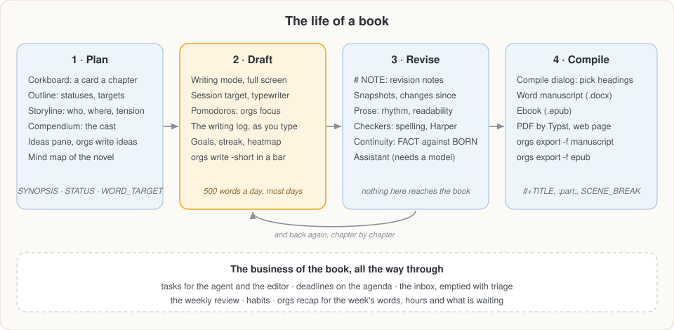

  This guide follows him through the life of the book: planning it,
  drafting it a day at a time, revising, running the business side the GTD
  way, and compiling a manuscript to send. [[*Writing mode][Writing mode]] in the editing
  guide is the reference for every tool shown here.

*** Where he writes

  

  Owen drafts in worg's writing mode, because that is where the writing
  tools are. He is not tied to it:

  - *In VS Code*, with [[https://github.com/ihdavids/vscode-org-everywhere][vscode-org-everywhere]], the manuscript is an ordinary
    org file: headings fold, links follow, and with the server it clocks in on
    the heading under the cursor and runs a focus timer in the status bar. worg's
    views (Files, the agenda, the clock report, the mind map…) open as editor
    panels, so the corkboard is a tab away from the text.
  - *In Sublime Text*, with [[https://github.com/ihdavids/orgeverywhere][Org Everywhere]], editing stays in Sublime and
    the agenda, clocking, capture and refile go through the same server.
    *Org: orgs Open Web UI* opens worg on any of its views.
  - *At the command line*, =orgs write= and =orgs recap= read the same writing
    log worg keeps, and =orgs focus= runs the same pomodoro timer.

  Whichever he uses, a word counted, a task ticked or a clock started in one
  shows up in the others.

*** Planning the book

**** Chapters as index cards

   The corkboard shows each heading as a card: its synopsis, its status and
   its words against its target. Owen plans a part by writing the synopses
   first, then drags the cards until the order feels right. Moving a card
   moves the heading, with everything under it, in the file.

   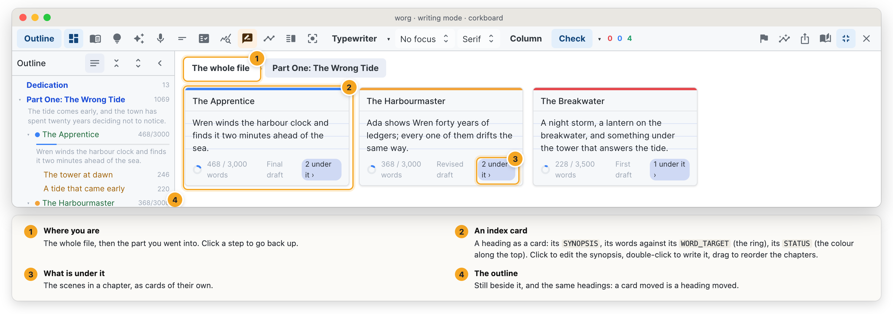

**** Who is in which scene

   The storyline draws a line for each character through the scenes, joined
   where they meet, under an arc of each scene's tension. It shows Owen at a
   glance that Ada disappears after the second chapter, and that Part One
   climbs steadily but never drops to give the reader a breath.

   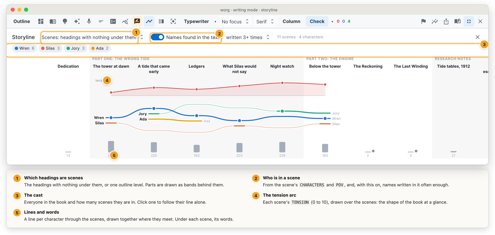

**** A character bible

   The compendium is a second org file of people, places and things, named
   by the manuscript's =#+COMPENDIUM:= line. Every property on an entry is a
   fact. In the text, every name it knows is underlined, and resting on one
   shows its card. It also catches mistakes without anyone reading for them:
   a fact written two ways, a character in a scene set before they were born.

   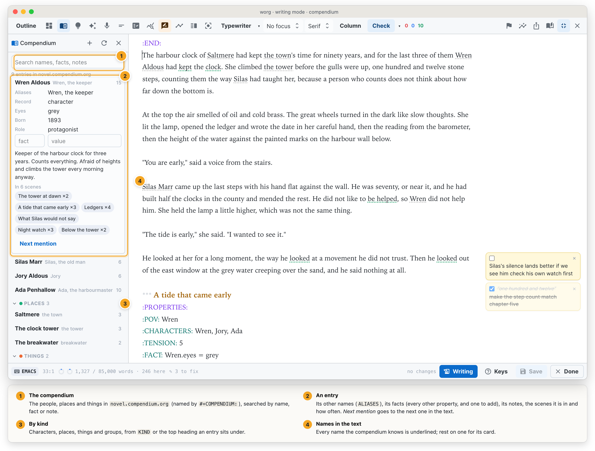

   The entries are records too (=RECORD: character=), so =orgs rec ls -type character=
   and worg's Collections tab list the same cast.

**** Names and places when he is stuck

   The Ideas pane in writing mode, and =orgs write ideas= at a prompt, make up
   characters, names, places, taverns, cultures, premises, complications and
   weather from word tables in the binary. Nothing is sent anywhere.
   =-seed= makes the same idea again, and =-org= prints it as a heading ready
   to capture.

   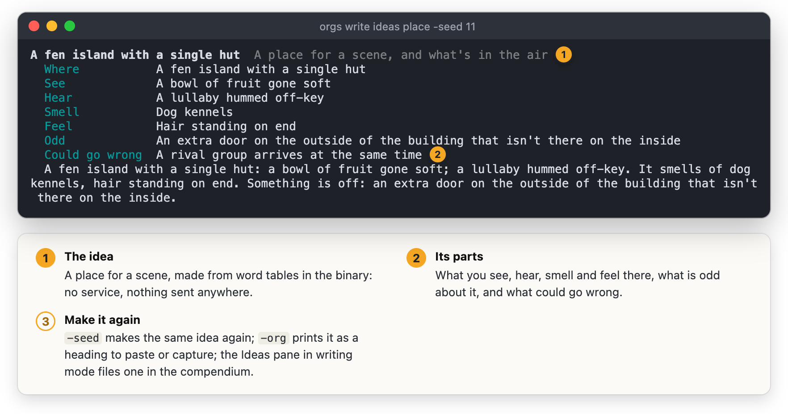

*** The structure the tools read

  None of this needs a special file format. The tools read ordinary org:
  keywords at the top, parts and chapters as headings, and properties on
  them. Emacs, VS Code and Sublime see the same text.

  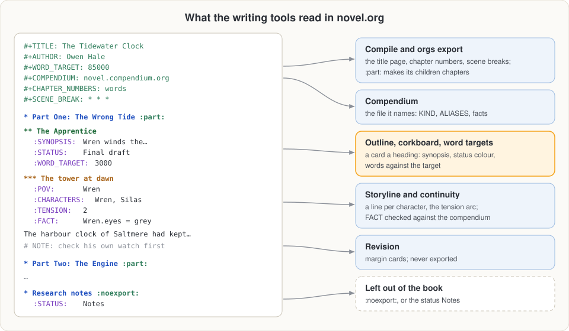

  #+BEGIN_SRC org
  ,#+TITLE: The Tidewater Clock
  ,#+WORD_TARGET: 85000
  ,#+COMPENDIUM: novel.compendium.org
  ,#+CHAPTER_NUMBERS: words
  ,#+SCENE_BREAK: * * *

  ,* Part One: The Wrong Tide                                    :part:
  ,** The Apprentice
  :PROPERTIES:
  :SYNOPSIS: Wren winds the harbour clock and finds it two minutes ahead of the sea.
  :STATUS: Final draft
  :WORD_TARGET: 3000
  :END:
  ,*** The tower at dawn
  :PROPERTIES:
  :POV: Wren
  :CHARACTERS: Wren, Silas
  :TENSION: 2
  :WHEN: 1912
  :END:
  The harbour clock of Saltmere had kept the town's time for ninety years…
  # NOTE: Silas's silence lands better if we see him check his own watch first
  #+END_SRC

  The statuses are /To do/, /First draft/, /Revised draft/, /Final draft/,
  /Done/ and /Notes/, each with its own colour on the cards and in the outline.

*** A writing day

  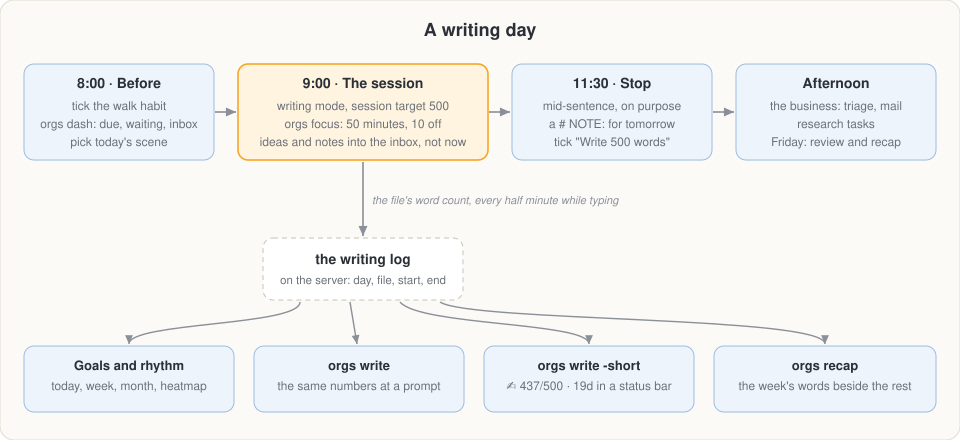

**** The session

   Owen opens the manuscript in writing mode, goes full screen, and writes.
   The outline down the side shows where every chapter stands; the status
   line counts the words in the file, the words written this session and
   the words in the heading he is in. The checkers underline as he types
   (spelling and Harper's grammar run in the browser, offline), and his
   revision notes wait in the margin.

   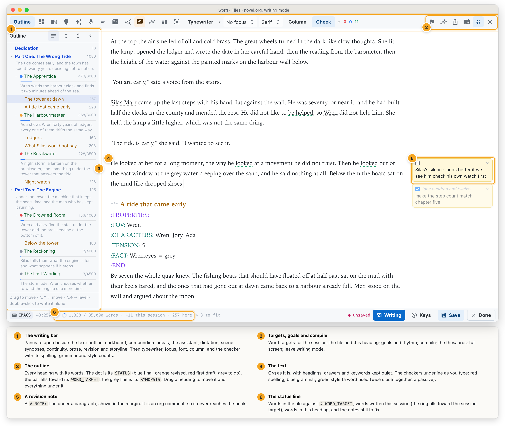

   The speller knows American spelling. Owen chose /Add to dictionary/ on
   /harbour/, /grey/ and his characters' names the first time they were
   underlined, and it has not complained since (the list is kept in his
   browser).

**** Pomodoros, when they help

   On days the words come slowly, Owen works in pomodoros: =orgs focus -work 50 -break 10=
   picks a task ("Finish /The Breakwater/"), clocks in, and calls a
   break when the time is up. The same session shows in worg's Focus tab, in
   VS Code's status bar if he is there, and as =🍅 32:10 Finish "The Breakwater"=
   from =orgs focus status= in his terminal's status line. The time lands in
   the task's logbook, so the week's recap knows where the hours went.

**** How the week is going

   Every count the editor makes goes into the writing log on the server. The
   goals dialog (the chart button on the writing bar, or a click on the
   status line) reads it: today, this week and this month against his goals,
   his streak, and a heatmap of every day he has written.

   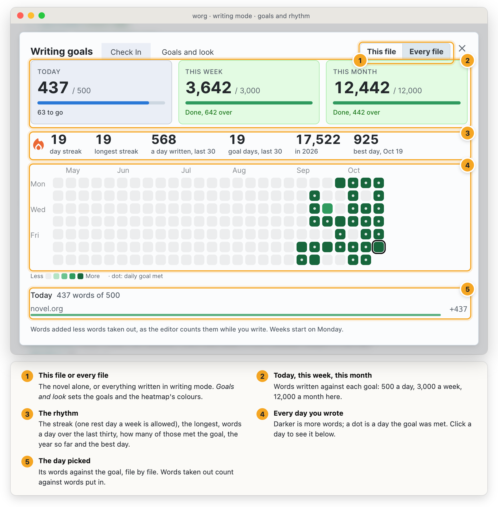

   =orgs write= shows the same numbers at a prompt, and =orgs write -short=
   prints one line (=✍ 437/500 · 19d=) for a status bar. Goals are set with
   =orgs write goals -daily 500 -weekly 3000 -monthly 12000 -rest 1=, or under
   /Goals and look/ in the dialog.

   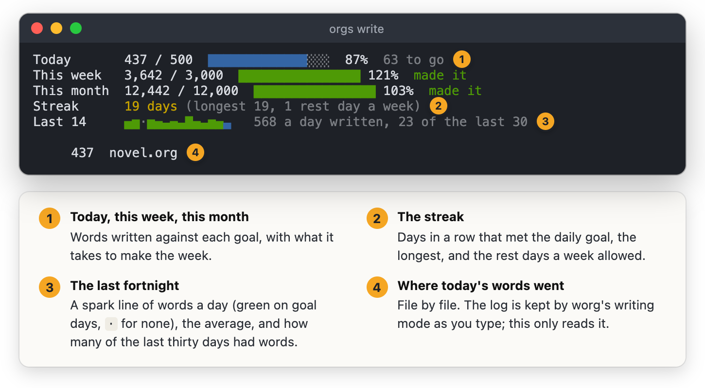

*** Revising

**** Notes, snapshots and what changed

   When he finishes a pass, Owen leaves notes for the next one as =# NOTE:=
   lines under the paragraph they are about. They are org comments, so they
   are in the file for him and never in the book. Before a big rewrite he
   takes a snapshot of the chapter from its section dialog in the outline
   (or with =orgs write snapshot 'The Apprentice' -title 'Before the second pass'=).
   Afterwards, /Show changes since/ in the Revision menu lights what he put
   in and strikes through what he took out.

   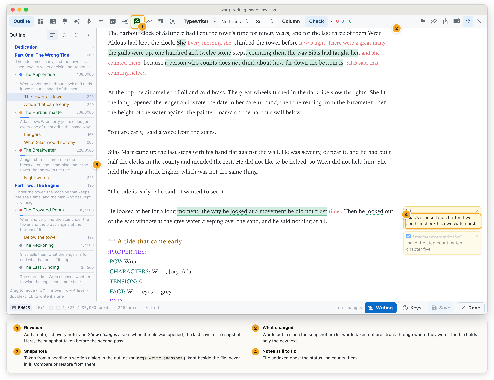

**** The prose in numbers

   The Prose pane reads the whole manuscript: sentence lengths, readability
   by chapter, how much of each scene is dialogue, and the words worth a
   second look. Each one opens to the places it is used.

   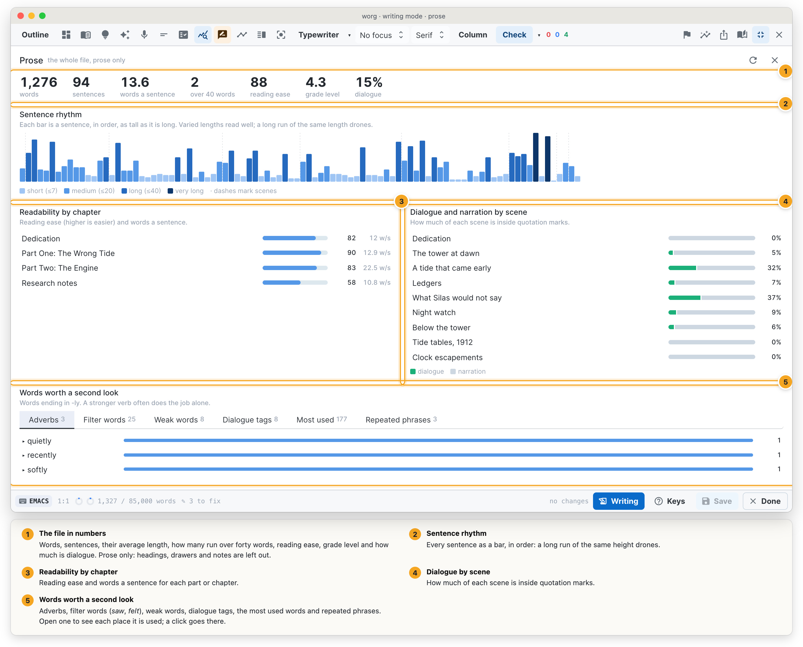

**** What needs more than orgs

   Some tools in writing mode call out to something else. They are worth
   knowing about, and the editing guide says how to set each one up:

   - *The assistant*, *scene synopses* and the *continuity check* ask a
     language model: Claude, ChatGPT or Gemini with a key, or a model running
     on the server under Ollama, llama.cpp, LM Studio or MLX (=orgs models=).
     It sees only the file, and only when asked.
   - *Dictation* is transcribed by whisper on the server.
   - *=orgs lint=* runs the same grammar checker at the command line, and
     needs =harper-ls= on the server (or LanguageTool).
   - *The thesaurus* looks words up online.

*** The business of the book

  Owen runs the rest of his writing life the GTD way, in =book.org= beside the
  manuscript: a heading for the draft, one for the agent and editor, one
  for research, one for admin, and two habits ("Write 500 words", "Walk
  before writing").

  - *Capture*: an idea for the last chapter at 11 at night goes into the inbox
    (=orgs cap=, worg's =c=, VS Code's capture), not into the manuscript.
  - *Clarify*: the inbox is emptied one item at a time with =orgs triage= or
    worg's Inbox: refile it, schedule it, or let it go.
  - *Organise*: the agent's deadline is a =DEADLINE=, the editor's notes a
    =WAITING= task, the reading an appointment on the agenda.
  - *Reflect*: on Friday, the weekly review walks what is stuck, waiting or
    stale. =orgs recap= is the week on one page, words included, ready to
    paste to his writing group.
  - *Engage*: in the morning, =orgs dash= says what is due before he opens
    the manuscript and forgets everything else.

  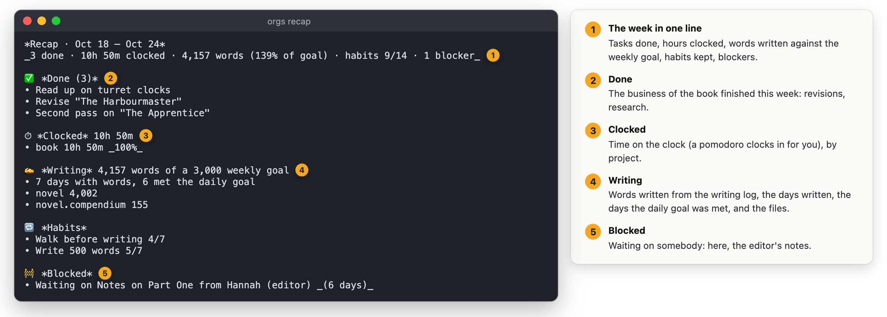

*** Compiling the manuscript

  When Part One is ready for the agent, Owen opens /Compile/ from the
  writing bar, picks the headings to include, and chooses a format. The
  research notes start out unticked, because they are tagged =:noexport:=. His
  file is not changed.

  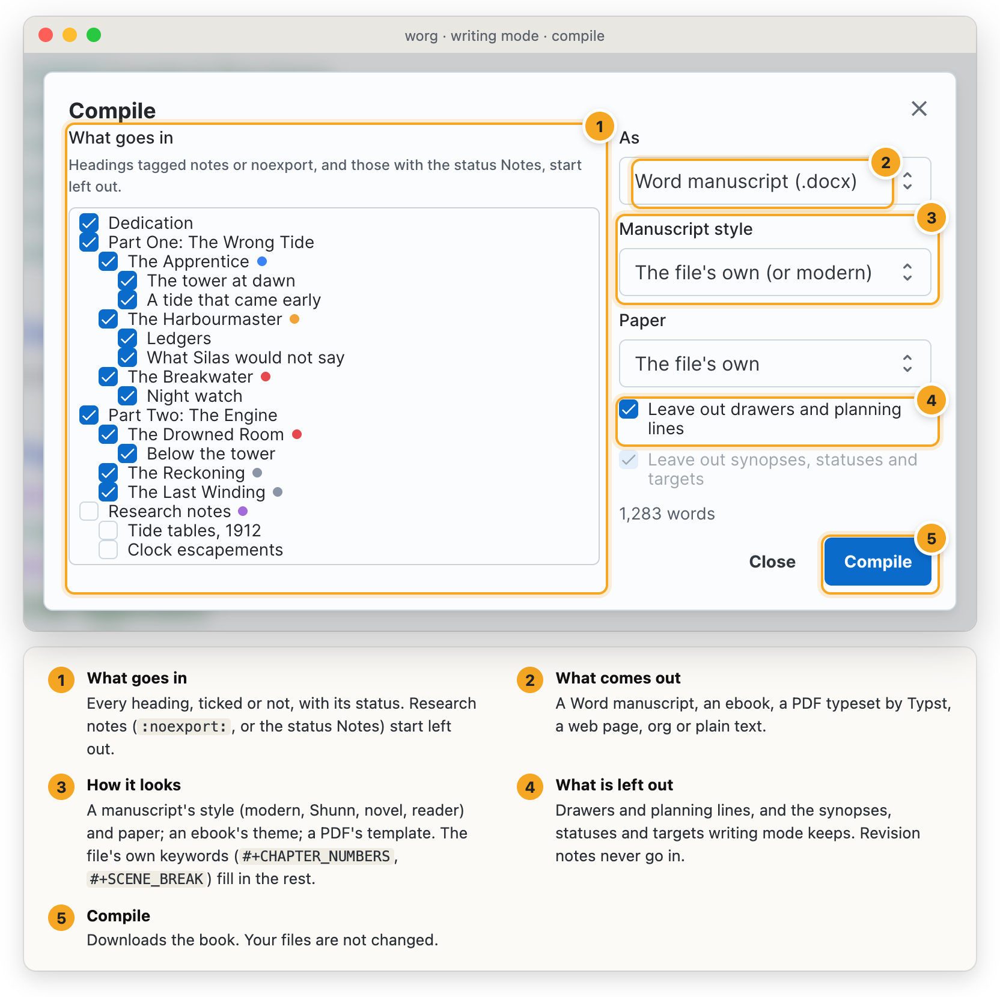

  The same books come from the command line:

  #+BEGIN_SRC sh
  orgs export -f manuscript novel.org -style shunn -out tidewater.docx
  orgs export -f epub novel.org -theme literary -out tidewater.epub
  orgs export -f manuscript -list-themes      # modern, novel, reader, shunn
  #+END_SRC

  The Word manuscript is the one to submit: chapters numbered as
  =#+CHAPTER_NUMBERS= says, scenes broken with =#+SCENE_BREAK=, a title page from
  the keywords. The PDF is typeset by Typst (it needs =typst= on the server)
  with the article, report or notes template. It makes a good reading copy,
  but it is laid out like a document, not a book.

*** Taking these pictures again

  The pictures come from their own notebook, =docs/screenshots/writer=: the
  manuscript, its compendium, =book.org= and an inbox. A month and a half of
  writing log, the goals and a snapshot are posted when the server starts.

  #+BEGIN_SRC sh
  cd tools/screenshots
  node capture.mjs -story writer                    # every picture here
  node capture.mjs -story writer writer-goals       # just the ones named
  #+END_SRC

  The shots are in =tools/screenshots/stories/writer.mjs=.

** An engineer's week at the command line
*** Who this is about

  Marcus is a backend engineer on a payments team. He lives in a terminal
  and an editor, and he runs his week on two simple rules:

  - *Getting Things Done.* Anything that wants his attention goes into an
    inbox first and is decided about later. Every project always has one
    =NEXT= action. Once a week he reviews the lot, so he can trust it.
  - *Pomodoros.* He works on one next action for 25 minutes, then takes a
    five minute break. Every fourth break is fifteen minutes. Interruptions
    are written down, not acted on.

  This page follows him from Monday to Friday. Every step is an =orgs=
  command against one =orgs serve=, so his terminal, his editor, worg on
  his phone and the menu bar on his laptop all show the same clock, the
  same inbox and the same pomodoro.

  The pictures were taken against his notebook, kept in
  =docs/screenshots/engineer-cli= (=node capture.mjs -story engineer-cli= in
  =tools/screenshots= takes them again). The three borrowed from
  [[*The command line, in pictures][The command line, in pictures]] (the dashboard, the standup and the recap) show the
  smaller demo notebook those pages use.

*** The shape of the week

  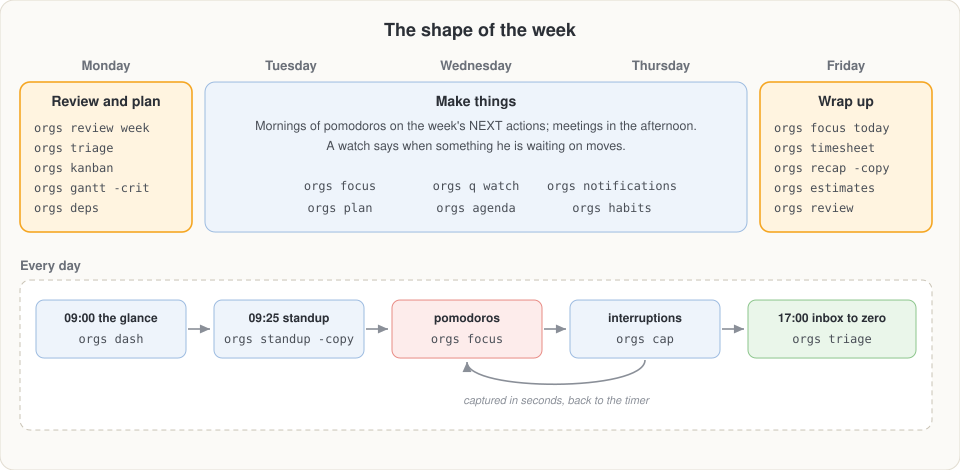

  Monday is for deciding: the weekly review, then a plan for the week.
  Tuesday to Thursday are for making things. Friday is for looking back.
  The same short loop runs under every day: a glance in the morning, the
  standup, pomodoros, interruptions captured as they come, and the inbox
  emptied before he leaves.

*** The loop he keeps

  GTD has five steps, and each one has a command:

  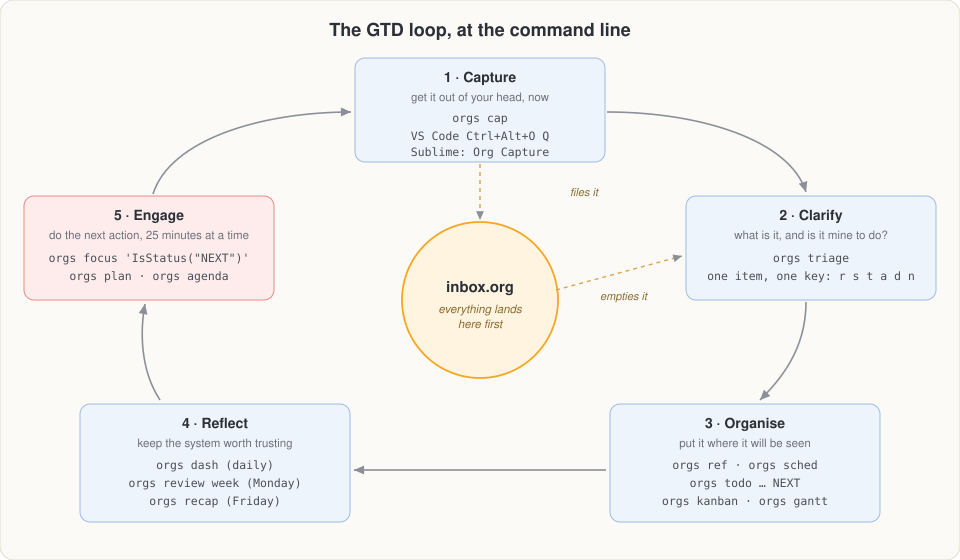

  | Step     | What it means                              | orgs                                      |
  |----------+--------------------------------------------+-------------------------------------------|
  | Capture  | get it out of your head, now               | =orgs cap=, or capture from the editor     |
  | Clarify  | what is it, and is it mine to do?          | =orgs triage=                             |
  | Organise | put it where it will be seen               | =orgs ref=, =orgs sched=, =orgs todo=, =orgs kanban= |
  | Reflect  | keep the system worth trusting             | =orgs dash=, =orgs review week=, =orgs recap= |
  | Engage   | do the next action, 25 minutes at a time   | =orgs focus=, =orgs plan=                  |

  The inbox in the middle is what holds the loop together. A capture never
  asks where something belongs, so it takes seconds. Triage asks later, one
  item at a time.

*** Setting it up once

  Marcus set this up once, the week he started.

**** One template that files into the inbox

   An inbox is the top level of any file called =inbox.org= (the
   =review.inbox= setting can make it a query instead). His capture template
   files there, so the editor, worg and the command line all capture the
   same way:

   #+BEGIN_SRC yaml
   server:
     captureTemplates:
       - name: "Inbox"
         type: "entry"
         target:
           type: "file"
           filename: "inbox.org"
         template: |-
           :PROPERTIES:
           :CREATED: {{now}}
           :END:
           {{CONTENT}}
   #+END_SRC

   The template is the body. At the command line the headline is its own
   box, and the keyword goes in it: =orgs cap Inbox -head "TODO Call the
   bank"=.

**** Saved queries, and a watch

   #+BEGIN_SRC sh
   orgs q save next 'IsStatus("NEXT") && !IsArchived()'
   orgs q save waiting 'IsStatus("WAITING") || IsStatus("BLOCKED")'
   orgs q watch waiting -left      # tell me when something stops waiting
   #+END_SRC

   Saved queries are shared with worg and the editors, so the same =next=
   list is in every one of them.

**** The pomodoro where he can see it

   The timer runs on the server, so anything can show it. He has it in his
   tmux status line and in the macOS menu bar:

   #+BEGIN_SRC sh
   # ~/.tmux.conf
   set -g status-right '#(orgs focus status)'
   set -g status-interval 5

   # SwiftBar (brew install swiftbar); use xbar's plugins folder for xbar
   orgs focus bar install "$HOME/Library/Application Support/SwiftBar/Plugins"
   #+END_SRC

   =orgs focus status= prints one line, =🍅 12:31 Implement idempotency keys=,
   and nothing when no session is running. The menu bar's menu can stop the
   session, add five minutes, skip to the break, and open worg's Focus tab.

**** His editors

   Marcus writes code in VS Code and keeps Sublime Text for long notes.
   Both talk to the same server; see [[*His editors, all week][His editors, all week]] below.

*** Monday morning: the weekly review

  The review comes first, before email, while the week is still his.

**** What wants a decision

   =orgs review= lists everything that needs deciding, each check with a
   sentence saying what to do about it: projects with no next action,
   deadlines nobody scheduled, things waiting on other people, time clocked
   against something still open, notes nothing links to. A check that finds
   nothing prints a green line. "No NEXT actions untouched in a month" is
   worth hearing too.

**** Walking it: the review, step by step

   =orgs review week= turns the list into seven steps, in GTD's order. Each
   step is the same screen, one item and one key per decision, and =u=
   takes the last decision back:

   1. *Empty the inbox.* The triage screen, below.
   2. *Projects with no next action.* The Developer portal has two open
      tasks and nothing marked =NEXT=. Marcus presses =1= and the guide
      becomes its next action.
   3. *Waiting for.* Read access to the production replica has waited nine
      days. =c= chases it, and the note goes into the item's logbook so the
      count starts again.
   4. *Last week's time.* Clocked against planned, by project and by tag.
      There is nothing to decide here, only something to look at.
   5. *Stale scheduled items.* Scheduled days ago, and nothing has happened
      since. Reschedule them, or admit they aren't happening.
   6. *The someday pile.* Keep, promote, schedule or drop.
   7. *Done.* The review is recorded, and the next one's first screen says
      how long ago this was.

   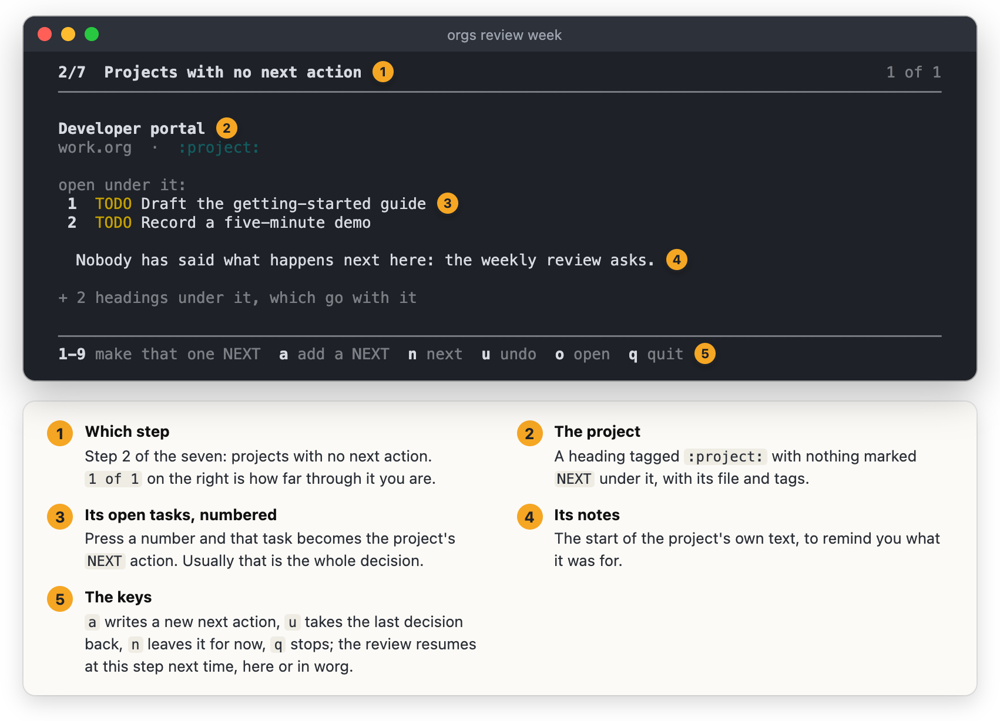

   The step he is on is kept on the server, so he can stop halfway, get
   coffee, and finish it in worg's Weekly Review tab on his phone.

**** Emptying the inbox: triage

   Step 1 is =orgs triage=, and he runs it on its own most evenings too:

   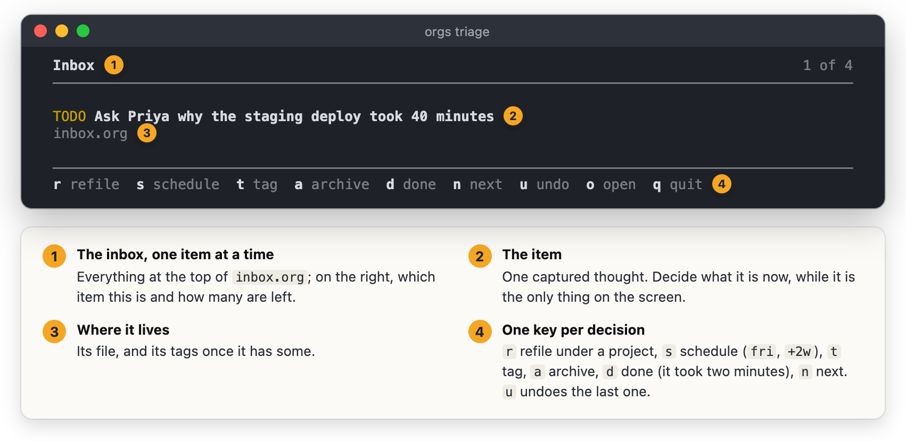

   "Ask Priya why the staging deploy took 40 minutes" takes him less than
   two minutes, so he does it and presses =d=. "Update the on-call rota for
   November" gets =s fri=. The replay-traffic idea gets =r=, filed under
   Search reindex as something to bring up at the architecture review.

*** Monday afternoon: planning the week

**** The board and the chain

   =orgs kanban= shows his Sprint board, a saved query grouped by keyword.
   =H= and =L= move a card between columns, which changes its keyword. A
   board is only a query and a layout, so it never goes stale.

   Then he checks the order things have to happen in. Load testing waits
   on the idempotency work (=AFTER: idempotency-keys=), and the rollout waits
   on load testing:

   #+BEGIN_SRC sh
   orgs deps
   #+END_SRC

   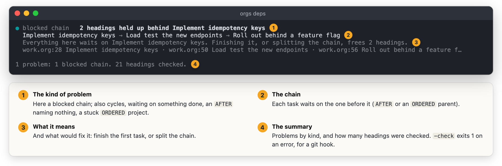

   One blocked chain, and he already knew about it: the idempotency keys
   are his priority this week. For projects measured in days rather than
   hours, =orgs gantt <saved query> -crit= draws the same chain as a chart
   with the critical path marked (see [[*Schedules: =orgs gantt=][Schedules]]).

*** Every morning

**** The glance: the dashboard

   At nine he opens a terminal and runs =orgs dash=: today's appointments
   and the line where now is, what is late, the habits, the inbox, what his
   watches found, and the command for each card that wants something.
   =orgs dash -w= keeps it on a spare screen, redrawn as things change.

   

**** The standup, ready to paste

   Five minutes before the standup:

   #+BEGIN_SRC sh
   orgs standup -copy
   #+END_SRC

   It lists what he finished since the last working day (Friday's, on a
   Monday), what he has clocked, what is on today and what is in the way,
   written in Slack's markup and put on the clipboard. He pastes it into the
   team channel and says the same thing out loud.

   

**** Blocking the day

   After the standup he gives the morning to the one task that matters and
   puts the take-home review after his 1:1:

   #+BEGIN_SRC sh
   orgs plan idempotency 10:00-12:00
   orgs plan take-home 15:00-16:00
   orgs plan                          # the day, and what is left
   #+END_SRC

   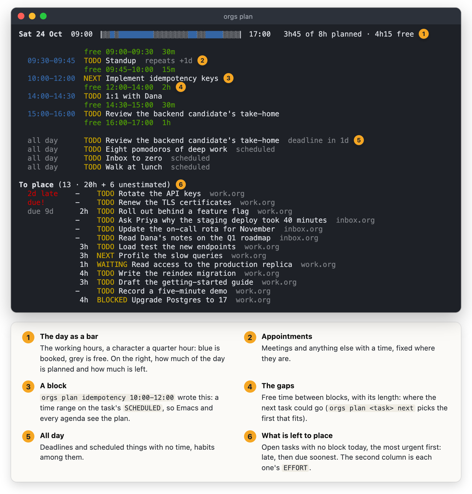

   A block is only a time range on the task's =SCHEDULED=. Emacs and every
   agenda see the plan, and worg's day planner shows the same blocks. Drag
   one there and =orgs plan= agrees.

*** Working in pomodoros

**** Starting one

   At ten he starts the first pomodoro on a next action:

   #+BEGIN_SRC sh
   orgs focus 'IsStatus("NEXT")'      # pick from his next actions
   orgs focus idempotency             # or name it
   #+END_SRC

   

   The server clocks in on the heading and counts down. When the 25 minutes
   are up it clocks out, writes the =CLOCK= line, notes the pomodoro beside
   it and starts the break. It does this whether or not anything is
   watching. Marcus usually presses =d= to get his terminal back and
   watches the countdown in tmux instead.

   

   A finished pomodoro leaves a line in the heading's logbook:

   #+BEGIN_SRC org
   ** NEXT [#A] Implement idempotency keys
      :LOGBOOK:
      - Pomodoro: 25 min focus, 5 min break [2026-10-23 Fri 11:25]
      CLOCK: [2026-10-23 Fri 11:00]--[2026-10-23 Fri 11:25] =>  0:25
      :END:
   #+END_SRC

   So "how many pomodoros did this take?" can be answered from the file
   itself, in Emacs, years later.

**** The lengths

   #+BEGIN_SRC sh
   orgs focus -work 50 -break 10      # longer rounds for deep work
   orgs focus -auto                   # start the next one when a break ends
   orgs focus stop | skip | extend 5  # from any terminal
   #+END_SRC

   The server remembers the lengths, so worg and the menu bar start with
   the same ones next time. Stopping early clocks the time but doesn't count
   the pomodoro. Clocking out or clocking in somewhere else, from any
   client, ends the work phase: two timers that disagree about what you are
   doing are worse than one.

**** When something interrupts

   Twenty minutes in, the on-call channel mentions that the nightly backup
   paged at 3am. It isn't his to fix this minute, but it mustn't be lost:

   #+BEGIN_SRC sh
   orgs cap Inbox
   #+END_SRC

   

   He types the headline and a tag, presses =ctrl-s=, and is back on the
   timer in under ten seconds. In VS Code the same capture is
   =Ctrl+Alt+O Q=. When there is nothing to fill in, it is one line:

   #+BEGIN_SRC sh
   orgs cap Inbox -no-form -head "TODO Check why the nightly backup paged at 3am"
   #+END_SRC

   At five he empties the inbox with =orgs triage=, then ticks off his
   habit: =orgs habits done "Inbox to zero"=.

*** Waiting on other people

  The reindex work can't go on without read access to the production
  replica, and that is Priya's to give. Rather than check every hour, he
  lets the server watch: the =waiting= query is watched with =-left=, so he
  hears when something stops waiting. On Wednesday afternoon:

  

  Priya has moved the item on. It shows in the dashboard's "Waiting for you"
  card, in =orgs notifications=, and with =-desktop= on the watch, as a
  notification on his screen. =orgs notifications -follow= prints each new
  one as it happens.

*** Friday afternoon: the wrap-up

**** Where the time went

   #+BEGIN_SRC sh
   orgs focus today -days 5           # pomodoros, day by day
   orgs timesheet                     # this week, sitting by sitting
   #+END_SRC

   Because every pomodoro clocked in and out, the timesheet is already
   correct. Most of his week is 25-minute sittings, with the meetings in
   between.

**** The recap for the week

   For his Friday note to Dana:

   #+BEGIN_SRC sh
   orgs recap -copy                   # the last seven days
   orgs recap -last -week -md         # Monday to Sunday, as Markdown
   #+END_SRC

   

**** How good were the estimates?

   Once a month he checks how far off his =EFFORT= estimates are:

   #+BEGIN_SRC sh
   orgs estimates -day 8
   #+END_SRC

   

   His backend work takes 0.6× what he estimates, while ops work runs over.
   Next week he will plan backend tasks a little smaller and leave room
   around ops work.

*** His editors, all week

  

  None of the above needs the command line in particular. It is the server
  that keeps the clock, the inbox, the saved queries and the pomodoro, and
  every client is a window onto it:

  - *VS Code, with [[https://github.com/ihdavids/vscode-org-everywhere][vscode-org-everywhere]].* The agenda is in the Org side
    bar, with today's and the week's clocked time under it. =Ctrl+Alt+O
    Ctrl+I= clocks in on the heading under the cursor and the status bar
    shows it running (=⏱ 0:42 Implement idempotency keys=). A clock started
    anywhere else, a pomodoro from =orgs focus= included, shows up there
    within a couple of minutes. =Ctrl+Alt+O Q= captures through the server's
    templates, and =Ctrl+Alt+O W= refiles. worg's views (Kanban, Gantt Chart,
    Clock Report, Saved Queries and the rest) open in editor panels, and a
    heading clicked in one opens in the editor. The extension also has a
    status bar timer of its own (*Start Timer*, =Ctrl+Alt+O Shift+T=) that
    clocks in on the server when started under a heading. Marcus uses
    =orgs focus= instead, so the session is the one his menu bar and tmux
    show.
  - *Sublime Text, with [[https://github.com/ihdavids/orgeverywhere][Org Everywhere]].* A fork of OrgExtended where
    everything that spans more than one file goes through the server: the
    agenda, clocking, capture, refile and archive, search, exporting. Clock
    in from Sublime and the clock is running in worg and at the command line.
    *Org Capture* lists the server's templates as =orgs: Inbox=. *Org: orgs
    Open Web UI* opens worg on any of its apps.
  - *worg* in a browser, a phone included, for the Weekly Review tab on the
    train and the agenda's day planner with drag and drop.

  So the clock he starts in VS Code is the one =orgs dash= shows. A thought
  captured in Sublime is in Monday's =orgs triage=. A review stopped in the
  terminal carries on in worg.

*** The week on a card

  | When               | He runs                                       |
  |--------------------+-----------------------------------------------|
  | Monday, first      | =orgs review week= (triage included)          |
  | Monday, after      | =orgs kanban=, =orgs deps=, =orgs gantt -crit= |
  | Every morning      | =orgs dash=, =orgs standup -copy=, =orgs plan= |
  | All day            | =orgs focus=, =orgs cap Inbox=                |
  | Every evening      | =orgs triage=, =orgs habits done …=           |
  | When told          | =orgs notifications=                          |
  | Friday             | =orgs timesheet=, =orgs recap -copy=, =orgs review= |
  | Monthly            | =orgs estimates -day 8=                       |

** An engineer's week in worg
*** The idea

  Marco is a backend engineer. He keeps his work the way /Getting Things
  Done/ says to: everything that comes in goes into an inbox, every inbox
  item gets a decision, every project has a next action, and once a week he
  reviews the lot. He does the work itself in pomodoros: twenty-five minutes
  on one thing, five off, a long break after the fourth.

  This is his week in worg, the web front end every =orgs serve= hands out.
  Each tab here reads the same notes through the same server as the command
  line and the editor plugins, so whatever he does in one shows up in the
  others straight away.

  

  GTD has five steps, and each has a tab or two to itself:

  

  The pictures are of a demo notebook kept in
  =docs/screenshots/engineer-worg=; =tools/screenshots= takes them again
  (=node capture.mjs -story engineer-worg=).

*** Monday morning: the weekly review

  Marco starts the week where GTD says to start it, with the review. He opens
  *Weekly Review* and works down the seven steps. Each step is one list and
  one decision per item, and the step he is on is kept on the server: if a
  meeting cuts him off half way, he picks up where he left off, in worg or in
  =orgs review week= at a prompt.

  Step one empties the inbox. It is the Inbox tab's triage, inside the review:

  

  Step two finds the projects that have stopped moving. /Website relaunch/ has
  four open tasks and not one of them NEXT, so nothing in it will get done
  until he decides what comes first. One click on *Make it NEXT* is nearly
  always the whole answer:

  

  Step three is what he is waiting on other people for, oldest first, with
  *Chase* beside each. Step four is last week's time, against what he planned:

  

  The billing service took more than he planned and the relaunch less. Step
  five sweeps up anything scheduled that went past with nothing done to it
  (here the API docs he never got to), step six the someday pile, and step
  seven records the review, so next Monday's first screen says how long it has
  been.

**** Calibrating the estimates

  Before he plans the week he checks how far off his estimates usually are.
  *Insights*, *Estimates*, grouped by project, with a working day of eight
  hours:

  

  Work takes him about 1.2 times what he estimates, and the over-runs are all
  on the billing service. When he puts an EFFORT on this week's billing tasks,
  he adds a fifth.

**** Planning the day

  The *Agenda* opens on today. Its day planner is the day as hours: the
  meetings already fixed, and down the side the open tasks with no time yet,
  the late and the soon-due first. Marco drags /Add retries to the webhook
  sender/ onto ten o'clock and the API docs onto quarter past two. Each drop
  writes a SCHEDULED time range into the task's file.

  

  The bar at the top keeps him honest: once what is planned plus the meetings
  fills the working day, the rest waits for tomorrow.

*** Tuesday: heads down

  Tuesday is for the work itself. Marco opens *Focus*, picks the webhook
  retries from the list (the tasks he worked on lately come first) and
  presses *Start*.

  

  The timer is the server's, not the browser's. Starting it clocks him in on
  the task. When the twenty-five minutes are up the server clocks him out,
  notes the pomodoro in the task's logbook and starts the break, whether or
  not any tab is open. This is his third today; the fourth earns the long
  break.

  

  He doesn't have to keep the Focus tab open. While a pomodoro or a break runs,
  every tab has the chip in its header, and clicking it gives him the controls
  without leaving what he is looking at:

  

**** Interruptions go in the inbox

  Halfway through a pomodoro Priya messages him: the export test is flaky
  again. GTD's answer is not to switch, and not to forget either. He presses
  =c= in whatever tab he is on, picks his *Interruption* template, and types it
  in:

  

  The template asks who it came from, because his template has a
  ={{from|Who asked?}}= in it. The entry goes into =inbox.org= and he goes back
  to the retries. The pomodoro never stopped. Capture templates live in the
  server's settings (=captureTemplates:=), so the same ones are offered at
  =orgs cap= and in both editor plugins.

*** Wednesday: cleaning up the plan

**** A list becomes tasks

  The webhook retries turned out bigger than one task. The heading has a list
  of what it involves, and each item deserves its own TODO, effort and clock.
  *Refactor*, *List to headings*, finds the heading by a few letters of its
  name and shows what it would do before it does it:

  

  Nothing is written until *Apply*. The same tab renames or merges a tag
  across every file (and lists the saved queries that still name the old one),
  splits a subtree into a file of its own, or merges two headings. The Diff &
  History tab can take any of them back.

**** What waits on what

  The relaunch's tasks are ORDERED, and the billing deploy waits on the load
  test with an AFTER. *Insights*, *Dependencies*, checks every such link:

  

  The deploy is still WAITING on a load test that finished a fortnight ago, so
  he unlinks it and makes it NEXT. The blocked chain is the honest picture of
  the relaunch: three tasks queued behind the component library. The *Gantt
  Chart* shows the same plan in time, each bar sized by its EFFORT and
  chained by the same links:

  

*** Thursday: unblocking

**** A watch on the blocked list

  Marco keeps a saved query, /Blocked/, of everything WAITING or BLOCKED. On
  Monday he turned on its watch with the bell on its row in *Saved Queries*.
  Now when something joins the list or leaves it, worg's bell says so. On
  Thursday the on-call runbook goes WAITING:

  

  A watch can also pop up as a browser alert, on the server's desktop, or in a
  terminal with =orgs notifications -follow=.

**** The board

  For the team's standup he shares *Kanban*: the same open work, a column per
  keyword. Dragging a card to another column changes the keyword in its file.

  

*** Friday: closing the week

  Friday afternoon Marco empties the inbox for real: everything captured
  since Monday, one item at a time, one key each.

  

  The flaky test gets =n=, making it NEXT for Monday. The standing desk goes
  to the someday pile with a tag. The plumber gets scheduled for Saturday
  (=s=, then /sat/). When the last one is decided worg says /Inbox zero/.

  Then a look back. *Clock Report*, /This Week/, shows where the hours went,
  pomodoros included, since each one was clocked. The habit strip at the top
  of the Agenda shows whether the morning runs survived the week. At a prompt,
  =orgs recap -copy= writes the same week as a message for the team channel.

*** The editors

  Marco writes code in VS Code, and his notes are open there too. Two editor
  plugins work with orgs, and either one makes the editor one more client of
  the same server:

  

  - *VS Code: Org Everywhere* ([[https://github.com/ihdavids/vscode-org-everywhere][vscode-org-everywhere]]). Org editing
    (folding, TODO keywords, tables, links) works on its own; the agenda,
    clock, capture, refile and the rest come from the server. Commands like
    *Org: Show Kanban*, *Org: Show Clock Report*, *Org: Show Saved Queries*
    and *Org: Show Agenda* open worg's views as editor tabs, already logged
    in. A heading opened from one of those panels opens in VS Code's editor,
    not worg's, and as he moves between headings in the editor the panel
    follows. For the tabs that aren't on its list (Focus, Inbox, Weekly
    Review, Insights, Refactor), *Org: Open worg in Browser* opens worg
    logged in.

    Clocking is the server's, so it is the same clock everywhere:
    =Ctrl+Alt+O Ctrl+I= clocks in on the heading under the cursor, and the
    status bar shows the running clock whoever started it, worg's Focus tab
    included. The plugin also has a pomodoro timer of its own in the status
    bar (*Start Timer*). Started under a heading, it clocks in there through
    the server, so that time lands in the same logbook and the same Clock
    Report.

  - *Sublime Text: Org Everywhere* ([[https://github.com/ihdavids/orgeverywhere][orgeverywhere]]), a fork of
    OrgExtended backed by the orgs server. Editing a buffer happens in the
    plugin; the agenda, the clock, capture templates, refile, ids and
    backlinks, search and exporting are the server's. *Org: orgs Open Web UI*
    opens worg in the browser on the tab you pick. Clock in from Sublime and
    the clock is running in worg and at the command line too.

  Either way his inbox, his clock, his saved queries and his capture
  templates are the ones worg has, because there is only one copy of each:
  the server's.

* Tables
** Details
*** Table formulas — a spreadsheet in an org table
**** What this is

  An org table can carry formulas on a =#+TBLFM:= line under it. The server
  works them out and writes the answers back into the table's cells, so a
  table of expenses can total itself, a reading list can count what is
  finished, and an order sheet can look prices up in another table.

  This is not Emacs' table engine. Emacs hands formulas to Calc or Lisp, which
  a server cannot run, so orgs has its own expression language with the same
  cell references (=$3=, =@2$3=, =@2$1..@>$1=) and its own function library.
  Plain arithmetic formulas usually work in both; anything using the
  functions below works only here.

  Every example in this guide is run by the test suite
  (=internal/app/orgs/tablesguide_test.go=): the tables are shown with the
  answers the evaluator really produces.

***** Running the formulas

   Nothing is recalculated as you type. Formulas run when you ask:

   - terminal: =orgs tables eval NAME= (=orgs tables= lists the tables and their names)
   - worg: the Tables tab, saving a table with evaluation on
   - VS Code: *Org: Execute Table* with the cursor in the table, or *Org: Execute All Tables In File*

   The table is rewritten in place, realigned, with the formula line kept.

   

   
   If a formula fails, nothing is written and the error names the formula.

**** Anatomy of a formula

  #+BEGIN_SRC org
  | item   | qty | price | total |
  |--------+-----+-------+-------|
  | apples |   3 |  0.50 |  1.50 |
  | pears  |   2 |  1.25 |  2.50 |
  | plums  |  10 |  0.20 |  2.00 |
  |--------+-----+-------+-------|
  | total  |  15 |       |  6.00 |
  #+TBLFM: $4=$2*$3;%.2f::@>$2=vsum(@2$2..@4$2)::@>$4=vsum(@2$4..@4$4);%.2f
  #+END_SRC

  The =#+TBLFM:= line holds any number of formulas separated by =::=, run
  left to right, so a later formula sees what an earlier one wrote. Each is

  #+BEGIN_EXAMPLE
  target=expression;format
  #+END_EXAMPLE

  Here =$4=$2*$3= fills every row of column 4 with quantity times price.
  It runs on the total row too (giving 0, since that row has no price), and
  then =@>$4=...= overwrites that one cell with the sum.

***** Naming cells: rows and columns

   | Reference      | Means                                                            |
   |----------------+------------------------------------------------------------------|
   | =$3=           | column 3. As a target: every row but the header                  |
   | =@2$3=         | row 2, column 3                                                  |
   | =@>$3=         | the last row, column 3. =@<= is the first row                    |
   | =@2$1..@4$3=   | a rectangle of cells, read row by row                            |
   | =@-1$3=        | one row up from the row being filled (=@+1= down)                |
   | =@#=, =$#=     | the number of the row or column being filled                     |
   | =remote(Name, $2)= | column 2 of the table named =Name= (see [[*Other tables: remote][Other tables]]) |

   *Rows are counted without the separator lines*: =@1= is the header,
   =@2= the first row under the first line, and a second line further down
   adds nothing to the count. In the example above the total row is =@5=.

   When a table has a header (a separator line after its first row), the
   header is never written to and is left out of column ranges.

***** The format after the semicolon

   Everything after =;= says how the answer is written and how cells are read.

   | Part   | Effect                                                                                  |
   |--------+-----------------------------------------------------------------------------------------|
   | =%.2f= | a printf pattern for the answer: =%.2f= two decimals, =%5.1f= padded to 5 characters    |
   | =%d=   | a whole number; the fraction is dropped, not rounded: 4.5 is written 4 (as Emacs does)  |
   | =N=    | read every cell as a number: text counts as 0, =true= as 1, a lone empty cell as 0      |
   | =E=    | keep empty cells in ranges; without it =vsum=, =vmean=, =vcount= skip them              |
   | =$=    | money: =$= is stripped from cells when reading and put in front of the answer            |
   | =H=    | include the header row in column ranges                                                  |

   They combine: =;%.2f$= writes =$12.50=.

   #+BEGIN_SRC org
   | item   | price | qty |   cost |
   |--------+-------+-----+--------|
   | tea    | $2.50 |   2 |  $5.00 |
   | coffee | $4.25 |   3 | $12.75 |
   #+TBLFM: $4=$2*$3;%.2f$
   #+END_SRC

   =E= and =N= in action; column 1 has an empty cell and a word:

   #+BEGIN_SRC org
   | x   | counted | counted, E | mean | mean, N |
   |-----+---------+------------+------+---------|
   | 4   |       3 |          4 |    6 |       4 |
   |     |         |            |      |         |
   | 8   |         |            |      |         |
   | n/a |         |            |      |         |
   #+TBLFM: @2$2=vcount($1)::@2$3=vcount($1);E::@2$4=vmean($1)::@2$5=vmean($1);N
   #+END_SRC

   =vcount= counts the three filled cells, or all four with =E=. =vmean=
   averages the numbers and passes over the text: (4+8)/2. With =N= the
   text =n/a= becomes a 0, so it is (4+8+0)/3; the empty cell is still
   left out, because leaving empty cells out is what =E= changes, not =N=.

***** Named columns, named cells and parameters

   A table whose first column is a marker column can name things, as in
   Emacs. The marker in the first cell says what the row is:

   | Marker | Row holds                                                                   |
   |--------+-----------------------------------------------------------------------------|
   | =!=    | column names: =$qty= then means =$3= (the marker column is column 1)        |
   | =^=    | names for the cells just above it: =$subtotal= means that cell             |
   | =_=    | names for the cells just below it                                           |
   | =$=    | parameters, written =name=value=: =$rate= is that value                     |

   Rows with a marker are never written to by formulas.

   #+BEGIN_SRC org
   |   | item | qty | price | total |
   |---+------+-----+-------+-------|
   | ! | item | qty | price | total |
   |   | tea  |   2 |   2.5 |     5 |
   |   | jam  |   1 |     4 |     4 |
   #+TBLFM: $5=$qty*$price
   #+END_SRC

   #+BEGIN_SRC org
   |   |  net | tax |
   |---+------+-----|
   |   |  100 |  20 |
   |   |   50 |  10 |
   | $ | rate=0.2 |     |
   #+TBLFM: $3=$2*$rate
   #+END_SRC

   A parameter is read like a cell, so =rate=0.2= is the number 0.2. The
   =$= row is a row of the table like any other, so a whole-column range
   (=vsum($2)=) would take its cell in too.

***** Constants

   =#+CONSTANTS: vat=0.2 shop=Corner= in the file makes =$vat= and =$shop=
   available to every table in it, and a heading's properties are there as
   =$PROP_NAME=. *Constants are text, not numbers*: wrap them in =value()=
   to calculate with them.

   #+BEGIN_SRC org
   #+CONSTANTS: vat=0.2
   | net | with vat |
   |-----+----------|
   | 100 |      120 |
   |  50 |       60 |
   #+TBLFM: $2=$1*(1+value($vat))
   #+END_SRC

**** What a cell's value is

  Before a formula sees a cell, its text is read as the first of these that fits:

  1. empty: an empty value (0 with =N=)
  2. a number: =42=, =-3.5=, =1e3= (with =$=, =$12.50= too)
  3. a date: =<2026-10-02 Fri>=, =<2026-10-02 Fri 09:30>=, =[2026-10-02 Fri]=, =2026-10-02=, =2026-10-02 09:30=
  4. a duration: =1:30=, =2h=, =1d 4h=, =3w= (a week is five days, as for effort estimates)
  5. true or false: =t=, =true=, =TRUE=, =True= and =f=, =false= ...
  6. otherwise text

  #+BEGIN_SRC org
  | cell             | number | date  | text  | blank |
  |------------------+--------+-------+-------+-------|
  | 42               | true   | false | false | false |
  | <2026-10-02 Fri> | false  | true  | false | false |
  | hello            | false  | false | true  | false |
  | TRUE             | false  | false | false | false |
  |                  | false  | false | false | true  |
  #+TBLFM: $2=isnumber($1)::$3=isdate($1)::$4=istext($1)::$5=isblank($1)
  #+END_SRC

  An answer is written as: numbers as short as they can be (=3=, not
  =3.000000=, unless a format says otherwise); dates as =<2026-10-02 Fri>=,
  with the time only when it is not midnight; durations as =1d 2h 30mins=;
  true and false as =true= and =false=; a list as =[1 2 3]= (use =join= to
  write one nicely).

  In a formula, text goes in quotes, single or double: ='fruit'=, ="fruit"=.
  =true=, =false=, =t=, =f= and =pi= are names you can use directly.

**** How a function reads its arguments

  *This is the rule to remember.* A cell reference means one of two things,
  and which one depends on the function, not on how you wrote it:

  - where a function wants a *range* (=vsum= and the other =v= functions,
    =vsumif= and the criteria functions, the ranges of a lookup, =join=,
    =sort=), =$2= is the *whole column*, header left out;
  - where a function wants a *value* (=sqrt=, =round=, =upper=, =concat=,
    =if=, =and=, the dates, the value a lookup searches for), =$2= is the
    cell *in the row being filled*.

  Each function's table below says which of its arguments are ranges: they
  are the ones named =range=, =keys=, =results= or =values=.

  #+BEGIN_SRC org
  | x | root | share |
  |---+------+-------|
  | 4 | 2.00 |  0.20 |
  | 9 | 3.00 |  0.45 |
  | 7 | 2.65 |  0.35 |
  #+TBLFM: $2=sqrt($1);%.2f::$3=$1/vsum($1);%.2f
  #+END_SRC

  In =$1/vsum($1)= the first =$1= is this row's x and the second is every x:
  each row's share of the total. A rectangle like =@2$1..@4$1= is always a range.

  Arithmetic and comparisons (=+ - * / % **=, =< <= > >= == !==, =&& || !=,
  =cond ? a : b=) work on the current row's cells.

**** Matching cells: criteria

  The =if= family of functions (=vsumif=, =vcountif= ...) take a *criteria*
  argument saying which cells count:

  | Criteria          | Matches                                                  |
  |-------------------+----------------------------------------------------------|
  | ='fruit'=         | cells equal to fruit, ignoring case: Fruit, FRUIT        |
  | =5= or ='5'=      | cells equal to the number 5                              |
  | ='>10'=           | numbers over 10; also =>==, =<=, =<==                    |
  | ='<>done'=        | anything but done, including empty cells; =!== also works |
  | ='>=2026-01-01'=  | dates on or after the first of January 2026              |
  | ='app*'=          | text starting app; =*= is any run of characters          |
  | ='?ale'=          | four letters ending ale; =?= is any one character        |
  | =''= or ='='=     | empty cells                                              |
  | ='<>'=            | cells that are not empty                                 |
  | =$1=              | cells equal to this row's cell in column 1               |

  A number never equals text, and =>= or =<= between a number and text is
  false. Text is ordered alphabetically, ignoring case.

**** Conditional totals: the =if= functions

  | Function                                       | Gives                                                           |
  |------------------------------------------------+-----------------------------------------------------------------|
  | =vsumif(range, criteria)=                      | the sum of the numbers in range that match                      |
  | =vsumif(range, criteria, values)=              | the sum of values on the rows where range matches               |
  | =vcountif(range, criteria)=                    | how many cells in range match                                   |
  | =vmeanif(range, criteria [, values])=          | the mean, as vsumif; 0 when nothing matches                     |
  | =vmaxif=, =vminif(range, criteria [, values])= | the largest or smallest, as vsumif; 0 when nothing matches      |
  | =vsumifs(values, range1, crit1, range2, crit2, ...)= | the sum of values on rows where *every* criterion matches |
  | =vmeanifs(values, range1, crit1, ...)=         | the mean, as vsumifs                                            |
  | =vcountifs(range1, crit1, range2, crit2, ...)= | rows where every criterion matches                              |
  | =vcounta(range)=                               | cells that are not empty, whatever is in them                   |
  | =vcountblank(range)=                           | empty cells                                                     |

  The ranges are walked side by side, so =range= and =values= should be the
  same height: row 3 of one goes with row 3 of the other. Empty cells are
  kept in place for this (unlike =vsum=), and text in =values= is ignored.

  Note the argument order: =vsumif= puts the values *last* (optional), the
  =ifs= forms put them *first* (required), as spreadsheets do.

  #+BEGIN_SRC org
  | name          | kind  | qty | price |
  |---------------+-------+-----+-------|
  | apple         | fruit |   3 |   1.5 |
  | pear          | fruit |   5 |     2 |
  | kale          | veg   |   2 |     4 |
  | beet          | veg   |     |     1 |
  |---------------+-------+-----+-------|
  | fruit qty     |       |   8 |       |
  | veg rows      |       |   2 |       |
  | qty over 2    |       |   8 |       |
  | names p...    |       |   1 |       |
  | fruit price   |       |     |  1.75 |
  | dear fruit    |       |   5 |       |
  | qty filled in |       |   3 |       |
  | qty missing   |       |   1 |       |
  #+TBLFM: @6$3=vsumif(@2$2..@5$2,'fruit',@2$3..@5$3)::@7$3=vcountif(@2$2..@5$2,'veg')::@8$3=vsumif(@2$3..@5$3,'>2')::@9$3=vcountif(@2$1..@5$1,'p*')::@10$4=vmeanif(@2$2..@5$2,'fruit',@2$4..@5$4)::@11$3=vsumifs(@2$3..@5$3,@2$2..@5$2,'fruit',@2$4..@5$4,'>1.5')::@12$3=vcounta(@2$3..@5$3)::@13$3=vcountblank(@2$3..@5$3)
  #+END_SRC

  The summary rows sit in the same columns as the data, so these formulas
  use explicit rectangles (=@2$3..@5$3=). A whole column (=$3=) would take
  the summary rows in too.

**** Looking things up

  | Function                               | Gives                                                                  |
  |----------------------------------------+------------------------------------------------------------------------|
  | =lookup(value, keys, results)=         | the cell of results beside the *first* key equal to value              |
  | =lookupfirst(value, keys, results)=    | the same as lookup                                                     |
  | =lookuplast(value, keys, results)=     | beside the *last* equal key                                            |
  | =lookupall(value, keys, results)=      | every match, as a list                                                 |
  | =index(range, n)=                      | the nth cell of range, from 1; =-1= is the last, =-2= the one before   |
  | =match(value, range)=                  | the position of the first cell equal to value, from 1; 0 when there is none |

  - With no =results=, a lookup gives the matching key itself, as Emacs'
    =org-lookup-first= does (useful to ask "is it there?").
  - When nothing matches, =lookup= and =lookuplast= give an empty cell
    rather than an error, so one missing key doesn't stop the whole table.
  - Equal means as in criteria without an operator: numbers by value, text
    ignoring case, dates by date. Wildcards and operators are *not* used.
  - =index= past either end is an error, which stops the formula.

  The common case, a price list kept in its own table:

  #+BEGIN_SRC org
  #+NAME: Prices
  | item   | price |
  |--------+-------|
  | tea    |   2.5 |
  | coffee |     4 |
  | jam    |   3.2 |
  #+END_SRC

  #+BEGIN_SRC org
  | item   | qty | price | cost |
  |--------+-----+-------+------|
  | coffee |   2 |     4 |    8 |
  | tea    |   3 |   2.5 |  7.5 |
  | bread  |   1 |       |    0 |
  #+TBLFM: $3=lookup($1,remote(Prices,$1),remote(Prices,$2))::$4=$2*$3
  #+END_SRC

  Here =$1= is read as a value (this row's item) and the two =remote(...)=
  as whole columns of =Prices=. Bread is not in the price list, so its price
  is left empty, and an empty cell counts as 0 in the arithmetic.

  The others, over one table:

  #+BEGIN_SRC org
  | day | who  | hours |
  |-----+------+-------|
  | mon | ann  |     3 |
  | tue | bob  |     5 |
  | wed | ann  |     2 |
  |-----+------+-------|
  | ann first   |   |     3 |
  | ann last    |   |     2 |
  | ann all     |   |   3,2 |
  | bob is at   |   |     2 |
  | second day  |   |   tue |
  | last hours  |   |     2 |
  #+TBLFM: @5$3=lookup('ann',@2$2..@4$2,@2$3..@4$3)::@6$3=lookuplast('ann',@2$2..@4$2,@2$3..@4$3)::@7$3=join(',',lookupall('ann',@2$2..@4$2,@2$3..@4$3))::@8$3=match('bob',@2$2..@4$2)::@9$3=index(@2$1..@4$1,2)::@10$3=index(@2$3..@4$3,-1)
  #+END_SRC

  A lookup's value can also be this row's cell, so each row can find
  something about itself: =$4=lookuplast($2,$2,$3)= puts, beside every row,
  the hours of the last row for the same person.

**** Statistics

  | Function                     | Gives                                                                            |
  |------------------------------+----------------------------------------------------------------------------------|
  | =vsum=, =vmean=, =vmedian=   | total, average, middle value                                                     |
  | =vmin=, =vmax=               | smallest and largest; 0 when there are no numbers                                |
  | =vcount= (or =vlen=)         | how many cells are filled in (numbers, text, anything)                           |
  | =vprod=                      | all the numbers multiplied together; 0 when there are none                       |
  | =vsdev=, =vvar=              | standard deviation and variance of a *sample* (divides by n-1), like STDEV, VAR  |
  | =vpsdev=, =vpvar=            | of a whole *population* (divides by n), like STDEV.P, VAR.P                      |
  | =vmode=                      | the number that occurs most often; on a tie, the one that comes first            |
  | =vpercentile(range, p)=      | the value p of the way up: p from 0 to 1, or 0 to 100; interpolates like PERCENTILE.INC |
  | =vquartile(range, q)=        | q = 0 smallest, 1 first quartile, 2 median, 3 third quartile, 4 largest          |
  | =vrank(value, range)=        | 1 for the largest number in range, 2 for the next ...; equal numbers share a rank |
  | =vrank(value, range, true)=  | 1 for the smallest instead                                                       |

  All of these use only the numbers in their ranges: text and empty cells
  are passed over. They take any number of ranges and values: =vsum($2, $4, 10)=.

  #+BEGIN_SRC org
  | student | score | rank |
  |---------+-------+------|
  | ann     |    72 |    4 |
  | bob     |    95 |    1 |
  | cy      |    88 |    2 |
  | dee     |    72 |    4 |
  | eve     |    81 |    3 |
  #+TBLFM: $3=vrank($2,$2)
  #+END_SRC

  Ann and Dee share 4th place, and nobody is 5th: as in a spreadsheet.

  #+BEGIN_SRC org
  | x     |      |
  |-------+------|
  | 2     |      |
  | 4     |      |
  | 4     |      |
  | 4     |      |
  | 5     |      |
  | 5     |      |
  | 7     |      |
  | 9     |      |
  |-------+------|
  | mean  |    5 |
  | sdev  | 2.14 |
  | psdev |    2 |
  | mode  |    4 |
  | p90   | 7.60 |
  | q1    |    4 |
  #+TBLFM: @10$2=vmean(@2$1..@9$1)::@11$2=vsdev(@2$1..@9$1);%.2f::@12$2=vpsdev(@2$1..@9$1)::@13$2=vmode(@2$1..@9$1)::@14$2=vpercentile(@2$1..@9$1,0.9);%.2f::@15$2=vquartile(@2$1..@9$1,1)
  #+END_SRC

**** Choosing: if, and, or

  | Function                      | Gives                                                                    |
  |-------------------------------+--------------------------------------------------------------------------|
  | =if(condition, then, else)=   | then when condition is true, else otherwise; with no else, an empty cell |
  | =and(...)=, =or(...)=         | true when every / any argument is true                                   |
  | =xor(...)=                    | true when an odd number of arguments are true                            |
  | =not(x)=                      | the opposite                                                             |
  | =iferror(value, fallback)=    | fallback when value is not a usable number (see below), else value       |
  | =isblank(x)=                  | true for an empty cell                                                   |
  | =isnumber(x)=, =istext(x)=, =isdate(x)= | what the cell was read as (see [[*What a cell's value is][What a cell's value is]]) |

  True is: =true=, a number other than 0, or the text =t=/=true=. Anything
  else, an empty cell included, is false. =and= and =or= given a range
  (=and(@2$5..@9$5)=) look at every cell in it.

  #+BEGIN_SRC org
  | name | score | grade | passed | note         |
  |------+-------+-------+--------+--------------|
  | ann  |    93 | A     | true   | top marks    |
  | bob  |    81 | B     | true   |              |
  | cy   |    58 | C     | false  | needs resit  |
  #+TBLFM: $3=if($2>=90,'A',if($2>=80,'B','C'))::$4=$2>=60::$5=if($2>=90,'top marks',if($2<60,'needs resit'))
  #+END_SRC

  Two things that differ from a spreadsheet:

  - *Both branches of =if= are worked out*, then one is kept. So
    =if($2>0, 10/$2, 0)= still divides by zero when =$2= is 0 (harmlessly:
    the answer is infinity, and the 0 is kept), but a branch that is an
    *error*, like =index= past the end, stops the formula even when it is
    not the branch chosen.
  - *=iferror= only catches bad numbers*: not-a-number (=0/0=, =sqrt(-1)=),
    infinity (=1/0=) and a missing value. A function that fails (a date
    that cannot be read, =index= out of range) stops the formula before
    =iferror= is reached.

  #+BEGIN_SRC org
  | spent | budget | used | used, safe |
  |-------+--------+------+------------|
  |    50 |    200 | 0.25 |       0.25 |
  |    10 |      0 | +Inf |          - |
  #+TBLFM: $3=$1/$2::$4=iferror($1/$2,'-')
  #+END_SRC

**** Text

  | Function                          | Gives                                                                      |
  |-----------------------------------+----------------------------------------------------------------------------|
  | =concat(a, b, ...)=               | this row's values joined with nothing between: =concat($1, '-', $2)=; a rectangle (=@2$1..@4$1=) gives all its cells |
  | =join(sep, values, ...)=          | the non-empty values joined with sep between; =$1= is the whole column: =join(', ', $1)= |
  | =len(text)=                       | the number of characters                                                   |
  | =upper(text)=, =lower(text)=      | in capitals, in small letters                                              |
  | =trim(text)=                      | spaces taken off both ends, and runs of spaces inside squeezed to one      |
  | =left(text, n)=, =right(text, n)= | the first or last n characters; n defaults to 1                            |
  | =mid(text, start, n)=             | n characters from start, counting the first character as 1                 |
  | =substitute(text, old, new)=      | every old replaced by new                                                  |
  | =rept(text, n)=                   | text n times: =rept('*', $2)= draws a bar                                  |
  | =contains(text, part)=            | true when part is in text, ignoring case                                   |
  | =startswith(text, part)=, =endswith(text, part)= | ignoring case                                               |
  | =value(text)=                     | the first number in text, commas ignored: ='USD 1,234.50'= is 1234.5; 0 if none |
  | =fmt(pattern, a, b, ...)=         | printf: =fmt('%.1f%%', $2)=, =fmt('%03d', $1)=, =fmt('%s: %d', $1, $2)=    |

  Numbers in text come out short (=3=, =2.5=); dates as =<2026-10-02 Fri>=.
  In =fmt=, =%d=, =%x=, =%o=, =%b= and =%c= are given a whole number, so =%d=
  of 3.0 is =3=.

  #+BEGIN_SRC org
  | first | last     | code | bar  | label         | t?    |
  |-------+----------+------+------+---------------+-------|
  | Ada   | Lovelace | ALOV | ***  | Lovelace, Ada | false |
  | alan  | turing   | ATUR | **** | Turing, Alan  | true  |
  #+TBLFM: $3=upper(concat(left($1),left($2,3)))::$4=rept('*',len($1))::$5=concat(upper(left($2)),mid($2,2,99),', ',upper(left($1)),mid($1,2,99))::$6=startswith($2,'T')
  #+END_SRC

**** Rounding and numbers

  | Function                    | Gives                                                                    |
  |-----------------------------+--------------------------------------------------------------------------|
  | =round(x)=, =round(x, places)= | to the nearest; halves go away from zero. places may be negative: =round(1234,-2)= is 1200 |
  | =roundup(x [, places])=     | away from zero: =roundup(2.01)= is 3, =roundup(-2.01)= is -3            |
  | =rounddown(x [, places])=   | toward zero: =rounddown(2.99)= is 2, =rounddown(-2.99)= is -2           |
  | =floor(x)=, =ceil(x)=       | down, up (=floor(-2.5)= is -3)                                           |
  | =trunc(x)=, =int(x)=        | the fraction dropped                                                     |
  | =abs(x)=, =neg(x)=, =sign(x)= | size, negated, -1 / 0 / 1                                               |
  | =clamp(x, low, high)=       | x, but no lower than low and no higher than high                         |
  | =mod(a, b)=                 | what is left of a after taking out bs; keeps a's sign: =mod(-7,3)= is -1 |
  | =rem(a, b)=                 | IEEE remainder, to the *nearest* multiple: =rem(7,4)= is -1 (use =mod=)  |
  | =pow(a, b)=, =sqrt(x)=, =exp(x)=, =log(x)= (natural), =log10=, =log2=, =pow10(n)=, =exp2(n)= | |
  | =sin=, =cos=, =tan=, =asin=, =acos=, =atan=, and the =h= forms | in radians; =radians(deg)= and =degrees(rad)= convert |
  | =rand()=, =randint(low, high)= | a fraction from 0 to 1; a whole number from low to high, both possible |

  Rounding is of the number itself; the =;%.2f= format only changes how it
  is written. Rounding to places works in binary, so a value like 2.345
  (stored as 2.34499...) rounds to 2.34, as it does in most languages.

  #+BEGIN_SRC org
  | x     | round | 1 place | up   | down | clamp |
  |-------+-------+---------+------+------+-------|
  | 2.375 |     2 |     2.4 |    3 |    2 | 2.375 |
  | -1.25 |    -1 |    -1.3 |   -2 |   -1 |     0 |
  | 17    |    17 |      17 |   17 |   17 |    10 |
  #+TBLFM: $2=round($1)::$3=round($1,1)::$4=roundup($1)::$5=rounddown($1)::$6=clamp($1,0,10)
  #+END_SRC

**** Dates

  | Function                      | Gives                                                                   |
  |-------------------------------+-------------------------------------------------------------------------|
  | =today()=                     | today's date, no time                                                   |
  | =now()=                       | this moment                                                             |
  | =date(text)=                  | the date written in text                                                |
  | =date(year, month, day)=      | that date; too large a day or month rolls on: =date(2026,2,30)= is 2 March |
  | =days(end, start)=            | the number of days from start to end (end first, like DAYS)             |
  | =datedif(start, end, unit)=   | the time between, in unit: ='d'= days, ='w'= whole weeks, ='m'= whole months, ='y'= whole years. Negative when end is first |
  | =adddays(date, n)=            | n days on (back when negative)                                          |
  | =addmonths(date, n)=          | n months on, on the same day; on a shorter month, its last day: 31 Jan + 1 is 28 Feb. =edate= is the same |
  | =addyears(date, n)=           | n years on; 29 Feb becomes 28 Feb                                       |
  | =addtime(date, duration)=     | a duration on: ='2h'=, ='1d 4h'=, ='1:30'=, a duration cell, or a number of minutes |
  | =eomonth(date [, n])=         | the last day of the month, n months on                                  |
  | =workday(date, n)=            | n working days on (Monday to Friday); back when n is negative. Holidays are not known |
  | =networkdays(start, end)=     | working days from start to end, both counted                            |
  | =year=, =month=, =day=, =hour=, =minute= (date) | the part as a number                              |
  | =monthname(date)=, =weekdayname(date)= | =January=, =Monday=                                         |
  | =weekday(date)=               | 0 for Sunday to 6 for Saturday                                          |
  | =yearday(date)=               | 1 to 366                                                                |
  | =weeknum(date)=               | the ISO week: weeks start on Monday, week 1 holds the first Thursday    |
  | =quarter(date)=               | 1 to 4                                                                  |
  | =datefmt(date, pattern)=      | the date written your way (below)                                       |
  | =duration(text)=              | the text read as a duration                                             |

  Days are counted by the calendar: from 23:00 one day to 01:00 the next is
  one day. A date argument can be a date cell, a text date (='2026-10-02'=),
  or a number of seconds since 1970.

  =datefmt= uses the codes Emacs' =format-time-string= uses:

  | Code | Gives       | Code | Gives                  |
  |------+-------------+------+------------------------|
  | =%Y= | 2026        | =%H= | hour 00-23             |
  | =%y= | 26          | =%I= | hour 01-12             |
  | =%m= | 10          | =%M= | minutes                |
  | =%d= | 02          | =%S= | seconds                |
  | =%e= | 2 (padded)  | =%p= | AM or PM               |
  | =%b= | Oct         | =%a= | Fri                    |
  | =%B= | October     | =%A= | Friday                 |
  | =%j= | day of year | =%V= | ISO week               |
  | =%%= | a % sign    | =%Z=, =%z= | time zone        |

  #+BEGIN_SRC org
  | task   | start            | due        | days | workdays | month end        | label      |
  |--------+------------------+------------+------+----------+------------------+------------|
  | report | <2026-01-30 Fri> | 2026-02-13 |   14 |       11 | <2026-02-28 Sat> | Fri 13 Feb |
  | audit  | <2026-01-31 Sat> | 2026-03-31 |   59 |       42 | <2026-03-31 Tue> | Tue 31 Mar |
  #+TBLFM: $4=days($3,$2)::$5=networkdays($2,$3)::$6=eomonth($3)::$7=datefmt($3,'%a %d %b')
  #+END_SRC

  More:

  #+BEGIN_SRC org
  | date             | answer                 | how                      |
  |------------------+------------------------+--------------------------|
  | <2026-01-31 Sat> | <2026-02-28 Sat>       | one month on             |
  | <2026-01-31 Sat> | <2026-02-02 Mon>       | next working day         |
  | <2026-01-31 Sat> | <2026-01-31 Sat 02:30> | two and a half hours on  |
  | <2026-01-31 Sat> | 5                      | ISO week                 |
  | <2026-01-31 Sat> | 1                      | whole months to 1 March  |
  #+TBLFM: @2$2=addmonths(@2$1,1)::@3$2=workday(@3$1,1)::@4$2=addtime(@4$1,'2:30')::@5$2=weeknum(@5$1)::@6$2=datedif(@6$1,'2026-03-01','m')
  #+END_SRC

**** Money

  These follow the spreadsheet convention: *money you pay out is negative,
  money you receive is positive*. A loan of 200000 that you receive gives a
  negative payment. =rate= is per period: a yearly 5% paid monthly is
  =0.05/12=, with the number of periods in months. The optional =type= is 1
  when payments are made at the *start* of each period, 0 (the default) at
  the end.

  | Function                          | Gives                                                      |
  |-----------------------------------+------------------------------------------------------------|
  | =pmt(rate, nper, pv [, fv [, type]])= | the payment each period that turns pv into fv (default 0) |
  | =pv(rate, nper, pmt [, fv [, type]])= | what a run of payments is worth today                  |
  | =fv(rate, nper, pmt [, pv [, type]])= | what you will have after nper periods                  |
  | =nper(rate, pmt, pv [, fv [, type]])= | how many periods it takes                              |
  | =npv(rate, v1, v2, ...)=          | today's value of amounts arriving at the *end* of periods 1, 2, ... |
  | =irr(v0, v1, v2, ...)=            | the rate at which those amounts, the first one *now*, are worth nothing today; needs both a negative and a positive amount |

  #+BEGIN_SRC org
  | loan   | yearly rate | years | monthly  | total paid |  interest |
  |--------+-------------+-------+----------+------------+-----------|
  | 200000 |        0.05 |    30 | -1073.64 | -386511.57 | 186511.57 |
  |  15000 |        0.07 |     5 |  -297.02 |  -17821.08 |   2821.08 |
  #+TBLFM: $4=pmt($2/12,$3*12,$1);%.2f::$5=pmt($2/12,$3*12,$1)*$3*12;%.2f::$6=-$5-$1;%.2f
  #+END_SRC

  The total is worked out from the payment itself, not from the rounded
  =-297.02= in the cell: =$5=$4*$3*12= would read back the rounded text
  and give =-17821.20=.

  #+BEGIN_SRC org
  | question                                  |    answer |
  |-------------------------------------------+-----------|
  | save 200 a month for 10 months at 6%      |   2045.61 |
  | months to save 10000 at 100 a month, 12%  |     69.66 |
  | 500 a month for 20 years at 8%, worth now | -59777.15 |
  | npv at 10%: -10000 then 3000, 4200, 6800  |   1188.44 |
  | irr of -70000 then 12000 ... 26000, in %  |      8.66 |
  #+TBLFM: @2$2=fv(0.06/12,10,-200);%.2f::@3$2=nper(0.12/12,-100,0,10000);%.2f::@4$2=pv(0.08/12,12*20,500);%.2f::@5$2=npv(0.1,-10000,3000,4200,6800);%.2f::@6$2=irr(-70000,12000,15000,18000,21000,26000)*100;%.2f
  #+END_SRC

**** Lists

  A few functions give a list of values rather than one: =sort=, =rsort=
  (largest first), =rdup= (repeats removed, first kept), =rev= (reversed)
  and =lookupall=. A list written into a cell looks like =[1 2 3]=, so they
  are usually wrapped in =join=, or given to a function that takes a range.

  #+BEGIN_SRC org
  | x | sorted  | unique | total of unique |
  |---+---------+--------+-----------------|
  | 3 | 1 2 3 3 | 3 1 2  |               6 |
  | 1 |         |        |                 |
  | 3 |         |        |                 |
  | 2 |         |        |                 |
  #+TBLFM: @2$2=join(' ',sort($1))::@2$3=join(' ',rdup($1))::@2$4=vsum(rdup($1))
  #+END_SRC

  *A list can only be the last argument of a function.* The expression
  parser flattens a list that comes first into the arguments after it:
  =join(' ', sort($1))= is fine, =index(sort($1), 2)= is not (the 2 becomes
  one more list item, and index sees five arguments).

**** Other tables: remote

  =remote(Name, ref)= reads from the table named =Name= (by =#+NAME:= above
  it), looked for in the same file first and then in every other file. =ref=
  is any reference: =$2= a column, =@3$2= one cell, =@2$1..@>$3= a block.

  #+BEGIN_SRC org
  #+NAME: Hits
  | who | damage |
  |-----+--------|
  | orc |      5 |
  | elf |      7 |
  | orc |     12 |
  #+END_SRC

  #+BEGIN_SRC org
  | monster | total damage | last hit | hits |
  |---------+--------------+----------+------|
  | orc     |           17 |       12 |    2 |
  | elf     |            7 |        7 |    1 |
  #+TBLFM: $2=vsumif(remote(Hits,$1),$1,remote(Hits,$2))::$3=lookuplast($1,remote(Hits,$1),remote(Hits,$2))::$4=vcountif(remote(Hits,$1),$1)
  #+END_SRC

  Write the name *without quotes*. =remote('Hits', $2)= is not recognised and
  the formula fails.

**** Colouring cells

  =highlight(cell, color[, value])= writes =value= (or the cell's own value)
  and gives the cell a colour; =red(cell[, value])=, =green=, =yellow=,
  =blue=, =cyan=, =purple=, =orange= and =pink= are the same with the colour
  in the name. =gradient(cell, progress, color, color...)= picks a colour
  along the list by =progress= from 0 to 100.

  #+BEGIN_SRC org
  | task   | done | status   |
  |--------+------+----------|
  | write  |   90 | on track |
  | review |   20 | behind   |
  #+TBLFM: $3=if($2 >= 50, green($3, "on track"), red($3, "behind"))
  #+END_SRC

  =$2=gradient($2, $2, "red", "yellow", "green")= colours a column of
  percentages by their own value, leaving the numbers as they are.

  The colours are not written into the file - org has nowhere to keep them.
  =POST /table/calc= answers with them beside the table, and an editor (the
  vscode plugin) shows them until the table is next changed.

**** Spreadsheet names

  For finding the function you would have used in a spreadsheet:

  | Spreadsheet                  | Here                         | Spreadsheet          | Here                     |
  |------------------------------+------------------------------+----------------------+--------------------------|
  | SUM, AVERAGE, MEDIAN         | vsum, vmean, vmedian         | IF, AND, OR, NOT     | if, and, or, not         |
  | MIN, MAX, COUNT, COUNTA      | vmin, vmax, vcount, vcounta  | IFERROR              | iferror (numbers only)   |
  | COUNTBLANK, PRODUCT          | vcountblank, vprod           | ISBLANK, ISNUMBER    | isblank, isnumber        |
  | SUMIF, COUNTIF, AVERAGEIF    | vsumif, vcountif, vmeanif    | CONCAT, TEXTJOIN     | concat, join             |
  | SUMIFS, COUNTIFS, AVERAGEIFS | vsumifs, vcountifs, vmeanifs | LEN, UPPER, LOWER    | len, upper, lower        |
  | MAXIFS, MINIFS               | vmaxif, vminif (one criterion) | LEFT, RIGHT, MID   | left, right, mid         |
  | VLOOKUP, XLOOKUP             | lookup                       | TRIM, SUBSTITUTE     | trim, substitute         |
  | INDEX, MATCH                 | index, match                 | REPT, VALUE, TEXT    | rept, value, fmt / datefmt |
  | STDEV, STDEV.P, VAR, VAR.P   | vsdev, vpsdev, vvar, vpvar   | SEARCH (as a test)   | contains                 |
  | MODE, PERCENTILE, QUARTILE   | vmode, vpercentile, vquartile | TODAY, NOW, DATE    | today, now, date         |
  | RANK                         | vrank                        | DAYS, DATEDIF        | days, datedif            |
  | ROUND, ROUNDUP, ROUNDDOWN    | round, roundup, rounddown    | EDATE, EOMONTH       | addmonths, eomonth       |
  | INT, ABS, SIGN, MOD          | floor, abs, sign, mod        | WORKDAY, NETWORKDAYS | workday, networkdays     |
  | RAND, RANDBETWEEN            | rand, randint                | WEEKNUM, WEEKDAY     | weeknum (ISO), weekday   |
  | PMT, PV, FV, NPER, NPV, IRR  | the same, in small letters   | YEAR, MONTH, DAY     | year, month, day         |

  Spreadsheet INT rounds down, which is =floor= here; =int= here drops the
  fraction, which differs for negative numbers.

**** Things that catch you out

  - *=$2= is a column or a cell depending on the function.* Ranges for
    =vsum= and friends, one cell for =sqrt= and friends. See
    [[*How a function reads its arguments][How a function reads its arguments]].
  - *A whole column includes everything under the header*, summary rows
    too. Under a total row, use =@2$3..@5$3= rather than =$3=.
  - *Rows are counted without separator lines.*
  - *Both branches of =if= are worked out.* An error in either stops the formula.
  - *=iferror= catches bad numbers, not errors.*
  - *A list can only be the last argument.* =join(',', sort($1))=, never =index(sort($1), 1)=.
  - *Cell references are found inside quotes too.* ='$1'= in a formula
    becomes a reference to column 1, so it cannot be written as text (=value('USD 1,234')=
    works; =value('$1,234')= does not).
  - *=remote= takes the table name without quotes.*
  - *Constants are text*: =value($vat)=, not =$vat=.
  - *A week is five days* in a duration (=1w= is =5d=), as for effort estimates.
  - *=rem= is not =mod=*: =rem(7,4)= is -1.
  - *Formulas don't run on their own.* Run them with =orgs tables eval=, worg or VS Code.

** Table Functions

  Orgs cannot support the more rigorous org mode like table syntax. It does it's best
  but a true implementation of org mode table syntax would require that orgs run a lisp
  interpreter inside your editor, and that's just not possible. That said, orgs
  does facilitate a very robust table evaluation that I hope might prove useful
  to people other than just me.

  Here is an example of a table with some expressions.
  org mode stores all table expression at the end of a table
  in a TBLFM: comment.

  #+BEGIN_SRC org
  #+NAME: Monsters
  | Monster Name | Start Health | Total Damage | %Alive | AC | Initiative |
  |--------------+--------------+--------------+--------+----+------------|
  | M1           |           44 |            0 |  100.0 |    |            |
  #+TBLFM:$4=(($2-$3)/$2)*100.0;%.1f::$3=lookuplast($1,remote(FightHistory,$2),remote(FightHistory,$4))
  #+END_SRC

  Looking at the first operation (up to the ::)
  
  #+BEGIN_SRC org
  	$4=(($2-$3)/$2)*100.0;%.1f
  #+END_SRC

  This states that every entry in the 4th column (IE the %Alive column)
  is set to the (Start Health - Total Damage) / Start Health * 100.0
  So each monsters % alive is the percentage of health left.

  Then there is that funny %.1f which tells the system to only keep one decimal place
  becase more would be tedious to look at.

  Next $3 finds the last row of the FightHistory table whose 2nd column holds my Monster Name,
  and pulls the value from its 4th column. This means I can update the fight history table and have
  this table auto update from it. To total every hit instead of taking the last one:

  #+BEGIN_SRC org
  	$3=vsumif(remote(FightHistory,$2),$1,remote(FightHistory,$4))
  #+END_SRC

  The full guide, with a worked example for every function (each one run by
  the test suite), is docs/tables.org. What follows is the short reference.

*** How functions read their arguments

   A range argument is expanded in full: in vsum($2) or vcountif($2,'>3'), $2 is the whole
   column (the header row is skipped). A value argument reads one cell: in sqrt($2) or the
   first argument of lookup($1,...), $2 is the cell in the current row.

   Strings may use single or double quotes. A cell reference inside a string is still
   replaced, so a literal like '$1' cannot be written.

   A function returning a list (sort, rsort, rdup, rev, lookupall) can only be the last
   argument of another function: join(',', sort($1)) works, index(sort($1), 2) does not.

   Criteria (the vsumif / vcountif family) are a value meaning "equal to", or a string
   starting with an operator: '>10', '<=2026-01-01', '<>done', '=' (empty), '<>' (not empty).
   Text compares without regard to case, and * and ? are wildcards: 'app*'.

*** Table Function Reference

   Standard Org Columnar Methods

   - vmean
   - vmedian
   - vsum
   - vmin
   - vmax

   Math methods

   - floor
   - ceil
   - round
   - trunc
   - abs
   - degrees
   - radians
   - int
   - float
   - bool
   - sqrt
   - cos
   - acos
   - cosh
   - acosh
   - tan
   - atan
   - atanh
   - tanh
   - sin
   - asin
   - asinh
   - sinh
   - log
   - log10
   - log2
   - exp
   - exp2
   - rem
   - pow
   - mod
   - pow10
   - neg
   - rdup
   - sort
   - rsort
   - rev
   - vlen
   - vcount
   - rand
   - passed
   - highlight

   Date methods

   - now
   - date
   - minute
   - hour
   - day
   - year
   - month
   - monthname
   - weekday
   - weekdayname
   - yearday
   - duration
  
   - date(year, month, day) :: also takes the three parts; Feb 30 rolls over to Mar 2
   - today() :: today's date with no time
   - days(end, start) :: calendar days from start to end
   - datedif(start, end, unit) :: unit 'd' days, 'w' weeks, 'm' complete months, 'y' complete years
   - adddays(date, n), addmonths(date, n), addyears(date, n) :: addmonths keeps month ends: Jan 31 + 1 is Feb 28. edate is addmonths
   - addtime(date, duration) :: '2h', '1d 3h', '1:30' or a duration value
   - eomonth(date [, n]) :: last day of the month, n months on
   - weeknum(date), quarter(date) :: ISO week number, quarter 1 to 4
   - workday(date, n) :: n working days (Monday to Friday) on, or back when n is negative
   - networkdays(start, end) :: working days from start to end, both counted
   - datefmt(date, pattern) :: strftime verbs as org uses them: %Y %m %d %H %M %S %a %A %b %B %j %V %%

   Dates in cells may be written <2026-10-02 Fri>, <2026-10-02 Fri 09:30>, [2026-10-02 Fri] or 2026-10-02.
   A date result is written <2026-10-02 Fri>, with the time only when it is not midnight.

   Conditional aggregates

   - vsumif(range, criteria [, values]) :: sum of values (or of range) where range meets criteria
   - vcountif(range, criteria) :: count of cells meeting criteria
   - vmeanif, vmaxif, vminif (range, criteria [, values]) :: as vsumif
   - vsumifs(values, range1, criteria1, range2, criteria2, ...) :: sum where every criterion holds
   - vmeanifs(values, range1, criteria1, ...), vcountifs(range1, criteria1, ...) :: as vsumifs
   - vcounta(range) :: non-empty cells
   - vcountblank(range) :: empty cells

   Lookups

   - lookup(value, keys [, results]) :: the result beside the first key equal to value, empty when none; lookupfirst is the same
   - lookuplast(value, keys [, results]) :: the last match instead
   - lookupall(value, keys [, results]) :: every match, as a list: join(', ', lookupall($1, ...))
   - index(range, n) :: the nth cell from 1; -1 is the last
   - match(value, range) :: position of the first equal cell from 1, 0 when none

   With no results range, lookups return the matching key, as org-lookup-first does.

   Statistics

   - vsdev, vvar :: sample standard deviation and variance
   - vpsdev, vpvar :: population standard deviation and variance
   - vprod :: product
   - vmode :: most frequent number
   - vpercentile(range, p) :: p from 0 to 1 (or 0 to 100), interpolated like PERCENTILE.INC
   - vquartile(range, q) :: q from 0 to 4
   - vrank(value, range [, ascending]) :: 1 for the largest, or the smallest when ascending

   Logic

   - if(condition, then [, else])
   - and(...), or(...), xor(...), not(x)
   - iferror(value, fallback) :: fallback when value is not a number (0/0), infinite (1/0) or missing.
     A function that fails outright still stops the formula, because arguments are evaluated first.
   - isblank(x), isnumber(x), istext(x), isdate(x)

   Text

   - concat(...) :: the values joined with nothing between
   - join(sep, ...) :: the non-empty values joined with sep
   - len, upper, lower :: length in characters, case
   - trim(text) :: ends trimmed, inner runs of spaces squeezed to one
   - left(text [, n]), right(text [, n]), mid(text, start, n) :: n characters, start counting from 1
   - substitute(text, old, new), rept(text, n)
   - contains(text, part), startswith(text, part), endswith(text, part) :: ignoring case
   - value(text) :: the first number in text: 'USD 1,234.50' is 1234.5
   - fmt(pattern, ...) :: printf: fmt('%.2f kg', $2), fmt('%03d', $1)

   Rounding

   - round(x [, places]), roundup(x [, places]), rounddown(x [, places]) :: roundup goes away from zero, rounddown toward it
   - sign(x), clamp(x, low, high), randint(low, high)

   Finance, with the spreadsheet sign convention: money paid out is negative. rate is per
   period; type is 1 for payments at the start of each period, 0 (default) at the end.

   - pmt(rate, nper, pv [, fv [, type]]) :: payment per period: pmt(0.05/12, 360, 200000) is -1073.64
   - pv(rate, nper, pmt [, fv [, type]]), fv(rate, nper, pmt [, pv [, type]])
   - nper(rate, pmt, pv [, fv [, type]])
   - npv(rate, values...) :: values at the end of periods 1, 2, ...
   - irr(values...) :: values from period 0; needs a change of sign

* Updaters

** Jira

	TODO More documentation on this module

	#+BEGIN_SRC yaml
    - name: "jira"
      endpoint: "your endpoint https://go-jira.atlassian.net"
      user: "The user operating on jira"
      queries: "List of JiraSearch objects"
	#+END_SRC

