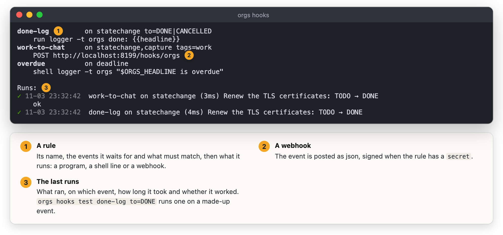

#+TITLE: Hooks: run something when something happens
#+DOC_SECTION: Setup

* What a hook is

  A rule in the server's yaml: when this kind of event happens, and it
  matches, run this program, shell line or webhook. Off until
  =hooks: enable: true=; rules come only from the yaml.

  #+BEGIN_SRC yaml
  server:
    hooks:
      enable: true
      timeout: 30s
      rules:
        - name: done-log
          on: [statechange]
          match: {to: "DONE|CANCELLED"}
          run: ["/usr/local/bin/log-done", "{{headline}}", "{{file}}"]
        - name: work-to-chat
          on: [statechange, capture]
          match: {tags: work}
          url: https://example.com/hooks/orgs
          secret: env:ORGS_HOOK_SECRET
        - name: overdue
          on: [deadline]
          shell: 'say "$ORGS_HEADLINE is overdue"'
  #+END_SRC

* The events

  | Event         | When                                                 | Fields besides headline, file, hash, line, tags |
  |---------------+------------------------------------------------------+-------------------------------------------------|
  | =statechange= | a heading's keyword changes - from worg, the command |                                                 |
  |               | line, or an editor saving the file                   | =from=, =to=                                    |
  | =clockout=    | a clock stops                                        | =minutes=                                       |
  | =clockin=     | a clock starts                                       |                                                 |
  | =capture=     | a capture is filed                                   | =template=                                      |
  | =deadline=    | an open heading's DEADLINE passes (its time, or the  | =date=                                          |
  |               | end of its day)                                      |                                                 |

  Any other event on the =/events= stream can be named too (=querymatch=,
  =focusend=, =tangled=, =notify= ...), or ="*"= for all but reloads. Every
  event has =kind=, =at= and =msg=; =tags= are the heading's own, its
  parents' and the file's.

* Matching

  =match= names fields and case-insensitive regular expressions that must
  match the whole value: =to: DONE= is DONE and not DONEISH, =to: "DONE|CANCELLED"=
  either. =tags: work= matches when any tag does. All of =match= must hold.

* What the hook gets

  - =run=: a program and its arguments, no shell. ={{headline}}=, ={{to}}=, ...
    are filled in /inside each argument/, so a title is always one argument
    whatever characters it has.
  - =shell=: a line for =sh -c=. The event is there only as environment
    variables - =ORGS_KIND=, =ORGS_HEADLINE=, =ORGS_FROM=, =ORGS_TO=,
    =ORGS_TAGS= (=a:b=), =ORGS_FILE=, =ORGS_LINE=, =ORGS_HASH=, =ORGS_MINUTES=,
    =ORGS_DATE=, =ORGS_TEMPLATE=, =ORGS_AT= - never pasted into the line, so
    quote them: ="$ORGS_HEADLINE"=.
  - Both also get the whole event as json on standard input, and =ORGS_HOOK=,
    the rule's name. =dir= sets the working directory.
  - =url=: the event is POSTed as ={"hook": ..., "event": {...}}= with
    =X-Orgs-Event= and =X-Orgs-Hook= headers, retried twice on a network error
    or a 5xx. With =secret= (literal, =env:NAME= or =keyring:NAME=) the body is
    signed: =X-Orgs-Signature: sha256=<hex hmac-sha256 of the body>=.
    =headers= adds more.

  A rule runs at most =limit= times a minute (30): a hook that edits an org
  file and so sets itself off again stops there, and says so in its runs.

* Seeing and trying them

  #+BEGIN_SRC sh
  orgs hooks                    # the rules and the last runs, with their output
  orgs hooks runs               # the last hundred
  orgs hooks test done-log kind=statechange headline="Ship it" from=TODO to=DONE
  #+END_SRC

  

  A test runs the rule on the event given, whatever its =on= and =match=
  say; only an administrator may.
