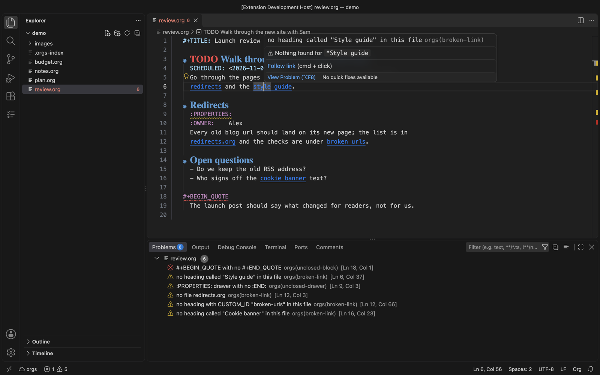

#+TITLE: Org files in any editor: =orgs lsp=
#+DOC_SECTION: Editing

* What it is

  =orgs lsp= is a language server: any editor that speaks the Language Server
  Protocol - Neovim, Helix, Zed, Sublime Text, Emacs (eglot), the JetBrains
  IDEs, VS Code - gets these for org files from it:

  - *Completion*: TODO keywords after the stars (the file's =#+TODO:=, else
    the server's), tags after a heading's colon (this file's first, then every
    tag the server knows), link targets after =[[= - headings, =#custom-id=s,
    =<<targets>>=, =file:= with every org file, =file:x.org::*= with that
    file's headings, and =id:= with every heading that has an ID, found by its
    title - =#+= keywords and blocks, source block languages and property
    names.
  - *Go to definition* on a link: =[[*Heading]]=, =[[#id]]=, =[[target]]=,
    =[[file:x.org::*Heading]]=, =[[file:x.org::42]]= and =[[id:...]]=, which
    the server finds in whichever file has it.
  - *Clickable links* for urls, files and the =linkProtocols= in your yaml.
  - *The outline* (document symbols): headings with their keyword, tags and
    date, and named blocks and tables under the heading they are in; and every
    heading of every file as a workspace symbol.
  - *Folding* of headings, blocks and drawers.
  - *Diagnostics*: a block with no =#+END_=, a drawer with no =:END:=, a link
    to a heading, file or id that is not there, and the Harper or LanguageTool
    lints of =orgs lint=, whose suggestions are quick fixes.
  - *Code actions*: schedule, deadline, refile (recent targets first), archive,
    and run the source block, =#+CALL:= or inline code under the cursor - with
    a =▶ Run= lens over every block the server would run.

  In VS Code (Org Everywhere starts it for you): broken links, an unclosed
  drawer and an unclosed block in the Problems panel, and a hover on one.

  

  The outline, folding and the links within a file work with no server. The
  rest is one request each to =orgs serve=, as for every other command.

* Setting an editor up

  The server is =orgs lsp= on standard input and output. Its flags:
  =-lint auto|harper|languagetool|all|off= (default =auto=, the first checker
  the server offers), =-lang=, =-dialect=, =-ignore RULES=, =-refile-depth N=
  and =-path-map SERVER=LOCAL= for a server on another machine. The same can
  be sent as initialization options: =lint=, =lang=, =dialect=, =ignore=,
  =refileDepth=, =pathMap= (an object).

** Neovim

   #+BEGIN_SRC lua
   vim.lsp.config('orgs', { cmd = { 'orgs', 'lsp' }, filetypes = { 'org' }, root_markers = { '.git' } })
   vim.lsp.enable('orgs')
   #+END_SRC

** Helix (=languages.toml=)

   #+BEGIN_SRC toml
   [language-server.orgs]
   command = "orgs"
   args = ["lsp"]

   [[language]]
   name = "org"
   scope = "source.org"
   file-types = ["org"]
   language-servers = ["orgs"]
   #+END_SRC

** Emacs (eglot)

   #+BEGIN_SRC emacs-lisp
   (add-to-list 'eglot-server-programs '(org-mode . ("orgs" "lsp")))
   #+END_SRC

** Zed, Sublime Text, JetBrains

   Any "custom language server" setting that takes a command: =orgs lsp=, for
   files ending =.org=.

* How edits are made

  An editor holds text the server has not seen yet. So *schedule*, *deadline*
  and *run* send the buffer to the server, which makes the edit it would make
  to the file and sends back the text; the difference arrives as one edit
  you can undo, and the file on disk is not touched. Nothing needs saving
  first.

  *Refile* and *archive* change two files, so they work on the files: they
  refuse while the buffer has unsaved changes ("save first"), and afterwards
  bring the buffer up to what the server wrote if the editor did not reload
  it by itself.

  The commands behind the actions can be bound to keys with
  =workspace/executeCommand=, which is also how to schedule for a date the
  menu does not offer:

  | Command        | Arguments                    | Notes                                                  |
  |----------------+------------------------------+--------------------------------------------------------|
  | =orgs.date=    | uri, line, name, value?      | =SCHEDULED=/=DEADLINE=; value as =orgs sched= reads it |
  | =orgs.run=     | uri, line                    | needs =babel.enable=                                   |
  | =orgs.refile=  | uri, line, {Filename, Olp}?  | asks where when the target is left out                 |
  | =orgs.archive= | uri, line                    |                                                        |

  #+BEGIN_SRC lua
  -- Neovim: schedule the heading under the cursor for Friday
  vim.lsp.buf.execute_command({ command = 'orgs.date',
    arguments = { vim.uri_from_bufnr(0), vim.fn.line('.') - 1, 'SCHEDULED', 'fri' } })
  #+END_SRC
