#+TITLE: More optional packages: canvases, trackers, related notes, drawings, media notes, callouts, backlink counts, maps, timelines, a library, hover previews, link titles, maths typing, local pictures, sticky headings
#+DOC_SECTION: Editing

* Turning them on

  These do in orgs what well-loved note-taking plugins do elsewhere, kept in
  org's own forms - links, properties, keywords and blocks - or, for canvases
  and drawings, in open file formats other tools read too, linked from org.
  Like the org packages (see /Optional org packages/), each is off until it
  is turned on and does nothing at all while off.

  #+BEGIN_SRC sh
  orgs features                  # which are on
  orgs features canvas on        # turn one on; written into the server's yaml
  #+END_SRC

  worg's *Org packages…* setting and VS Code's *Org: Turn orgs Features On or
  Off* list them too.

  #+BEGIN_SRC yaml
  server:
    features:
      canvas: true
      tracker: true
      related: true
      excalidraw: true
      mediaNotes: true
      callouts: true
      backlinkCounts: true
      mapView: true
      timeline: true
      mediaDb: true
      hoverEditor: true
      autoLinkTitle: true
      latexSuite: true
      localImages: true
      stickyHeader: true
  #+END_SRC

* Canvases (JSON Canvas)

  A canvas is a board of cards and arrows: headings from your org files,
  notes, pictures and links, laid out on a page with no edges, grouped and
  joined up. It is kept in a =.canvas= file beside your org files, in the
  open [[https://jsoncanvas.org/spec/1.0/][JSON Canvas 1.0]] format, so the same board opens in other
  JSON Canvas apps and here. Turn it on with =orgs features canvas on=.

** What a board is made of

  - *Heading cards* show an org heading: its keyword, title, tags and text,
    rendered the way the file view renders it. Opening one (double click)
    opens the heading.
  - *File cards* show a whole org file (its title, the start of it, its top
    headings), a picture, or any other file.
  - *Link cards* show a web address.
  - *Text cards* hold a note typed on the board.
  - *Groups* are labelled boxes around cards; a group moves with the cards
    in it.
  - *Edges* join two cards, from a side of one to a side of the other, with
    an arrow at either end, both or neither, a label and a colour.

  Cards and groups take one of six colours (red, orange, yellow, green,
  cyan, purple - the =1= to =6= of the format) or any =#hex= colour.

** How a heading is named in the file

  A heading on a board is a file node naming the org file, with the
  heading's =:ID:= as its subpath:

  #+BEGIN_SRC json
  {"id":"0ba6ef0e2a6b0a3d","type":"file","file":"notes/plans.org","subpath":"#^5f0c2b7e-1d1a-4a65-9f4b-3c2d1e0f9a8b",
   "x":140,"y":-220,"width":400,"height":300}
  #+END_SRC

  When a heading is put on a board it is given an =:ID:= (in its property
  drawer, as =org-id= would) if it has none, so the card keeps finding it
  when it is renamed or refiled into another file - the board then names
  the new file on its next save. A heading with a =:CUSTOM_ID:= and no =:ID:=
  is named by its =CUSTOM_ID=.

  These are read too, for boards made by hand or in other apps:

  | Written                               | Finds                                     |
  |---------------------------------------+-------------------------------------------|
  | ="subpath": "#^ID"=                   | the heading with that =:ID:= (or =CUSTOM_ID=) |
  | ="subpath": "#Plans#Next year"=       | the heading by its outline path           |
  | ="subpath": "#id:ID"=                 | an org =id:= target                         |
  | ="file": "plans.org::*Plans"=         | org's search option: a heading by title   |
  | ="file": "plans.org::#plans"=         | a =CUSTOM_ID=                               |
  | ="file": "plans.org::42"=             | the heading line 42 is in                 |

  Paths are relative to the org directory the board is in (vault-relative
  paths), and are looked for beside the board as well. A
  heading or file that is not there any more is drawn as a dashed card
  saying so; nothing is removed.

** Text cards: org or markdown

  In JSON Canvas a text card is markdown. Here a text card is shown as org, unless
  it reads as markdown and not as org (a =# heading=, =**bold**=,
  =[text](url)=, a ```` ``` ```` fence, a => quote=), in which case it is converted to
  org first. Either way it is written back exactly as you typed it, so a
  board shared with another app keeps its markdown and a board of your own can
  be pure org.

** In an org file

  Link to a board the way you link to any file:

  #+BEGIN_SRC org
  The plan, as it stands: [[file:boards/plan.canvas][The plan board]]
  #+END_SRC

  While the feature is on, the html export (and so worg's rendered view of
  the file) draws the board itself in its place - groups, cards with their
  keyword, tags and the start of their text, pictures, arrows and labels -
  as a picture, with the link's description under it. A board that points
  at a heading also counts as a link to it: it shows in the heading's
  backlinks, in =HasBacklinks()=, and in the link graph.

  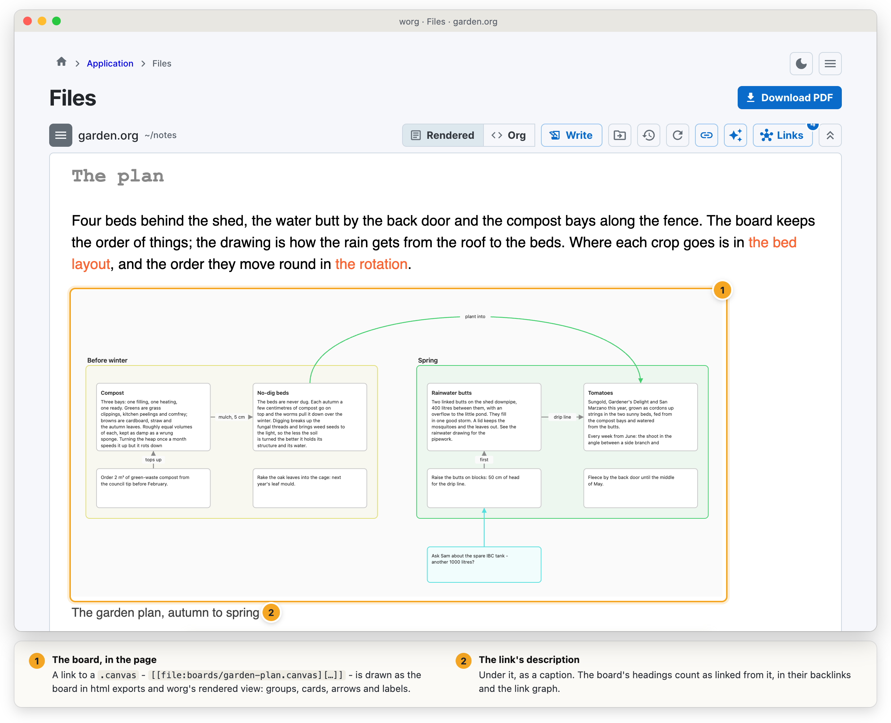

** In worg

  The *Canvas* tab (in the sidebar while the feature is on) picks a board or
  makes a new one, and draws it on a board you can pan (drag the empty
  board, or scroll) and zoom (ctrl-scroll, pinch, or the buttons; the last
  button shows everything).

  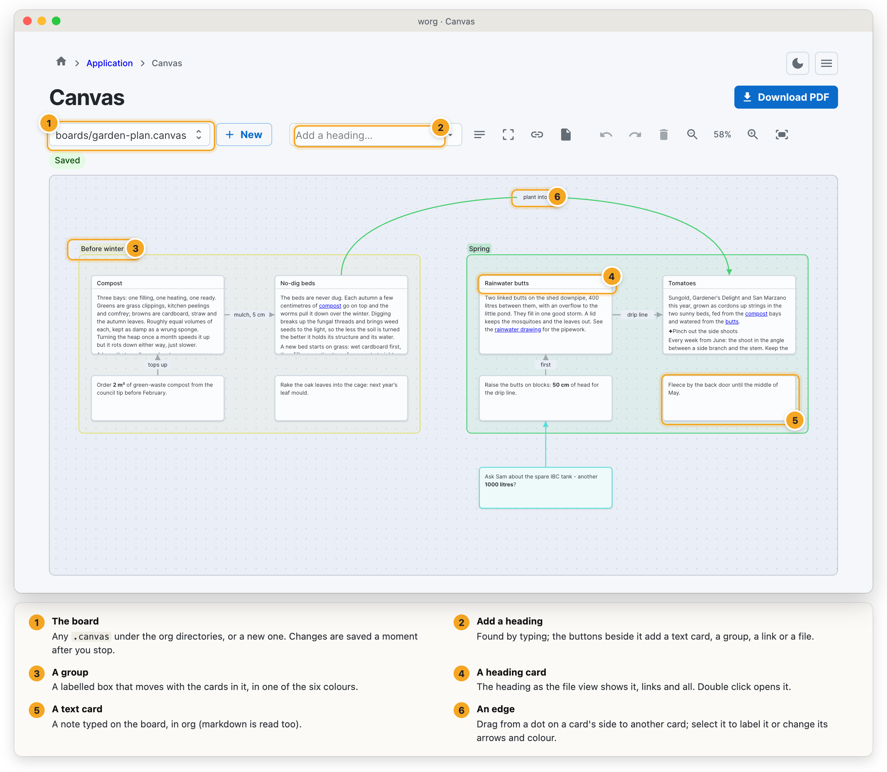

  - Add a heading from the *Add a heading…* box, a text card, a group, a
    link or a file from the buttons. A url or text dropped on the board
    becomes a card where it is dropped; so does a task dragged from the day
    planner's list.
  - Drag cards to move them (a group takes its cards with it), the corner
    to resize. Shift-click adds to the selection; shift-drag on the empty
    board selects everything in the box; ctrl-a selects all.
  - Hover a card and drag one of the dots on its sides to another card to
    join them. Select an edge to give it a label, choose its arrows or its
    colour.
  - Double click (or Enter) opens a heading, edits a text card or renames
    a group. Delete removes what is selected (and the edges on it);
    ctrl-z and ctrl-shift-z undo and redo.

  Changes are saved a moment after you stop. If the file changed somewhere
  else - in another app, in another tab - while you had changes not yet
  saved, the tab says *Changed elsewhere* and asks: *Load theirs* or *Keep
  mine*. With nothing unsaved, a change made elsewhere is simply shown.

** From the command line

  #+BEGIN_SRC sh
  orgs canvas                               # every board under the org directories
  orgs canvas show plan                     # groups, cards and edges as an outline
  orgs canvas add plan 'Write the report'   # a heading: a title, a query, -hash or a picker
  orgs canvas add plan pics/map.png         # a file
  orgs canvas add plan https://jsoncanvas.org
  orgs canvas add plan -text 'An idea'      # a text card (- reads it from stdin)
  orgs canvas add plan -group Later -color green
  orgs canvas add plan 'Book flights' -in Later    # inside a group
  orgs canvas link plan 'Write the report' 'Book flights' -label then
  orgs canvas link plan idea jsoncanvas -both      # -both or -none for the arrows
  orgs canvas svg plan -out plan.svg        # the board as a picture
  orgs canvas new boards/plan               # an empty board
  #+END_SRC

  A card is put in the first free place, reading rows from the top left of
  the board (or of the group), unless =-x= and =-y= say where. =link= names
  a card by its id or by words in its title, text, file or url; when the
  words fit more than one card it says which, with their ids.
  =orgs canvas show plan -json= is the board and what each card shows.

  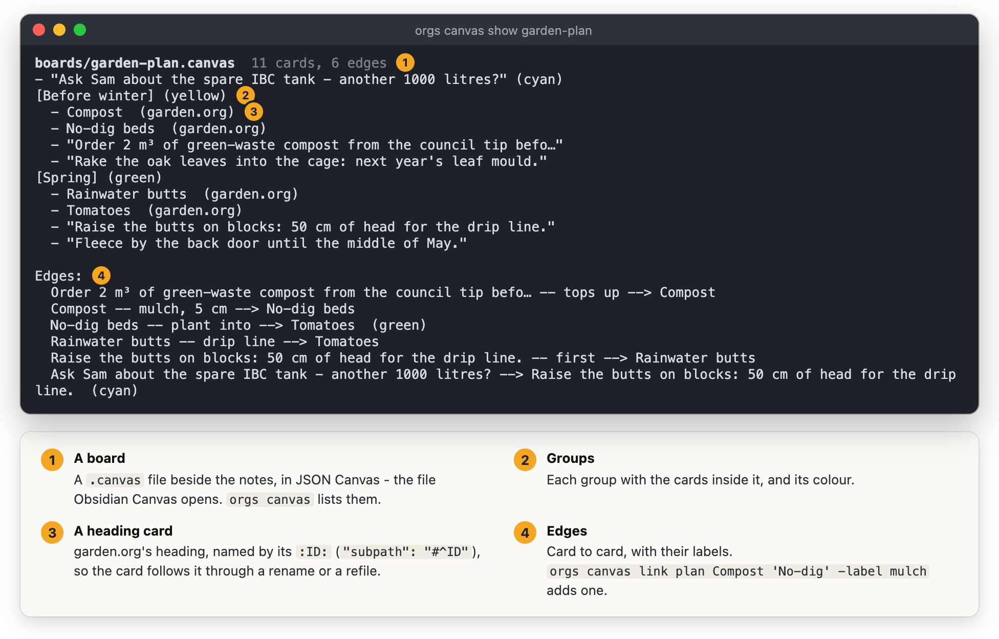

** In VS Code

- *Org: New Canvas* asks for a name (relative to the server's first org
  directory, =boards/plan=) and opens the new board.
- *Org: Add Heading to Canvas* puts the heading at the cursor on a board you
  pick (or a new one). The heading is given an =:ID:= if it has none, so the
  card follows it when it is renamed or refiled.
- A =.canvas= file opens as JSON by default, so a vault of notes opened in
  VS Code is not changed under you. *Reopen Editor With… → Canvas (orgs /
  worg)* shows worg's board in the tab: drag, connect, edit, and click a
  heading's card to open it in the editor. The board is saved by the orgs
  server, never by VS Code. To always open boards this way, add to your
  settings:

  #+BEGIN_SRC json
  "workbench.editorAssociations": { "*.canvas": "org.canvasEditor" }
  #+END_SRC

Both commands and the editor need the =canvas= feature on (*Org: Turn orgs
Features On or Off*).

* Trackers and heatmap calendars

  With =tracker= on, a =#+TRACKER:= line anywhere in a file charts one
  thing a day: a property you write on your day pages, a tag, a query, a
  habit, the time clocked under a heading, the words you wrote, or a column
  of a table. It is a tracker and heatmap calendar in org's own
  spelling: the options are =key:value= words, as on a =#+PLOT:= line,
  and the data is ordinary properties, logbooks and tables that Emacs reads
  as it always has.

  #+BEGIN_SRC org
  ,* How the year went
  ,#+TRACKER: source:property:MOOD title:"Mood"
  ,#+TRACKER: source:habit:Run color:green goal:1
  ,#+TRACKER: source:clock:Writing type:bar from:-30d
  ,#+TRACKER: source:property:SLEEP type:line from:-60d goal:7:00
  ,#+TRACKER: source:query:"IsDone()" type:bar from:-8w title:"Done"
  #+END_SRC

  The line is never changed; the chart is drawn wherever the file is shown:
  worg's rendered view and every html export get a heatmap calendar or a
  line in place of the line, a LaTeX export the same picture in TikZ, a
  Typst export the picture inline, and the plain text exporter a sparkline
  with the summary. With the feature off the line is an unknown keyword and
  exports as nothing, as in Emacs.

** What a tracker follows

   =source:= names it, as =kind:argument= (the kind may also be its own
   key: =habit:Run= is =source:habit:Run=):

   | =source:property:MOOD=       | the =MOOD= property, a day at a time (below)                  |
   | =source:tag:gym=             | how many headings tagged =:gym:= fall on each day             |
   | =source:query:"IsDone()"=    | how many headings a query finds on each day                   |
   | =source:habit:Run=           | the days the habit =Run= was done (its =State "DONE"= lines)  |
   | =source:clock:Writing=       | minutes clocked a day under =Writing= and everything below it |
   | =source:clock:*=             | every clock in every file                                     |
   | =source:words=               | words written a day (writing mode's log)                      |
   | =source:table:weight=        | a =#+NAME: weight= table: a date column and a value column    |

   A habit or clock heading is found by its title (the same title, else
   every title containing the words); =clock:= also takes a query
   (=source:clock:"HasTags(\"client\")"=). A clock that runs past midnight
   counts on both days. A habit ticked twice in a day is one day.

** The day a value is for

   A property is read from:

   - *day pages*: a file named for its day - orgs's =Wed_2026_11_04.org=,
     org-roam's =2026-11-04.org=, org-journal's =20261104= - in its own
     property drawer at the top of the file, or on a =#+PROPERTY: MOOD 4=
     line. On a week page (=dayPageMode: week=), a heading called =Mon=,
     =Tue=... is that day of the page's week.
   - *any heading with a day*: a title that starts with a date (a datetree's
     =2026-11-04 Wednesday=) or a heading under one, then =CLOSED=,
     =CREATED=, =SCHEDULED=, =DEADLINE=, then a timestamp in it. =date:=
     picks one instead: =date:closed=, =date:created=, =date:scheduled=,
     =date:deadline=, =date:timestamp=, =date:title=, =date:page=.

   #+BEGIN_SRC org
   :PROPERTIES:
   :MOOD: 4
   :SLEEP: 7:30
   :END:
   ,#+TITLE: Wed_2026_11_04
   #+END_SRC

   Tags and queries count headings on the same days, so
   =source:query:"IsDone()"= counts each finished task on the day it was
   closed.

** Values

   A value is read the way it is written:

   | =4=, =72.5kg=, =8,000=            | a number (a unit after it is dropped) |
   | =1:30=, =1h30m=, =45m=, =2h=      | a duration, in minutes                |
   | =yes=, =t=, =[X]= / =no=, =[ ]=   | true or false, 1 or 0                 |
   | =★★★☆☆=, =⭐⭐=, =4/5=             | a rating                              |

   When a day has several values (two headings that day, a table with two
   rows), =agg:= says how they become one: =sum= (the default for counts,
   habits, clocks and words), =mean= (the default for properties and
   tables), =max=, =min=, =last= or =count=.

** The options

   | =type:=            | =heatmap= (the default: a year of days like GitHub's), =line=, =bar=, =sparkline=   |
   | =from:= =to:=      | the days shown, as =orgs sched= reads a date: =-30d=, =-1y=, =2026-01-01=; =to:= is today |
   | =agg:=             | sum, mean, max, min, last, count                                                     |
   | =goal:=            | the value a day must reach to count toward a streak (=goal:1=, =goal:7:00=)          |
   | =title:=           | the chart's title (the property, habit or query by default)                         |
   | =color:=           | blue (the default), orange, aqua, yellow, magenta, green, violet, red, or =#rrggbb= |
   | =min:= =max:=      | the colour scale's ends (otherwise from the values)                                 |
   | =unit:=            | a word after the values                                                             |
   | =file:=            | only files whose path contains this (or whose name matches a glob)                  |
   | =datecol:= =col:=  | a table's date and value columns, by number or header (otherwise found)             |

   Every tracker has a summary: the days with a value, the total and mean,
   the least and most, and two streaks - the run of days meeting the goal
   (any value above zero without one) up to today, and the longest. A run
   up to yesterday is still current: today is not over yet.

** The days as an org table

   A dynamic block takes the same words and writes the days, newest first,
   with a total, the mean, the days counted and the streak under them; it is
   refreshed like any dynamic block (=orgs dblock=).

   #+BEGIN_SRC org
   ,#+BEGIN: tracker source:habit:Run from:-14d
   ,#+CAPTION: Run, 2026-10-21 to 2026-11-04, at [2026-11-04 Wed 23:43].
   | Date             |           Run |
   |------------------+---------------|
   | [2026-11-04 Wed] |             1 |
   | [2026-11-03 Tue] |             1 |
   |------------------+---------------|
   | Total            |            11 |
   | Mean             |             1 |
   | Days             |            11 |
   | Streak           | 5 (longest 5) |
   ,#+END:
   #+END_SRC

   =empty:t= lists the days with nothing too; =rows:30= keeps the newest
   thirty.

** From the command line

   #+BEGIN_SRC sh
   orgs track MOOD                          # a property: a year as a heatmap in the terminal
   orgs track source:habit:Run -type sparkline
   orgs track clock:Writing -type bar -from -30d
   orgs track all                           # every #+TRACKER: line, drawn
   orgs track ls                            # where the #+TRACKER: lines are
   orgs track log MOOD 4                    # :MOOD: 4 on today's day page
   orgs track log SLEEP 7:30 -date yesterday
   #+END_SRC

   The words after =orgs track= are a =#+TRACKER:= line's; =-type=,
   =-from=, =-to= and =-color= override the line's. =-json= is the whole
   series. =orgs track log= writes the property into today's day page with
   a line edit: into its own property drawer, or on a week page under the
   day's heading (made at the end of the page when it is not there). A day
   page that does not exist yet is made, from =dayPageTemplate= for today.

   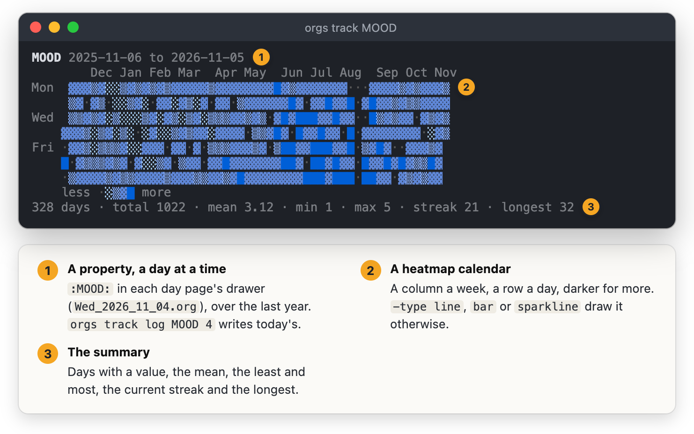

** In worg and VS Code

   worg's *Trackers* tab shows every =#+TRACKER:= line in the files as a
   card with its chart, its summary and where it is; hovering a day says its
   value, and clicking it opens that day's page (or the heading the value
   came from). A property tracker has a *Log today* box. *New tracker* is a
   builder - what to follow, the chart, how a day adds up, how far back, a
   goal, a title, a colour - which draws the chart as you go and gives the
   =#+TRACKER:= line to copy or add to a file. The pencil on a card opens
   that card's line in the builder.

   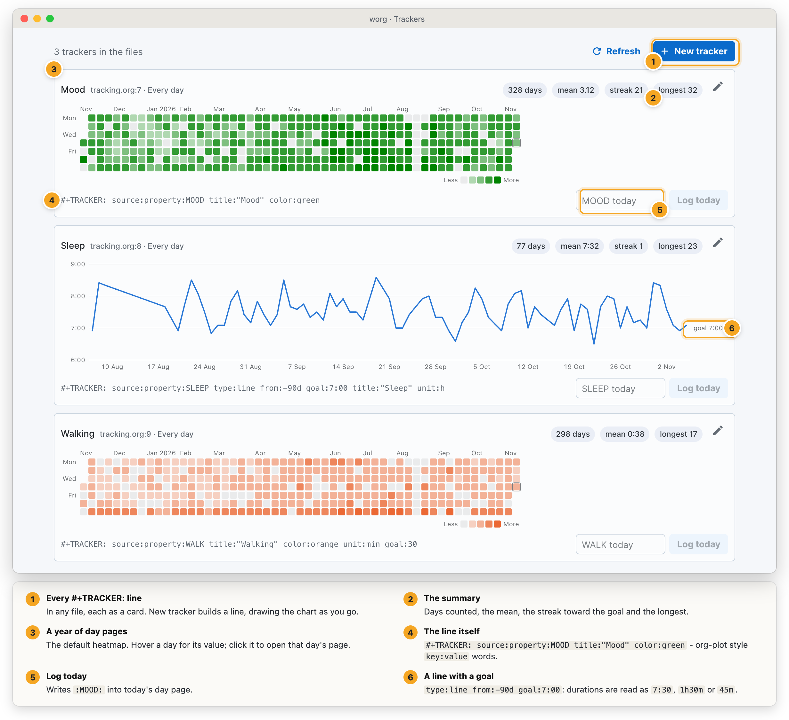

   In VS Code a code lens over every =#+TRACKER:= line shows the last month
   as a sparkline and the summary, and opens the chart beside the file; a
   hover says the same. *Org: Log Tracker Value* writes a property on
   today's day page (the properties your trackers follow are offered
   first), *Org: Insert Tracker* builds a line from a few questions and puts
   it under the cursor, and *Org: Show Trackers* opens worg's tab.

* Related notes

  The headings most like the one you are reading, from anywhere in your
  files, each with a reason: the words the two share most and the sentence of
  it most like what you are reading. One button links it, and the link is an
  ordinary org link. Turn it on with =orgs features related on=.

  Nothing needs setting up: the *words* engine reads every heading's own text
  - its title (counted twice) and its body up to its first child - and
  compares them by the words they use, rare words weighing more than common
  ones (BM25, by cosine, so a score runs from 0 to 1). Only prose counts:
  property and logbook drawers, planning and clock lines, =#+= lines,
  src/example/export/comment blocks, link targets (a link's description
  counts), urls, timestamps, footnotes and =verbatim= are left out. Words are
  lightly stemmed (/notes/ meets /note/, /draining/ meets /drain/) and
  common words (/the/, /which/, /todo/) are not counted.

  A heading asks with its whole subtree; a file with all of its text. What
  comes back leaves out the heading itself, its parents and everything under it (a
  file: everything in it), and whatever a link already joins to it - either
  way, a link from it or one into it. Ask with =linked= to keep those, marked.

** Embeddings

  With a model, the *embeddings* engine finds notes alike in meaning even when
  they share few words. Name a backend in the server's yaml:

  #+BEGIN_SRC yaml
  related:
    engine: auto            # auto, words or embeddings
    embeddings:
      backend: ollama       # ollama, local, openai or gemini
      model: nomic-embed-text
      perMinute: 60         # requests a minute, at most
      batch: 16             # headings per request
      blend: 0.25           # how much of the words score is mixed in
  #+END_SRC

  | Backend  | Asks                                                 | Default model             | Key                                    |
  |----------+------------------------------------------------------+---------------------------+----------------------------------------|
  | =ollama= | =/api/embed= at the assistant's Ollama url (=url= to change) | =nomic-embed-text=  | none                                   |
  | =local=  | =/v1/embeddings= of a local runtime or =assistant.local.servers= entry (=llamacpp:name=, =lmstudio:name=), or =url= | none: name one | the server's, if any                   |
  | =openai= | =/v1/embeddings= at =api.openai.com= (or =url=)      | =text-embedding-3-small=  | =apiKey=, else the assistant's chatgpt key |
  | =gemini= | Google's OpenAI-compatible endpoint                  | =gemini-embedding-001=    | =apiKey=, else the assistant's gemini key  |

  Pull the model first (=ollama pull nomic-embed-text=, or worg's model
  manager); a llama.cpp server must be started with =--embeddings=. The
  server works through your headings in the background, a batch at a time,
  never more than =perMinute= requests a minute, and keeps the vectors in
  =<config>_related_vectors.gob= beside its yaml, keyed by the heading's text:
  only a heading whose text changed is asked for again, and a restart asks
  for nothing. =engine: auto= answers by embeddings once at least half the
  headings have one, and by words until then (the answer says which). A
  heading's question needs no request - it is its subtree's stored vectors -
  but unsaved text from an editor is embedded when asked.

** Linking one

  /Link/ writes the result under the heading you are reading, at the end of
  its own text (before its first child), in a =Related:= list - made the first
  time, added to after that:

  #+BEGIN_SRC org
  ,** Upgrading the cluster
  We drain each node, cordon it, then upgrade the kubelet.

  Related:
  - [[id:7c0a74bf-404c-4021-9bfd-e4caf7a8917e][Node maintenance]]
  #+END_SRC

  The note linked to is given an =:ID:= first if it has none, as org-id would.
  A file with no =ID= is linked =[[file:./other.org][Title]]=. The same link is
  never written twice. A =Related:= or =See also:= line you wrote yourself is
  used as the list.

** From the command line

  | Command                                  | Does                                                    |
  |------------------------------------------+---------------------------------------------------------|
  | =orgs related 'Upgrading the cluster'=   | the notes like a heading (a title, query or hash)       |
  | =orgs related ops.org [-line 12]=        | like a file, or the heading at a line of it             |
  | =orgs related ... -link 2=               | link the second one                                     |
  | =orgs related ... -engine embeddings=    | choose the engine; =-linked= keeps linked ones; =-n 20= |
  | =orgs related text 'some words'=         | like some text (or text on stdin)                       |
  | =orgs related pairs=                     | pairs alike across everything, with no link between    |
  | =orgs related status=                    | what is indexed, and the embeddings' progress           |
  | =orgs related reindex [-embeddings]=     | read everything again (=-embeddings=: every vector too) |

  =-json= prints the server's answer.

  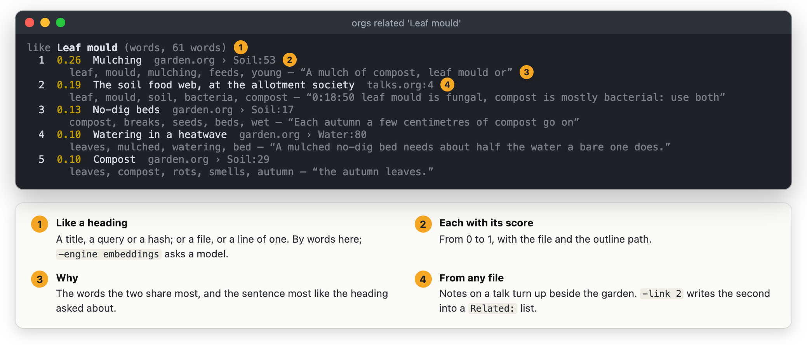

** In worg and VS Code

  worg: the ✨ button in the Files tab's bar opens a Related panel beside the
  page that follows the heading you are reading (the cursor in the editor or
  source view, the top of the page in the rendered view), with each result's
  score, shared words and sentence; click to open it, the link button to link
  it, the pin to stay on one heading while you look around. The panel also
  sits in Search's Inspect dialog. The engine (auto, words, embeddings) is
  chosen in the panel, and the embeddings' progress is at its foot. The
  /Related Notes/ tab (sidebar and palette) shows how the index stands, reads
  everything again, and lists /Alike, and not linked/: the pairs of headings
  most like each other that nothing links yet, each with a Link button.

  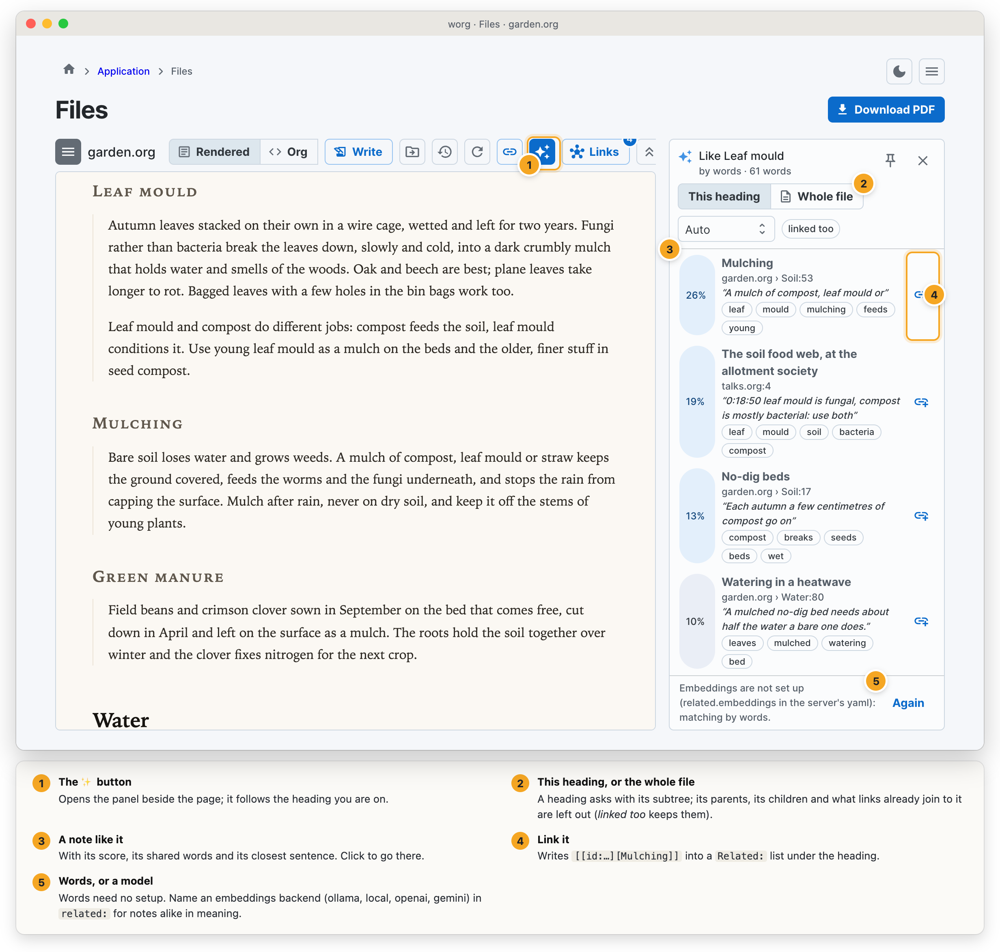

  VS Code: a /Related Notes/ view in the Org side bar follows the heading at
  the cursor, asking about the buffer's own text while it has unsaved
  changes. Click a result to open it; the inline link button saves the buffer
  and links it. /Org: Show Related Notes/ opens the view; its title bar pins
  it, refreshes it and picks the engine.

* Drawings (Excalidraw, org-excalidraw)

  Hand-drawn diagrams kept beside the org files as Excalidraw drawings -
  the same =.excalidraw= files excalidraw.com saves, and Excalidraw's
  markdown form, =.excalidraw.md= - linked from org the way a picture is. With
  =features: excalidraw:= on, worg draws and edits them, every export shows
  them, and the link stays an ordinary file link that Emacs opens.

  #+BEGIN_SRC org
  ,* How a request gets in
  The proxy sees it first.

  ,#+CAPTION: The request flow
  ,#+ATTR_HTML: :width 600
  [[file:drawings/request.excalidraw]]
  #+END_SRC

  A link with no description is the drawing as a picture, so =#+CAPTION:=,
  =#+NAME:= and =#+ATTR_HTML:= / =#+ATTR_LATEX:= work as for any picture.
  org-excalidraw's =[[excalidraw:…]]= links are read the same way, and so is
  a link to an =.excalidraw.md=. A link with a description stays a link.

  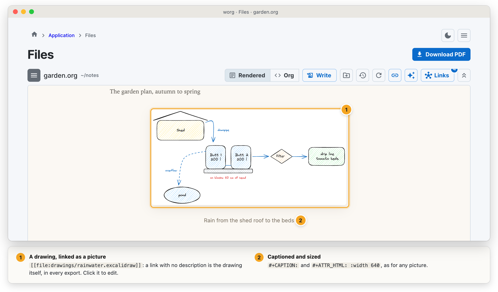

** The picture beside it

   Each save from worg writes the drawing's picture next to it: =request.excalidraw.svg=
   (Excalidraw's own export, with the scene inside it, so the svg opens
   again as a drawing in excalidraw.com) and =request.excalidraw.png= (twice
   the size, for LaTeX). That is the name org-excalidraw and excalidraw.com's
   "embed scene" export use, so =org-display-inline-images= in Emacs shows
   it when the file links the svg; a markdown =Drawing.excalidraw.md= gets
   =Drawing.excalidraw.svg=.

   A drawing made or changed elsewhere (another app, excalidraw.com, a text
   editor) has no picture, or one older than the drawing. Then the server
   draws one itself the first time an export needs it, and keeps it beside
   the drawing: rectangles, ellipses, diamonds, lines and arrows with their
   heads, text, freehand strokes, pasted pictures and frames, in plain lines
   - legible, but not Excalidraw's hand-drawn look. The next save from worg
   replaces it with Excalidraw's own.

** Exports

   The html exporter (and so worg's rendered page and the VS Code preview),
   Typst, reveal.js and the other html exporters show the svg. LaTeX, the
   pdf and Beamer want a png: the one worg saved while it is as new as the
   drawing, else one made from the svg by =rsvg-convert= when that is
   installed; with neither, the link is left as a link and the server says
   why on its log. Nothing of this touches the org file: the links are
   pointed at the picture in the export copy only. A drawing outside every
   org directory is shown only when a picture is already beside it - the
   server never writes there.

** What is read

   | =.excalidraw=    | Excalidraw's json: ={"type": "excalidraw", "version": 2, "elements", "appState", "files"}=. Pictures pasted into a drawing are kept in it as data urls, as Excalidraw keeps them. |
   | =.excalidraw.md= | Excalidraw's markdown form: the scene in its =compressed-json= block (lz-string) or =json= block, the pictures its =## Embedded Files= section names (=id: [[cat.png]]=, found beside the drawing, from the vault root, or by name). |

   Saving an =.excalidraw.md= writes its drawing block back as a plain =json=
   block (the plugin reads both and compresses it again on its own next save
   if it is set to), and makes its =## Text Elements= section again from the
   drawing - the plugin takes text from there over the json, so a stale
   section would undo the edit. The front matter, the Embedded Files section
   and anything else written in the file are kept. Pictures pasted in worg
   into a markdown drawing stay in the json; the plugin keeps its own as vault
   files.

** In worg

   *Drawings* in the sidebar (and the palette) lists every drawing under the
   org directories, newest first, with its picture and the org lines that
   link to it; the box at the top makes a new one. A click opens it in
   Excalidraw itself, over the page. It saves with =ctrl-s= and two seconds
   after the last change, writing the drawing, its svg and its png; dark
   mode follows worg's. A drawing changed elsewhere since it was opened is
   not overwritten: the bar says so and offers *Overwrite* or *Reload theirs*.

   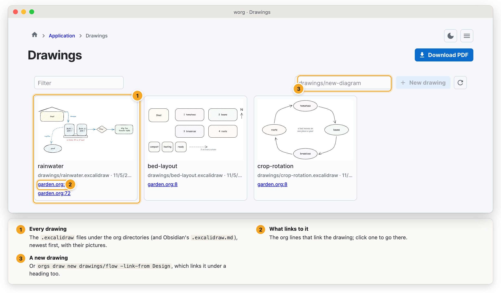

   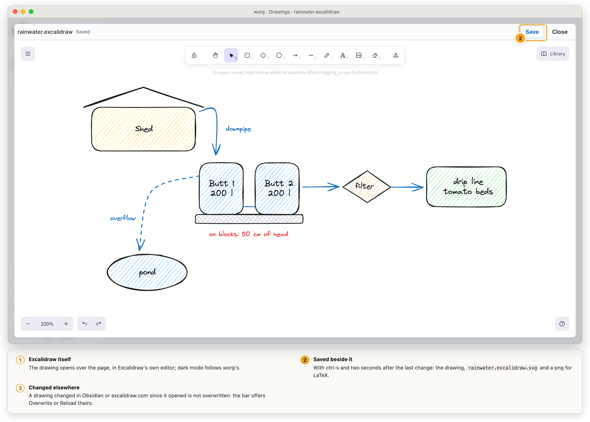

   In the Files tab, clicking a drawing in the rendered page opens it, and
   the org editor's *New drawing here* asks a name and a caption, makes the
   drawing beside the file, puts the link under the cursor's line and opens
   the drawing - the unsaved text stays where it was underneath.

** From the command line

   #+BEGIN_SRC sh
   orgs draw ls                                   # every drawing, its picture, what links to it
   orgs draw new drawings/flow                    # an empty drawing, from the first org directory
   orgs draw new flow -link-from 'Design' -caption 'The flow'   # and its link under a heading
   orgs draw svg flow.excalidraw -out flow.svg    # the server's own drawing of it (-saved: the saved one if fresh)
   orgs draw open flow.excalidraw                 # worg's editor in the browser
   #+END_SRC

   A drawing is named by its path, its path from the first org directory, or
   its name when only one drawing has it. =-link-from= takes a title, a query
   or a hash, and the picker with =-=. =-json= gives the list or the answer.

** In VS Code

   A =.excalidraw= file opens in worg's drawing editor in the tab (the
   extension does not carry a second Excalidraw). Hovering over a drawing's
   link shows its picture, with an *Edit drawing* link. *Org: New Drawing*
   makes one beside the org file, puts its link at the cursor and opens it;
   *Org: Open Drawing* opens the one under the cursor, or a list. With the
   Excalidraw extension (pomdtr.excalidraw-editor) installed, the first open
   asks which editor to use and remembers it in =org.excalidraw.editor=
   (=worg= saves the pictures exports use; the other extension does not).

** Endpoints

   =GET /excalidraw/list=, =GET /excalidraw?file==, =GET /excalidraw/svg?file==
   (=&render=server= for the server's drawing), =POST /excalidraw/save=
   ={File, Scene, Svg, Png, Modified}=, =POST /excalidraw/new= ={File, Hash |
   Filename, Caption}=. A save is checked: the scene must be an Excalidraw
   scene (at most 32 MB), the svg may not run anything (no scripts, event
   handlers or foreign objects; pictures only as data urls, links only http,
   https or mailto), the png must be a png, and every file must be inside the
   org directories. Each is written beside its file and renamed into place.

* Notes on video and audio (org-media-note)

  Notes on a lecture, a talk, a podcast or a voice memo are a list under a
  heading. Each item starts with a link to its moment in the recording. The
  links are org-media-note's, so the same file works in Emacs, where they
  jump mpv to that moment:

  #+BEGIN_SRC org
  ,* Week 3 lecture
  :PROPERTIES:
  :MEDIA: lectures/week3.mp4
  :END:
  - [[video:lectures/week3.mp4#0:12:30][0:12:30]] the proof starts here
  - [[video:lectures/week3.mp4#0:31:05-0:32:10][0:31:05-0:32:10]] worth hearing twice
  ,* A talk
  - [[audio:talks/keynote.mp3#0:04:10][0:04:10]] the one slide that matters
  ,* On YouTube
  - [[video:https://www.youtube.com/watch?v=dQw4w9WgXcQ#0:00:43][0:00:43]] the chorus
  ,* From the bibliography
  - [[videocite:smith2020#0:05:00][0:05:00]] a cited recording
  #+END_SRC

  - =video:= and =audio:= name a file (relative to the org file, as Emacs
    reads it) or a url. YouTube and Vimeo urls play in their own players.
  - =videocite:= and =audiocite:= name a citation key. The key's entry in
    the file's bibliographies (=#+bibliography:= and =citations.bibliography=
    in the yaml) gives its =file= field first, then its =url=, which is the
    order org-media-note uses.
  - =#0:12:30= is a moment. =#0:12:30-0:12:40= is an A-B loop: the player
    plays that span over and over. =0:12:30.250= (milliseconds) is read and
    written too.

  The recording a heading is about comes from the first of these it has:

  1. a =:MEDIA:= property: a path, a url, a link, or =cite:key=;
  2. an =:AUDIO:= property. This is what a voice note writes, so recorded
     voice notes can be annotated the same way;
  3. a media link in the heading's own text.

  org-media-note keeps no property of its own (it asks mpv what is
  playing), so =:MEDIA:= is orgs's. Emacs ignores it and reads the links.

  Turn it on with =orgs features mediaNotes on=.

** In worg

   The *Media Notes* panel lists every heading with a recording. The player
   sits beside its notes:

   - Click a note to jump there. A loop note plays its span until you clear
     the loop.
   - Type in the note box. The note is stamped with the moment you started
     typing, and *Pause while I type* holds the player still meanwhile.
     ctrl-enter (or *Note*) writes it among the other notes in time order.
   - *A* and *B* mark a loop. With both set, the next note is written as a
     loop.
   - The panel also has speed control, back and forward five seconds, and
     *Transcribe* (see below).
   - Keys, while not typing: =k= play/pause, =j= back 5s, =l= on 5s, =n= the
     note box, =[= and =]= the loop marks, =\= clears the loop.

   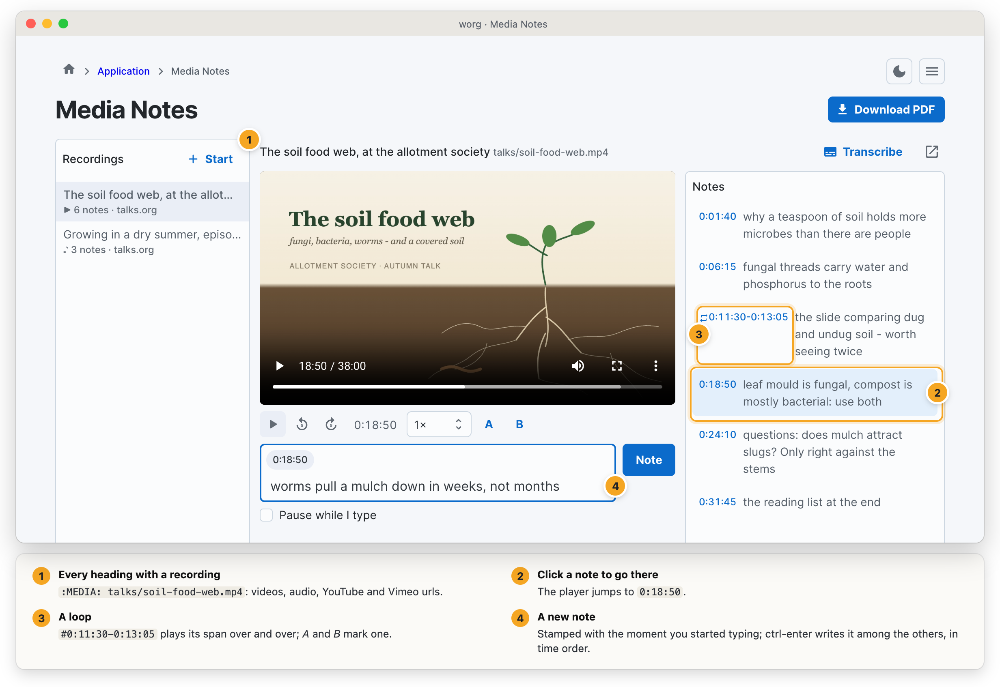

   In a file's rendered view, clicking a timestamp link opens the panel at
   that moment. alt-click plays it in the page instead.

** In exported pages

   With the feature on, the html exporter draws one player per recording,
   where its first link is. Every timestamp link on the page then seeks that
   player, and a loop link loops. The page needs no server for this: a small
   script comes with it. Links to YouTube and Vimeo get their embedded
   players. Other exporters, and html with the feature off, keep them as
   ordinary links.

** From the command line

   #+BEGIN_SRC sh
   orgs media                                   # every heading with a recording
   orgs media notes 'Week 3'                    # its notes, by time
   orgs media add 'Week 3' 12:30 'the proof'    # a note at a moment
   orgs media add 'Week 3' 31:05-32:10 'again'  # an A-B loop
   orgs media play 'Week 3' 12:30               # mpv (else vlc, iina, the OS player) from there
   orgs media start lectures/week4.mp4 -file school.org -title 'Week 4'
   orgs media transcribe 'Week 4' -write        # whisper's words, each a linked note
   #+END_SRC

   The time is the first word that reads as one (=12:30=, =0:12:30=,
   =12:30-12:45=). The words before it name the heading. With no heading
   named, the one session there is is used, or you pick one. =play= hands
   mpv =--start= and the loop, just as org-media-note does. A file that is
   not on this machine is streamed from the server.

   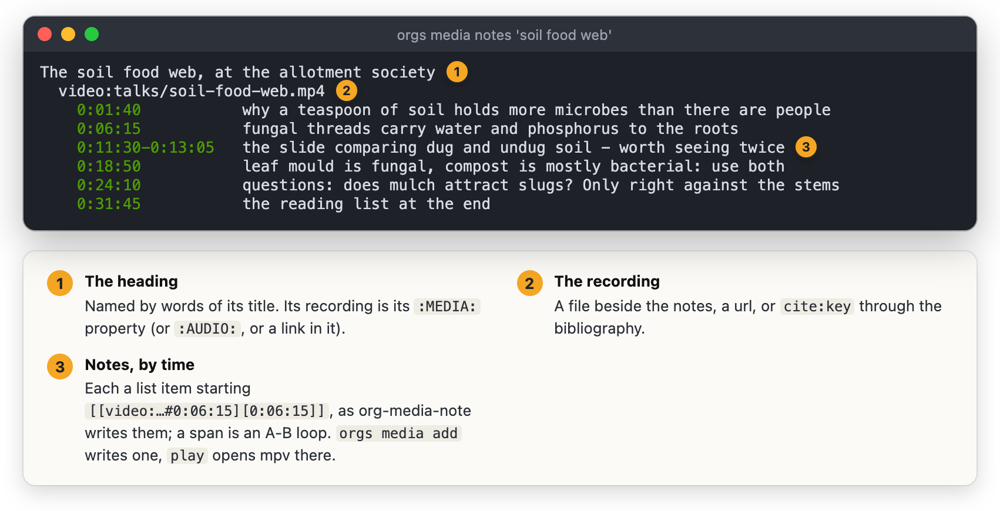

** In VS Code

   - A media link is clickable. It opens a player beside the text at that
     moment, looping a loop link. Hovering shows the time and the recording.
   - *Org: Open Media Player* opens the recording of the heading the cursor
     is in.
   - *Org: Insert Media Timestamp* asks the open player for its time (or
     asks you) and writes the link the way org-media-note's insert does: as
     a new list item on a blank line or after a note, otherwise at the
     cursor. The player's *Note here* button does the same.

   Local files play straight from disk. A citation key is looked up
   through the server.

** Transcribing

   With a whisper server set up for voice notes (=voice:= in the yaml),
   *Transcribe* in worg, or =orgs media transcribe -write=, writes whisper's
   segments under the heading. Each segment becomes a timestamp note, so the
   transcript can be clicked through like any other notes.

* Callouts (org special blocks)

  Callouts - the coloured boxes with a title and an icon, some of
  them folding - written the way org already writes a box: a special block.
  Turn it on with =orgs features callouts on=. Off, a =#+begin_warning= block is
  what it always was (a =<div class="warning-block">= in html, an environment
  in LaTeX); on, every exporter draws it as a callout. Nothing is written into
  the file either way.

  #+BEGIN_SRC org
  ,#+begin_warning Mind the gap
  The doors close fast.
  ,#+end_warning

  ,#+begin_tip Take the early train :fold closed
  It is half empty.
  ,#+end_tip

  ,#+begin_faq :title "Why: because" :fold open
  Because.
  ,#+end_faq
  #+END_SRC

  The block's name is the type; the words after it are the title (or
  =:title "..."=, for a title with a colon in it); with no title the type's
  own name is shown. Emacs reads all of this as an ordinary special block, so
  =ox-html= writes =<div class="warning">= for it and org-special-block-extras
  users keep their own definitions.

  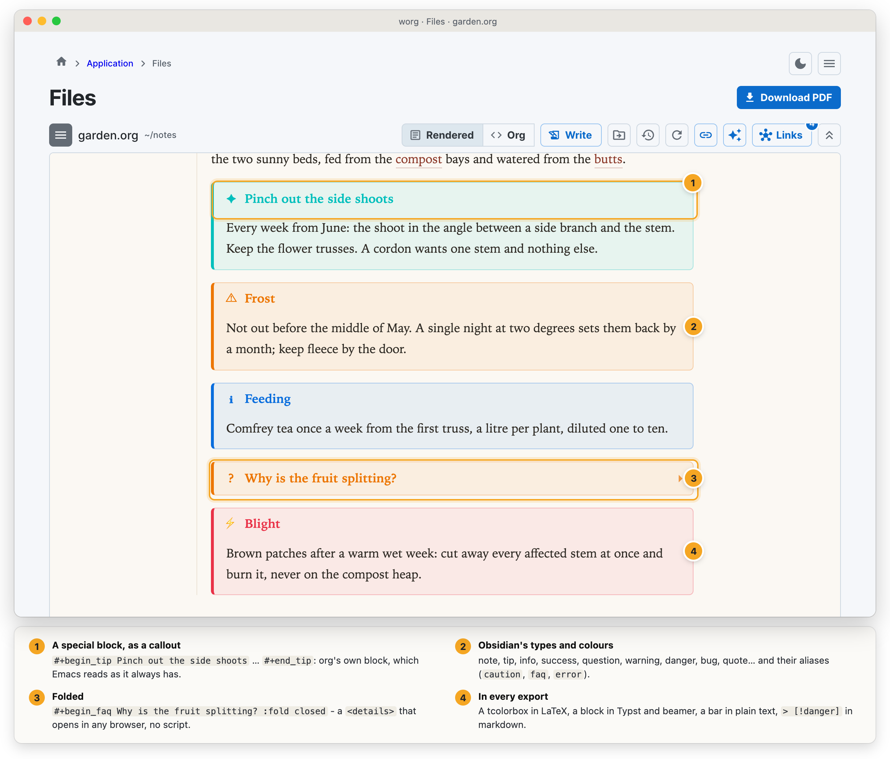

** The types

   The usual callout types, with their aliases and colours (=orgs callouts types= lists them,
   and =GET /callouts/types= is the list every client uses):

   | Type       | Also written                  | Colour  | Beamer       |
   |------------+-------------------------------+---------+--------------|
   | =note=     |                               | blue    | block        |
   | =abstract= | =summary=, =tldr=             | cyan    | block        |
   | =info=     |                               | blue    | block        |
   | =todo=     |                               | blue    | block        |
   | =tip=      | =hint=, =important=           | cyan    | exampleblock |
   | =success=  | =check=, =done=               | green   | exampleblock |
   | =question= | =help=, =faq=                 | orange  | block        |
   | =warning=  | =caution=, =attention=        | orange  | alertblock   |
   | =failure=  | =fail=, =missing=             | red     | alertblock   |
   | =danger=   | =error=                       | red     | alertblock   |
   | =bug=      |                               | red     | alertblock   |
   | =example=  | (see below)                   | purple  | exampleblock |
   | =quote=    | =cite=                        | grey    | block        |

   Three names already mean something in org, so they stay what they are:

   - =#+begin_example= is org's verbatim block and never a callout. Write an
     example callout as =#+begin_callout Results :type example=.
   - =#+begin_quote= and =#+begin_abstract= are a callout only when they say so,
     with a title or a callout argument (=#+begin_quote Wilde=,
     =#+begin_abstract :fold open=). Plain, they are a quote and an abstract.

   =#+begin_callout Title :type NAME= is the general form, for any type.
   A type no row names (=#+begin_callout :type recipe=, or =#+begin_recipe
   Soup :fold open= - a block with a callout argument) is drawn as a note,
   and =orgs callouts check= warns about it. A special
   block with no callout argument and an unknown name (=#+begin_details=) is
   left alone.

** Folding, icons and colours

   | Argument            | Means                                                        |
   |---------------------+--------------------------------------------------------------|
   | =:fold open=        | folds, starts open (markdown's =[!tip]+=); also =+=          |
   | =:fold closed=      | starts folded (markdown's =[!tip]-=); also =-=, or =:fold=   |
   | =:title "..."=      | the title, in place of the words after the name              |
   | =:icon 🍲=          | an icon of its own: a short text (an emoji), or a type's name |
   | =:color #aa00aa=    | a colour of its own (=#hex=, a css colour name, =rgb(...)=)  |

   A folding callout is a =<details>= in html, so it opens and closes in any
   browser with no script; printed, it is open. LaTeX, Typst, beamer and plain
   text show it open.

** What each export makes of it

   - *html* (and worg's rendered view, and VS Code's preview): a box with the
     type's icon and title in a bar, a coloured rule down its left and a faint
     ground of the same colour, in every built-in theme. A dark theme gets
     lighter titles; the documentation themes (docs, rtd, furo) follow the
     reader's light or dark setting.
   - *LaTeX*: a =tcolorbox= (=\begin{orgcallout}{callout-warning}{Mind the gap}=),
     defined in the preamble when the document has a callout.
   - *Typst*: a =#block= with the type's fill and a rule down its left.
   - *beamer*: =block=, =alertblock= or =exampleblock= by type (the table
     above), the title as the block's title. =#+begin_note= stays a speaker
     note in a deck, as it was.
   - *reveal.js, deck.js, WebSlides, impress.js*: the html box. =note= and
     =notes= stay speaker notes.
   - *Plain text* (=orgs export -f ascii=): the paragraphs behind a bar, under
     a line saying the type and title:
     #+BEGIN_EXAMPLE
     | WARNING: Mind the gap
     |
     | The doors close fast.
     #+END_EXAMPLE
     (=-f txt= goes through pandoc, which does not know callouts.)
   - *Markdown* (=orgs export -f markdown=): back to markdown's
     => [!warning]- Mind the gap=, so a note can go to a vault and back.

   And the other way: =orgs import= of a markdown file or a vault of notes
   turns => [!warning]- Mind the gap= into =#+begin_warning Mind the gap :fold
   closed=, an =[!example]= into =#+begin_callout :type example=, and a type
   of the vault's own (=[!recipe] Soup=) into =#+begin_callout Soup :type
   recipe=, so each comes back out as it went in.

** From the command line

   #+BEGIN_SRC sh
   orgs callouts                       # every callout in every file, under its heading
   orgs callouts ls notes.org          # one file's
   orgs callouts types                 # the types, aliases and colours
   orgs callouts check notes.org       # warn about unknown types (-check: exit 1)
   orgs callouts check -format quickfix   # file:line: lines for vim or Emacs
   #+END_SRC

   =orgs lsp= (and so any editor using it) warns about an unknown type on the
   begin line, and offers the callout types when you type =#+BEGIN_=.

   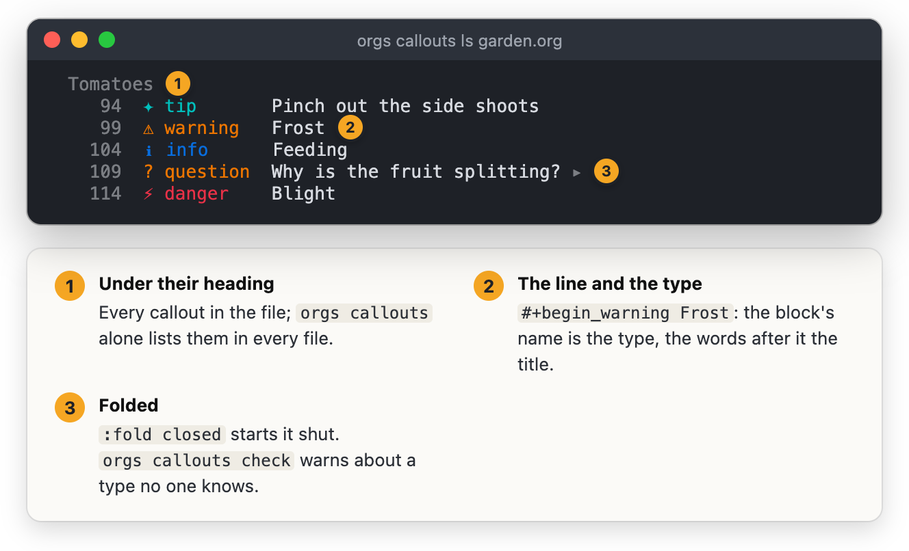

** In worg and VS Code

   *worg*: in the org editor each callout block is coloured by its type (a
   rule down the left, a faint ground, the icon on its begin line), folds from
   its begin line like a heading, and the bar's *Callout* menu inserts one
   (type, title and fold) around the selection or on a new line. The rendered
   view shows them as the html export does, folding ones with their toggles.

   *VS Code*: the same colouring, an icon and a hover on each begin line,
   folding, the callout types completed after =#+begin_=, and *Org: Insert
   Callout* (type, title, fold; wraps the selection). The preview is the html
   export.

* Backlink counts

  With =features: backlinkCounts:= on, orgs writes beside each heading how
  many places link to it, counting org links: =[[id:…]]=, =[[file:notes.org::*Plans]]=, =[[*Plans]]=,
  =[[#custom-id]]= - every link the backlinks panel already knows. Nothing
  is written into your files; the counts are worked out from the links that
  are there.

  #+BEGIN_SRC sh
  orgs features backlinkCounts on
  #+END_SRC

  - A heading's count is the number of *places* linking to it. A heading
    with three links to yours counts once (the number of links is in the
    tooltip). A link from a heading to itself does not count, and neither
    does a link to the file rather than a heading in it - that one counts
    for the file.
  - A link's count is how many *other* links go where it goes, so a link to
    a heading that six other notes link to as well says =↩ 6=.
  - Unlinked mentions - the heading's title or its =ROAM_ALIASES= /
    =ALIASES= written in plain text elsewhere - can be counted too (=≈ 2=).
    They cost the server more, so each client has a switch for them, and a
    title made only of common words ("Notes", "Meeting") is not searched for,
    as in the links panel.

** In worg

   Each linked-to heading has a small =↩ 3= badge, in the rendered page and
   in the org editor (where links others share get one too). The editor's
   badges follow your typing: the server counts the text you have, saved or
   not. Click a badge and the links panel opens at that heading, with every
   place linking to it on the line it is written on; click one to go there.
   The =≈= button in the links panel's header switches mention counts on and
   off for the badges.

   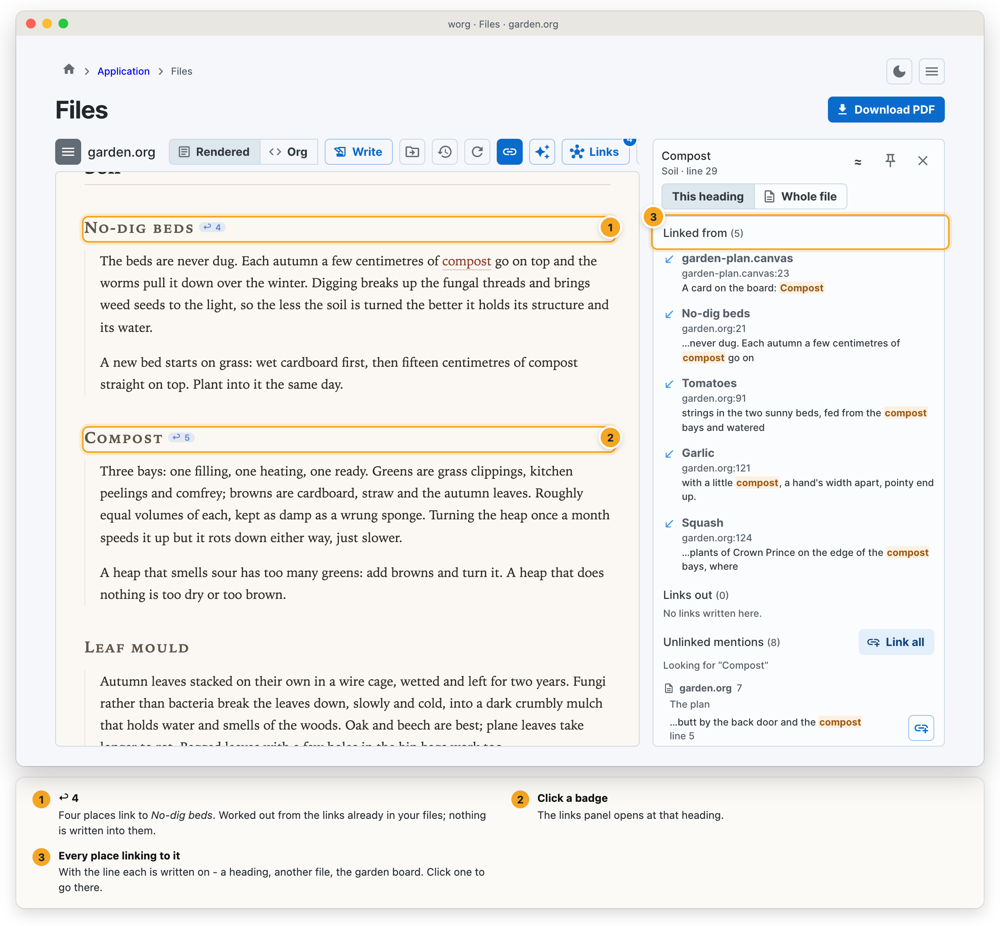

   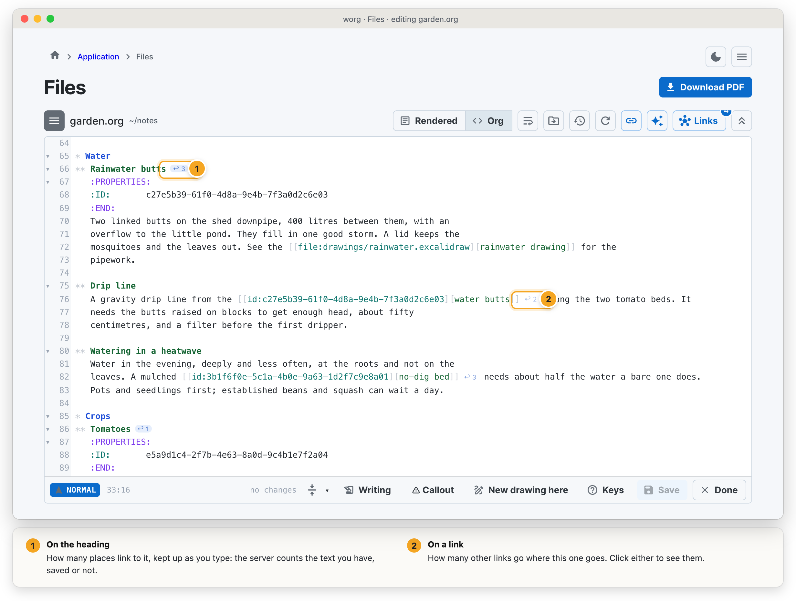

** On the command line

   #+BEGIN_SRC sh
   orgs linkcounts notes.org              # the linked-to headings, ↩ 3 beside each
   orgs linkcounts notes.org -all         # the whole outline
   orgs linkcounts notes.org -mentions    # ≈ 2 for unlinked mentions too
   orgs linkcounts notes.org -links       # every link in the file, and how many others go there
   orgs linkcounts -top                   # the most linked headings in the database
   orgs links counts notes.org            # the same as orgs linkcounts
   orgs linkcounts notes.org -json
   #+END_SRC

   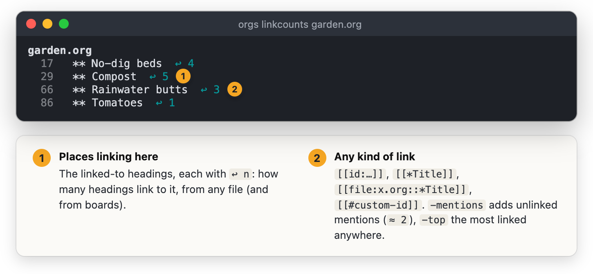

** In VS Code

   A code lens over each linked-to heading says =3 backlinks · 2 mentions=;
   clicking it lists the places, each with the line it is written on, and
   opens the one you pick. Links whose target others link to too get an
   inlay hint =↩ 4= after them, which lists the places for that target.
   =org.backlinkCounts.style= is =lens= (the default), =inlay= (=↩ 3 ≈ 2=
   at the end of the headline) or =off=; =org.backlinkCounts.mentions=
   counts mentions. *Org: Show What Links Here* does it for the heading at
   the cursor.

** In exports

   Off by default even with the feature on, because a published page is
   read by people who cannot follow the links. To have html exports write
   the badge after each linked-to heading:

   #+BEGIN_SRC yaml
   server:
     features:
       backlinkCounts: true
     backlinkCounts:
       export: true        # html exports get ↩ 3 after linked-to headings
       mentions: false     # ≈ 2 for unlinked mentions in exports too
   #+END_SRC

   The badge is a =<span class="org-backlinks">=, so a theme can style or
   hide it.

* Places on a map (org-osm)

  With =mapView= on, every heading that says where it is becomes a pin on a
  map: the cafe you mean to try, the places a trip went, the people in your
  contacts. It is a map view in org's own spelling. A place is the
  =:LOCATION:= property, the one org itself uses (Emacs's calendar export
  writes it into an event's LOCATION), so nothing new goes into your files
  unless you ask for it.

  #+BEGIN_SRC org
  ,* TODO Coffee at Revolver                                      :cafe:
  :PROPERTIES:
  :LOCATION: 49.2834, -123.1090
  :END:
  ,* Granville Island market                                      :food:
  :PROPERTIES:
  :LOCATION: Granville Island, Vancouver
  :END:
  #+END_SRC

** What a place can be

   =:LOCATION:= holds coordinates in any of the ways they are usually
   written, a link that has them, or words:

   | =49.2834, -123.1090=, =49.2834 -123.1090=                | decimal degrees, latitude first          |
   | =geo:49.2834,-123.1090=                                  | a geo: uri (RFC 5870)                    |
   | =49°17'N 123°7'W=, =48.8584 N, 2.2945 E=                 | degrees, minutes, seconds, hemispheres   |
   | =https://www.openstreetmap.org/?mlat=…&mlon=…=           | an OpenStreetMap link (or =#map=z/lat/lon=) |
   | =https://www.google.com/maps/place/…/@49.30,-123.14,14z= | a Google Maps link; a dropped pin wins over the view |
   | =https://maps.apple.com/?ll=…=, Bing's =cp=lat~lon=      | Apple and Bing links                     |
   | =[[https://…][Big Ben]]=                                 | any of those links as an org link        |
   | =Granville Island, Vancouver=                            | words: an address or a place name        |

   Also read: =:LATITUDE:= with =:LONGITUDE:=, and a contact's
   =:ADDRESS:= / =:ADDRESS_HOME:= / =:ADDRESS_WORK:= (the records'
   vcard fields), each its own pin, so somebody with a home and a work
   address shows twice, labelled.

** Addresses, and looking them up

   Words have to be looked up before they can go on a map. orgs asks
   [[https://nominatim.org][Nominatim]], OpenStreetMap's own geocoder, by
   default - one address a second, as its usage policy asks - and keeps
   every answer in =<config>_geocode.json= beside the server's yaml, so
   each address is asked for once. Nothing is looked up until you say:

   #+BEGIN_SRC sh
   orgs map geocode -all                     # every address not looked up yet
   orgs map geocode 'Granville Island'       # what the geocoder finds by that name
   orgs map geocode 'Market' -write          # this heading's address, kept as :GEO:
   #+END_SRC

   worg's Map tab has a *Find them* button for the same thing. Set
   =mapView.autoGeocode: true= to have new addresses looked up as the map
   asks for them.

   Coordinates found for an address can be written back beside it, only when
   you ask (=-write=, *Keep coordinates* in worg, *Keep as :GEO:* in VS
   Code), so Emacs, a phone or a server with no network has them too:

   #+BEGIN_SRC org
   :LOCATION: Granville Island, Vancouver
   :GEO:      49.270795,-123.134291
   #+END_SRC

   =:GEO:= belongs to the address beside it: giving the heading another
   place takes it off (or writes the new one). The name is
   =mapView.geoProperty= if you would rather another.

** The Map tab

   worg's *Map* (in the sidebar while the feature is on) is a real map -
   OpenStreetMap's tiles, which you can drag and zoom - with every place
   on it and a list beside it.

   - The *query box* is the one Search has: =IsTask()=,
     =HasTags("travel")=, =IsStatus("NEXT")= keep only those headings.
   - Pins are coloured *by keyword* (none, still to do, done) or *by tag*
     (the first tag's colour), with a legend. Pins close together are drawn
     as one counted circle; click it to zoom in.
   - A pin's card shows the heading's title, keyword, tags and the start of
     its text, with *Open* (the heading in Files), *Move pin*, *Edit
     place…* and a link to openstreetmap.org.
   - *Place a heading* - pick any heading, then click the map where it is or
     search an address and pick a result. Places not found yet are listed
     under *Not on the map*, each with a *Place* button. A click writes
     coordinates (to the precision the zoom allows); a picked address is
     written as you typed it, with its coordinates as =:GEO:= if you leave
     *Keep the coordinates* ticked.
   - Search's row menu has *Show on map*: the Map tab opens on that heading,
     or starts placing it if it has no place.
   - The copy button gives a =#+MAP:= line for what the map shows now (the
     query, the centre and zoom), to put the map in a page.

   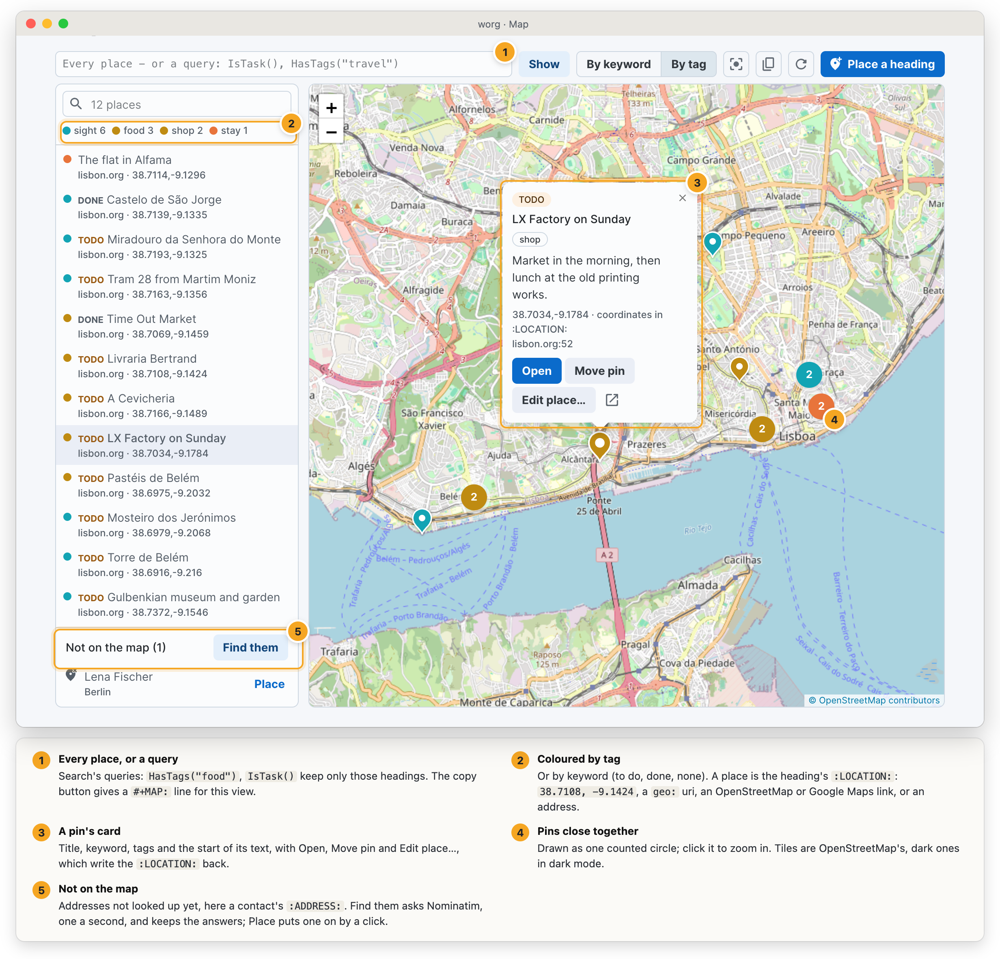

   The map follows worg's light and dark modes (dark tiles are the light
   ones turned, unless =mapView.tileDarkUrl= names a dark style).

** A map in a page: =#+MAP:=

   A =#+MAP:= line draws a map where it stands:

   #+BEGIN_SRC org
   ,* Vancouver
   ,#+MAP: title:"Around town" height:340

   ,* Trips
   ,#+MAP: query:"HasTags(\"travel\")" colour:tag title:"Trips"
   ,#+MAP: query:"IsTask()" center:"48.85,2.35" zoom:12
   #+END_SRC

   The words are written as a =#+TRACKER:= line's:

   | =query:"…"=          | the headings to show; without one, the places of the heading the line is under and its subtree (the whole file above the first heading) |
   | =center:"lat,lon"=   | where the map is centred (default: fitted to the places) |
   | =zoom:12=            | 0 (the world) to 19 (a street corner)                    |
   | =height:400=         | in pixels (default 360); =width:= likewise (720)         |
   | =colour:tag=         | pins by first tag rather than by keyword                 |
   | =title:"…"=          | a caption                                                |
   | =tiles:nil=          | draw the pins over a grid of degrees, without tiles      |

   An html export (and so worg's rendered view of the file) shows a picture
   of the map - OpenStreetMap's tiles composed on the server, numbered pins,
   each a link to openstreetmap.org - and the places as a numbered list
   below it. In worg's rendered view the picture becomes the live map. The
   plain text, LaTeX and Typst exporters write the list (each place linked
   to openstreetmap.org, with its coordinates). With the feature off the
   line is an unknown keyword and exports as nothing, as in Emacs.

   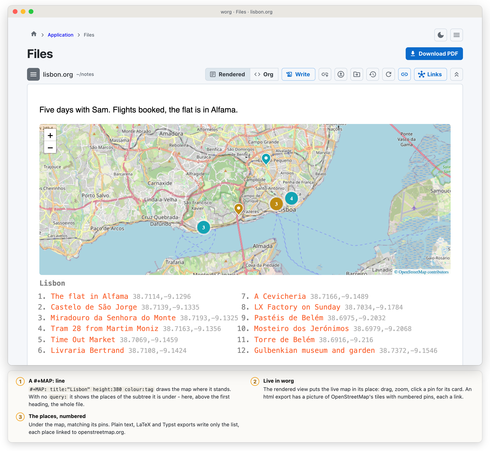

   Tiles are fetched with a User-Agent naming orgs, two at a time, at most
   thirty a picture, and kept for a month in the user cache folder
   (=orgs/map-tiles=). With =mapView.staticTiles: false=, or no network, the
   pins are drawn over a plain grid of degrees instead, so an export never
   fails for want of tiles.

** From the command line

   #+BEGIN_SRC sh
   orgs map                                   # every place: title, coordinates, file:line, how it was found
   orgs map coffee                            # headings whose title has the words (or a query: 'IsTask()')
   orgs map -placed -format geojson > places.geojson   # a GeoJSON FeatureCollection for anything else
   orgs map set 'Coffee at Revolver' '49.2834,-123.109'
   orgs map set Market 'Granville Island, Vancouver' -geo   # look it up now and keep :GEO:
   orgs map set Market ''                     # take the location off
   orgs map open Paris                        # in the OS's maps (Apple Maps on a mac), or -in osm|google|geo
   orgs map status                            # tiles, the geocoder, the cache
   #+END_SRC

   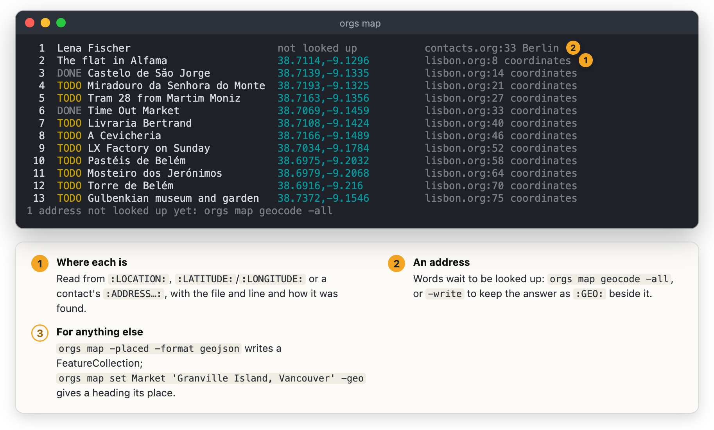

   The GeoJSON carries each heading's title, keyword, tags, file, line,
   hash and an openstreetmap.org link, with =marker-color= set as the map
   colours it (github and geojson.io draw it).

** In VS Code

   - Hovering a =:LOCATION:= line (or =:GEO:=, =:LATITUDE:=, an
     =:ADDRESS_…:=) shows a small map of the place with its coordinates and
     links to OpenStreetMap and to worg's Map; an address not looked up yet
     offers *Look it up*.
   - *Org: Show Map* opens worg's Map tab in a panel, on the heading at the
     cursor when it has a place.
   - *Org: Set Location* asks where the heading at the cursor is: type an
     address (the geocoder offers what it finds) or coordinates.

** Settings

   #+BEGIN_SRC yaml
   server:
     features:
       mapView: true
     mapView:
       geocodeUrl: https://nominatim.openstreetmap.org/search   # any Nominatim-compatible search
       email: ""            # sent with each lookup, as Nominatim asks of heavy users
       autoGeocode: false   # true: look new addresses up as the map asks for them
       geoProperty: GEO
       tileUrl: https://tile.openstreetmap.org/{z}/{x}/{y}.png
       tileDarkUrl: ""      # tiles for dark mode; empty: the light ones, darkened
       attribution: "© OpenStreetMap contributors"
       staticTiles: true    # false: exported maps without tiles
   #+END_SRC

   A tile server of your own (or a commercial one with its key in the url)
   goes in =tileUrl=; set =attribution= to what its terms ask for.

* Timelines

  With =timeline= on, dated headings become events on a timeline: a
  history note's people and battles, a project's tasks, a journal's days.
  It is a timeline in org's own spelling: the
  dates are org's own timestamps, planning lines and properties, a
  =#+TIMELINE:= line says what to draw with =key:value= words (as on a
  =#+PLOT:= or =#+TRACKER:= line), and Emacs reads the file as it always
  has.

  #+BEGIN_SRC org
  ,#+TITLE: A short history of England
  ,#+TIMELINE: group:tag title:"England, 55 BC to 1603" from:"60 BC" to:1610

  ,* Roman Britain                                                 :era:
  :PROPERTIES:
  :DATE:     43 -- 410
  :END:
  ,* Caesar crosses the Channel                                   :rome:
  :PROPERTIES:
  :DATE:     55 BC
  :END:
  ,* Sutton Hoo ship burial                                      :saxon:
  :PROPERTIES:
  :DATE:     c. 625
  :END:
  ,* Battle of Hastings                                    :war:norman:
  :PROPERTIES:
  :DATE:     1066-10-14
  :END:
  ,* Hundred Years' War                                            :war:
  :PROPERTIES:
  :DATE:     1337 -- 1453
  :END:
  #+END_SRC

  The line is never changed. worg's rendered view puts the live timeline in
  its place (drag it, zoom it, click an event), an html export the same
  picture as a still SVG, a Typst export the SVG inline, and LaTeX and plain
  text exports a chronological list. With the feature off the line is an
  unknown keyword and exports as nothing, as in Emacs.

** What becomes an event

   Each heading goes on the timeline once, with the first of these it has:

   | =:DATE:= property                       | a free date (below), a point or a span                 |
   | an org date range =<a>--<b>=            | a span, in its title or its own text                   |
   | =SCHEDULED:= and a later =DEADLINE:=    | a span from one to the other                           |
   | an active timestamp =<2026-11-04 Wed>=  | a point (with a time, at that time)                    |
   | =CLOSED:=                               | a point: when it was done                              |
   | =SCHEDULED:= or =DEADLINE:= alone       | a point                                                |
   | =:CREATED:=                             | a point                                                |
   | a datetree day                          | a point: a heading titled =2026-11-04 Wednesday=, or under one |

   With =clocks:t= every closed =CLOCK:= line is a span too (a heading's
   sittings, under the heading's own lane).

   - *Eras*: a heading with a span and =:TIMELINE: era= (or the tag
     =:era:=) is drawn as a band across the top with a faint wash down
     through every lane - a reign, a period, a phase of a project.
   - *Leave one out* with =:TIMELINE: no= (or the tag =:notimeline:=).
   - *Colour*: =:COLOR:= (or =:TIMELINE_COLOR:=) - =blue=, =orange=,
     =aqua=, =yellow=, =magenta=, =green=, =violet=, =red= or a =#hex= -
     overrides the lane's colour for that heading.

** History notes: the =:DATE:= property

   Org timestamps cannot say 44 BC, and are awkward for "about 1200" or
   "the 1950s". =:DATE:= takes a date the way a historian writes one:

   | =1066=, =1066-10=, =1066-10-14=      | a year, a month, a day                         |
   | =1066-10-14 09:30=                   | a moment                                       |
   | =14 October 1066=, =Oct 14, 1066=    | the same day in words                          |
   | =-500=, =500 BC=, =500 BCE=          | 500 BC (there is no year 0: =-1= is 1 BC)      |
   | =-44-03-15=                          | 15 March 44 BC                                 |
   | =AD 800=, =800 CE=                   | 800                                            |
   | =c. 1200=, =ca. 1200=, =circa 1200=, =~1200=, =1200?= | about 1200 (drawn hollow) |
   | =1950s=                              | the decade, as a span                          |
   | =12th century=, =5th century BC=     | the century, as a span (1101-1200; 500-401 BC) |
   | =1939-1945=, =1939 -- 1945=, =1914 to 1918=, =500 - 400 BC= | a span; the end is the end of its year (or month, or day) |
   | =<2026-11-04 Wed>=, =<a>--<b>=       | an org timestamp or range                      |

   A single day or year is a point at its start; a decade, a century or a
   range is a span. VS Code's hover on a =:DATE:= line says how it was read,
   and =orgs timeline date 'c. 1200'= does the same in a terminal.

** The =#+TIMELINE:= line

   | =query:"HasTags(\"history\")"= | the headings to draw: a query (any file). Without one, the line draws its own file |
   | =file:=                       | only files matching a glob or part of a path; =file:all= every file |
   | =group:=                      | the lanes: =tag= (a heading's first tag), =file=, =parent= (the heading above), =keyword=, =property:NAME=, =none=; =auto= (the default) picks files when there are several, else parents when they differ, else one lane |
   | =from:=, =to:=                | the range shown: a free date (=-500=, =1066=, =2026-01-01=) or a day as orgs reads one typed (=-1y=, =today=, =+2w=); =to:1945= includes all of 1945 |
   | =title:=                      | the timeline's title                                                       |
   | =height:=                     | in a rendered page, how tall the view may be before it scrolls (pixels) |
   | =clocks:t=                    | clocked time as spans                                                      |
   | =limit:=                      | the most events (2000; the most recent are kept)                           |

   Lanes take the chart palette's colours in the order they first appear;
   a lane past the eighth is grey.

** For Emacs readers: =#+BEGIN: timeline=

   A dynamic block takes the same words and writes the events as an org
   table - date, a link to the heading, and its lane - which =C-c C-c= (or
   =orgs dblock=) brings up to date:

   #+BEGIN_SRC org
   ,#+BEGIN: timeline group:tag from:1300 to:1500
   ,#+CAPTION: Timeline, 7 events, at [2026-11-05 Thu 07:28].
   | Date        | Event                                       | Lane   |
   |-------------+---------------------------------------------+--------|
   | 1337 – 1453 | [[*Hundred Years' War][Hundred Years' War]] | war    |
   | 1348 – 1350 | [[*Black Death][Black Death]]               | plague |
   | 1381        | [[*Peasants' Revolt][Peasants' Revolt]]     | war    |
   ,#+END:
   #+END_SRC

   A heading with an =:ID:= is linked by it; one in another file by
   =file:…::*Title=.

** In worg

   The *Timeline* tab (in the sidebar and the palette while the feature is
   on) shows every dated heading, a =#+TIMELINE:= line from the files, or a
   query, in lanes:

   - drag to pan, the wheel or a pinch to zoom about the pointer - from a
     million years across down to twenty minutes; =+= =-= and the arrows
     from the keyboard, =T= for today, =0= to fit everything;
   - the axis says what changed at each tick (=09:00=, then =Nov 4= at
     midnight; =Mar=, then =2026= in January; centuries as =500 BC=, =1=,
     =500=), under a band naming the larger unit - the month, the year, the
     millennium - which stays in view while it lasts;
   - spans are bars with their name inside when it fits, points are dots
     (hollow when approximate), and names never overlap: a lane grows rows
     instead;
   - hover an event for its date, how long it lasted, its lane and tags and
     its first lines; click it to open the heading;
   - a red line marks today; the strip underneath is the whole timeline with
     the part in view marked - drag it, or click to go there;
   - the lanes picker (tag, file, parent, keyword, a property), "Clocks",
     and *Jump to…*, which takes any date =:DATE:= does (=1066=, =44 BC=,
     =1950s=, =today=).

   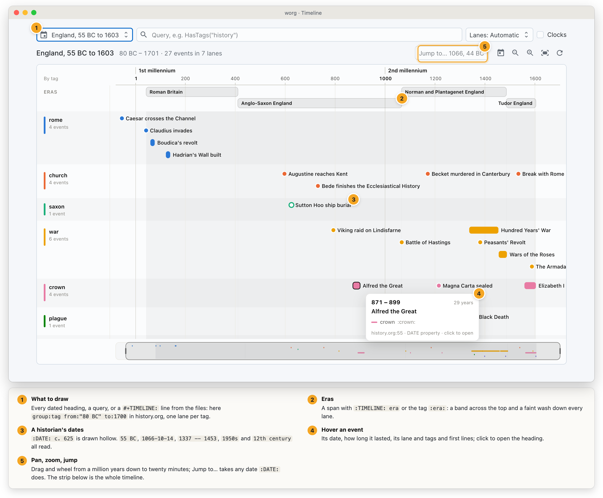

   In the Files tab's rendered view a =#+TIMELINE:= line is the same live
   timeline, sized to the page; the wheel scrolls the page until you click
   into it. *Open in Timeline ↗* opens the tab on it.

** On the command line

   #+BEGIN_SRC sh
   orgs timeline                          # every dated heading, by year and month
   orgs timeline 'HasTags("history")'     # a query's (by century for a long history)
   orgs timeline group:tag from:-500      # a #+TIMELINE: line's words
   orgs timeline -file project.org -group parent -from -1y -to today -clocks
   orgs timeline ls                       # the #+TIMELINE: lines
   orgs timeline svg -file history.org -out t.svg   # the exported picture
   orgs timeline date '5th century BC'    # how a :DATE: reads
   orgs timeline -json | jq '.Events[].Title'
   #+END_SRC

   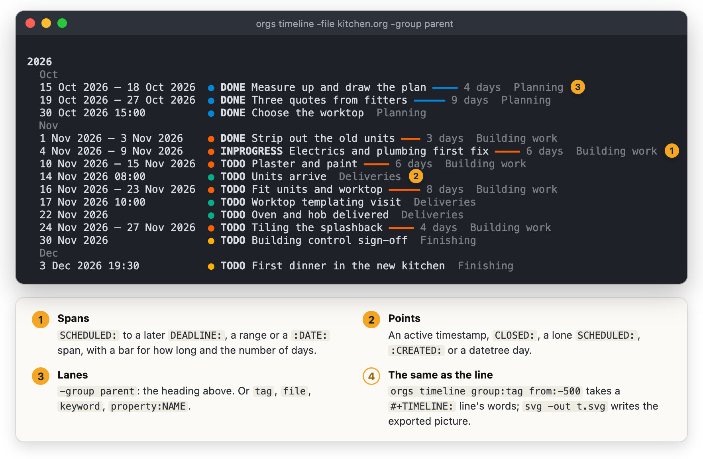

   Spans get a small bar (longer for longer, on a log scale) and how long
   they lasted; approximate dates a hollow =○=, eras =▒=.

** In VS Code

   - A code lens over every =#+TIMELINE:= line (and timeline block): its
     title, how many events in how many lanes and from when to when; click
     it to open worg's Timeline on it beside the file.
   - *Org: Show Timeline*: this file's, a query's, every dated heading, or
     any =#+TIMELINE:= line in the files.
   - Hover a =:DATE:= property to see how it was read (=c. 1200 · at 1200 ·
     a year · approximate=), or that it was not.

** Endpoints

   =GET /timeline/events= (=line=, =query=, =group=, =from=, =to=,
   =file=, =here=, =clocks=), =GET /timeline/list=, =GET /timeline/svg=
   (=width=), =GET /timeline/date?text== - see the API section.

* Books, films and games

  Look a book, film, TV show, game or album up in a public catalogue and
  orgs files it as a heading with its details, its cover and its
  description, written as an ordinary org record so Emacs reads it the same:

  #+BEGIN_SRC org
  ,* Books
    :PROPERTIES:
    :COLLECTION: book
    :END:

  ,** Dune  :fiction:science_fiction:
     :PROPERTIES:
     :RECORD:         book
     :ID:             3ef37370-8e60-4825-8f08-1ed2789b3d5f
     :ADDED:          [2026-11-05 Thu 07:14]
     :AUTHOR:         Frank Herbert
     :PUBLISHED_DATE: 1965
     :PUBLISHER:      Ace Trade
     :PAGES:          544
     :ISBN:           9780441013593
     :URL:            https://openlibrary.org/works/OL893414W
     :MEDIA_ID:       openlibrary:OL893414W
     :IMAGE:          [[file:images/book/dune.jpg]]
     :STATUS:         reading
     :RATING:         4
     :STARTED_DATE:   [2026-11-05 Thu 07:14]
     :END:

     Set on the desert planet Arrakis, Dune is the story of the boy Paul
     Atreides...
  #+END_SRC

  Turn it on with =orgs features mediaDb on= (or Settings → Org packages
  in worg, or Org: Turn orgs Features On or Off in VS Code).

** What it looks up, and where

   | Kind        | Catalogues, in the order asked                            | Key                          |
   |-------------+-----------------------------------------------------------+------------------------------|
   | =book=      | Open Library (titles, authors, ISBNs), Google Books       | none; Google's is optional   |
   | =film=      | TMDB, else Wikidata and Wikipedia                         | TMDB needs one               |
   | =show= (TV) | TMDB, else Wikidata and Wikipedia                         | TMDB needs one               |
   | =game=      | IGDB, RAWG, else Wikidata and Wikipedia                   | IGDB and RAWG need one       |
   | =album=     | MusicBrainz, covers from the Cover Art Archive; Wikidata  | none                         |
   | =other=     | Wikipedia                                                 | none                         |

   So books, albums, and films, shows and games by way of Wikidata work with
   nothing set up. A catalogue without its key is skipped, and one that
   cannot be reached is passed over for the next: the search says which
   were asked and what each answered. Answers are kept for an hour, and
   MusicBrainz is asked no more than once a second, as it asks.

   An ISBN - typed, pasted with hyphens, or scanned - is looked up directly.
   Search for an album as =OK Computer by Radiohead= or =Radiohead - OK
   Computer=.

** The heading

   Each one is a record (see Records): =:RECORD: book= (=film=, =show=,
   =game=, =album=, =other=), so the records browser and collections list
   them, with fields named so they are shown as what they are - a date, a
   link, a picture:

   | Kind  | Fields                                                                 |
   |-------+------------------------------------------------------------------------|
   | book  | =AUTHOR=, =SUBTITLE=, =PUBLISHED_DATE=, =PUBLISHER=, =PAGES=, =ISBN=, =LANGUAGE= |
   | film  | =DIRECTOR=, =CAST=, =RELEASE_DATE=, =RUNTIME=                           |
   | show  | =CREATOR=, =CAST=, =FIRST_AIRED_DATE=, =NETWORK=, =SEASONS=, =EPISODES= |
   | game  | =DEVELOPER=, =PUBLISHER=, =RELEASE_DATE=, =PLATFORMS=                   |
   | album | =ARTIST=, =RELEASE_DATE=, =LABEL=, =TRACKS=                             |

   and for all of them =URL= (the page about it at the catalogue), =IMAGE=
   (the cover, saved in =images/<kind>/= beside the org file and linked
   relatively), =MEDIA_ID= (=catalogue:id=, how orgs knows it again) and
   =STATUS=. Genres become tags (=science_fiction=), the description is the
   heading's text, and an album's tracks are a numbered list under it.

   The same =MEDIA_ID= or ISBN already filed is refused, saying where it is,
   unless you add it again on purpose.

   A new one goes, in this order of preference: where you say (a file and
   a heading); else where the yaml puts that kind; else under the kind's
   collection heading; else under a new collection heading (Books, Films,
   TV shows, Games, Albums) in =library.org=.

** Shelves and stars

   Every one is on a shelf: /up next/, /in progress/, /done/ or /set
   aside/ - for a book "to read", "reading", "read"; for a film "to watch",
   "watching", "watched"; "to play", "playing", "played" for a game. The
   shelf is

   1. the =STATUS= property, if it has one (any of those words, or =want=,
      =doing=, =done=, =dropped=, =finished=, =dnf=, =on hold=...);
   2. else its TODO keyword: a done keyword is done (=CANCELLED= is set
      aside), =TODO= is up next, any other - =READING=, =NEXT=, =STARTED= -
      is in progress;
   3. else =FINISHED_DATE= means done and =STARTED_DATE= in progress;
   4. else up next.

   Moving one to a shelf writes =STATUS=, and =STARTED_DATE= when you start
   it or =FINISHED_DATE= when you finish it if it has none yet. =RATING= is
   0 to 5 stars, halves allowed (=4.5=); =8/10= and =★★★★= are read too.
   A keyword is never changed, so a file kept with =TODO=/=DONE= stays that
   way (and =STATUS=, once written, wins over it).

** A shelf in a document

   #+BEGIN_SRC org
   ,#+BEGIN: library :kind book :shelf read :sort rating :limit 10
   ,#+END:
   #+END_SRC

   fills in a table of title (a link to its heading), author, year, status
   and stars. =:kind= is any kind or =all=, =:shelf= a shelf or one of its
   words, =:sort= =added= (the default), =title=, =creator=, =year= or
   =rating=. It is refreshed like any dynamic block (=C-c C-c=, worg,
   =orgs dblock=, and before an export).

** Filling in again

   A heading typed by hand - a title, perhaps an =ISBN= or an =AUTHOR= - or
   one filed before a catalogue knew more can be looked up again: by its
   =MEDIA_ID=, else its ISBN, else its title (and author and year to choose
   among the hits). Only what is missing is written - fields, the cover, the
   genre tags, and the description when the heading has no text of its own
   - and =STATUS= and =RATING= are never touched.

** From the command line

   #+BEGIN_EXAMPLE
   orgs library search book dune                 the catalogue's hits, with their ids
   orgs library add book dune                    choose one in a picker and file it
   orgs library add book 9780441013593 -status reading -rating 4
   orgs library add film -id movie/329865 -source tmdb -file films.org -under "To watch"
   orgs library add album ok computer by radiohead -first
   orgs library add other -id Eiffel_Tower -preview   the heading it would write
   orgs library ls [book] [-shelf doing]         what you have
   orgs library show dune
   orgs library set dune -status read -rating 4.5    (or: finish dune, start, drop, rate dune 4)
   orgs library refresh "left hand"              fill in what it is missing
   orgs library sources                          which catalogues can be asked
   #+END_EXAMPLE

   Every command takes =-json=. Under a pipe, =add= with several hits
   refuses and says how to choose (=-id= or =-first=) rather than asking.

   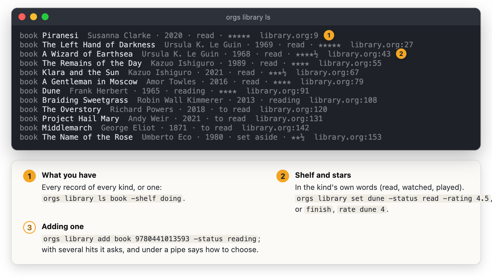

** In worg and VS Code

   worg's Library tab shows what you have as shelves of covers, by kind,
   with the stars clickable on every cover; sort by when added, title,
   author, year or rating, filter by words or a tag. Click a cover for its
   details: move it to another shelf, rate it, fill its details in again,
   open its heading. The search box above looks things up; a hit opens with
   its cover and description, and you choose the shelf, stars and where it
   goes before adding it. On a phone, the barcode button scans a book's
   ISBN with the camera (Chrome and Edge on Android, Safari 17+; the page
   must be on https or localhost).

   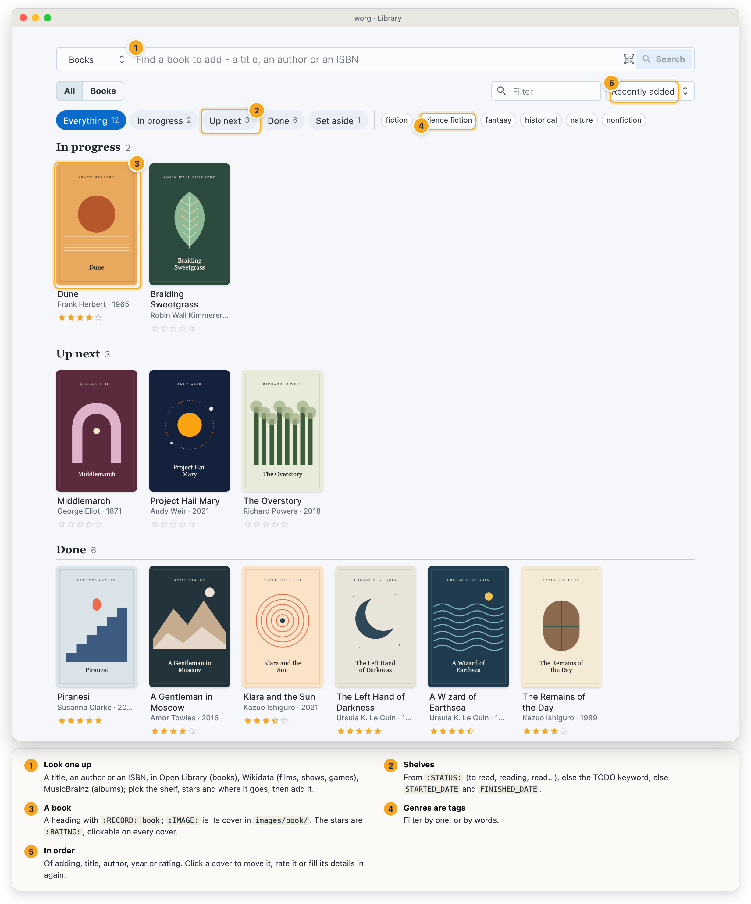

   VS Code has Org: Add Book, Film or Game… (a live search as you type; put
   the heading at the cursor as an edit you can undo, have the server write
   it in this file with the cover saved, or file it where that kind goes),
   Org: Refresh Media Details and Org: Rate or Shelve Media for the heading
   at the cursor, and Org: Open Library for worg's tab in a panel.

** Settings

   #+BEGIN_SRC yaml
   server:
     features:
       mediaDb: true
     mediaDb:
       contact: you@example.com    # put in the User-Agent, as MusicBrainz and Wikipedia ask
       language: en                # for Wikipedia, Wikidata and TMDB
       noCovers: false             # link the cover's url instead of saving it
       maxTags: 5                  # genres written as tags; noTags: true for none
       keys:
         tmdb: env:TMDB_KEY        # a v3 api key or a v4 read token
         googlebooks: env:GOOGLE_BOOKS_KEY
         rawg: keyring:rawg
         igdbClientId: abc123      # a Twitch application's id and secret
         igdbClientSecret: keyring:igdb
       urls:                       # point a catalogue elsewhere (a mirror, a proxy)
         openlibrary: https://openlibrary.org
       kinds:
         book:
           file: books.org
           under: Reading list     # a heading title or a::b path in that file
           sources: [openlibrary, googlebooks]
           fields: [AUTHOR, PUBLISHED_DATE, ISBN, PAGES]   # only these (MEDIA_ID and STATUS always)
           status: to read         # what a new one starts as
         film:
           capture: Film           # or: a capture template's target
   #+END_SRC

   A key is written as it is, as =env:NAME= (read from the server's
   environment) or =keyring:NAME= (the OS keyring, service =orgs=).
   Attribution: book data from Open Library; film and TV data from TMDB
   ("This product uses the TMDB API but is not endorsed or certified by
   TMDB"); games from IGDB.com or RAWG; albums from MusicBrainz and the
   Cover Art Archive; Wikidata (CC0) and Wikipedia text (CC BY-SA). Each
   heading's =URL= links back to the page it came from.

* Hover previews

  Rest the pointer on a link and a card shows what it points at: the heading
  an =id:= names, a =[[*Heading]]= of the same file, a heading or a custom id
  in another file, the start of a whole file, a picture, a pdf, a recording,
  or a web page's title, description and picture. It works over ordinary
  org links - nothing is added to your
  files, and Emacs reads them as it always did.

  #+BEGIN_SRC sh
  orgs features hoverEditor on
  #+END_SRC

  Every kind of link org writes works:

  #+BEGIN_SRC org
  ,* Garden
  See [[id:6a1e2c4d-…][the soil notes]], [[*Watering]], [[Watering]],
  [[file:notes.org::*Soil]], [[file:notes.org::#beds]], [[file:notes.org::42]],
  [[file:notes.org]], [[file:plans/bed.png][the bed plan]],
  [[file:papers/compost.pdf]] and https://example.com.
  #+END_SRC

  A relative link is read against the file it is written in, as org reads it.

** In worg

   Anywhere worg shows org - the rendered page, the Org view, the editor,
   search results, kanban card backs, canvas cards - resting on a link for a
   moment opens its card. Hold ⌘ (ctrl elsewhere) to open it at once.

   - Moving off the link and the card closes it; *pin* it to keep it.
   - Drag the card by its header to move it (that pins it too), and its
     corner to size it.
   - A link inside a card opens another card on top of it.
   - *Open* goes to the heading; *Edit* turns the card into an editor of the
     heading's own lines. ⌘S saves them, and only those lines are written. If
     the file changed since the card read it, the save is refused and says
     so; *Reload* reads it again.
   - Esc closes the top card.

   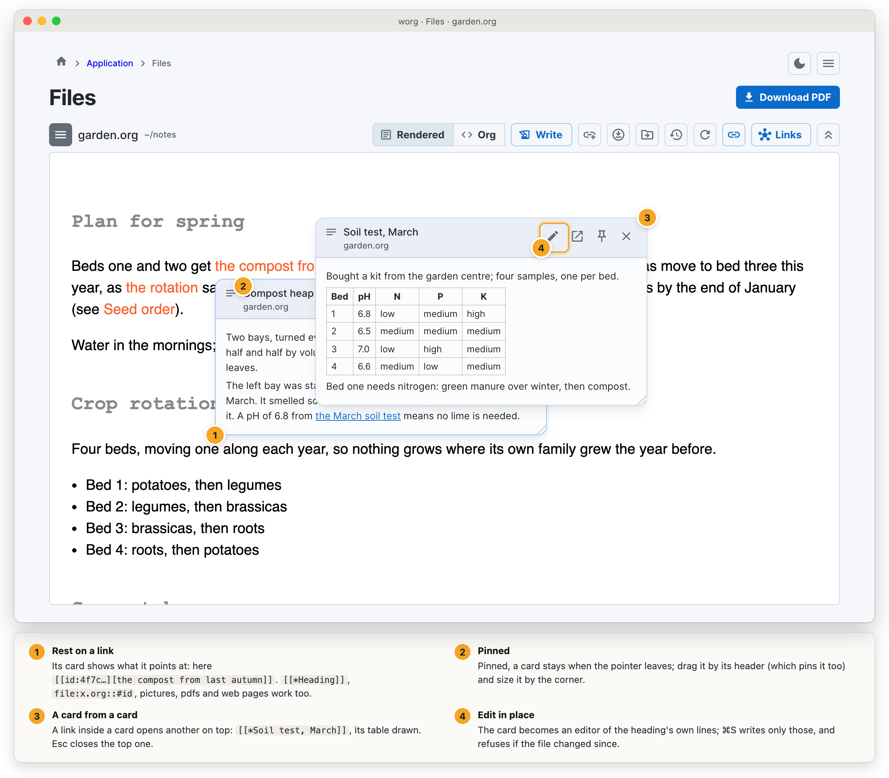

** On the command line

   #+BEGIN_SRC sh
   orgs peek id:6a1e2c4d-…                  # the heading, coloured like orgs show
   orgs peek '[[*Soil]]' -from notes.org    # read against notes.org
   orgs peek file:notes.org::#beds -lines 10
   orgs peek https://example.com            # title and description
   orgs peek id:6a1e2c4d-… -edit            # open it in $EDITOR at its line
   orgs peek id:6a1e2c4d-… -json            # everything the server answered
   #+END_SRC

   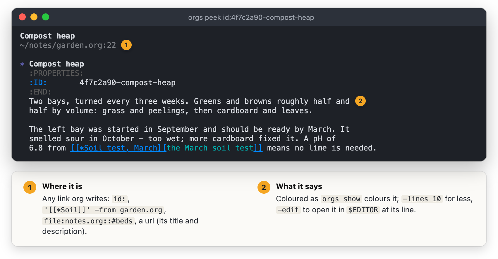

** In VS Code

   Hovering a link shows its target as text, read straight from the
   workspace when the file is there and from the server otherwise, with
   three actions:

   - *Open* - the target, at its line;
   - *Peek* - VS Code's peek view on the target, where it can be edited
     without leaving the file you are in (also *Org: Peek Link Target* for
     the link under the cursor);
   - *Edit in place* - the target's subtree narrowed into a tab of its own;
     saving it writes it back.

** Settings

   Every key is optional.

   #+BEGIN_SRC yaml
   server:
     hoverEditor:
       noWeb: false          # web links show only their address; nothing is fetched
       privateHosts: false   # let a preview fetch addresses on this machine or its network
       timeout: 8s
       userAgent: ""         # default: orgs/<version> (link preview)
   #+END_SRC

   A web page is read by the server, only while the feature is on: its
   =<head>= (OpenGraph, then twitter:, then the plain title and
   description), at most a megabyte, with a timeout, and cached for six
   hours (ten minutes when it could not be reached). Addresses on the
   server's own machine and network are refused unless =privateHosts= is
   set. The picture is loaded by your browser from the page's site. With
   no network, a web link's card shows its address.

* Link titles from the web (org-cliplink)

  Paste a web address and get the page's title with it, the way Emacs's
  org-cliplink does. Nothing new is written into
  your files: an ordinary org link,

  #+BEGIN_SRC org
  Watch [[https://www.youtube.com/watch?v=dQw4w9WgXcQ][Rick Astley - Never Gonna Give You Up (Official Video)]] later.
  #+END_SRC

  The server reads the page (a browser may not read another site's page,
  and the command line has no page to read). The title is the page's own,
  with the site's furniture taken off: =" - YouTube"=, =" · GitHub"=,
  =" - Wikipedia"=, =" - Stack Overflow"= and its tag in front, and any
  =" | Site"= or =" - Site"= that is the page's own site name. Videos on
  YouTube, Vimeo, SoundCloud, Spotify and Flickr are asked through their
  oEmbed endpoints, which give the video's own title and channel. Brackets
  in a title become braces, so they cannot end the link early (org-protocol
  links are written the same way).

  - *worg*: in the org editor, paste a url on its own. It goes in as
    =[[url][Fetching title…]]= at once and the title replaces the
    placeholder when it comes; the cursor stays where you are. One undo
    goes back to the plain url, a second takes the paste away. With words
    selected, the paste makes =[[url][those words]]= without fetching
    anything. *Shift-paste* (ctrl/cmd+shift+v) pastes the url as it is. The
    capture dialog's body and the heading editor's body do the same. In
    source blocks, property drawers, =#+= lines, tables and inside a link a
    paste is left alone.

    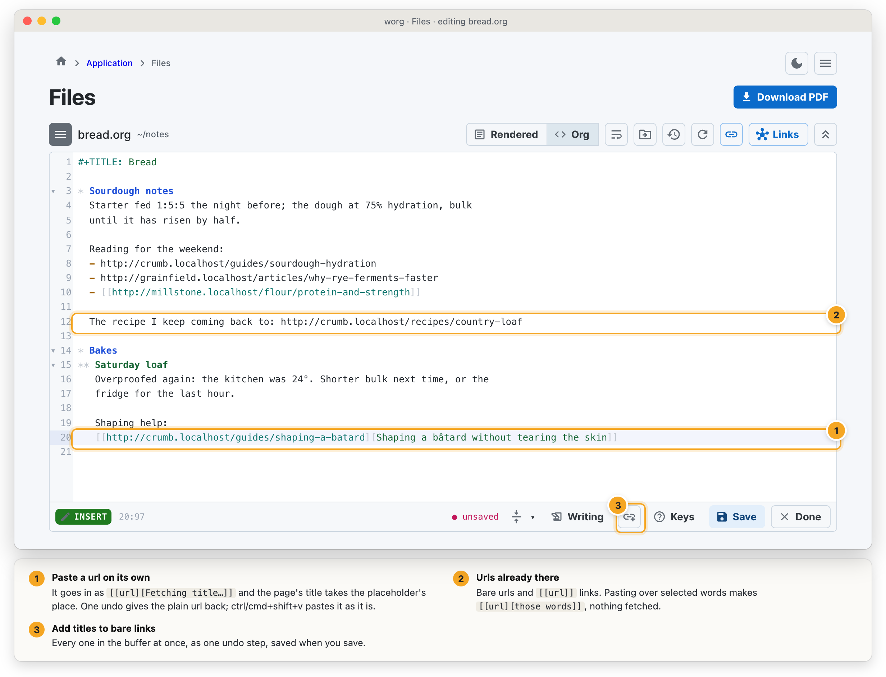
  - *Add titles to bare links* (the link button in the Files tab's bar and
    in the editor's bar) lists every bare url and =[[url]]= in the file with
    the title its page gives; change any title, untick any to leave it, then
    *Add titles*. From the Files tab the server writes the file (and refuses
    if it changed since the list was made); in the editor the buffer
    changes, as one undo step, and is saved when you save.

    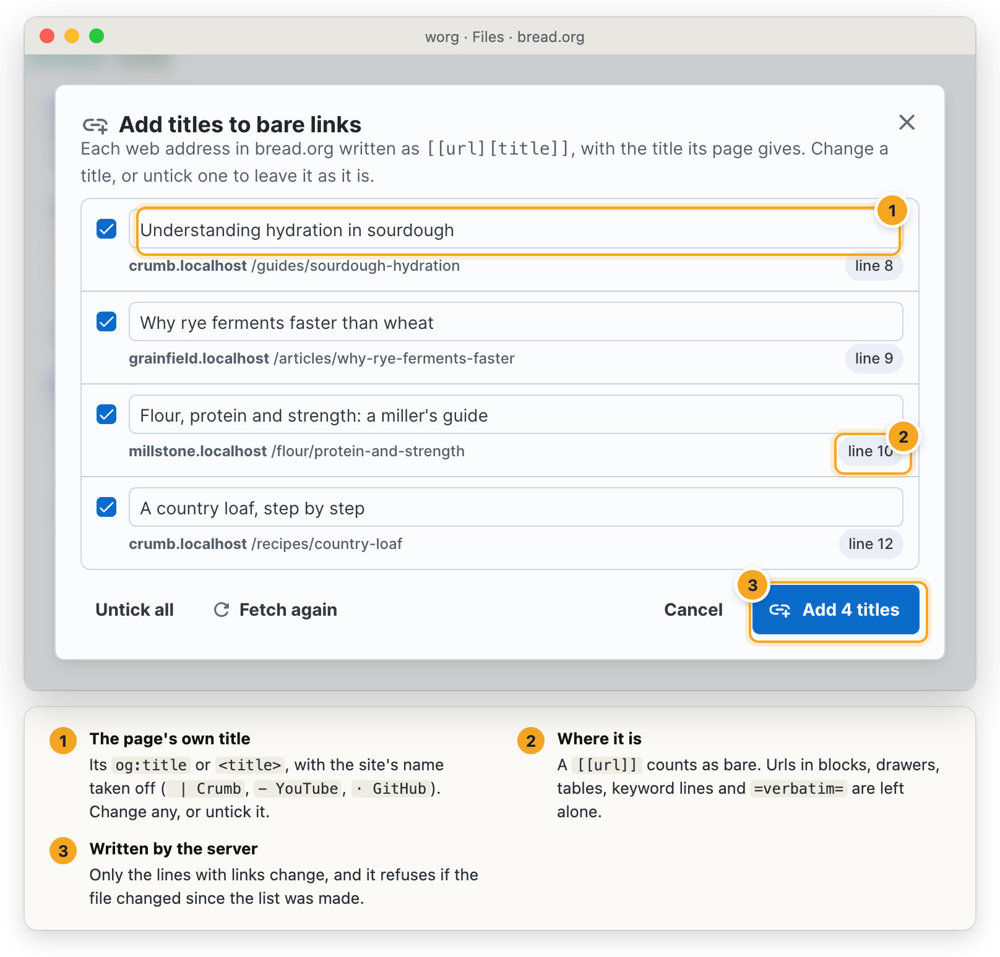
  - *VS Code*: ctrl/cmd+v in an org file does the same as worg's paste
    (ctrl/cmd+shift+v pastes plain), and *Org: Add Titles to Bare Links*
    lists the buffer's bare links in a pick list.
  - *The command line*:

    #+BEGIN_SRC sh
    orgs link-title https://orgmode.org/manual/Hyperlinks.html
    # [[https://orgmode.org/manual/Hyperlinks.html][Hyperlinks (The Org Manual)]]
    orgs link-title -title URL                # the title alone
    pbpaste | orgs link-title                 # every url on stdin, one link a line
    orgs link-title -filter < notes.org       # the text back with its bare urls titled
    orgs link-title -retitle notes.org        # the diff, then asks before writing
    orgs link-title -retitle notes.org -dry-run
    #+END_SRC

    =-filter= is for an editor: in vim, =:'<,'>!orgs link-title -filter=.

    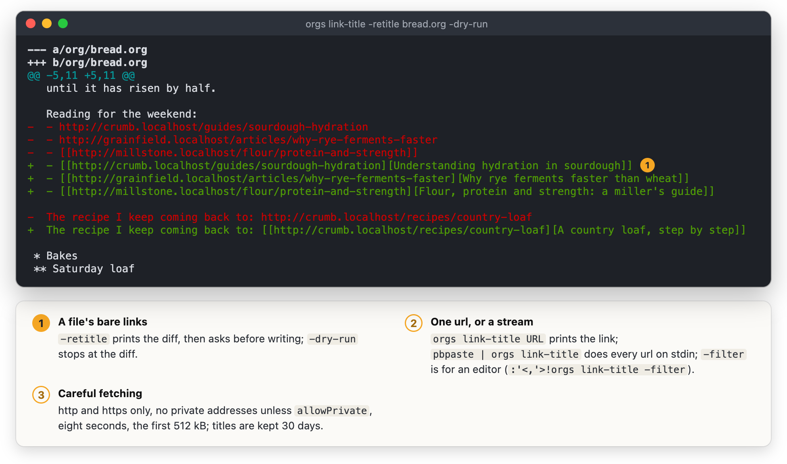

  A url that cannot be read (no network, a page that says 404, a pdf) stays
  =[[url]]=, and says why. *Add titles to bare links* leaves alone urls in
  source, example, export and comment blocks, in property drawers, on
  keyword and fixed-width lines, in tables (a title would push the columns
  out of line), inside other links and in =verbatim=.

  The fetch happens on every paste, so it is careful: http and https only;
  never a private address (127.0.0.1, 10.x, 172.16-31.x, 192.168.x,
  169.254.x, localhost), checked again on every redirect and on the address
  actually dialled, unless =allowPrivate= says otherwise; eight seconds, the
  first 512kB, one request at a time per site. Titles are kept 30 days (in
  memory and in the user cache folder, =orgs/link-titles.json=), so a url
  pasted twice is asked about once.

  #+BEGIN_SRC yaml
  server:
    features:
      autoLinkTitle: true
    autoLinkTitle:
      rules:                       # your cleanups, tried before the built-in ones
        - host: example.com        # also www.example.com, docs.example.com
          strip: [" \\| Example Docs$"]   # regular expressions, removed from the title
      ignore: [docs.google.com]    # never fetched: the paste stays a plain url
      allowPrivate: false          # true: fetch intranet and localhost pages too
      keepSiteName: false          # true: keep " - Site" on every title
      noDefaultRules: false        # true: only your rules
      noOembed: false              # true: never ask a video site's oEmbed endpoint
      cacheFor: 30d
      timeout: 8s
  #+END_SRC

* Quick maths typing (cdlatex)

  Org already reads LaTeX maths in the middle of text: =\( … \)= and
  =$…$= inline, =\[ … \]= and =$$ … $$= on a line of their own, and an
  environment such as =\begin{equation} … \end{equation}= or
  =\begin{align}= at the start of a line. Typing it is slow. With
  =latexSuite= on, orgs types it the way Emacs's
  cdlatex does: short triggers
 expand as you type, TAB moves through the
  places a snippet leaves to fill, and the maths under the cursor is drawn
  as you write it.

  #+BEGIN_SRC org
  ,* Euler
  The identity mk e^{i@p} + 1 = 0
     → The identity \( e^{i\pi} + 1 = 0 \)
  dm  sum  n  TAB  TAB  ooo  TAB  1/n^2  TAB  =@p^2/6
     → \[ \sum_{n=1}^{\infty} \frac{1}{n^2} = \frac{\pi^2}{6} \]
  #+END_SRC

  Nothing in the file is special: what is written is plain org maths, so
  Emacs, pandoc and every exporter read it as they always have.

  - *Into maths*: =mk= makes =\( \)= and =dm= a display block (=\[ \]= on
    lines of their own); =beq= and =bal= make an =equation= and an =align=.
    They work in text, after a space.
  - *In maths*: =@a= is =\alpha= (=`a= too, as in cdlatex), =//= a
    fraction, =sr= =^{2}=, =x1= =x_1=, =->= =\to=, =<== =\leq=, =RR= =\mathbb{R}=,
    =sum= a sum with its limits, =lr(= a pair of =\left( \right)=, =pmat= a
    matrix, =xhat= =\hat{x}=, =sin= =\sin= - about 170 of them. Typing a
    command's name in full (=\sqrt=) never expands inside it.
  - *a/* makes the term before the slash the top of a fraction:
    =(a+b)/= is =\frac{a+b}{}=, =2\alpha^2/= is =\frac{2\alpha^2}{}=.
  - In the example above (each step typed with no spaces between) =sum= wrote =\sum_{i=1}^{n}= with the =i=
    selected: =n= replaced it, TAB kept the =1=, =ooo= made the top
    =\infty=, and TAB went on past it.
  - *TAB* expands the snippets that wait for it (=int=, =par=), jumps to the
    next place a snippet left (=\frac{|}{}= then the bottom, then after it),
    and otherwise moves the cursor out of the bracket it is in. One undo
    gives back what you typed before a snippet expanded.
  - *With a selection*, a key wraps it: =S= in a square root, =U= under a
    brace, =C= crossed out, =(= in =\left( \right)=, and in text =$= makes it
    maths.

  orgs keeps the snippets as org tables, so they are yours to change.
  =orgs latex init= (or *Make my own snippets file* in worg) writes
  =latex-snippets.org= beside your notes:

  #+BEGIN_SRC org
  ,* Mine
  | Trigger | Replacement              | Options | Description           |
  |---------+--------------------------+---------+-----------------------|
  | sr      | ^{2}                     | mA      | squared (as built in) |
  | ip      | \langle $1, $2 \rangle$0 | mA      | an inner product      |
  | ooo     |                          | mA      | (no ∞ snippet)        |
  #+END_SRC

  Every table in the file with a Trigger and a Replacement column is read.
  A row with the same trigger and modes as a built-in one replaces it; an
  empty replacement turns it off. The built-in set is the same kind of file
  (=orgs latex snippets -builtin= lists it).

  - *Options*: =t= in text, =m= in any maths, =n= inline maths only, =M=
    display maths only; =A= as you type (otherwise on TAB); =r= the trigger
    is a pattern, matched against what is just before the cursor, with
    =[[0]]= its first group (=([A-Za-z])hat= → =\hat{[[0]]}=); =w= not
    straight after a letter; =v= wraps the selection, written =${VISUAL}=.
  - *Replacement*: =$1=, =$2=… are the places TAB visits, =${1:x}= one with
    =x= already in it, =$0= where the cursor ends. The same number twice is
    typed in both places at once (=\begin{$1} … \end{$1}=). In a table cell
    =\vert= is a =|= and =\n= a new line.

  #+BEGIN_SRC sh
  orgs latex snippets                    # every snippet, by group
  orgs latex snippets greek              # those with every word
  orgs latex expand 'x + @a'             # what typing that becomes: \alpha
  orgs latex expand -plain -tab '\( x int'   # the line as it would read
  orgs latex check notes.org             # problems in the file's maths
  orgs latex check notes.org -format quickfix -check   # for an editor or a hook
  orgs latex init                        # latex-snippets.org to edit
  #+END_SRC

  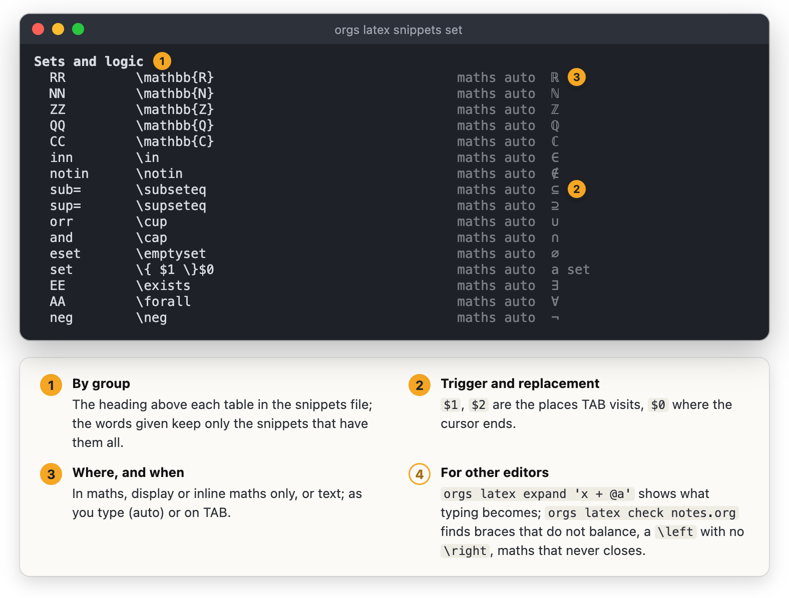

  =orgs latex expand= is for editors with no engine of their own: it reads
  the mode from the delimiters in what it is given (=-mode inline= says it
  outright) and works from the built-in set when no server answers.
  =orgs latex check= finds braces that do not balance, a =\left= with no
  =\right=, environments that are not ended (or end another), environments
  KaTeX and MathJax do not draw, maths that never closes, and =$ x$= - with
  a space after the dollar org reads it as text, not maths.

  In worg's editor the maths the cursor is in is drawn just below it as you
  type (a small card, light or dark with the page), and the places a
  snippet left are underlined until TAB reaches them. ⌘⌥L (or *Maths
  snippets* in the palette) opens the cheat sheet: every snippet drawn as it
  comes out, searchable, with the switches - expand as I type, a/ makes a
  fraction, preview the maths, and *draw maths in place*, which shows every
  piece of maths drawn except the one the cursor is in, as org-fragtog does
  in Emacs. Rendered pages draw the maths with KaTeX.

  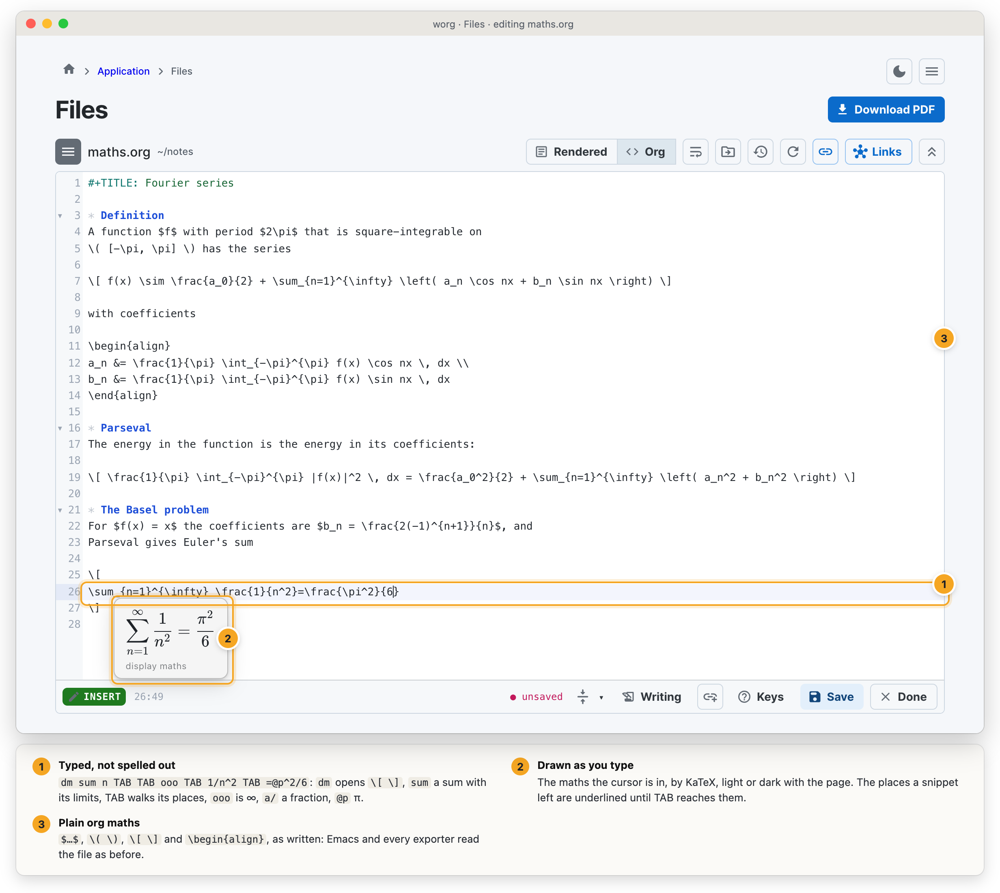

  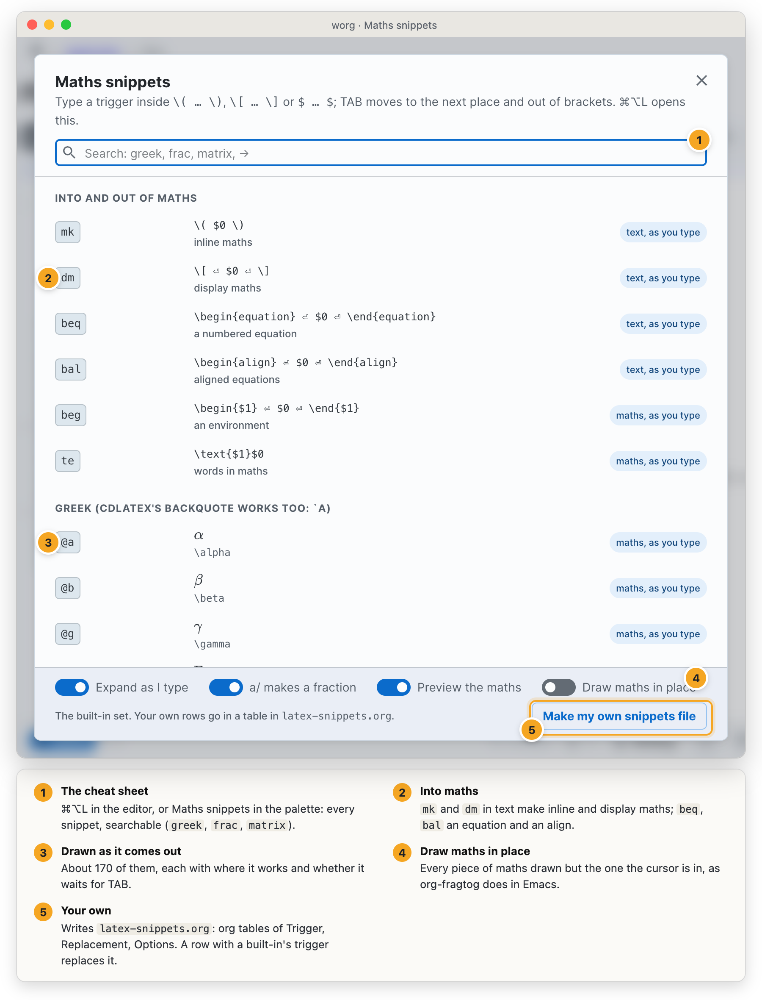

  In VS Code the same snippets expand as you type in an org file, TAB
  works in maths, *Org: Preview Maths* opens a panel beside the editor that
  draws the maths under the cursor as you type, a hover over maths offers
  it, and the file's maths is checked when it is opened or saved (the
  Problems panel). *Org: Show Latex Snippets* lists them and inserts one,
  *Org: Wrap Selection in a Maths Snippet* does the selection ones, *Org:
  Toggle Latex Suite* turns the typing off and on.

  An html export draws its maths with KaTeX, loaded from a CDN unless
  =latexSuite.katex= names another copy (or =off=); LaTeX, Beamer and PDF
  exports pass the maths through as written.

  #+BEGIN_SRC yaml
  server:
    features:
      latexSuite: true
    latexSuite:
      snippets: latex-snippets.org   # your own tables, from the first org directory
      noBuiltin: false               # true: only your own snippets
      katex: https://cdn.jsdelivr.net/npm/katex@0.16.11/dist   # what an html export loads; "off" for none
  #+END_SRC

* Keep web pictures here (org-download)

  A note clipped from the web links its pictures where they were found, and
  those links break when the site moves, and show nothing on a plane. This
  downloads each one beside the notes and points the link at the copy, the
  way Emacs's org-download writes one. Turn it on with
  =orgs features localImages on=.

  Before and after:

  #+BEGIN_SRC org
  ,* The lake
    #+CAPTION: The lake at dawn
    #+ATTR_HTML: :width 300
    [[https://photos.example/lake.png]]

    We walked past [[https://photos.example/forest.jpg][the forest]] on the way.
  https://cdn.example/photo-1501785888041
  #+END_SRC

  #+BEGIN_SRC org
  ,* The lake
    #+DOWNLOADED: https://photos.example/lake.png @ 2026-11-05 10:20:33
    #+CAPTION: The lake at dawn
    #+ATTR_HTML: :width 300
    [[file:images/lake.png]]

    We walked past [[file:images/forest.jpg][the forest]] on the way.
  #+DOWNLOADED: https://cdn.example/photo-1501785888041 @ 2026-11-05 10:20:33
  [[file:images/photo-1501785888041.jpg]]
  #+END_SRC

  *What counts as a web picture.* A link to an http or https url whose name
  ends like a picture (=.png=, =.jpg=, =.jpeg=, =.gif=, =.webp=, =.avif=,
  =.bmp=; =.svg= with =svg: true=), with or without a description, and a
  picture's url written on a line of its own. A url with no extension at all
  (=https://cdn.example/photo-1501=) is a picture only when its server says
  so: orgs asks it (a =HEAD=, or the first kilobyte). Left alone: urls in
  source, example, export and comment blocks, in drawers and property lines,
  in headings and in =#+= keyword lines, and urls in the middle of a sentence
  that are not links.

  *What is written.* Only the lines holding a link change. The description,
  the =#+CAPTION:= and every =#+ATTR_…:= line stay as they were. Above a link
  that is alone on its line goes org-download's =#+DOWNLOADED: url @ time=
  line - above the caption and attributes, never between them and the
  picture, so the caption still belongs to it. A link inside a paragraph is
  just pointed at the copy (a keyword line there would end the paragraph).
  A picture that could not be fetched keeps its web link.

  *Where pictures go.* =images/= beside the org file, so the links are
  relative and moving the whole folder keeps them (=images/{file}/= gives
  each file its own folder). A picture is named after the url's file name,
  or a short hash of the url when it has none worth keeping, with the
  extension its bytes call for. The same picture already in the folder,
  under any name, is linked rather than downloaded twice.

  *Safety.* Only http and https. Addresses on this machine or the local
  network (and cloud metadata addresses) are refused unless
  =allowPrivate: true=, checked when connecting, so a name that points at
  one is refused too. Each picture must really be one (its first bytes are
  checked, whatever the site claims), at most 20 MB, and one run stops after
  200 MB. orgs says who it is in its User-Agent. Hosts in =ignore= are left
  on the web.

  *Download on save.* With =auto: true=, every save of a file - from Emacs,
  worg, VS Code or anything else - keeps its new web pictures here, a moment
  after the save. A site that failed is not asked again for an hour.

  #+BEGIN_SRC yaml
  server:
    features:
      localImages: true
    localImages:
      dir: images             # beside the org file; images/{file} for a folder per file
      auto: false             # download on save
      ignore: [example.com]   # hosts (and their subdomains) left alone
      maxImageMB: 20
      maxRunMB: 200
      allowPrivate: false
      svg: false              # svg pictures can carry scripts
      annotate: true          # false: no #+DOWNLOADED: line
  #+END_SRC

  *Pictures nothing links any more.* After a picture's link is deleted the
  file stays. =orgs images orphans= lists the pictures in the pictures
  folders whose name no org file mentions (nor a canvas, a drawing or other
  text file in the org directories - a name written anywhere keeps it).
  =-delete= asks before deleting them, and only an account that may delete
  files can.

** From the command line

   #+BEGIN_SRC sh
   orgs images scan trip.org            # the web pictures it links, with sizes
   orgs images scan                     # every file
   orgs images localize trip.org        # download them and point the links at the copies
   orgs images localize -dry-run        # what would be downloaded, every file
   orgs images orphans                  # pictures nothing links
   orgs images orphans -delete          # ...and delete them (asks; -yes to not)
   #+END_SRC

   Progress goes to stderr, so =-json= is only the answer.

   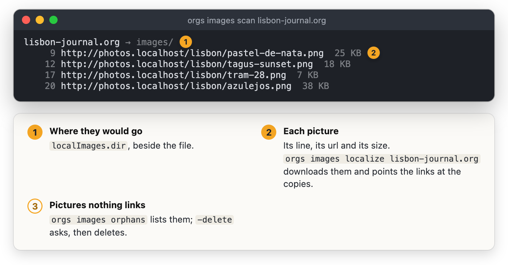

** In worg

   The file view's bar has a /Keep web pictures here/ button: a list of the
   file's web pictures with a thumbnail, where each is and how big, a box to
   leave one out, and a button that keeps the rest here. /Settings…/ under
   it sets the folder, download on save and the =#+DOWNLOADED:= line. In
   the rendered page, a picture still loaded from the web has a faint dashed
   outline, and hovering it shows /On the web · keep here/, which keeps
   that one. In the editor, pasting a picture's url on its own downloads it
   at once and writes =#+DOWNLOADED:= and the =[[file:…]]= link (a paste
   over selected words, ctrl/cmd+shift+v, and any other url go on to the
   link title paste as before).

   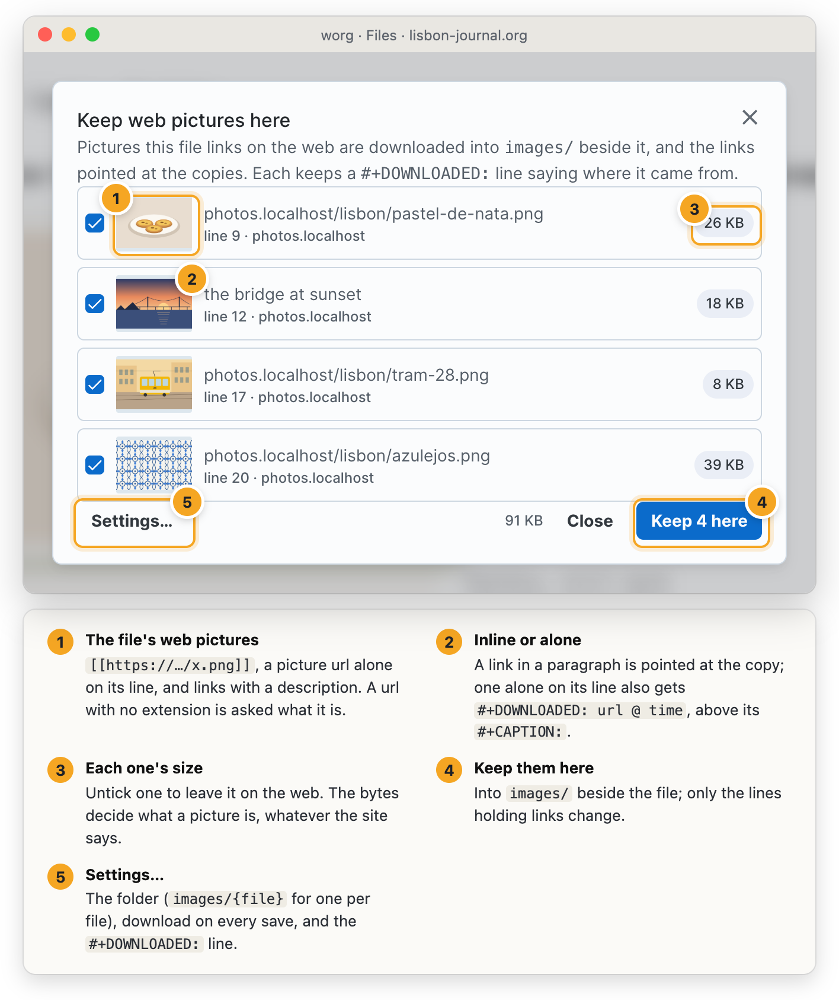

** In VS Code

   /Org: Keep Web Pictures Here/ lists the current file's web pictures to
   pick from, then has them downloaded (the file is saved first, and read
   back after). Above each picture still on the web is a /Download here/
   lens, and hovering one shows the picture with the same action. Download
   on save is the server's =auto=.

* Sticky headings (org-sticky-header)

  With =features: stickyHeader:= on, a file open in worg has a bar pinned
  over it that names the headings the top of the view is under, the way
  org-sticky-header's =full= mode does in Emacs' header line:

  #+BEGIN_EXAMPLE
  Projects › Garden › NEXT [#A] Raised beds
  #+END_EXAMPLE

  #+BEGIN_SRC sh
  orgs features stickyHeader on
  #+END_SRC

  It follows the scroll in all three ways of reading a file: the rendered
  page, the Org view and the editor. In the editor it follows the text you
  have, saved or not. Each heading in the bar is a button that scrolls back
  to it (in the editor it also puts the cursor there). Folding counts: a
  folded subtree's lines are not on screen, so the bar names what is. Above
  the first heading it says /Top of the file/.

  The small button at the bar's right end sets what it shows, kept per
  browser: every heading above (the default) or only the nearest one, and
  whether a heading's TODO keyword and priority are shown. A rendered page
  shows a keyword only if its html theme writes one. On a phone the bar
  keeps the outermost heading and the one you are in, and folds the rest
  into a =…= that lists them.

  Nothing is written to your files and nothing is asked of the server: the
  bar reads the page it is drawn over. It is worg's alone: Emacs has
  org-sticky-header itself.
