#+TITLE: Optional org packages: checklists, edna, noter, remark, expiry, recur, budgets, contents, review, recipes, ledgers
#+DOC_SECTION: Editing

* Turning them on

  The Emacs packages below are ones orgs does the work of. Each is off until you turn it
  on, and does nothing at all while off: a TRIGGER or EXPIRY property in
  your files is left alone, and the commands and panels for it say it is
  off.

  #+BEGIN_SRC sh
  orgs features                 # which are on
  orgs features edna on         # turn one on; written into the server's yaml
  #+END_SRC

  worg's settings menu has an *Org packages…* entry, and VS Code has *Org: Turn
  orgs Features On or Off*. All three write the same =features:= block:

  #+BEGIN_SRC yaml
  server:
    features:
      checklistReset: true
      edna: true
      noter: true
      remark: true
      expiry: true
      autoArchive: true
      recur: true
      clockBudget: true
      toc: true
      review: true
      chef: true
      ledger: true
      superAgenda: true
      orgQl: true
  #+END_SRC

  Only an administrator can turn one on or off, unless the server runs
  with =noAuth=.

* Checklists that start again (org-checklist)

  A repeating heading with =:RESET_CHECK_BOXES: t= has every checkbox in it,
  and in the headings under it, unticked when it is marked done and comes
  round again. Its =[n/m]= cookies follow.

  #+BEGIN_SRC org
  ,* TODO Weekly review [3/3]
  SCHEDULED: <2026-11-09 Mon +1w>
  :PROPERTIES:
  :RESET_CHECK_BOXES: t
  :END:
  - [X] empty the inbox
  - [X] read the calendar
  - [X] look over the projects
  #+END_SRC

  =#+PROPERTY: RESET_CHECK_BOXES t= does it for every heading in a file.
  =orgs check -reset= (worg: *Reset checkboxes* on a kanban card; VS Code:
  *Org: Reset Checkboxes*) unticks a heading's boxes by hand, whether or not
  the feature is on.

* Triggers and blockers (org-edna)

  Two properties, in org-edna's language. A =BLOCKER= stops a heading being
  marked done; a =TRIGGER= acts on other headings once it is.

  #+BEGIN_SRC org
  ,** TODO Write the draft
  :PROPERTIES:
  :BLOCKER: previous-sibling
  :TRIGGER: next-sibling todo!(NEXT) scheduled!("++1d")
  :END:
  #+END_SRC

  Finders gather headings, and the action or condition after them works on
  what they gathered:

  | Finders     | =self= =parent= =children= =first-child= =last-child= =descendants= =ancestors= =siblings= =siblings-wrap= =rest-of-siblings= =next-sibling= =next-sibling-wrap= =previous-sibling= =ids(a b)= =match("+work")= =olp("file.org" "A/B")= |
  | Options     | =children(todo-only)=, =todo-and-done-only=, =no-comment=, =no-archive= |
  | Actions     | =todo!(NEXT)= =scheduled!("+1d")= =deadline!("fri")= =tag!("a:b")= =set-property!("P" "v")= =delete-property!("P")= =set-priority!("A")= =set-effort!("1:00")= =archive!= =chain!("P")= |
  | Conditions  | =done?= =todo-state?(WAITING)= =headings?= =has-property?("P" "v")= =has-tags?("a")= =matches?("+x")= =re-search?("regexp")=, each negated with =!= |
  | Other       | =consider(any)= / =all= / a count / a fraction, and =if ... then ... else ... endif= in a TRIGGER |

  A BLOCKER with finders and no condition waits for them all to be done
  (edna's =!done?=). Dates in =scheduled!= and =deadline!=: =+2d= from the
  date the target has (or today), =++2d= from now, =-1w=, =cp= (copy this
  heading's), =rm=, or anything =orgs sched= takes (=mon=, =tomorrow 10:00=).
  A =todo!= that finishes a heading runs that heading's own TRIGGER too, five
  deep at most and never the same heading twice.

  The blocker is checked wherever a heading is marked done (the CLI, worg,
  VS Code, MCP), and =IsBlocked()= in a query counts it. =-force= goes past
  it.

  #+BEGIN_SRC sh
  orgs edna                      # a heading's TRIGGER and BLOCKER, and what done would do
  orgs edna -check 'ids(a1) !done?' -blocker
  orgs edna -names               # every finder, action and condition
  #+END_SRC

  =orgs lsp= marks a TRIGGER or BLOCKER it cannot read, and completes the
  names as you type.

* Notes on a PDF (org-noter)

  A heading with =:NOTER_DOCUMENT:= is a session, and the headings under it
  with =:NOTER_PAGE:= are its notes, in page order - org-noter's own shape,
  so a session started in Emacs opens in worg and the other way round.

  #+BEGIN_SRC org
  ,* Attention is all you need
  :PROPERTIES:
  :NOTER_DOCUMENT: papers/attention.pdf
  :NOTER_PAGE: 4
  :END:
  ,** Scaled dot product
  :PROPERTIES:
  :NOTER_PAGE: (4 . 0.31)
  :END:
  ,#+begin_quote
  We suspect that for large values of d the dot products grow large
  ,#+end_quote
  Hence the √d.
  #+END_SRC

  worg's *Noter* panel shows the document beside its notes: select a
  passage to note it, click a note to go to its page. VS Code's *Org: Open
  PDF Notes* opens the same panel.

  #+BEGIN_SRC sh
  orgs noter                                   # every session
  orgs noter notes                             # a session's notes, page by page
  orgs noter add -page 4 -y 0.3 -quote '...' 'the note'
  orgs noter start reading.org papers/x.pdf
  #+END_SRC

* Highlights and margin notes (org-remark)

  Highlight a passage of any file and keep a note on it without touching
  the file: the highlights live in a marginalia file, org-remark's, so
  Emacs reads them too.

  #+BEGIN_SRC yaml
  remark:
    notesFile: marginalia.org   # relative to the first org directory
  #+END_SRC

  In VS Code, *Org: Highlight Selection* works in any editor and the
  highlights are drawn there; worg highlights in a file's Org view. When the
  file changes, a highlight is found again by its words.

  #+BEGIN_SRC sh
  orgs remark                                  # every file with highlights
  orgs remark show notes.txt                   # file:line:col, for a quickfix list
  orgs remark add notes.txt 'the words' -line 7 -note 'why'
  orgs remark note ID 'a better note'
  orgs remark rm ID
  #+END_SRC

* Headings that expire, and old done work (org-expiry, auto archive)

  With =expiry= on, a heading whose =:EXPIRY:= has passed is filed away.
  The value is a date, or a span after its =:CREATED:=:

  #+BEGIN_SRC org
  ,* An article to read
  :PROPERTIES:
  :CREATED: [2026-11-04 Wed 10:00]
  :EXPIRY: +2w
  :END:
  #+END_SRC

  With =autoArchive= on, a heading in a done keyword that was closed longer
  ago than =after= is archived. =:AUTO_ARCHIVE: nil= on a heading (or a
  heading above it, or the file's =#+PROPERTY:=) keeps it; =:AUTO_ARCHIVE:
  7d= archives it sooner.

  #+BEGIN_SRC yaml
  expiry:
    handler: archive   # archive, sibling, tag (adds :ARCHIVE:) or keyword
    keyword: EXPIRED
    every: 1h
  autoArchive:
    after: 30d
    mode: archive      # archive, sibling or tag
  #+END_SRC

  The server looks every =every=. To see and do it yourself:

  #+BEGIN_SRC sh
  orgs expire               # what is due, and why
  orgs expire -run          # file it away
  orgs expire -set +2w      # give a heading an EXPIRY (a span or a date)
  #+END_SRC

  worg's *Expiry & Archive* panel lists what is due with a button to file it away, and a search row's menu has *Expires…*; VS Code has *Org:
  File Away Expired and Old Done Items* and *Org: Set Expiry*.

* Repeats in plain words (org-recur)

  A recurrence written in the heading's title, between bars. When the
  heading is marked done it is not closed: its =SCHEDULED= moves to the
  rule's next date after today and its keyword goes back to the first open
  one, as a repeat does - a =State= line in the logbook, =:LAST_REPEAT:=, no
  =CLOSED=.

  #+BEGIN_SRC org
  ,* TODO Water plants |+2|
  SCHEDULED: <2026-11-04 Wed>
  ,* TODO Pay rent |1,15|
  ,* TODO Standup |wkdy 09:30|
  ,* TODO Gym |Mon,Thu|
  #+END_SRC

  Between the bars is a comma separated list; the rule's next date is the
  earliest of them. These are org-recur's spellings (org-read-date's):

  | =+2= =+2d= =+w= =+2w= =+1m= =+1y=     | that long from today (=+w= is a week)                          |
  | =+0= =.=                              | today                                                          |
  | =Mon= =thursday= =Sun,Sat=            | the next such weekday                                          |
  | =1= =15= =1,15=                       | the next such day of a month (=31= skips the short months)     |
  | =wkdy=                                | the next weekday, Monday to Friday unless =recur.weekdays= says |
  | =+tue= =+2tue= =-fri=                 | the next (second) Tuesday after today; the Friday before        |
  | =12-25= =dec 25= =25 Dec= =12/25=     | the next such day of the year                                  |
  | =2027-01-01=                          | that date                                                      |
  | =10:00= =3pm= =Mon 09:00= =Thu 10:00-11:00= | a time, alone (today if still to come, else tomorrow) or with any of the above |

  A weekday, day of the month or day of the year that is today counts as
  the next one, not today: =|Thu|= finished on a Thursday goes to next
  Thursday. (org-read-date would say today.) A rule with no time of day
  keeps the time the stamp had.

  Which date moves: =SCHEDULED=; else =DEADLINE= when that is the only date
  the heading has; else a =SCHEDULED= is added. A stamp that also carries an
  org repeater (=SCHEDULED: <2026-11-02 Mon +1w>=) moves by the rule, once -
  the cookie is kept as written but not stepped as well. Any other
  repeating date on the heading moves on by org's own rule.

  Bars that are not a rule (=* a | b | c=) are left alone: the heading is
  simply done. =IsRecurring()= finds the headings that have one.

  #+BEGIN_SRC sh
  orgs recur                          # every heading with a rule: in words, and its next dates
  orgs recur set 'Water' '|Mon,Fri|'  # give a heading a rule (a query or hash, then the rule)
  orgs recur clear 'Water'            # take it off
  orgs recur explain '|1,15|' -n 6    # what a rule means, and its next dates
  orgs search 'IsRecurring()'
  #+END_SRC

  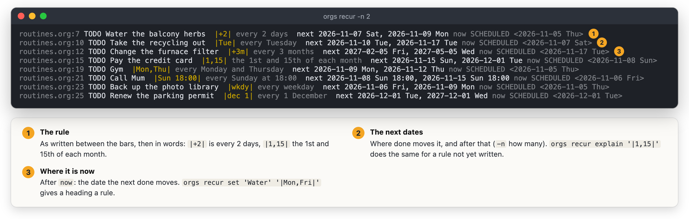

  worg draws the rule as a chip after the title - =↻ every 2 days · Fri 6
  Nov= - in the search rows and the agenda, and a search row's menu has
  *Repeats…*, which shows the next dates as you type.

  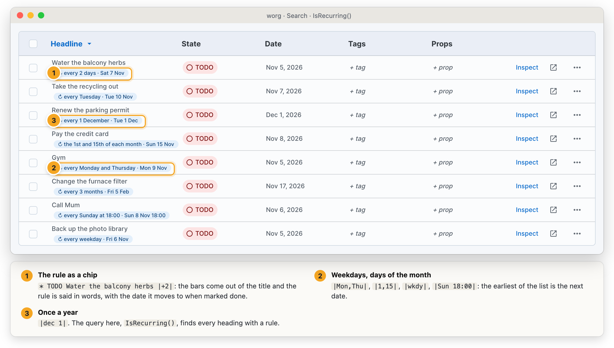

  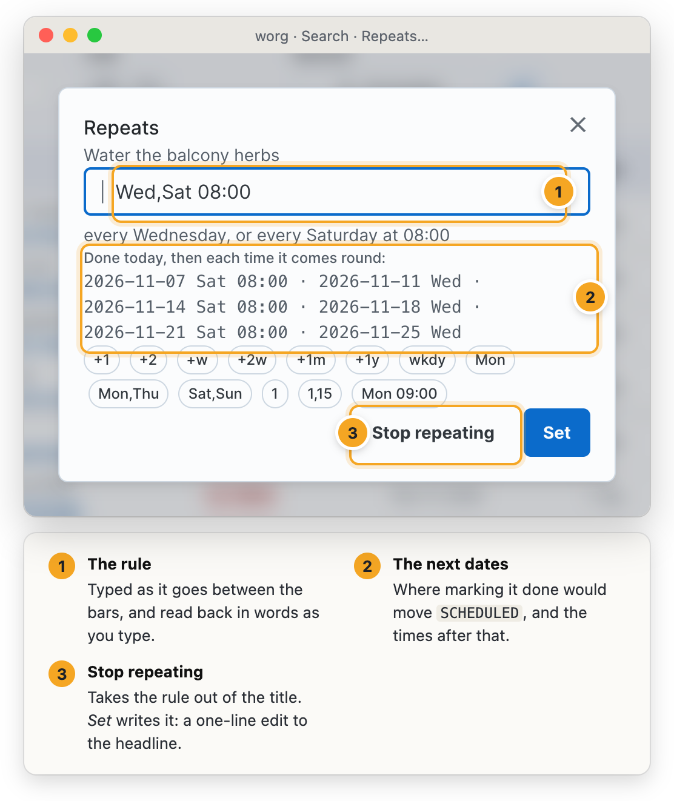

  In VS Code the rule
  gets the same note after it and a hover with its next dates, a =|= in a
  heading offers common rules, and *Org: Set Recurrence* sets or clears the
  rule of the heading at the cursor.

  #+BEGIN_SRC yaml
  server:
    features:
      recur: true
    recur:
      weekdays: "mon,tue,wed,thu,fri"   # what |wkdy| stands for
  #+END_SRC

  Not done: org-recur's =org-recur-finish-done= and =-archive= (they are
  about finishing a heading /without/ a rule, which here is just marking it
  done), its own =org-recur-schedule-today= (=orgs sched today= does that),
  and the rest of org-read-date's spellings (ISO weeks such as =2026-W45=,
  words such as =tomorrow=).

* Time budgets (org-clock-budget)

  With =clockBudget= on, a heading can be given a time allowance for a
  period, and the time clocked under it in that period - the heading's own
  clocks and every heading below it - is set against the allowance. The
  property names the period:

  #+BEGIN_SRC org
  ,* Writing the book
  :PROPERTIES:
  :BUDGET_WEEK: 5:00
  :BUDGET_MONTH: 20:00
  :END:
  ,** TODO Chapter one
  #+END_SRC

  =BUDGET_DAY=, =BUDGET_WEEK= (Monday to Sunday), =BUDGET_MONTH=,
  =BUDGET_QUARTER= (from January) and =BUDGET_YEAR=. A value is =H:MM= or
  a plain number of minutes (org-clock-budget's two spellings), or =5h=,
  =90m=, =1h30m=. A budget is the heading's own, not inherited, and comes
  round again each period: nothing carries over. A clock that is running
  counts up to now, whether Emacs is running it (an open =CLOCK:= line) or
  orgs is.

  Each budget also has a /pace/: how far through the period it is now. On a
  Wednesday at noon a week is 36% through, so 1:48 of a 5:00 budget is on
  track and 4:00 is spending ahead of the week.

  Clocking in under a heading that is already over budget says so in the
  answer ("Writing the book is over its budget: 5:30 of 5:00 this week"), and
  a clock that runs past a budget raises a notification once. Settings:

  #+BEGIN_SRC yaml
  clockBudget:
    dailyHours: 12   # hours a day that can be budgeted (org-clock-budget's default)
    notify: true     # false: no notification when a running clock goes over
  #+END_SRC

  =dailyHours= makes the /budgetable/ time of a period (12 hours × 7 days is
  84 hours a week), which the report compares the budgets given out against.

  From the command line:

  #+BEGIN_SRC sh
  orgs budget                          # every budget, with bars against the pace
  orgs budget -period week -over       # this week's, only those over
  orgs budget -date 2026-10-15         # the periods around another day
  orgs budget clocked                  # what the running clock is spending
  orgs budget set 'Writing' week 5:00  # give one (off takes it away)
  #+END_SRC

  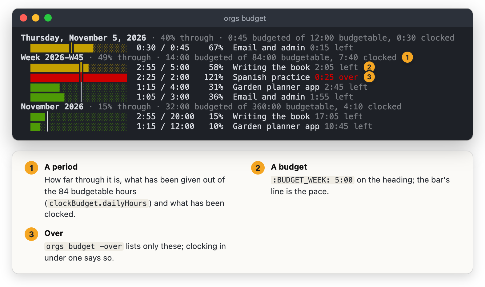

  In a file, org-clock-budget's report as a table, refreshed like any
  dynamic block:

  #+BEGIN_SRC org
  ,#+BEGIN: clockbudget :period week,month :scope agenda
  ,#+END:
  #+END_SRC

  =:period= is one or more periods (default: every one somebody has a
  budget for), =:scope= =agenda= (every file, the default) or =file=,
  =:date= another day. The last two rows are org-clock-budget's sums:
  budgeted against clocked, and budgetable hours against what is given out.

  Queries: =HasBudget()= / =HasBudget("week")= and =OverBudget()= /
  =OverBudget("month")=.

  worg's *Time Budgets* tab shows each period's budgets as bars with a mark
  for the pace, steps back and forward a period at a time, opens a heading
  on a click, and sets, changes or takes off a budget (*Add a budget* finds a
  heading by its title). While the clock runs under a budgeted heading, the
  header shows a chip beside the focus timer: used against budget, red once
  over. VS Code shows the same in the status bar, and has *Org: Show Clock
  Budgets* and *Org: Set Clock Budget* (for the heading at the cursor).

  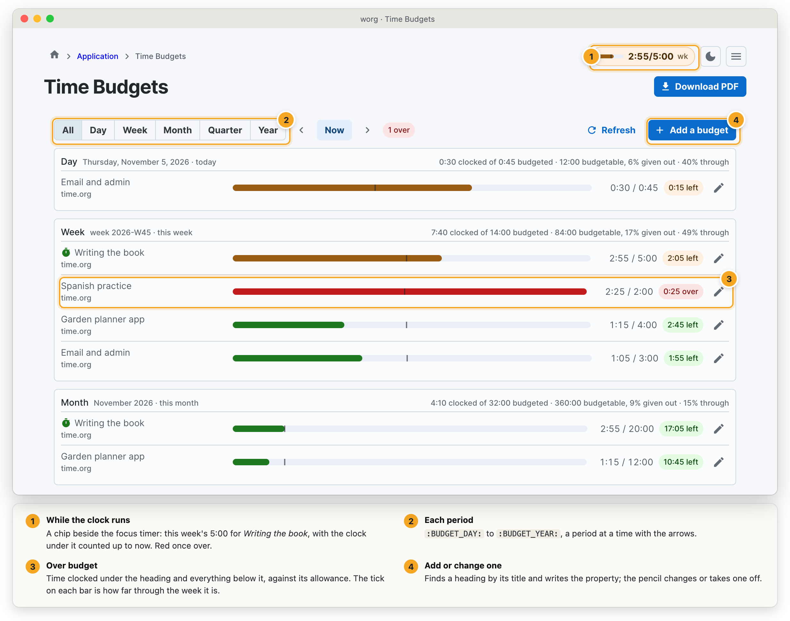

* Tables of contents (toc-org, org-make-toc)

  A list of links to a file's headings that keeps itself current: every time
  the file is saved - from Emacs, worg, VS Code or anything else - orgs
  brings it up to date. Turn it on with =orgs features toc on=. Three ways to
  ask for one, and a file may have all three.

  *toc-org's way: a heading tagged =:TOC:=.* Its whole body is the list; any
  text you write there is replaced (planning lines and drawers directly under
  the headline stay). Only the first =:TOC:= heading in a file is written.

  #+BEGIN_SRC org
  ,* Table of Contents :TOC:
  - [[#about][About]]
    - [[#installation][Installation]]
  - [[#use][Use]]

  ,* About
  ,** Installation
  ,* Use
  #+END_SRC

  | Tag                | Means                                                               |
  |--------------------+---------------------------------------------------------------------|
  | =:TOC:=            | two levels deep, github-style links (=[[#about][About]]=)           |
  | =:TOC_3:=          | three levels deep                                                   |
  | =:TOC_2_gh:=       | github-style links, said outright                                   |
  | =:TOC_2_org:=      | org links (=[[*About][About]]=), which Emacs follows with no help   |
  | =:QUOTE:= beside it | the list inside a =#+BEGIN_QUOTE= block                            |

  =@= may stand for =_= (=:TOC@2@org:=), as in toc-org. Levels are counted
  from the top of the file. Left out: the =:TOC:= heading itself, headings
  tagged =:noexport:= or marked =COMMENT= (with everything under them), and
  under a =:noexport_1:= heading its children (=:noexport_2:= keeps one level
  of them, and so on). A heading with a =CUSTOM_ID= is linked by it. Keyword,
  priority, tags and =[1/3]= cookies are not part of an entry (a cookie would
  change the list every time a box is ticked), and a link in a title shows as
  its description. Two headings with one title are =#notes= and =#notes-1=.

  *org-make-toc's way: a =:TOC:= property and a =:CONTENTS:= drawer.* The list
  goes in the drawer and the text around it stays. A =:TOC:= property with no
  drawer under it is a setting for the tables above it, not a table.

  #+BEGIN_SRC org
  ,* Contents
  :PROPERTIES:
  :TOC: :include all :ignore this
  :END:
  Some words before the list.
  :CONTENTS:
  - [[#about][About]]
  :END:
  #+END_SRC

  | Setting                       | Means                                                                    |
  |-------------------------------+--------------------------------------------------------------------------|
  | =:include all=                | the whole file (the default)                                             |
  | =:include descendants=        | the headings under this one                                              |
  | =:include siblings=           | this heading's siblings and what is under them                           |
  | =:depth N=                    | on the table's heading: N levels from where it starts. On any other      |
  |                               | heading: N levels of what is under it, in every table that lists it      |
  | =:ignore this=                | leave this heading out (what is under it is still listed)                |
  | =:ignore descendants=         | leave out what is under it                                               |
  | =:ignore siblings=            | leave out its siblings                                                   |
  | =:local depth=                | this heading's =:depth= is only for its own table, not tables above it   |
  | =:force depth= / =:force ignore= | this table ignores the =:depth= / =:ignore= of the headings it lists  |
  | =:links org=                  | org links instead of github ones (ours; org-make-toc chooses in elisp)   |

  A list goes in parentheses: =:ignore (this descendants)=. The old values
  =all=, =children=, =siblings= on their own still read.

  *A dynamic block.* Anywhere, refreshed on save like the others and by
  =orgs dblock=:

  #+BEGIN_SRC org
  ,#+BEGIN: toc :depth 2
  - [[*About][About]]
    - [[*Installation][Installation]]
  ,#+END:
  #+END_SRC

  =:depth=, =:include= as above (of the heading the block is under), and
  =:links gh=. Org links are the default here. The heading the block is under
  is not listed.

  The links work everywhere orgs shows a file: the exported page and worg's
  rendered view go to the heading, whichever kind the table uses.

  #+BEGIN_SRC sh
  orgs toc                          # bring every file's tables up to date
  orgs toc notes.org                # one file
  orgs toc -check                   # write nothing; exit 1 if any table is stale
  orgs -local toc -check            # the same with no server (a git hook, CI)
  orgs toc -print notes.org         # what the tables should say
  orgs toc -insert notes.org        # add a * Table of Contents :TOC: heading
  orgs toc -insert notes.org -make-toc -line 12   # org-make-toc's drawer at line 12's heading
  #+END_SRC

  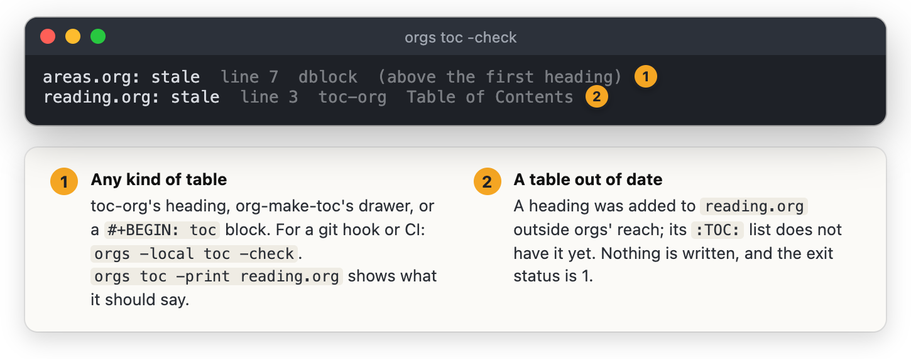

  worg: the table of contents button in the Files tab's bar (Update, Insert a
  =:TOC:= heading, Insert a Contents heading), and the same button in the org
  editor, which works on the text being edited; saving from the editor
  brings the tables up to date first.

  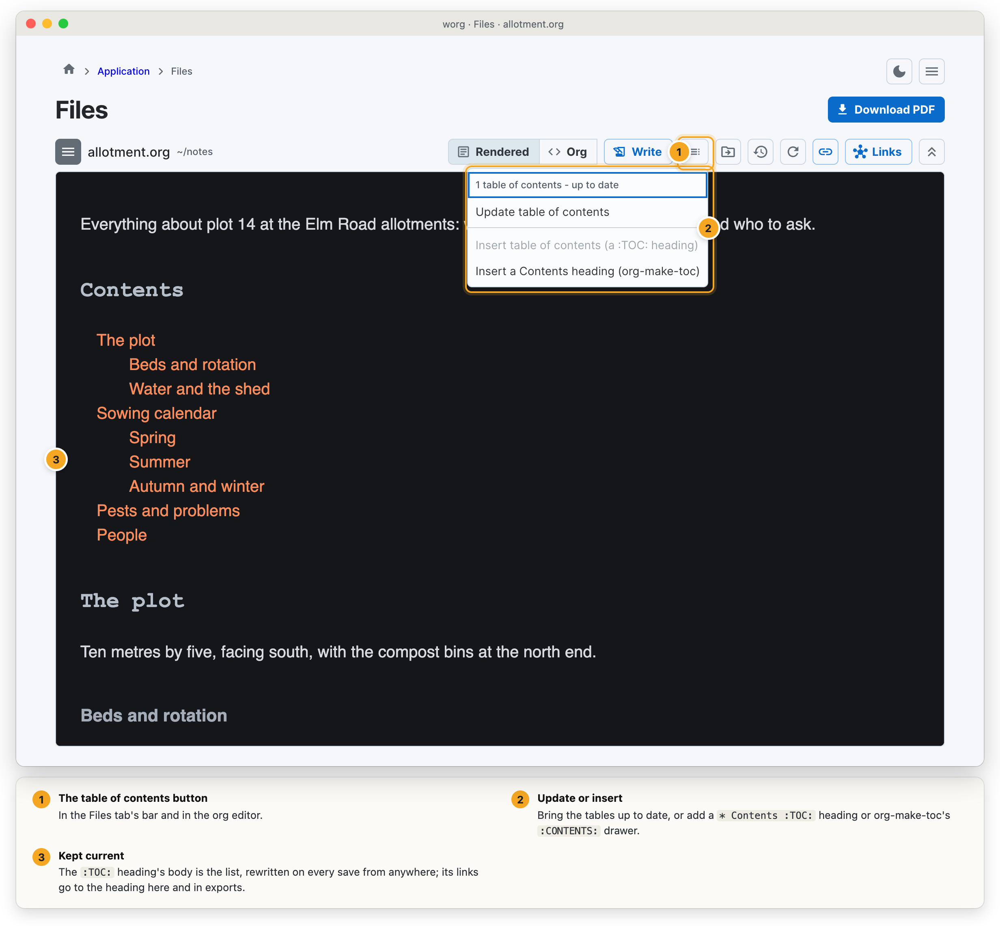

  VS Code: *Org: Update Table of
  Contents*, *Org: Insert Table of Contents* (a =:TOC:= heading, a
  =:CONTENTS:= drawer at the heading at the cursor, or a =#+BEGIN: toc= block),
  and the tables are brought up to date on save (=org.toc.updateOnSave=, on by
  default). Both work on unsaved text.

* Headings that come back to be read (org-review)

  With =review= on, a heading can be given a cadence: it comes back to be
  read again every so often. This is for areas, projects and notes you want
  to look at regularly (a monthly look at your finances, a quarterly look at
  each project), not for tasks with a date. orgs reads and writes
  org-review's own properties, so the same files work in Emacs:

  #+BEGIN_SRC org
  ,* Areas
  :PROPERTIES:
  :REVIEW_DELAY: +2w
  :END:
  ,** Health
  :PROPERTIES:
  :LAST_REVIEW: [2026-10-01 Thu]
  :END:
  ,** Money
  :PROPERTIES:
  :REVIEW_DELAY: +1m
  :LAST_REVIEW: [2026-10-20 Tue]
  :NEXT_REVIEW: [2026-11-20 Fri]
  :END:
  #+END_SRC

  - =:NEXT_REVIEW:= is when it is next due. When it is set, it wins.
  - Otherwise the heading is due on its =:LAST_REVIEW:= plus its delay.
  - =:REVIEW_DELAY:= is the delay (=+3d=, =+2w=, =+1m=, =+1y=). It is
    inherited from the headings above and from the file's =#+PROPERTY:
    REVIEW_DELAY=. With none of those, =orgReview.delay= is used (=+1m=).
    Above, Health is due two weeks after 1 October.
  - A heading with a =REVIEW_DELAY= of its own and no dates has never been
    reviewed, so it is due now. In the example that is /Areas/.
  - A heading takes part only when it has one of the three properties
    itself. With =orgReview.unreviewed: true=, a heading that only
    inherits a delay is due too. This is org-review's
    =org-review-unreviewed=, and it flags every heading under that delay.
  - Archived, commented and finished headings are never due.

  Marking a heading reviewed writes =LAST_REVIEW= as today, and
  =NEXT_REVIEW= as today plus the delay. Changing the cadence moves
  =NEXT_REVIEW= to the last review (or today) plus the new delay. Snoozing
  moves only =NEXT_REVIEW=.

  #+BEGIN_SRC yaml
  orgReview:
    delay: +1m          # the cadence of a heading with no REVIEW_DELAY
    setsNext: always    # always, only-future or never (org-review-sets-next-date)
    stamp: inactive     # [2026-11-04 Wed]; active writes <2026-11-04 Wed>
    unreviewed: false
  #+END_SRC

  (=review:= is a different block. It configures the weekly review wizard,
  which is not this.)

  #+BEGIN_SRC sh
  orgs reviews                         # what is due, most overdue first
  orgs reviews -within 7               # and what falls due this week
  orgs reviews walk                    # one at a time: r reviewed, s snooze, c cadence, u undo, o open
  orgs reviews done 2 -note 'on track' # the second one; a note goes into its log drawer
  orgs reviews done 'Money'            # by title, a query or a hash
  orgs reviews set Money +1w           # its cadence; -next fri, or -clear to stop reviewing it
  orgs reviews snooze Money +3d
  orgs search 'ReviewDue()'            # the query functions ReviewDue() and HasReview()
  orgs agenda -view R                  # today's agenda, then what is due for review
  #+END_SRC

  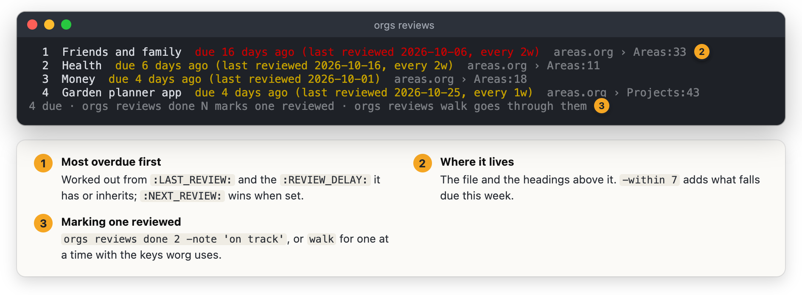

  worg has a *Due for Review* panel. It shows the due headings one at a
  time, with their text rendered, and takes one key per decision:
  =r= reviewed, =R= reviewed with a note, =s= snooze, =c= change the
  cadence, =o= open, =→= next, =u= undo. A search row's menu has *Review
  every…*. In the weekly review, the stale items step also lists what is
  due for review.

  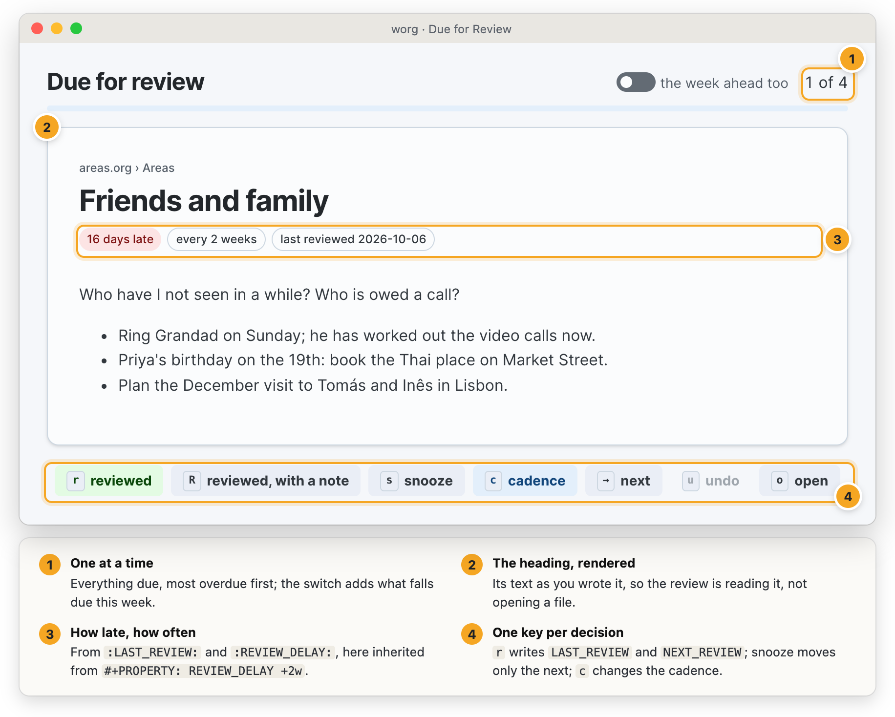

  VS Code has these commands:
  - *Org: Mark Heading Reviewed*
  - *Org: Set Review Cadence*
  - *Org: Headings Due for Review*: a list that opens the heading, with
    buttons that mark it reviewed or snooze it.

  VS Code also puts a line over each heading in review (for example "20
  days late · every 2 weeks"). Click it to mark the heading reviewed.

* Recipes from web pages (org-chef)

  Give orgs the address of a recipe page and it writes the recipe as a
  heading, the way org-chef does in Emacs, so one cookbook file serves both:

  #+BEGIN_SRC org
  ,* Weeknight Chicken Curry
  :PROPERTIES:
  :source-url: https://spiceandsimmer.example/chicken-curry/
  :servings:   4
  :prep-time:  15 min
  :cook-time:  25 min
  :ready-in:   40 min
  :IMAGE:      [[file:images/recipes/weeknight-chicken-curry.jpg]]
  :RECORD:     recipe
  :END:
  A creamy, mild curry that's on the table in 40 minutes.

  ,** Ingredients
  - 2 tablespoons vegetable oil
  - 1 large onion, finely chopped
  - 1 1/2 pounds boneless chicken thighs

  ,** Directions
  1. Heat the oil in a large pan over medium heat.
  2. Add the onion and cook until soft, about 8 minutes.
  #+END_SRC

  The page is read for its schema.org recipe data, which nearly every
  recipe site carries (WordPress recipe plugins, the big recipe sites, the
  newspapers). A page with steps in sections ("For the sauce") gets a
  heading per section under Directions. orgs adds two properties org-chef
  does not write and does not mind: =:IMAGE:=, the picture, saved beside
  the org file in =images/recipes/=, and =:RECORD: recipe=, which lists the
  recipes in the records browser too.

  A heading is a recipe when it has =:source-url:= (org-chef's, written by
  either), =:RECORD: recipe=, or both an Ingredients and a Directions child -
  so a recipe typed by hand from org-chef's manual capture template counts.
  Times may be written as org-chef writes them (=15  m=) or as orgs does.

  #+BEGIN_SRC sh
  orgs chef add https://www.example.com/recipes/curry          # into recipes.org
  orgs chef add https://… -file cook.org -under Mains           # under a heading
  orgs chef add https://… -dry-run                              # show the heading, write nothing
  orgs chef ls chicken                                          # recipes with chicken in them
  orgs chef show curry -servings 6                              # scaled for six
  orgs chef cook curry                                          # one step at a time
  orgs chef shop curry burgers -servings 4                      # a shopping list
  #+END_SRC

  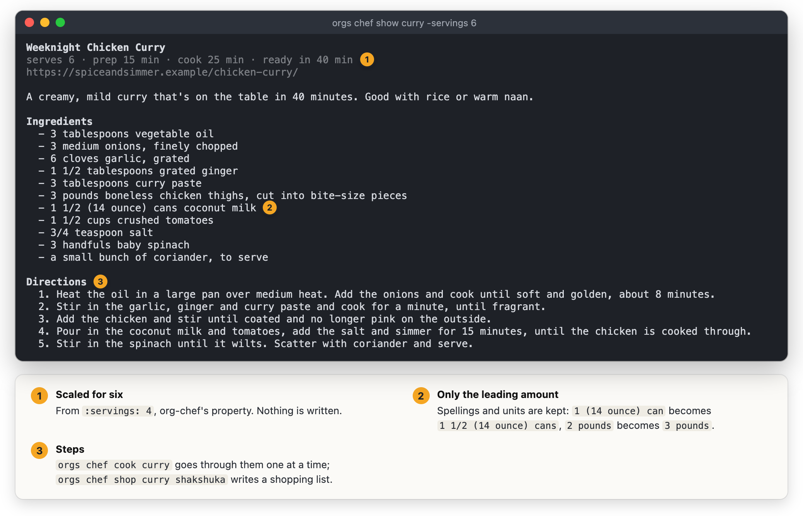

  - *Scaling* multiplies each ingredient's leading amount and keeps its
    spelling and units: =1/2 cup= doubles to =1 cup=, =½ cup= to =1 cup=,
    =1 1/2 pounds= halves to =3/4 pound=, =2-3 teaspoons= doubles to =4-6=,
    =400g= to =800g=. Only the leading amount changes, so =1 (16 ounce)
    can= doubles to =2 (16 ounce) cans=. Large amounts are rounded as a
    cook would (=150 g=, not =150 1/3 g=). A recipe that does not say what
    it serves scales by a factor instead (=-factor 2=). Nothing is written:
    the file keeps the recipe as it was.
  - *A shopping list* adds the same thing in the same unit up across
    recipes (=2 cups rice= and =1 cup rice= are =3 cups rice=) and is
    written as a heading of checkboxes with a =[0/n]= cookie: under a
    =Shopping= heading in the recipes file when there is one, else at the
    end of the first recipe's file, or where =-file= and =-under= say.
  - A page already in a file (the same =:source-url:=) is not added again
    unless asked (=-force=, or *Add anyway*).
  - Some sites turn servers away; worg and the api take the page's html
    pasted in (=Html= on =/chef/fetch= and =/chef/add=).

  worg's *Recipes* tab takes a pasted address, shows what was read before
  anything is written and lets you pick the file and heading; it lists the
  recipes with their pictures and searches them by name and ingredient. A
  recipe opens with a servings stepper, ingredients to tick off (kept in the
  browser, not the file), *Cook* - large type, one step at a time, the
  arrow keys to move, and the screen kept awake where the browser can - and
  *Add to list* for the shopping list.

  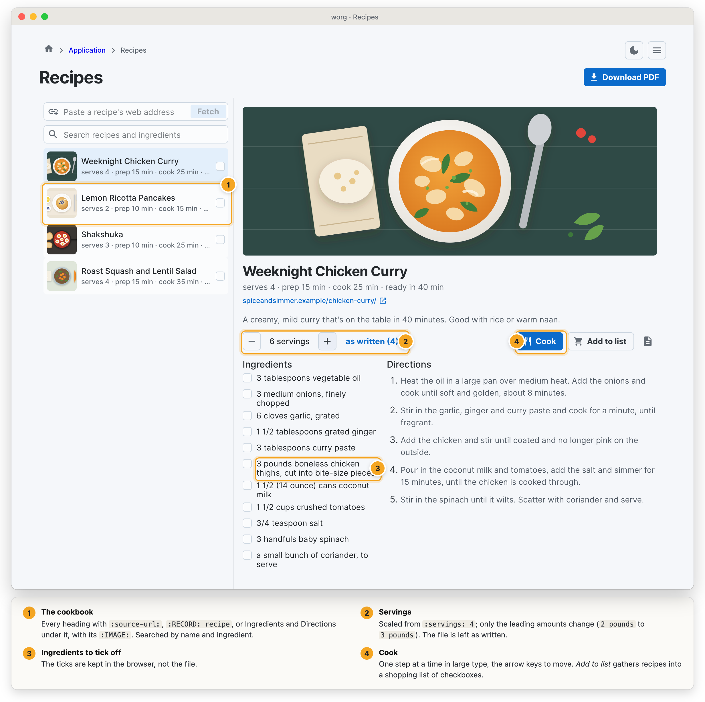

  VS Code has *Org: Import Recipe from
  URL* (put in the open file at the cursor, as an edit you can undo, or
  written by the server with its picture), *Org: Scale Recipe* (the recipe at
  the cursor, scaled, to copy or insert) and *Org: Make a Shopping List from
  Recipes*.

  #+BEGIN_SRC yaml
  server:
    features:
      chef: true
    chef:
      file: recipes.org      # where a recipe goes when no file is named (made if missing)
      checkboxes: false      # ingredients as - [ ] items (org-chef writes plain - items)
      noRecord: false        # leave out :RECORD: recipe
      noPictures: false      # keep the picture's url instead of saving it
  #+END_SRC

* Ledger journals (ledger-mode, ob-ledger)

  Money kept the way ledger and hledger keep it - plain-text transactions -
  in source blocks of an org file, or in =.ledger=, =.journal=, =.hledger= and
  =.dat= files under the org directories. With =features: ledger:= on, orgs
  reads them itself: balances, registers, monthly totals and checks work
  without ledger or hledger installed.

  #+BEGIN_SRC org
  ,* Accounts
  ,#+NAME: opening
  ,#+BEGIN_SRC ledger
  commodity $
    format $1,000.00

  2026/01/01 * Opening
      Assets:Bank:Checking     $3,000.00
      Equity:Opening
  ,#+END_SRC

  ,* This year
  ,#+BEGIN_SRC ledger :cmdline reg Expenses
  2026/02/07 ! (1042) Grocer  ; :food:
      Expenses:Food:Groceries    $98.10
      Expenses:Food:Snacks       $12.00
      Assets:Bank:Checking     = $2,889.90
  ,#+END_SRC
  #+END_SRC

** One journal or one block

   All the =ledger= and =hledger= blocks of a file are read *in order as one
   journal*: the second block's assertions are checked against the first
   block's balances, and its accounts and commodities are the first's. This
   is what every report, the dynamic block and the checks read.

   ob-ledger runs each block *alone*, and so does running a block (C-c C-c,
   =orgs code at=, worg's Run). Any report can be asked for one block alone
   too: =-block 1= (its place, from 0), =-block opening= (its =#+NAME:=) or
   =block=line:12=.

** What is read

   | Dates          | =2026/11/04=, =2026-11-04=, =2026.11.04=, =11/04= with =Y 2026= (or =year=); =2026/11/04=2026/11/05= for the auxiliary date |
   | The first line | status =*= or =!=, a code =(1042)=, the payee, =; a note= (hledger's =payee \vert note= too) |
   | Postings       | an account, then two spaces (or a tab) and the amount; =(Budget:Rent)= virtual and unbalanced, =[Savings]= virtual and balanced; one posting may leave its amount out |
   | Amounts        | =$1,000.50=, =-$5=, =$-5=, =10 AAPL=, =1.000,00 EUR=, ="M&M" 3=; =decimal-mark ,= for commas |
   | Costs          | =10 AAPL @ $150=, =@@ $1500=, ={$150}= lot prices; two commodities and no cost read as an exchange |
   | Assertions     | =Assets:Bank  $-50 = $950= checked; =Assets:Bank  = $950= with no amount is an assignment; ===, =*= as hledger has them |
   | Metadata       | =; :tag1:tag2:= and =; Key: value= on a transaction or a posting |
   | Directives     | =account=, =commodity= (and its =format=), =include= (only inside the org directories), =alias a=b= and =alias /re/=b=, =apply account=, =D=, =P= prices, =Y=/=year=, =comment= ... =end comment= |
   | Skipped, with a warning | periodic =~= and automated === transactions, value expressions, directives it does not know |

   An unbalanced transaction, a failed assertion, a date that is not a day
   and an amount that does not read are errors, each at the line it is on -
   the org file's own line for a block.

** Reports

   #+BEGIN_SRC sh
   orgs ledger                                  # balance of every journal, as ledger bal prints it
   orgs ledger bal -source money.org -depth 2
   orgs ledger bal Expenses not Rent -period 'this year'
   orgs ledger reg ^Assets:Bank -period 'last month'
   orgs ledger monthly Expenses -depth 2        # a month a line, an account a column
   orgs ledger check                            # file:line problems; exits 1 on an error
   orgs ledger check -format quickfix
   orgs ledger sources
   orgs ledger -f money.ledger bal              # a file here, no server at all
   #+END_SRC

   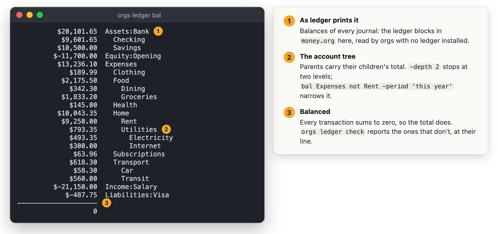

   Words after the report are account regular expressions, any of which may
   match, as ledger's are; =not= leaves the next ones out. Periods are said in
   words: =this month=, =last year=, =2026=, =2026-11=, =nov=, =q3=, =from
   2026-01-01 to 2026-04-01=, =jan..mar=, =since last month= - the end is not
   included. =-json= gives the rows.

   A dynamic block writes a report into the file as an org table, refreshed
   with =orgs dblock= (or =C-c C-c= in Emacs with orgs' blocks):

   #+BEGIN_SRC org
   ,#+BEGIN: ledger :report balance :account Expenses :period "this year" :depth 2
   | Account  | Balance   |
   |----------+-----------|
   | Expenses | $2,755.50 |
   | \_  Food | $355.50   |
   | \_  Rent | $2,400.00 |
   |----------+-----------|
   | *Total*  | $2,755.50 |
   ,#+END:
   #+END_SRC

   =:report= is =balance=, =register=, =monthly= or =check=; =:source= is
   another journal (the file the block is in when it has ledger blocks,
   every journal otherwise); =:block=, =:account=, =:period=, =:begin=,
   =:end=, =:depth= and =:real= as above.

** Running a block

   Running a =ledger= block runs =ledger -f= as before, and an =hledger=
   block now runs =hledger -f= (it used to run ledger). When the program is
   not installed and the feature is on, orgs answers the block itself for a
   =:cmdline= of =bal=, =reg= or =accounts= with =-p=, =-b=, =-e=,
   =--depth=, =--real=, =--flat= and account patterns; anything else says to
   install ledger. A journal with an error answers with the error, as
   ledger does.

** In worg and VS Code

   worg's *Ledger* tab: a journal (or one block of it) and a period at the
   top; the account tree with balances, opened and folded by its arrows;
   pick an account to see its month-by-month totals as bars (a table one
   click away) and its register with a running total, each row opening its
   line. The journal's problems are listed above, each a link to its line.

   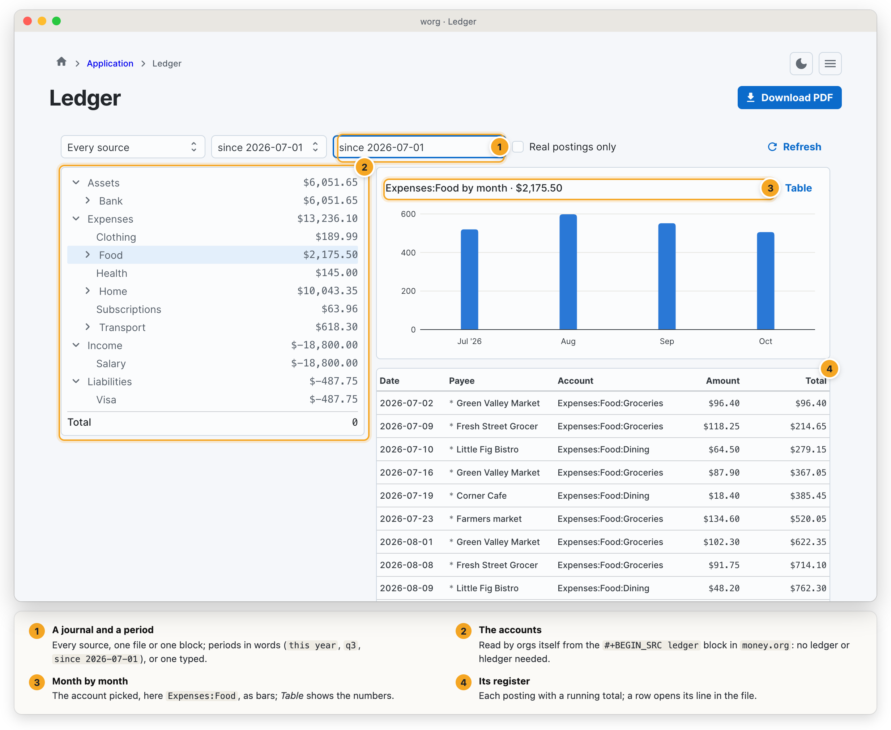

   VS Code marks unbalanced transactions and failed assertions in ledger
   blocks as you type, shows an account's balance when you hover on it, and
   has *Org: Ledger Balance* and *Org: Ledger Register*, which print the
   report in the *Org Ledger* output.

* Grouped agendas (org-super-agenda)

  With =superAgenda= on, the agenda's items are sorted into titled groups the
  way org-super-agenda sorts them: each item goes to the first group that
  takes it, and what no group takes is listed last under /Other items/. A
  day of the agenda is grouped within the day; a list (open tasks, a tags
  match, stuck projects) as a whole.

  The groups every agenda uses go in the yaml, as =org-super-agenda-groups=
  does in Emacs. A section of an agenda view (=agenda.views=) may name its
  own =groups:=, or say =noGroups: true= to stay as it was.

  #+BEGIN_SRC yaml
  server:
    agenda:
      groups:
        - name: Today
          timeGrid: true
        - name: Overdue
          deadline: past
          scheduled: past
        - name: Important
          priority: A
        - name: Quick
          effortMax: "0:15"
        - name: Waiting
          todo: [WAITING]
          order: 9
        - discard: true
          tag: [someday]
        - auto: category
  #+END_SRC

  Several selectors in one group are alternatives: an item matching any of
  them is taken. =and:= is a list of selectors that must all match, =not:= a
  list none of which may. A group with only a name takes nothing.

  | Selector    | Takes                                                         |
  |-------------+---------------------------------------------------------------|
  | =anything=  | every item left                                               |
  | =timeGrid=  | an entry at a time of day                                     |
  | =tag=       | any of these tags, inherited ones included                    |
  | =todo=      | any of these keywords; =[t]= any not-done one                 |
  | =priority=  | =A=, =A,B=, =>B= (higher than B), =<B=; no cookie counts as B |
  | =deadline=  | =past=, =today=, =future=, =any=, =none=, or a day =2026-11-05= |
  | =scheduled= | the same, for SCHEDULED                                       |
  | =date=      | the same, for a plain active timestamp                        |
  | =habit=     | habits                                                        |
  | =category=  | any of these categories                                       |
  | =file=      | a regexp over the file's path                                 |
  | =property=  | =NAME= (has it) or =NAME=value=                               |
  | =heading=   | a regexp over the title                                       |
  | =regexp=    | a regexp over the title and the property values               |
  | =children=  | =any= (has children), =todo= (has open ones), =none=          |
  | =effortMin= | an EFFORT of at least this (=1:00=)                           |
  | =effortMax= | an EFFORT under this                                          |
  | =query=     | what an orgs query finds (=IsProject()=, a ={{ filter }}=)    |

  =auto:= makes one group per value instead, named by it and in its order:
  =category=, =tags= (all of an item's tags), =todo=, =priority=, =file=,
  =dir=, =parent=, =outline= (the headings above), =planning= or
  =property:NAME=. An item with no value goes on to the next group.

  =name:= titles a group, =order:= moves it (lower first; /Other items/ is
  99), =discard: true= drops what it takes. A bad regexp or an unknown =auto=
  is reported in the answer's message; the rest of the grouping still
  happens.

  #+BEGIN_SRC sh
  orgs features superAgenda on
  orgs agenda -view n          # printed in its groups, as org-agenda-write would
  orgs agenda -view a -as html
  #+END_SRC

  worg's agenda views (the picker above the calendar) draw each group's name
  with its items under it. =GET /agenda=, =/agenda/nodes= and =/agenda/view=
  answer =Groups= beside the items, as indexes into them, so every client
  shows the same groups; a request may send its own with =groups== (the list
  as json) or turn them off with =grouped=f=.

* Query blocks (org-ql)

  With =orgQl= on, org-ql's dynamic block is refreshed by orgs as Emacs
  refreshes it: the headings an org-ql query finds, as a table. A file with
  these blocks reads the same in both.

  #+BEGIN_EXAMPLE
  #+BEGIN: org-ql :query "todo:NEXT tags:work" :columns (todo (priority "P") heading deadline) :sort (deadline priority) :take 10
  #+END:
  #+END_EXAMPLE

  Refresh it like any dynamic block: =orgs dblock notes.org=, worg's
  refresh, or on a schedule with =orgs refresh=.

  =:query= takes either of org-ql's spellings:

  - =(and (todo "NEXT") (tags "work") (not (done)) (deadline :to today))=
  - =todo:NEXT tags:work !done: deadline:to=today= - terms side by side must
    all match, =!= turns one round, =pred:a,b= gives several arguments,
    =pred:key=value= a keyword one, and a plain word or ="phrase"= is looked
    for in the heading and its text.

  | Predicate                                     | Means                                                    |
  |-----------------------------------------------+----------------------------------------------------------|
  | =(todo)= =(todo "A" "B")=                      | any open keyword, or one of these                        |
  | =(done)=                                      | a finished keyword                                       |
  | =(tags "a" "b")= =(tags-all "a" "b")=          | any of these tags (inherited too), or all of them        |
  | =(priority "A")= =(priority >= "B")=           | a priority, or a comparison (A is the highest)           |
  | =(heading "words")= =(regexp "re")=            | in the title; in the title or the text                   |
  | =(property "NAME")= =(property "NAME" "v")=    | has it; has that value (=:inherit t= looks above too)    |
  | =(level 2)= =(level < 3)= =(level 2 4)=        | outline level                                            |
  | =(scheduled …)= =(deadline …)= =(closed …)=    | =:on=, =:from=, =:to=: =today=, days (=-7=, =30=) or =2026-11-05= |
  | =(deadline auto)=                             | past or inside its warning period                        |
  | =(ts :from -7 :to today)=                     | a date of the heading's own in the span                  |
  | =(planning)= =(habit)= =(blocked)= =(clocked)= | has a planning date, is a habit, is blocked, was clocked |
  | =(category "c")= =(path "work")=               | category; part of the file's path                        |
  | =(link)= =(link "x")= =(effort "1:00")=        | has links, links to x; EFFORT at most                    |
  | =(and …)= =(or …)= =(not …)=                   | as written                                               |

  =(ts …)= is close to org-ql's, not the same: it counts SCHEDULED and DEADLINE
  as dates of the heading's own, and a heading with any of its dates outside
  the span is left out. Predicates orgs cannot
  answer yet (=ancestors=, =parent=, =children=, =outline-path=, =src=,
  =(clocked)= over a span) are refused by name rather than read as something
  else; the block is left as it was and the refresh says why.

  | Parameter    | Meaning                                                                         |
  |--------------+---------------------------------------------------------------------------------|
  | =:columns=   | =heading=, =todo=, =priority=, =deadline=, =scheduled=, =closed=, =tags=, =file= |
  |              | or a property's name; =(name "Title")= retitles one. Default =(heading todo)=    |
  | =:sort=      | =date= (deadline, else scheduled), =deadline=, =scheduled=, =closed=,           |
  |              | =priority=, =todo= (the file's keyword order), =heading=, =random=, =reverse=   |
  | =:take=      | the first N rows; a negative N, the last N                                      |
  | =:ts-format= | how dates are written, as strftime; default =%Y-%m-%d= (and the time if it has one) |
  | =:scope=     | =file= keeps to this file; otherwise every file the server watches              |

  A title links to its heading by its =ID= when it has one, else by its
  title. The heading the block is written under is never one of its rows.
