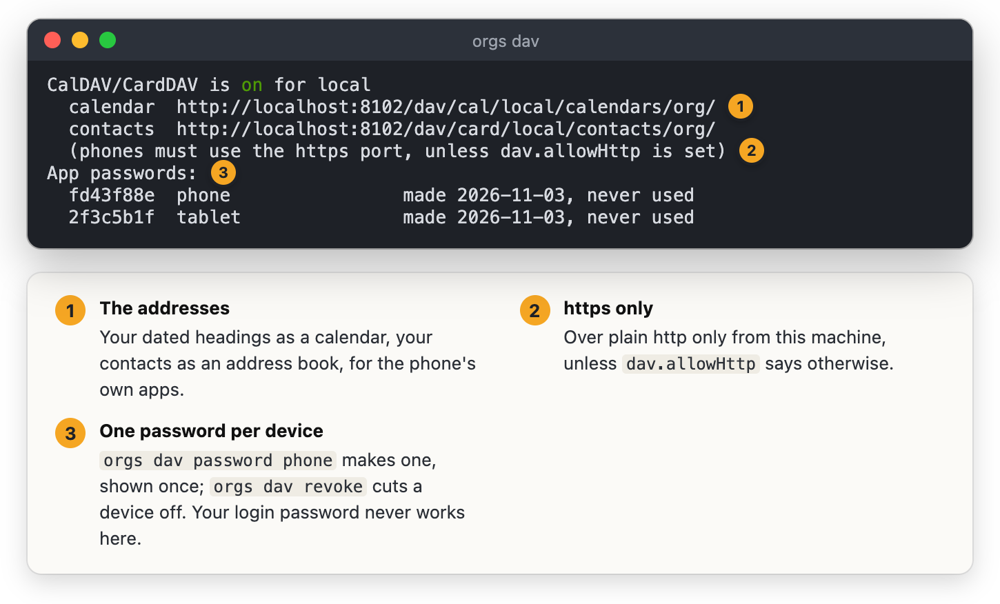

#+TITLE: Your agenda and contacts on a phone: CalDAV and CardDAV
#+DOC_SECTION: Setup

* What you get

  The phone's own Calendar shows every dated heading - SCHEDULED, DEADLINE
  (as "Due: ..."), and appointments' own timestamps - and its Contacts app
  shows your contact records and any heading with an =EMAIL= or =PHONE=
  property. Both ways: move an event and the heading's date moves; rename it
  and the heading is renamed; add a phone number and it is in the drawer.

  | On the phone          | In your org files                                          |
  |-----------------------+------------------------------------------------------------|
  | move an event         | its SCHEDULED, DEADLINE or timestamp, repeater kept        |
  | rename an event       | the heading's title                                        |
  | delete an event       | the date comes off; the heading stays                      |
  | new event             | a heading in =inbox.org= (=dav.newEvents=)                 |
  | edit a contact        | its fields, changed by value; other properties untouched   |
  | new contact           | a contact record (or =contacts.org= when there is no list) |
  | delete a contact      | refused - remove people in org                             |

* Turning it on

  In the server's yaml, then restart it:

  #+BEGIN_SRC yaml
  server:
    dav:
      enable: true
  #+END_SRC

  Then make an app password for the phone. It is shown once; only its hash is
  kept, and each device gets its own so one can be cut off.

  #+BEGIN_SRC sh
  orgs dav password "my phone"
  orgs dav                      # what is on, and every password with when it was last used
  orgs dav revoke 410704f2
  #+END_SRC

* On the phone

  =orgs dav= says whether it is on, the addresses to give the phone and the
  app passwords made so far:

  

  - *iPhone*: Settings → Calendar → Accounts → Add Account → Other → Add
    CalDAV Account. Server: your server's host and https port
    (=box.local:8443=), user: your orgs user, password: the app password. The
    same again under Contacts → Add CardDAV Account.
  - *Android*: DAVx5, "Login with URL and user name", =https://box.local:8443/=.

  The phone must reach the server over *https*. A plain http address is
  refused unless the request comes from the server's own machine (a reverse
  proxy in front of it) or =dav.allowHttp: true= is set for a network you
  trust, such as a VPN. A server with a self-signed certificate needs that
  certificate trusted on the phone first.

* Safe by default

  - Off until =dav.enable=; =dav.readOnly= lets the phone look and not change.
  - Only app passwords open it - never your login password - compared in
    constant time; five wrong ones from an address and it waits, doubling up
    to fifteen minutes.
  - Each user sees only their own collections.
  - Every change is checked against the version the phone last saw, so a
    phone that has not synced cannot overwrite an edit made elsewhere.
  - Changes are line edits of the lines concerned, as everywhere else in
    orgs: nothing else in the file moves.
