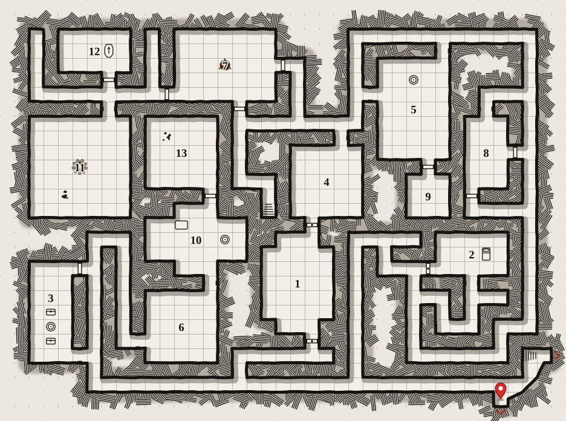
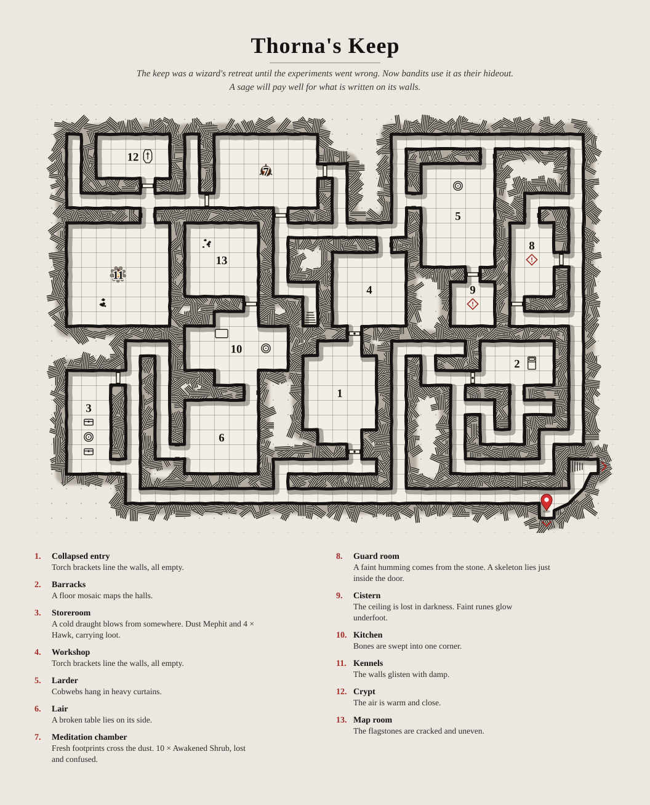

#+TITLE: Thorna's Keep
#+STARTUP: overview
#+DND_DUNGEON: thornas-keep.dungeon.json

The keep was a wizard's retreat until the experiments went wrong. Now bandits use it as their hideout. A sage will pay well for what is written on its walls.

* Map
  :PROPERTIES:
  :SEED:            1793774752351306000
  :CORRIDORS:       errant
  :DEADENDS:        some
  :DOORS:           standard
  :EGRESS:          yes
  :KIND:            dungeon
  :LAYOUT:          rectangle
  :LEVEL:           1
  :MOTIF:           none
  :PARTY:           4
  :POLYMORPH:       yes
  :ROOMLAYOUT:      scattered
  :ROOMSIZE:        medium
  :SIZE:            medium
  :STAIRS:          yes
  :DND_FOG:         AAAAAAAAAAAAAAAAAAAAAAAfAAAA4AMAAAB8AAAAgA8AAADwAQAAAD4AAADABwAAAAAAAAAAAAAAAAAAAAAAAAAAAAAAAADgAB8AAD7gAwDAB3wAAPgAAAAAHwAAAOADAAAAOAAAAAAAAAAAAAAAAAAAAAgAAAD4AQAAAAg=
  :DND_PARTY:       
  :DND_FOG_GM:      nil
  :DND_FOG_PLAYERS: t
  :DND_COMBAT:      eyJsaXN0IjpbeyJjb25kaXRpb25zIjpbXSwidGVtcCI6MCwiaGlkZGVuIjpmYWxzZSwiaW5pdCI6OSwibmFtZSI6Ikx5cmEgU2lsdmVybGVhZiIsImtpbmQiOiJwYyIsImJvbnVzIjo0LCJocCI6MzIsIm1heCI6MzIsImFjIjoxNCwicGMiOiIzZWUxN2JlOSIsIm5vdGUiOiJTYW0gwrcgU29yY2VyZXIgKERyYWNvbmljIEJsb29kbGluZSkgNSIsImlkIjoibXcxcmFuZHAxb2h2NSJ9LHsiY29uZGl0aW9ucyI6W10sInRlbXAiOjAsImhpZGRlbiI6ZmFsc2UsImluaXQiOjE3LCJuYW1lIjoiQnJhbm5vYyIsImtpbmQiOiJwYyIsImJvbnVzIjowLCJocCI6NDQsIm1heCI6NDQsImFjIjoxOCwicGMiOiIwYTg1M2M3OSIsIm5vdGUiOiJKbyDCtyBGaWdodGVyIiwiaWQiOiJtdzFyYW5kcDJrNGVlIn0seyJjb25kaXRpb25zIjpbXSwidGVtcCI6MCwiaGlkZGVuIjpmYWxzZSwiaW5pdCI6OCwibmFtZSI6Ik1pcmVsYSIsImtpbmQiOiJwYyIsImJvbnVzIjoxLCJocCI6MzgsIm1heCI6MzgsImFjIjoxNiwicGMiOiIxZDNmMjg1MSIsIm5vdGUiOiJBbGV4IMK3IENsZXJpYyIsImlkIjoibXcxcmFuZHAzcGxmNCJ9LHsiY29uZGl0aW9ucyI6W10sInRlbXAiOjAsImhpZGRlbiI6ZmFsc2UsImluaXQiOjE0LCJuYW1lIjoiVGFtc2luIFJlZWQiLCJraW5kIjoicGMiLCJib251cyI6NCwiaHAiOjMzLCJtYXgiOjMzLCJhYyI6MTUsInBjIjoiODlmMzE3YTMiLCJub3RlIjoiS2FpIMK3IFJvZ3VlIiwiaWQiOiJtdzFyYW5kcDRndGxxIn0seyJjb25kaXRpb25zIjpbXSwidGVtcCI6MCwiaW5pdCI6MTYsIm5hbWUiOiJIb2Jnb2JsaW4gMSIsImtpbmQiOiJtb25zdGVyIiwiYm9udXMiOjEsImhwIjoxMSwibWF4IjoxMSwiYWMiOjE4LCJtb25zdGVyIjoiSG9iZ29ibGluIiwiaWQiOiJtdzFyYXBnMzViZXhkIn0seyJjb25kaXRpb25zIjpbXSwidGVtcCI6MCwiaW5pdCI6MTQsIm5hbWUiOiJIb2Jnb2JsaW4gMiIsImtpbmQiOiJtb25zdGVyIiwiYm9udXMiOjEsImhwIjoxMSwibWF4IjoxMSwiYWMiOjE4LCJtb25zdGVyIjoiSG9iZ29ibGluIiwiaWQiOiJtdzFyYXJndjZkeGd2In0seyJjb25kaXRpb25zIjpbXSwidGVtcCI6MCwiaW5pdCI6MTgsIm5hbWUiOiJHb2JsaW4iLCJraW5kIjoibW9uc3RlciIsImJvbnVzIjoyLCJocCI6NywibWF4Ijo3LCJhYyI6MTUsIm1vbnN0ZXIiOiJHb2JsaW4iLCJpZCI6Im13MXJjYmVrMXRiY3UifSx7ImNvbmRpdGlvbnMiOltdLCJ0ZW1wIjowLCJpbml0IjoxMiwibmFtZSI6IkhvYmdvYmxpbiAzIiwia2luZCI6Im1vbnN0ZXIiLCJib251cyI6MSwiaHAiOjExLCJtYXgiOjExLCJhYyI6MTgsIm1vbnN0ZXIiOiJIb2Jnb2JsaW4iLCJpZCI6Im13MXJjZGc2MnEzODYifV0sInJvdW5kIjoxLCJ0dXJuIjoibXcxcmNiZWsxdGJjdSIsInN0YXJ0ZWQiOnRydWV9
  :DND_TRACK:       nil
  :DND_TOKENS:      W3siaWQiOiJmLW13MXJhcGczNWJleGQiLCJwYXRoIjoiIiwibmFtZSI6IkhvYmdvYmxpbiAxIiwiciI6MjMsImMiOjMzLCJzaXplIjoxLCJmaWdodGVyIjoibXcxcmFwZzM1YmV4ZCIsIm50aCI6MX0seyJpZCI6ImYtbXcxcmFyZ3Y2ZHhndiIsInBhdGgiOiIiLCJuYW1lIjoiSG9iZ29ibGluIDIiLCJyIjoyNSwiYyI6MzUsInNpemUiOjEsImZpZ2h0ZXIiOiJtdzFyYXJndjZkeGd2IiwibnRoIjoyfSx7ImlkIjoiZi1tdzFyY2JlazF0YmN1IiwicGF0aCI6IiIsIm5hbWUiOiJHb2JsaW4iLCJyIjoyNSwiYyI6MzMsInNpemUiOjEsImZpZ2h0ZXIiOiJtdzFyY2JlazF0YmN1In0seyJpZCI6ImYtbXcxcmNkZzYycTM4NiIsInBhdGgiOiIiLCJuYW1lIjoiSG9iZ29ibGluIDMiLCJyIjoyNSwiYyI6MzAsInNpemUiOjEsImZpZ2h0ZXIiOiJtdzFyY2RnNjJxMzg2IiwibnRoIjozfV0=
  :END:
  - Map :: 
  - Players' map :: 
  - One page :: 
* Wandering monsters
  | d6 | Encounter                   | Doing              | XP  |
  |----+-----------------------------+--------------------+-----|
  | 1  | Blood Hawk and 4 × Scorpion | carrying loot      | 65  |
  | 2  | 3 × Poisonous Snake         | lost and confused  | 75  |
  | 3  | 2 × Violet Fungus           | sleeping           | 100 |
  | 4  | Giant Weasel and 6 × Lizard | sleeping           | 85  |
  | 5  | Cockatrice and 2 × Scorpion | carrying loot      | 120 |
  | 6  | Draft Horse and Kobold      | guarding something | 75  |
* Rooms
** 1. Collapsed entry
   :PROPERTIES:
   :ROOM:     1
   :END:
   /Torch brackets line the walls, all empty./

   - Exits ::
     - North :: locked door, to room 4
     - South :: locked door, to room 3, the way out, stairs down
   - Size :: 50 × 70 ft, eight-sided
   - Here :: torch brackets line the walls, all empty
** 2. Barracks
   :PROPERTIES:
   :ROOM:     2
   :END:
   /A floor mosaic maps the halls./

   - Exits ::
     - South :: archway, to room 8, the way out, stairs down
     - West :: locked door, to the way out, room 8, stairs down
   - Size :: 50 × 30 ft
   - Here :: fresh footprints cross the dust
   - Feature :: A mosaic on the floor shows a map of the dungeon, with one room marked.
** 3. Storeroom
   :PROPERTIES:
   :ROOM:     3
   :END:
   /A cold draught blows from somewhere. Dust Mephit and 4 × Hawk, carrying loot./

   - Exits ::
     - East :: wooden door, to room 6
     - East :: archway, to room 6, room 1
   - Size :: 30 × 70 ft
   - Here :: a cold draught blows from somewhere
   - Monsters :: Dust Mephit and 4 × Hawk, carrying loot (medium, 140 XP)
   - Treasure :: 100 gp, 500 sp, 2,000 cp; A carved bone idol with a maker's mark nobody knows (25 gp art); A clay dagger worn smooth by handling (25 gp art); A pewter tapestry with a maker's mark nobody knows (25 gp art); A clay statuette shaped like a fish (25 gp art); A pewter chess set worn smooth by handling (25 gp art); A painted wooden goblet shaped like a fish (25 gp art)

   | # | Monster     | CR  | XP  | AC | HP |
   |---+-------------+-----+-----+----+----|
   | 1 | Dust Mephit | 1/2 | 100 | 12 | 17 |
   | 4 | Hawk        | 0   | 40  | 13 | 1  |
** 4. Workshop
   :PROPERTIES:
   :ROOM:     4
   :END:
   /Torch brackets line the walls, all empty./

   - Exits ::
     - North :: archway, to room 5, room 7, stairs up
     - South :: locked door, to room 1
   - Size :: 50 × 50 ft
   - Here :: torch brackets line the walls, all empty
** 5. Larder
   :PROPERTIES:
   :ROOM:     5
   :END:
   /Cobwebs hang in heavy curtains./

   - Exits ::
     - North :: archway, to room 8, room 4, room 7
     - South :: wooden door, to room 9
     - West :: archway, to room 4, room 7
   - Size :: 50 × 70 ft
   - Here :: cobwebs hang in heavy curtains
** 6. Lair
   :PROPERTIES:
   :ROOM:     6
   :END:
   /A broken table lies on its side./

   - Exits ::
     - North :: archway, to room 10
     - West :: archway, to room 3
   - Size :: 50 × 50 ft
   - Here :: a broken table lies on its side
** 7. Meditation chamber
   :PROPERTIES:
   :ROOM:     7
   :END:
   /Fresh footprints cross the dust. 10 × Awakened Shrub, lost and confused./

   - Exits ::
     - East :: wooden door, to room 4, room 5, stairs up
     - South :: wooden door, to stairs up, room 4, room 5
     - West :: wooden door, to room 12, room 11
   - Size :: 70 × 50 ft
   - Here :: fresh footprints cross the dust
   - Monsters :: 10 × Awakened Shrub, lost and confused (medium, 100 XP)

   | #  | Monster        | CR | XP  | AC | HP |
   |----+----------------+----+-----+----+----|
   | 10 | Awakened Shrub | 0  | 100 | 9  | 10 |
   - Light :: a brazier of coals glows in the middle of the room
** 8. Guard room
   :PROPERTIES:
   :ROOM:     8
   :END:
   /A faint humming comes from the stone. A skeleton lies just inside the door./

   - Exits ::
     - North :: archway, to room 5
     - East :: wooden door, to room 5
     - South :: wooden door, to room 5, room 2
   - Size :: 30 × 50 ft
   - Here :: a faint humming comes from the stone
   - Trap :: Hidden pit — Setback mechanical trap · DC 10 · 1d10 piercing
     - Kind :: mechanical trap, setback for levels 1-4
     - Where :: in a stairwell
     - Trigger :: a pressure plate under a flagstone
     - Effect :: The floor gives way into a pit lined with spikes.
     - Resolve :: DC 10 Dexterity save, 1d10 piercing damage on a failure; a creature that fails falls in
     - Spot :: DC 12 Wisdom (Perception): scratches on the floor
     - Disarm :: DC 12 using thieves' tools
     - Bypass :: it can only fire once a day
** 9. Cistern
   :PROPERTIES:
   :ROOM:     9
   :END:
   /The ceiling is lost in darkness. Faint runes glow underfoot./

   - Exits ::
     - North :: wooden door, to room 5
   - Size :: 30 × 30 ft
   - Here :: the ceiling is lost in darkness
   - Trap :: Falling block — Dangerous mechanical trap · DC 13 · 2d10 bludgeoning
     - Kind :: mechanical trap, dangerous for levels 1-4
     - Where :: in a narrow corridor
     - Trigger :: a pressure plate under a flagstone
     - Effect :: A stone block drops from the ceiling.
     - Resolve :: DC 13 Dexterity save, 2d10 bludgeoning damage on a failure, half on a success; the block then blocks the passage
     - Spot :: DC 10 Wisdom (Perception): a draught from a hidden slot
     - Disarm :: DC 14 using thieves' tools
     - Bypass :: step only on the darker stones
** 10. Kitchen
   :PROPERTIES:
   :ROOM:     10
   :END:
   /Bones are swept into one corner./

   - Exits ::
     - North :: wooden door, to room 13
     - South :: archway, to room 6
   - Size :: 70 × 50 ft, cross-shaped
   - Here :: bones are swept into one corner
** 11. Kennels
   :PROPERTIES:
   :ROOM:     11
   :END:
   /The walls glisten with damp./

   - Exits ::
     - North :: archway, to room 12, room 7
   - Size :: 70 × 70 ft
   - Here :: the walls glisten with damp
   - Light :: a fire pit burns, the ceiling black with its soot
** 12. Crypt
   :PROPERTIES:
   :ROOM:     12
   :END:
   /The air is warm and close./

   - Exits ::
     - South :: wooden door, to room 11, room 7
   - Size :: 50 × 30 ft
   - Here :: the air is warm and close
** 13. Map room
   :PROPERTIES:
   :ROOM:     13
   :END:
   /The flagstones are cracked and uneven./

   - Exits ::
     - South :: wooden door, to room 10
   - Size :: 50 × 50 ft
   - Here :: the flagstones are cracked and uneven
