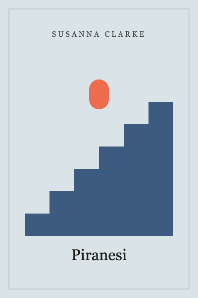
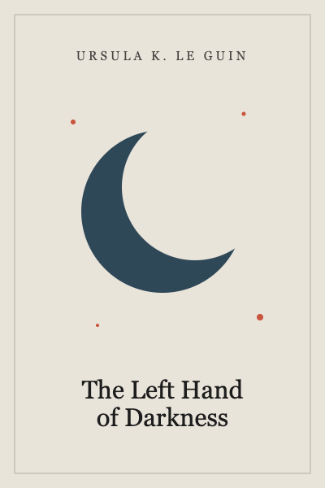
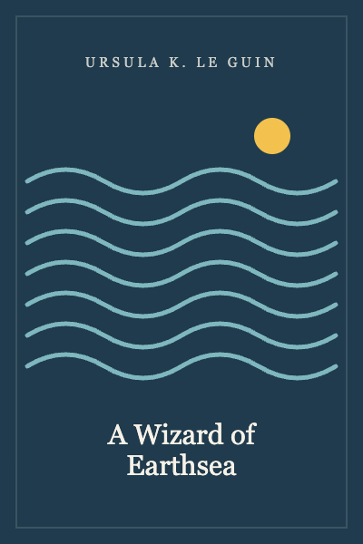
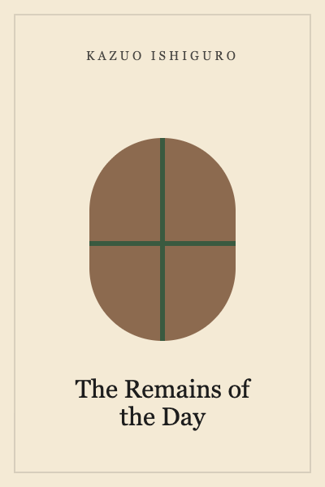
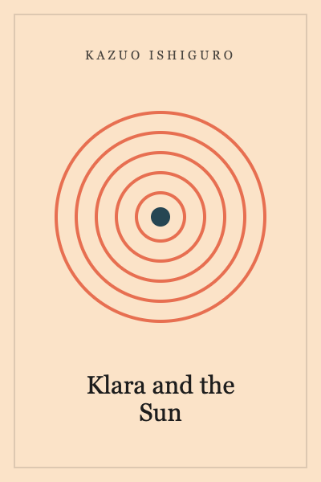
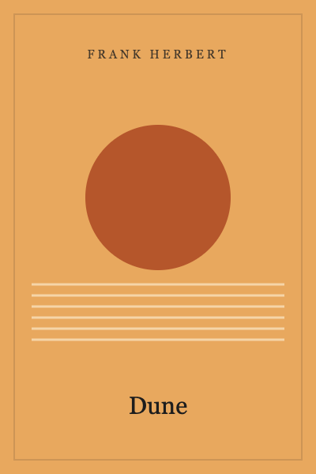
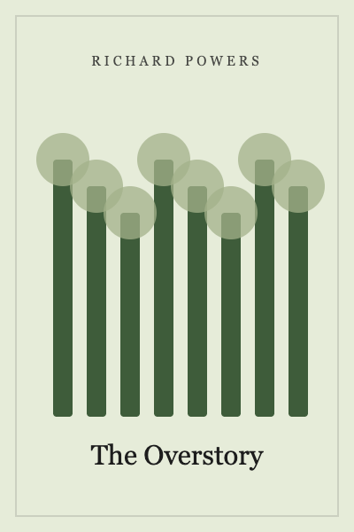
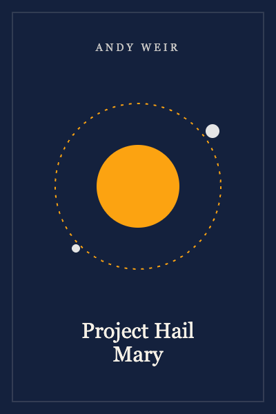
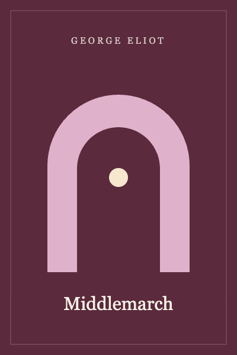
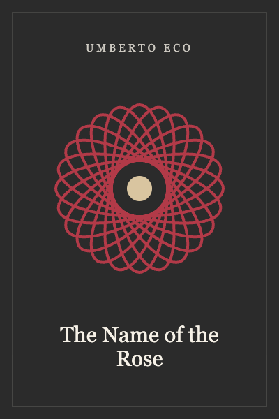

#+TITLE: Library

* Books
  :PROPERTIES:
  :COLLECTION: book
  :ICON:     📚
  :END:

** Piranesi                                               :fiction:fantasy:
   :PROPERTIES:
   :RECORD:         book
   :ADDED:          [{{D-60}} 21:04]
   :AUTHOR:         Susanna Clarke
   :PUBLISHED_DATE: 2020
   :PUBLISHER:      Bloomsbury
   :PAGES:          272
   :ISBN:           9781635575637
   :IMAGE:          
   :STATUS:         read
   :RATING:         5
   :STARTED_DATE:   [{{D-58}}]
   :FINISHED_DATE:  [{{D-51}}]
   :END:
   Piranesi lives in the House, a world of endless halls and tides, and
   keeps a careful journal of everything in it.

** The Left Hand of Darkness                      :fiction:science_fiction:
   :PROPERTIES:
   :RECORD:         book
   :ADDED:          [{{D-120}} 19:30]
   :AUTHOR:         Ursula K. Le Guin
   :PUBLISHED_DATE: 1969
   :PUBLISHER:      Ace
   :PAGES:          304
   :IMAGE:          
   :STATUS:         read
   :RATING:         5
   :FINISHED_DATE:  [{{D-90}}]
   :END:
   An envoy comes to the winter planet Gethen, where people have no fixed
   sex, to ask it to join a league of worlds.

** A Wizard of Earthsea                                   :fiction:fantasy:
   :PROPERTIES:
   :RECORD:         book
   :ADDED:          [{{D-150}} 20:00]
   :AUTHOR:         Ursula K. Le Guin
   :PUBLISHED_DATE: 1968
   :PAGES:          183
   :IMAGE:          
   :STATUS:         read
   :RATING:         4.5
   :END:

** The Remains of the Day                                         :fiction:
   :PROPERTIES:
   :RECORD:         book
   :ADDED:          [{{D-200}} 18:12]
   :AUTHOR:         Kazuo Ishiguro
   :PUBLISHED_DATE: 1989
   :PAGES:          258
   :IMAGE:          
   :STATUS:         read
   :RATING:         4
   :END:

** Klara and the Sun                              :fiction:science_fiction:
   :PROPERTIES:
   :RECORD:         book
   :ADDED:          [{{D-100}} 22:41]
   :AUTHOR:         Kazuo Ishiguro
   :PUBLISHED_DATE: 2021
   :PAGES:          303
   :IMAGE:          
   :STATUS:         read
   :RATING:         3.5
   :END:

** A Gentleman in Moscow                                 :fiction:historical:
   :PROPERTIES:
   :RECORD:         book
   :ADDED:          [{{D-80}} 09:15]
   :AUTHOR:         Amor Towles
   :PUBLISHED_DATE: 2016
   :PAGES:          462
   :IMAGE:          
   :STATUS:         read
   :RATING:         4
   :END:

** Dune                                           :fiction:science_fiction:
   :PROPERTIES:
   :RECORD:         book
   :ADDED:          [{{D-20}} 07:14]
   :AUTHOR:         Frank Herbert
   :PUBLISHED_DATE: 1965
   :PUBLISHER:      Ace
   :PAGES:          544
   :ISBN:           9780441013593
   :IMAGE:          
   :STATUS:         reading
   :RATING:         4
   :STARTED_DATE:   [{{D-12}}]
   :END:
   Set on the desert planet Arrakis, Dune is the story of the boy Paul
   Atreides, heir to a noble family tasked with ruling an inhospitable world.

** Braiding Sweetgrass                                    :nonfiction:nature:
   :PROPERTIES:
   :RECORD:         book
   :ADDED:          [{{D-30}} 12:00]
   :AUTHOR:         Robin Wall Kimmerer
   :PUBLISHED_DATE: 2013
   :PAGES:          408
   :IMAGE:          
   :STATUS:         reading
   :STARTED_DATE:   [{{D-8}}]
   :END:

** The Overstory                                             :fiction:nature:
   :PROPERTIES:
   :RECORD:         book
   :ADDED:          [{{D-15}} 21:30]
   :AUTHOR:         Richard Powers
   :PUBLISHED_DATE: 2018
   :PAGES:          502
   :IMAGE:          
   :STATUS:         to read
   :END:

** Project Hail Mary                              :fiction:science_fiction:
   :PROPERTIES:
   :RECORD:         book
   :ADDED:          [{{D-10}} 13:05]
   :AUTHOR:         Andy Weir
   :PUBLISHED_DATE: 2021
   :PAGES:          496
   :IMAGE:          
   :STATUS:         to read
   :END:

** Middlemarch                                                    :fiction:
   :PROPERTIES:
   :RECORD:         book
   :ADDED:          [{{D-5}} 20:20]
   :AUTHOR:         George Eliot
   :PUBLISHED_DATE: 1871
   :PAGES:          880
   :IMAGE:          
   :STATUS:         to read
   :END:

** The Name of the Rose                                :fiction:historical:
   :PROPERTIES:
   :RECORD:         book
   :ADDED:          [{{D-70}} 16:45]
   :AUTHOR:         Umberto Eco
   :PUBLISHED_DATE: 1980
   :PAGES:          536
   :IMAGE:          
   :STATUS:         dropped
   :RATING:         2.5
   :END:
   Put down at the library chapter; maybe again in winter.
